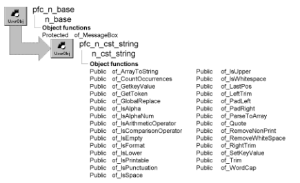

# n_cst_string

**Description**

String parsing service. This service provides functions that you can call to manipulate string data.

**Ancestry**



**Library**

- PFCAPSRV.PBL
- PFEAPSRV.PBL

**Object relationships**

n_cst_numerical

**Usage**

To use string functions:

1. Declare a variable of type n_cst_string:

   ```
   n_cst_string   inv_string
   ```

Because PFC defines this object with the autoinstantiate option, you don’t need to code CREATE or DESTROY statements.

2. Call string service functions as needed.

**See also**

n_cst_conversion

## Instance variables

N_cst_string includes instance variables:

| Instance variable | Description | Data type | Access |
| --- | --- | --- | --- |
| CST_GLOBALREPLACE_LEGACY | Constant set to 1 | Integer | Public |
| CST_GLOBALREPLACE_NEW | Constant set to 2 | Integer | Public |
| CST_HOTMAIL_RULE | Constant set to 1 | Integer | Public |
| CST_NULL |  | String | Public |
| CST_RFC_5321 | Constant set to 2 | Integer | Public |

## Functions

N_cst_string includes precoded object functions:

- of_ArrayToString
- of_CountOccurrences
- of_ExpressionString
- of_Format (PFC 2025 and later)
- of_GetGlobalReplaceMethod
- of_GetKeyValue
- of_GetToken
- of_GlobalReplace
- of_GlobalReplaceLegacy
- of_GlobalReplaceNew
- of_IsAlpha
- of_IsAlphaNum
- of_IsArithmeticOperator
- of_IsComparisonOperator
- of_IsEmpty
- of_IsFormat
- of_IsLower
- of_IsPrintable
- of_IsPunctuation
- of_IsSpace
- of_issurroundedby
- of_IsUpper
- of_iswellformedemailaddress
- of_IsWhiteSpace
- of_LastPos
- of_LeftTrim
- of_PadLeft
- of_PadRight
- of_ParseToArray
- of_Quote
- of_RemoveNonPrint
- of_RemovePunctuation
- of_RemoveWhiteSpace
- of_RightTrim
- of_SetGlobalReplaceMethod
- of_SetKeyValue
- of_Trim
- of_trimspecificleadchars
- of_trimspecifictrailchars
- of_URLEncode
- of_WordCap

### of_ArrayToString

**Description**

Creates a single string from an array of strings.

**Access**

Public

**Syntax**

```
instancename.of_ArrayToString ( source, delimiter, {processempty} target )
```

| Argument | Description |
| --- | --- |
| *instancename* | Instance name of n_cst_string |
| *source* | String array to be converted into a single string |
| *delimiter* | String specifying the delimiter the function places between array elements |
| *processempty* | Boolean allowing processing of empty string arguments if true |
| *target* | String to contain the *source* array (passed by reference) |

**Return value**

Long. Returns 1 if the function succeeds and -1 if an error occurs.

**Examples**

This example calls the of_ArrayToString function:

```
String   ls_array[ ], ls_single
Long    ll_return
String  ls_delimiter = "~t"

// logic to populate ls_array
...
ll_return = inv_string.of_ArrayToString &
   (ls_array, ls_delimiter, ls_single)
```

### of_CountOccurrences

**Description**

Counts the number of occurrences of one string within another string.

**Access**

Public

**Syntax**

```
instancename.of_CountOccurrences ( source, target {, ignorecase } )
```

| Argument | Description |
| --- | --- |
| *instancename* | Instance name of n_cst_string |
| *source* | String to be searched |
| *target* | String to search for |
| *ignorecase* (optional) | Boolean indicating whether to search for exact upper-lowercase match. The default is TRUE |

**Return value**

Long. Returns the number of occurrences of *target* within *source*.

**Examples**

This example calls the of_CountOccurrences function:

```
String   ls_source, ls_target
Long  ll_count

ls_source = mle_source.text
ls_target = mle_target.text
ll_count = inv_string.of_CountOccurrences &
   (ls_source, ls_target, TRUE)
MessageBox("String", String(ll_count) &
    " occurrences of " + ls_target &
   + " within " + ls_source )
```

### of_ExpressionString

**Description**

Returns a value as a string in a DataWindow expression, for Find, SetFilter, or Evaluate: between single quotes, with each tilde (~) written as ~~ and each single quote written as ~'.

**Access**

Public

**Syntax**

```
instancename.of_ExpressionString ( value )
```

| Argument | Description |
| --- | --- |
| *instancename* | Instance name of n_cst_string |
| *value* | String. A value, for example a column's data or text the user typed |

**Return value**

String. The quoted value, or null if *value* is null.

**Usage**

A value put between quotes as it is makes the expression invalid when it contains a single quote, and changes its meaning when it contains a tilde (for example, `~t` is a tab in an expression). The DataWindow and DataStore services use this function for of_BuildExpression and of_BuildComparison.

**Examples**

This example finds the row for the name the user typed, which can be O'Brien:

```
n_cst_string  lnv_string
long  ll_row

ll_row = dw_1.Find("last_name = " + &
   lnv_string.of_ExpressionString(sle_name.text), &
   1, dw_1.RowCount())
```

### of_Format

> Available in PFC 2025 and later. Not available in the 2019 and 2022 versions of PFC.

**Description**

Replaces the placeholders in a text with values.

**Access**

Public

**Syntax**

```
instancename.of_Format ( text, values )
```

| Argument | Description |
| --- | --- |
| *instancename* | Instance name of n_cst_string |
| *text* | String. Text with placeholders: `%s` for the next value, `%1` to `%9` for a value by position, `%%` for a percent sign |
| *values* | String array. The values |

**Return value**

String. The text with the placeholders replaced. A placeholder without a value is left as it is. The values are not searched for placeholders, so a value can contain `%`.

**Usage**

The PFC language service and the of_MessageBox functions use it for messages with values. Placeholders by position let a translation put the values in another order.

**Examples**

```
string ls_parms[]

ls_parms[1] = "3"
ls_parms[2] = "rows"
// "Delete these 3 rows?"
ls_text = inv_string.of_Format("Delete these %s %s?", ls_parms)
// "rows: 3"
ls_text = inv_string.of_Format("%2: %1", ls_parms)
```

### of_GetGlobalReplaceMethod

**Description**

Obtains an integer value that represents which of_GlobalReplace method/technique will be used when of_GlobalReplace is used.

**Access**

Public

**Syntax**

```
instancename.of_GetGlobalReplaceMethod ( )
```

| Argument | Description |
| --- | --- |
| *instancename* | Instance name of n_cst_string |

**Return value**

Integer. integer CST_GLOBALREPLACE_NEW (= 2) The new, more efficient method will be used. CST_GLOBALREPLACE_LEGACY (= 1) The original method will be used.

### of_GetKeyValue

**Description**

Retrieves the right side of a *keyword*=*value* string.

**Access**

Public

**Syntax**

```
instancename.of_GetKeyValue ( source, keyword, separator )
```

| Argument | Description |
| --- | --- |
| *instancename* | Instance name of n_cst_string |
| *source* | String containing the complete expression |
| *keyword* | String containing the keyword to be searched for |
| *separator* | String containing the separator character in *source* |

**Return value**

String. Returns the value corresponding to *keyword*. If *keyword* is not in *source*, the function returns an empty string; if any argument’s value is NULL, the function returns NULL.

**Examples**

This example is from the w_sheet pfc_ControlGotFocus event:

```
String   ls_microhelp
n_cst_string   lnv_string
...
ls_microhelp = lnv_string.of_GetKeyValue &
   (idrg_current.tag, "microhelp", ";")
...
```

### of_GetToken

**Description**

Retrieves the token from a passed string. This function receives as arguments a string from which the token is to be removed (from the left) and the separator character.

**What is a token?** A token is a collection of characters separated by a delimiter.

If the separator character appears in the string, the function returns the token, not including the separator character. If the separator character does not appear in the string, the function returns the entire string. In either case, the source string is truncated on the left by the length of the token and separator character if any.

**Access**

Public

**Syntax**

```
instancename.of_GetToken ( source, separator )
```

| Argument | Description |
| --- | --- |
| *instancename* | Instance name of n_cst_string |
| *source* | String to be parsed (passed by reference) |
| *separator* | String containing the separator |

**Return value**

String. Returns the token if *separator* is found within *source* and returns the entire *source* if *separator* is not found.

**Usage**

Call this function to break up strings with embedded values into multiple separate strings.

**Examples**

This example calls the of_GetToken function:

```
String  ls_parm[ ], ls_type, ls_colname, ls_level
Integer  li_args, li_cnt, li_p1, li_p2, li_level
n_cst_string  lnv_string

// Parse the comma-delimited string
li_args = 1
ls_parm[li_args] = &
Trim(lnv_string.of_GetToken(as_args, ","))
DO WHILE Len(as_args) > 0
   li_args ++
   ls_parm[li_args] = &
   Trim(lnv_string.of_GetToken(as_args, ","))
Loop
...
```

### of_GlobalReplace

**Description**

Replaces all occurrences of one string within another string.

**Access**

Public

**Syntax**

```
instancename.of_GlobalReplace ( source, lookfor, replacewith
{, ignorecase} )
```

| Argument | Description |
| --- | --- |
| *instancename* | Instance name of n_cst_string |
| *source* | String to be searched |
| *lookfor* | String to be found |
| *replacewith* | String used to replace *lookfor* |
| *ignorecase* (optional) | Boolean indicating whether to search for exact upper-lowercase match. The default is TRUE |

**Return value**

String. Returns *source* with all occurrences of *lookfor* replaced with *replacewith*.

**Examples**

This example calls the of_GlobalReplace function:

```
String   ls_source, ls_original
String   ls_replace, ls_new

ls_source = mle_source.text
ls_original = mle_original.text
ls_replace = mle_replacement.text
ls_new = inv_string.of_GlobalReplace &
   ls_source, ls_original, ls_replace)
MessageBox("String", "New String is: " &
   + ls_new )
```

### of_GlobalReplaceLegacy

**Description**

Replace all occurrences of one string inside another with a new string.

**Access**

Public

**Syntax**

```
instancename.of_GlobalReplaceLegacy ( as_source, as_old, as_new, ab_ignorecase )
```

| Argument | Description |
| --- | --- |
| *instancename* | Instance name of n_cst_string |
| *as_source* | String. The string being searched. |
| *as_old* | String. The old string being replaced. |
| *as_new* | String. The new string. |
| *ab_ignorecase* | Boolean. A boolean stating to ignore case sensitivity. |

**Return value**

String. as_Source with all occurrences of as_Old replaced with as_New. If any argument's value is NULL, function returns NULL.

### of_GlobalReplaceNew

**Description**

Replace all occurrences of one string inside another with a new string. Usage Notes: This method implements an alternative algoithm that is designed to be more efficient (hence, faster) than the original method. The gain in performance is due to avoidance of the "Replace" PowerScript string function. The original method has been renamed to of_GlobalReplaceLegacy. It can be invoked explicitly, or by first invoking: of_SetGlobalReplaceMethod( lnv_string.CST_GLOBALREPLACE_LEGACY) and then using of_GlobalReplace. The new method appears to be approx. 50-60% faster than the original method. Disclaimer: The above statements are not to be construed as a guarantee of improved performance. Your mileage may vary.

**Access**

Public

**Syntax**

```
instancename.of_GlobalReplaceNew ( as_source, as_old, as_new, ab_ignorecase )
```

| Argument | Description |
| --- | --- |
| *instancename* | Instance name of n_cst_string |
| *as_source* | String. The string being searched. |
| *as_old* | String. The old string being replaced. |
| *as_new* | String. The new string. |
| *ab_ignorecase* | Boolean. A boolean stating to ignore case sensitivity. |

**Return value**

String. as_Source with all occurrences of as_Old replaced with as_New. If any argument's value is NULL, function returns NULL.

### of_IsAlpha

**Description**

Reports whether a passed string contains only alphabetic characters (a-z and A-Z.)

**Access**

Public

**Syntax**

```
instancename.of_IsAlpha ( source )
```

| Argument | Description |
| --- | --- |
| *instancename* | Instance name of n_cst_string |
| *source* | String to be tested |

**Return value**

Boolean. Returns TRUE if *source* contains only alphabetic characters and FALSE if it does not. If *source* is NULL, the function returns NULL.

**Examples**

This example calls the of_IsAlpha function:

```
String   ls_source

ls_source = mle_source.text
IF inv_string.of_IsAlpha(ls_source) THEN
   MessageBox("String", ls_source &
   + " contains only alphabetic characters")
ELSE
   MessageBox("String", ls_source &
   + " contains nonalphabetic characters")
END IF
```

### of_IsAlphaNum

**Description**

Reports whether a passed string contains only alphanumeric characters (a-z, A-Z, and 0-9.)

**Access**

Public

**Syntax**

```
instancename.of_IsAlphaNum ( source )
```

| Argument | Description |
| --- | --- |
| *instancename* | Instance name of n_cst_string |
| *source* | String to be tested |

**Return value**

Boolean. Returns TRUE if *source* contains only alphanumeric characters and FALSE if it does not. If *source* is NULL, the function returns NULL.

**Examples**

This example calls the of_IsAlphaNum function:

```
String   ls_source

ls_source = mle_source.text
IF inv_string.of_IsAlphaNum(ls_source) THEN
   MessageBox("String", ls_source &
   + " contains only alphanumeric characters")
ELSE
   MessageBox("String", ls_source &
   + " contains nonalphanumeric characters")
END IF
```

### of_IsArithmeticOperator

**Description**

Reports whether a passed string contains only arithmetic operator characters. Arithmetic operator characters are (, ), +, -, \*, /, and ^.

**Access**

Public

**Syntax**

```
instancename.of_IsArithmeticOperator ( source )
```

| Argument | Description |
| --- | --- |
| *instancename* | Instance name of n_cst_string |
| *source* | String to be tested |

**Return value**

Boolean. Returns TRUE if *source* contains only arithmetic operator characters and FALSE if it does not. If *source* is NULL, the function returns NULL.

**Examples**

This example calls the of_IsArithmeticOperator function:

```
String   ls_source

ls_source = mle_source.text
IF inv_string.of_IsArithmeticOperator(ls_source) THEN
   MessageBox("String", ls_source &
   + " contains only arithmetic operators")
...
```

### of_IsComparisonOperator

**Description**

Reports whether a passed string contains only comparison operator characters. Comparison operator characters are &lt;, >, and =.

**Access**

Public

**Syntax**

```
instancename.of_IsComparisonOperator ( source )
```

| Argument | Description |
| --- | --- |
| *instancename* | Instance name of n_cst_string |
| *source* | String to be tested |

**Return value**

Boolean. Returns TRUE if *source* contains only comparison operator characters and FALSE if it does not. If *source* is NULL, the function returns NULL.

**Examples**

This example calls the of_IsComparisonOperator function:

```
String   ls_source

ls_source = mle_source.text
IF inv_string.of_IsComparisonOperator(ls_source) &
   THEN
   MessageBox("String", ls_source &
      + " contains only comparison operators")
...
```

### of_IsEmpty

**Description**

Reports whether a passed string is either empty or NULL.

**Access**

Public

**Syntax**

```
instancename.of_IsEmpty ( source )
```

| Argument | Description |
| --- | --- |
| *instancename* | Instance name of n_cst_string |
| *source* | String to be tested |

**Return value**

Boolean. Returns TRUE if *source* is empty or NULL and FALSE if it is neither.

**Examples**

This example calls the of_IsEmpty function:

```
String   ls_source

ls_source = sle_directory.text
IF inv_string.of_IsEmpty(ls_source) THEN
   MessageBox("String", &
   "You must specify a directory.")
END IF
```

### of_IsFormat

**Description**

Reports whether a passed string contains only format characters. Format characters are all nonalphanumeric printable characters.

**Access**

Public

**Syntax**

```
instancename.of_IsFormat ( source )
```

| Argument | Description |
| --- | --- |
| *instancename* | Instance name of n_cst_string |
| *source* | String to be tested |

**Return value**

Boolean. Returns TRUE if *source* contains only format characters and FALSE if it does not. If *source* is NULL, the function returns NULL.

**Examples**

This example calls the of_IsFormat function:

```
String   ls_source

ls_source = mle_source.text
IF inv_string.of_IsFormat(ls_source) THEN
   MessageBox("String", ls_source &
   + " contains only format characters")
...
```

### of_IsLower

**Description**

Reports whether the alphabetic characters in a passed string are all lowercase.

**Access**

Public

**Syntax**

```
instancename.of_IsLower ( source )
```

| Argument | Description |
| --- | --- |
| *instancename* | Instance name of n_cst_string |
| *source* | String to be tested |

**Return value**

Boolean. Returns TRUE if the alphabetic characters in *source* are all lowercase and FALSE if they are not. If *source* is NULL, the function returns NULL.

**Examples**

This example calls the of_IsLower function:

```
String   ls_source

ls_source = mle_source.text
IF inv_string.of_IsAlpha(ls_source) THEN
   IF inv_string.of_IsLower(ls_source) THEN
   MessageBox("String", ls_source &
      + " contains only lowercase letters")
...
```

### of_IsPrintable

**Description**

Reports whether a passed string contains only printable characters (ASCII 32 through ASCII 126).

**Access**

Public

**Syntax**

```
instancename.of_IsPrintable ( source )
```

| Argument | Description |
| --- | --- |
| *instancename* | Instance name of n_cst_string |
| *source* | String to be tested |

**Return value**

Boolean. Returns TRUE if *source* contains only printable characters and FALSE if it does not. If *source* is NULL, the function returns NULL.

**Examples**

This example is from the of_LeftTrim function:

```
Character   lc_char
Boolean     lb_char
...
DO WHILE Len(as_source) > 0 AND NOT lb_char
   lc_char = as_source
   IF of_IsPrintable(lc_char) AND &
      NOT of_IsSpace(lc_char) THEN
         lb_char = TRUE
...
```

### of_IsPunctuation

**Description**

Reports whether a passed string contains only punctuation characters. Punctuation characters are ! " ’ . : ; ? and the comma.

**Access**

Public

**Syntax**

```
instancename.of_IsPunctuation ( source )
```

| Argument | Description |
| --- | --- |
| *instancename* | Instance name of n_cst_string |
| *source* | String to be tested |

**Return value**

Boolean. Returns TRUE if *source* contains only punctuation characters and FALSE if it does not. If *source* is NULL, the function returns NULL.

**Examples**

This example calls the of_IsPunctuation function:

```
String   ls_source

ls_source = mle_source.text
IF inv_string.of_IsPunctuation(ls_source) THEN
   MessageBox("String", ls_source &
   + " contains only punctuation")
...
```

### of_IsSpace

**Description**

Reports whether a passed string contains only spaces.

**Access**

Public

**Syntax**

```
instancename.of_IsSpace ( source )
```

| Argument | Description |
| --- | --- |
| *instancename* | Instance name of n_cst_string |
| *source* | String to be tested |

**Return value**

Boolean. Returns TRUE if *source* contains only spaces and FALSE if it does not. If *source* is NULL, the function returns NULL.

**Examples**

This example calls the of_IsSpace function:

```
String   ls_source

ls_source = sle_directory.text
IF inv_string.of_IsEmpty(ls_source) OR &
   inv_string.of_IsSpace(ls_source) THEN
   MessageBox("String", &
      "You must specify a directory.")
   Return
END IF
...
```

### of_issurroundedby

**Description**

Trim specified leading chars from the specified source string.

**Syntax 1**

Access: Public

**Syntax**

```
instancename.of_issurroundedby ( as_source, as_begin_surrounding, as_end_surrounding, as_tobe_surrounded )
```

| Argument | Description |
| --- | --- |
| *instancename* | Instance name of n_cst_string |
| *as_source* | String. The source string to check. |
| *as_begin_surrounding* | String. The string that correspond to the beginning of the surrounding characters combinaison. |
| *as_end_surrounding* | String. Optional string that correspond to the endding of the surrounding characters combinaison (if not specified assume is equal to as_begin_surrounding. |
| *as_tobe_surrounded* | String. The string that contains the characters to be checked there are found between the specified surrounding characters inside as_source. |

**Return value**

Boolean.

**Syntax 2**

Access: Public

**Syntax**

```
instancename.of_issurroundedby ( as_source, as_surroundedby, as_tobe_surrounded )
```

| Argument | Description |
| --- | --- |
| *instancename* | Instance name of n_cst_string |
| *as_source* | String. The source string totrim. as_totrim The specific string that contains the leading chars to be trimmed from as_source. |
| *as_surroundedby* | String. |
| *as_tobe_surrounded* | String. |

**Return value**

Boolean. String Returns trimmed string, if no error occurs. NULL, if an error occurs.

### of_IsUpper

**Description**

Reports whether the alphabetic characters in a passed string are all uppercase.

**Access**

Public

**Syntax**

```
instancename.of_IsUpper ( source )
```

| Argument | Description |
| --- | --- |
| *instancename* | Instance name of n_cst_string |
| *source* | String to be tested |

**Return value**

Boolean. Returns TRUE if the alphabetic characters in *source* are all uppercase and FALSE if they are not. If *source* is NULL, the function returns NULL.

**Examples**

This example calls the of_IsUpper function:

```
String   ls_source

ls_source = mle_source.text
IF inv_string.of_IsAlpha(ls_source) THEN
   IF inv_string.of_IsUpper(ls_source) THEN
   MessageBox("String", ls_source &
      + " contains only uppercase letters")
...
```

### of_iswellformedemailaddress

**Description**

Check that the specified Email addres is well formed according to the specified validation rule.

**Syntax 1**

Access: Public

**Syntax**

```
instancename.of_iswellformedemailaddress ( as_emailaddress, ai_emailaddresscheckrule )
```

| Argument | Description |
| --- | --- |
| *instancename* | Instance name of n_cst_string |
| *as_emailaddress* | String. The Email address to check. |
| *ai_emailaddresscheckrule* | Integer. The optional Check rule to use, by default it used the hotmail rule. Possible values are : - cst_hotmail_rule, to apply HotMail validation rules, or - cst_rfc_5321, to apply RFC 5321 validation rules. |

**Return value**

Boolean. True, Ok False, Not ok.

**Syntax 2**

Trim specified leading chars from the specified source string.

Access: Public

**Syntax**

```
instancename.of_iswellformedemailaddress ( as_emailaddress )
```

| Argument | Description |
| --- | --- |
| *instancename* | Instance name of n_cst_string |
| *as_emailaddress* | String. |

**Return value**

Boolean. String Returns trimmed string, if no error occurs. NULL, if an error occurs.

### of_IsWhiteSpace

**Description**

Reports whether a passed string contains only whitespace characters (newline, tab, vertical tab, carriage return, form feed, backspace, and space).

**Access**

Public

**Syntax**

```
instancename.of_IsWhiteSpace ( source )
```

| Argument | Description |
| --- | --- |
| *instancename* | Instance name of n_cst_string |
| *source* | String to be tested |

**Return value**

Boolean. Returns TRUE if *source* contains only whitespace characters and FALSE if it does not. If *source* is NULL, the function returns NULL.

**Examples**

This example calls the of_IsWhiteSpace function:

```
String   ls_source

ls_source = mle_source.text
IF inv_string.of_IsWhiteSpace(ls_source) THEN
   MessageBox("String", ls_source &
   + " contains only whitespace")

...
```

### of_LastPos

**Description**

Searches backward through a string to find the last occurrence of another string.

**Access**

Public

**Syntax**

```
instancename.of_LastPos ( source, target {, start } )
```

| Argument | Description |
| --- | --- |
| *instancename* | Instance name of n_cst_string |
| *source* | String containing the complete expression |
| *target* | String containing the expression to be searched for |
| *start* (optional) | Long specifying the starting position. The default is 0 (start with the last character) |

**Return value**

Long. Returns the position of the leftmost character of the last occurrence of *target* if it is found and 0 if *target* is not found.

**Usage**

This function complements the PowerScript Pos function, which finds the first occurrence of one string within another string.

**Examples**

This example is from the n_cst_filesrv of_ParsePath function:

```
Integer  li_pos
String   ls_file
n_cst_string  lnv_string
...
// Get the file name and extension.
li_pos = lnv_string.of_LastPos &
   (as_path, is_separator, 0)
ls_file = Right(as_path, (Len(as_path) - li_pos))
as_path = Left(as_path, li_pos)
...
```

### of_LeftTrim

**Description**

Removes spaces and nonprintable characters from the beginning of a string.

**Access**

Public

**Syntax**

```
instancename.of_LeftTrim ( source {, removespaces
{, removenonprintable } } )
```

| Argument | Description |
| --- | --- |
| *instancename* | Instance name of n_cst_string |
| *source* | String to be trimmed |
| *removespaces* (optional) | Boolean specifying whether to remove spaces. The default is TRUE |
| *removenonprintable* (optional) | Boolean specifying whether to remove nonprintable characters (for example, newline, tab, and carriage return). The default is FALSE |

**Return value**

String. Returns *source* with the specified characters removed. If any argument’s value is NULL, the function returns NULL.

**Usage**

This function complements the PowerScript Trim function, which removes both leading and trailing spaces from a string.

**Examples**

This example calls the of_LeftTrim function:

```
...
IF ll_first > 0 and ll_last > 0 THEN
   ls_line = lnv_string.of_LeftTrim &
   (ls_line, TRUE, TRUE)
   IF Left (ls_line, 1) = "[" THEN
   ll_pos = Pos (ls_line, "]")
...
```

### of_PadLeft

**Description**

Pads a string with spaces on the left until it is a specified length.

**Access**

Public

**Syntax**

```
instancename.of_PadLeft ( source, length )
```

| Argument | Description |
| --- | --- |
| *instancename* | Instance name of n_cst_string |
| *source* | String to be expanded |
| *length* | Long specifying the new length |

**Return value**

String. Returns *source* with left-padded spaces to make it a *length* characters long. If any argument’s value is NULL, the function returns NULL.

**Examples**

This example calls the of_PadLeft function:

```
String   ls_source, ls_new

ls_source = mle_source.text
ls_new = inv_string.of_PadLeft(ls_source, 40)
MessageBox("String", "Original is: ’" &
   + ls_source + "’ ~r~nPadded string is: ’" &
   + ls_new + "’" )
```

### of_PadRight

**Description**

Pads a string with spaces on the right until it is a specified length.

**Access**

Public

**Syntax**

```
instancename.of_PadRight ( source, length )
```

| Argument | Description |
| --- | --- |
| *instancename* | Instance name of n_cst_string |
| *source* | String to be expanded |
| *length* | Long specifying the new length |

**Return value**

String. Returns *source* with right-padded spaces to make it a *length* characters long. If any argument’s value is NULL, the function returns NULL.

**Examples**

This example calls the of_PadRight function:

```
String   ls_source, ls_new

ls_source = mle_source.text
ls_new = inv_string.of_PadRight(ls_source, 40)
MessageBox("String", "Original is: ’" &
   + ls_source + "’ ~r~nPadded string is: ’" &
   + ls_new + "’" )
```

### of_ParseToArray

**Description**

Parses a string into array elements, based on a delimiter string.

**Access**

Public

**Syntax**

```
instancename.of_ParseToArray ( source, delimiter, array )
```

| Argument | Description |
| --- | --- |
| *instancename* | Instance name of n_cst_string |
| *source* | String to be converted into an array |
| *delimiter* | String specifying the character(s) that separate array elements in *source* |
| *array* | String array into which the function places the extracted strings (passed by reference) |

**Return value**

Long. Returns the number of elements in *array*. If *source* or *delimiter* are NULL, the function returns NULL.

**Examples**

This example is from the n_cst_sql of_Parse function:

```
Integer  li_len, li_pos, li_kwnum, li_numstats
Integer  li_cnt
String   ls_uppersql, ls_keyword[7], ls_clause[7]
String   ls_sql[ ]
n_cst_string  lnv_string

// Separate the statement into multiple statements,
// Separated by UNIONs
li_numstats = lnv_string.of_Parsetoarray &
   (as_sql, "UNION", ls_sql)
...
```

### of_Quote

**Description**

Encloses a string in double quotes.

**Access**

Public

**Syntax**

```
instancename.of_Quote ( source )
```

| Argument | Description |
| --- | --- |
| *instancename* | Instance name of n_cst_string |
| *source* | String to be enclosed in double quotes |

**Return value**

String. Returns *source* enclosed in double quotes.

**Examples**

This example calls the of_Quote function:

```
String  ls_source, ls_new

ls_source = mle_source.text
ls_new = inv_string.of_Quote(ls_source)
MessageBox("String", "Original is: " &
   + ls_source + "~r~nNew String is: " &
   + ls_new)
```

### of_RemoveNonPrint

**Description**

Removes all nonprintable characters from a string. Nonprintable characters are:

ASCII 31 and lower ASCII 127 and higher

**Access**

Public

**Syntax**

```
instancename.of_RemoveNonPrint ( source )
```

| Argument | Description |
| --- | --- |
| *instancename* | Instance name of n_cst_string |
| *source* | String from which the function removes nonprintable characters |

**Return value**

String. Returns *source* with nonprintable characters removed. If *source* is NULL, the function returns NULL.

**Examples**

This example calls the of_RemoveNonPrint function:

```
...
inv_string.of_RemoveNonPrint &
   (ls_original[li_count])
...
```

### of_RemovePunctuation

**Description**

No description is available.

**Access**

Public

**Syntax**

```
instancename.of_RemovePunctuation ( as_source )
```

| Argument | Description |
| --- | --- |
| *instancename* | Instance name of n_cst_string |
| *as_source* | String. |

**Return value**

String.

### of_RemoveWhiteSpace

**Description**

Removes all whitespace characters from a string. Whitespace characters are newline, tab, vertical tab, carriage return, form feed, backspace, and space.

**Access**

Public

**Syntax**

```
instancename.of_RemoveWhiteSpace ( source )
```

| Argument | Description |
| --- | --- |
| *instancename* | Instance name of n_cst_string |
| *source* | String from which the function removes whitespace characters |

**Return value**

String. Returns *source* with whitespace characters removed. If *source* is NULL, the function returns NULL.

**Examples**

This example calls the of_RemoveWhiteSpace function:

```
String   ls_original[ ]
Integer  li_return, li_count

li_return = inv_filesrv.of_FileRead &
   (sle_file.text, ls_original)
CHOOSE CASE li_return
   CASE -1
   MessageBox("Error", "Error accessing file")
   CASE ELSE
   FOR li_count = 1 to li_return
      mle_target.text = mle_target.text + &
         inv_string.of_RemoveWhiteSpace &
            (ls_original[li_count])
   NEXT
END CHOOSE
```

### of_RightTrim

**Description**

Removes spaces and nonprintable characters from the end of a string.

**Access**

Public

**Syntax**

```
instancename.of_RightTrim ( source {, removespaces
{, removenonprintable } } )
```

| Argument | Description |
| --- | --- |
| *instancename* | Instance name of n_cst_string |
| *source* | String to be trimmed |
| *removespaces* (optional) | Boolean specifying whether to remove spaces. The default is TRUE |
| *removenonprintable* (optional) | Boolean specifying whether to remove nonprintable characters (for example, newline, tab, and carriage return). The default is FALSE |

**Return value**

String. Returns *source* with the specified characters removed. If any argument’s value is NULL, the function returns NULL.

**Usage**

This function complements the PowerScript Trim function, which removes both leading and trailing spaces from a string.

**Examples**

This example is from the n_cst_string of_Trim function:

```
...
IF ab_remove_spaces and ab_remove_nonprint THEN
// Remove spaces and nonprintable characters.
   as_source = of_LeftTrim(as_source, &
   ab_remove_spaces, ab_remove_nonprint)
   as_source = of_RightTrim(as_source, &
...
```

### of_SetGlobalReplaceMethod

**Description**

Specifies which of_GlobalReplace method/technique is to be used when the of_GlobalReplace fn is used.

**Access**

Public

**Syntax**

```
instancename.of_SetGlobalReplaceMethod ( ai_method )
```

| Argument | Description |
| --- | --- |
| *instancename* | Instance name of n_cst_string |
| *ai_method* | Integer. integer CST_GLOBALREPLACE_NEW (= 2) The new, more efficient method is to be used. CST_GLOBALREPLACE_LEGACY (= 1) The original method is to be used. |

**Return value**

Integer. integer SUCCESS (1) - The requested method will be used. FAILURE (-1) - ai_Method is null or not valid.

### of_SetKeyValue

**Description**

Sets the value portion of a *keyword*=*value* expression.

**Access**

Public

**Syntax**

```
instancename.of_SetKeyValue ( source, keyword, newvalue, separator )
```

| Argument | Description |
| --- | --- |
| *instancename* | Instance name of n_cst_string |
| *source* | String whose value is to be set (passed by reference) |
| *keyword* | String specifying the keyword whose value will be set |
| *newvalue* | String containing the new value |
| *separator* | String specifying the separator character in *source* |

**Return value**

Long. Returns 1 if the function succeeds, -1 if an error occurs, and NULL if any argument’s value is NULL.

**Examples**

This example calls the of_SetKeyValue function:

```
...
ls_key = inv_string.of_GetToken(ls_temp, "=")
li_return = inv_string.of_SetKeyValue &
   (ls_source, ls_key, ls_value, "=")
...
```

### of_Trim

**Description**

Removes spaces and nonprintable characters from the left and right end of a string.

**Access**

Public

**Syntax**

```
instancename.of_Trim ( source {, removespaces
{, removenonprintable } } )
```

| Argument | Description |
| --- | --- |
| *instancename* | Instance name of n_cst_string |
| *source* | String to be trimmed |
| *removespaces* (optional) | Boolean specifying whether to remove spaces. The default is TRUE |
| *removenonprintable* (optional) | Boolean specifying whether to remove nonprintable characters (for example, newline, tab, and carriage return). The default is FALSE |

**Return value**

String. Returns *source* with the specified characters removed. If any argument’s value is NULL, the function returns NULL.

**Usage**

This function complements the PowerScript Trim function, which does not remove nonprintable characters.

**Examples**

This example calls the of_Trim function:

```
String   ls_key, ls_line
n_cst_string   lnv_string
Integer  li_keys
Long     ll_equal
...
ls_key = lnv_string.of_Trim &
   (Left (ls_line, ll_equal - 1), TRUE, TRUE)
IF Len (ls_key) > 0 THEN
   li_keys++
   as_keys[li_keys] = ls_key
END IF
...
```

### of_trimspecificleadchars

**Description**

Trim specified leading chars from the specified source string.

**Access**

Public

**Syntax**

```
instancename.of_trimspecificleadchars ( as_source, as_totrim )
```

| Argument | Description |
| --- | --- |
| *instancename* | Instance name of n_cst_string |
| *as_source* | String. The source string totrim. |
| *as_totrim* | String. The specific string that contains the leading chars to be trimmed from as_source. |

**Return value**

String. Returns trimmed string, if no error occurs. NULL, if an error occurs.

### of_trimspecifictrailchars

**Description**

Trim specified trailing chars from the specified source string.

**Access**

Public

**Syntax**

```
instancename.of_trimspecifictrailchars ( as_source, as_totrim )
```

| Argument | Description |
| --- | --- |
| *instancename* | Instance name of n_cst_string |
| *as_source* | String. The source string to trim. |
| *as_totrim* | String. The specific string that contains the leading chars to be trimmed from as_source. |

**Return value**

String. Returns trimmed string, if no error occurs. NULL, if an error occurs.

### of_URLEncode

**Description**

Encodes a string to use as parameter in URL. - Not encoded chars (because not reserved for special use): a - z, A - Z, 0 - 9 - _ . ! ~ \* ' ( ) - Space: + - all other ASCII chars: %xy (xy = hex value of the char) - all non ASCII chars: converted into two or thee Bytes, each encoded as %xy.

**Access**

Public

**Syntax**

```
instancename.of_URLEncode ( as_value )
```

| Argument | Description |
| --- | --- |
| *instancename* | Instance name of n_cst_string |
| *as_value* | String. String value to encode for URL. |

**Return value**

String. String The encoded value.

### of_WordCap

**Description**

Sets the first letter of each word in a string to uppercase and all remaining letters to lowercase.

**Access**

Public

**Syntax**

```
instancename.of_WordCap ( source )
```

| Argument | Description |
| --- | --- |
| *instancename* | Instance name of n_cst_string |
| *source* | String to be converted |

**Return value**

String. Returns *source* with all words set to initial cap.

**Examples**

This example calls the of_WordCap function:

```
String   ls_source, ls_new

ls_source = mle_source.text
ls_new = inv_string.of_WordCap(ls_source)
mle_target.text = ls_new
```
