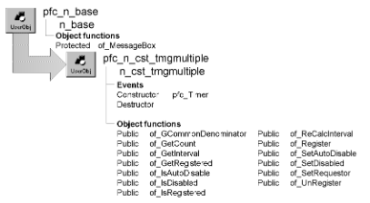

# n_cst_tmgmultiple

**Description**

Timing service (multiple timers). Use this service to maintain an unlimited number of timers triggered at specified intervals (with a one second granularity).

**Ancestry**



**Library**

- PFCAPSRV.PBL
- PFEAPSRV.PBL

**Object relationships**

- [n_cst_datetime](n_cst_datetime.md)
- [n_ds](../08-standard-class-user-objects/n_ds.md)
- [n_tmg](../08-standard-class-user-objects/n_tmg.md)
- n_tmgregisterattrib

**Usage**

Use this service to implement multiple timers. To use this service:

1. Establish an instance variable of type n_tmg:

   ```
   n_tmg itmg_timer
   ```

2. Create the instance of n_tmg:

   ```
   itmg_timer = CREATE n_tmg
   ```

3. Enable the multiple timer service:

   ```
   itmg_timer.of_SetMultiple(TRUE)
   ```

4. Register the objects and events to be notified (window are the objects in this example):

   ```
   itmg_timer.inv_multiple.of_Register  &
      (this, "ue_timer1", 5)
   itmg_timer.inv_multiple.of_Register  &
      (this, "ue_timer2", 10)
   itmg_timer.inv_multiple.of_Register  &
      (this, "ue_timer3", 30)
   ```

5. Code the events to receive notification from n_cst_tmgmultiple (ue_timer1, ue_timer2, and ue_timer3 in this example):
6. (optional) Unregister objects and events:

   ```
   itmg_timer.inv_multiple.of_UnRegister()
   ```

This service is for use with n_tmg, the PFC timing object.

**See also**

n_cst_tmgsingle

## Instance variables

N_cst_tmgmultiple includes instance variables:

| Instance variable | Description | Data type | Access | Usage |
| --- | --- | --- | --- | --- |
| ib_autodisable | Indicates whether the service enables autodisable | Boolean | Protected | Set with of_SetAutoDisable |
| ib_disabled | Indicates whether a notification can occur | Boolean | Protected | Set with of_SetDisabled |
| ids_list | DataStore containing information on registered objects | n_ds | Protected | Internal |
| il_interval | Timer interval | Long | Protected | Access with of_GetInterval |
| inv_datetime | DateTime service | n_cst_datetime | Protected | Internal |
| inv_tmgregister[ ] | Information on registered objects | n_cst_tmgregist erattrib | Protected | Internal |
| itmg_requestor | N_tmg instance that owns the n_cst_tmgmultiple instance | n_tmg | Protected | Internal |
| POSTEVENT | Constant set to 1 | Integer | Public | Use with of_Register |
| TRIGGEREVENT | Constant set to 0 | Integer | Public | Use with of_Register |

## Events

N_cst_tmgmultiple includes precoded events:

|   |
| --- |
| Constructor pfc_Timer |
| Destructor |

### Constructor

**Description**

Creates an instance of ids_list.

**Usage**

This event executes when the object is created.

### Destructor

**Description**

Destroys the instance of ids_list.

**Usage**

This event executes when the object is destroyed.

### pfc_Timer

**Description**

Notifies the registered object that the timer has fired. Depending on how you registered the objects, this event either triggers or posts the specified events.

**Usage**

The n_tmg Timer event calls this event.

## Functions

N_cst_tmgmultiple includes precoded object functions:

- of_GCommonDenominator
- of_GetCount
- of_GetInterval
- of_GetRegistered
- of_IsAutoDisable
- of_IsDisabled
- of_IsRegistered
- of_RecalcInterval
- of_Register
- of_SetAutoDisable
- of_SetDisabled
- of_SetRequestor
- of_UnRegister

### of_GCommonDenominator

**Description**

Retrieves the greatest common denominator of two values.

**Access**

Public

**Syntax**

```
tmgcontrol.instancename.of_GCommonDenominator ( value1, value2 )
```

| Argument | Description |
| --- | --- |
| *tmgcontrol* | Instance name of the n_tmg-based timing control |
| *instancename* | Instance name of n_cst_tmgmultiple (the n_tmg default is inv_multiple) |
| *value1* | Long containing the first value |
| *value2* | Long containing the second value |

**Return value**

Long. Returns the greatest common denominator of the two values if the function succeeds and -1 if an error occurs.

**Usage**

Internal.

**Examples**

This example is from the of_RecalcInterval function:

```
...
ll_gcd = of_GCommonDenominator &
   (inv_tmgregister[li_idx].il_notifyinterval,ll_gcd)
...
```

### of_GetCount

**Description**

Retrieves the number of registered objects.

**Access**

Public

**Syntax**

```
tmgcontrol.instancename.of_GetCount ( )
```

| Argument | Description |
| --- | --- |
| *tmgcontrol* | Instance name of the n_tmg-based timing control |
| *instancename* | Instance name of n_cst_tmgmultiple (the n_tmg default is inv_multiple) |

**Return value**

Integer. Returns the number of registered objects if the function succeeds, and -1 if an error occurs.

**Examples**

This example calls the of_GetCount function:

```
Integer  li_return

IF IsValid(itmg_timer.inv_multiple) THEN
   li_return =  &
   itmg_timer.inv_multiple.of_GetCount()
END IF
sle_1.text = String(li_return)
```

### of_GetInterval

**Description**

Retrieves the current interval.

**Access**

Public

**Syntax**

```
tmgcontrol.instancename.of_GetInterval ( )
```

| Argument | Description |
| --- | --- |
| *tmgcontrol* | Instance name of the n_tmg-based timing control |
| *instancename* | Instance name of n_cst_tmgmultiple (the n_tmg default is inv_multiple) |

**Return value**

Long. Returns the current interval if the function succeeds and 0 if no interval has been defined.

**Examples**

This example calls the of_GetInterval function:

```
Long ll_interval

IF IsValid(itmg_timer.inv_multiple) THEN
   ll_interval =  &
   itmg_timer.inv_multiple.of_GetInterval()
END IF
sle_1.text = "Interval is: " &
   + String(ll_interval)
```

### of_GetRegistered

**Description**

Retrieves information for registered objects.

**Access**

Public

**Syntax**

```
tmgcontrol.instancename.of_GetRegistered ( objects )
```

| Argument | Description |
| --- | --- |
| *tmgcontrol* | Instance name of the n_tmg-based timing control |
| *instancename* | Instance name of n_cst_tmgmultiple (the n_tmg default is inv_multiple) |
| *objects* | N_cst_tmgregisterattrib array into which the function places information on registered objects (passed by reference) |

**Return value**

Integer. Returns the number of entries in the *objects* array if the function succeeds and -1 if an error occurs.

**Examples**

This example calls the of_GetRegistered function:

```
n_cst_tmgregisterattrib lnv_objects[ ]
Integer li_return

IF IsValid(itmg_timer.inv_multiple) THEN
   li_return = &
      itmg_timer.inv_multiple.of_GetRegistered  &
         (lnv_objects)
END IF
...
```

### of_IsAutoDisable

**Description**

Reports whether the service is using the autodisable feature.

**Access**

Public

**Syntax**

```
tmgcontrol.instancename.of_IsAutoDisable ( )
```

| Argument | Description |
| --- | --- |
| *tmgcontrol* | Instance name of the n_tmg-based timing control |
| *instancename* | Instance name of n_cst_tmgmultiple (the n_tmg default is inv_multiple) |

**Return value**

Boolean. Returns TRUE if autodisable is enabled and FALSE if it is not.

**Examples**

This example is from the pfc_Timer event:

```
...
If of_IsAutoDisable() Then
   of_SetDisabled(False)
End If
...
```

### of_IsDisabled

**Description**

Reports whether notification is disabled. If autodisable is enabled, n_cst_tmgmultiple disables itself automatically while notifying registered objects.

**Access**

Public

**Syntax**

```
tmgcontrol.instancename.of_IsDisabled ( )
```

| Argument | Description |
| --- | --- |
| *tmgcontrol* | Instance name of the n_tmg-based timing control |
| *instancename* | Instance name of n_cst_tmgmultiple (the n_tmg default is inv_multiple) |

**Return value**

Boolean. Returns TRUE if notification is disabled and FALSE if it is not.

**Examples**

This example is from the pfc_Timer event:

```
If of_IsDisabled() Then
   Return 0
End If
...
```

### of_IsRegistered

**Description**

Reports whether the specified object or object/event combination is registered.

**Access**

Public

**Syntax**

```
tmgcontrol.instancename.of_IsRegistered ( object { , event } )
```

| Argument | Description |
| --- | --- |
| *tmgcontrol* | Instance name of the n_tmg-based timing control |
| *instancename* | Instance name of n_cst_tmgmultiple (the n_tmg default is inv_multiple) |
| *object* | PowerObject referencing the object to be tested |
| *event* (optional) | String specifying the event defined within *object* |

**Return value**

Boolean. Returns TRUE if *object* or *object* and *event* are registered with the service and FALSE if they are not.

**Examples**

This example calls the of_IsRegistered function:

```
IF IsValid(itmg_timer.inv_multiple) THEN
   IF itmg_timer.inv_multiple.of_IsRegistered(parent)
 THEN
   sle_1.text = "Window is registered"
   ELSE
   sle_1.text = "Not registered"
   END IF
END IF
```

### of_RecalcInterval

**Description**

Calculates a new interval.

**Access**

Public

**Syntax**

```
tmgcontrol.instancename.of_RecalcInterval ( )
```

| Argument | Description |
| --- | --- |
| *tmgcontrol* | Instance name of the n_tmg-based timing control |
| *instancename* | Instance name of n_cst_tmgmultiple (the n_tmg default is inv_multiple) |

**Return value**

Long. Returns the new interval if the function succeeds and -1 if an error occurs.

**Usage**

Internal.

**Examples**

This example is from the pfc_Timer event:

```
...
If lb_deleted Then
   of_ReCalcInterval()
End If
...
```

### of_Register

**Description**

Registers an object instance (or object instance and event) with n_cst_tmgmultiple.

**Access**

Public

**Syntax**

```
tmgcontrol.instancename.of_Register ( object, event, interval { , style } )
```

| Argument | Description |
| --- | --- |
| *tmgcontrol* | Instance name of the n_tmg-based timing control |
| *instancename* | Instance name of n_cst_tmgmultiple (the n_tmg default is inv_multiple) |
| *object* | PowerObject referencing the instance to be notified when the timer fires |
| *event* | String specifying the event to be called. This must be a valid event for *object* |
| *interval* | Long specifying the timer interval in seconds |
| *style* (optional) | Integer or n_cst_tmgmultiple constant specifying the notification style: |
|  | **• 0 or TRIGGEREVENT** Trigger the event (default) |
|  | **• 1 or POSTEVENT** Post the event |

**Return value**

Integer. Returns 1 if the function succeeds and -1 if an error occurs.

**Usage**

Call this function to specify the object, event, and interval used by the timer.

If you specify an interval of zero, the service disables the timer.

**Examples**

This example calls the of_Register function:

```
IF IsValid(itmg_timer.inv_multiple) THEN
   itmg_timer.inv_multiple.of_Register  &
   (parent, "ue_showtimer", 15)
END IF
```

### of_SetAutoDisable

**Description**

Specifies whether n_cst_tmgmultiple disables notifications automatically during the notification process.

**Access**

Public

**Syntax**

```
tmgcontrol.instancename.of_SetAutoDisable ( boolean )
```

| Argument | Description |
| --- | --- |
| *tmgcontrol* | Instance name of the n_tmg-based timing control |
| *instancename* | Instance name of n_cst_tmgmultiple (the n_tmg default is inv_multiple) |
| *boolean* | Boolean specifying whether the service disables notification automatically (TRUE) or not (FALSE) |

**Return value**

Integer. Returns 1 if the function succeeds and -1 if an error occurs.

**Examples**

This example calls the of_SetAutoDisable function:

```
itmg_timer.inv_multiple.of_SetAutoDisable(TRUE)
```

### of_SetDisabled

**Description**

Specifies whether n_cst_tmgmultiple sends notifications to registered objects.

**Access**

Public

**Syntax**

```
tmgcontrol.instancename.of_SetDisabled ( boolean )
```

| Argument | Description |
| --- | --- |
| *tmgcontrol* | Instance name of the n_tmg-based timing control |
| *instancename* | Instance name of n_cst_tmgmultiple (the n_tmg default is inv_multiple) |
| *boolean* | Boolean specifying whether to the service sends notifications to registered objects (TRUE) or not (FALSE) |

**Return value**

Integer. Returns 1 if the function succeeds and -1 if an error occurs.

**Usage**

If autodisable is enabled, the pfc_Timer event calls this function to prevent simultaneous notifications.

**Examples**

This example is from the pfc_Timer event:

```
If of_IsAutoDisable() Then
   of_SetDisabled(True)
End If
```

### of_SetRequestor

**Description**

Associates the requesting object with this instance of n_cst_tmgmultiple.

**Access**

Public

**Syntax**

```
tmgcontrol.instancename.of_SetRequestor ( requestor )
```

| Argument | Description |
| --- | --- |
| *tmgcontrol* | Instance name of the n_tmg-based timing control |
| *instancename* | Instance name of n_cst_tmgmultiple (the n_tmg default is inv_multiple) |
| *requestor* | N_tmg-based timing object instance to be associated with the service |

**Return value**

Integer. Returns 1 if the function succeeds and -1 if an error occurs.

**Examples**

This example is from the n_tmg of_SetSingle function:

```
...
inv_multiple = Create n_cst_tmgmultiple
inv_multiple.of_SetRequestor(this)
...
```

### of_UnRegister

**Description**

Unregisters the current notification object.

**Access**

Public

**Syntax**

```
tmgcontrol.instancename.of_UnRegister ( { object { , event } } )
```

| Argument | Description |
| --- | --- |
| *tmgcontrol* | Instance name of the n_tmg-based timing control |
| *instancename* | Instance name of n_cst_tmgmultiple (the n_tmg default is inv_multiple) |
| *object* (optional) | PowerObject specifying the object to unregister. If you don’t specify this argument the function unregisters all objects |
| *event* (optional) | String specifying the event to unregister. If you don’t specify this argument the function unregisters all events for *object* |

**Return value**

Integer. Returns the number of unregistered entries if the function succeeds, 0 if the entry was not found, and -1 if an error occurs.

**Examples**

This example calls the of_UnRegister function:

```
itmg_timer.inv_multiple.of_UnRegister()
```
