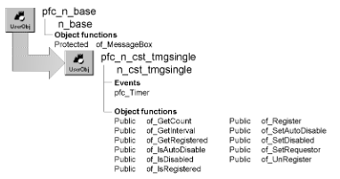

# n_cst_tmgsingle

**Description**

Timing service (single timer). Use this service to maintain a single timer, triggered at regular intervals between .55 and 65 seconds.

**Ancestry**



**Library**

- PFCAPSRV.PBL
- PFEAPSRV.PBL

**Object relationships**

n_tmg

**Usage**

Use this service to implement a single timer. To use this service:

1. Establish an instance variable of type n_tmg:

   ```
   n_tmg itmg_timer
   ```

2. Create the instance of n_tmg:

   ```
   itmg_timer = CREATE n_tmg
   ```

3. Enable the single timer service:

   ```
   itmg_timer.of_SetSingle(TRUE)
   ```

4. Register the object and the event to be notified (the window is the object in this example):

   ```
   IF IsValid(itmg_timer.inv_single) THEN
      itmg_timer.inv_Single.of_Register  &
      (this, "ue_showtimer", 15)
   END IF
   ```

5. Code the event to receive notification from n_cst_tmgsingle (ue_showtimer in this example):
6. (Optional) Unregister the object and event:

   ```
   itmg_timer.inv_single.of_UnRegister()
   ```

This service is for use with n_tmg, the PFC timing object.

**See also**

n_cst_tmgmultiple

## Instance variables

N_cst_tmgsingle includes instance variables:

| Instance variable | Description | Data type | Access | Usage |
| --- | --- | --- | --- | --- |
| ib_autodisable | Indicates whether the service enables autodisable | Boolean | Protected | Set with of_SetAutoDisable |
| ib_disabled | Indicates whether a notification can occur | Boolean | Protected | Set with of_SetDisabled |
| ii_notifystyle | Notification style: TriggerEvent or PostEvent | Integer | Protected | Set with of_Register |
| ipo_notifyobject | Object to notify when the timer fires | PowerObject | Protected | Set with of_Register |
| ir_interval | Timer interval | Real | Protected | Set with of_Register |
| is_notifyevent | Event to notify when the timer fires | String | Protected | Set with of_Register |
| itmg_requestor | N_tmg instance that owns the n_cst_tmgsingle instance | n_tmg | Protected | Internal |
| POSTEVENT | Constant set to 1 | Integer | Public | Use with of_Register |
| TRIGGEREVENT | Constant set to 0 | Integer | Public | Use with of_Register |

## Events

N_cst_tmgsingle includes a precoded event:

pfc_Timer

### Constructor

**Description**

The Timing Single the service.

**Syntax**

```
instancename.EVENT Constructor ( )
```

| Argument | Description |
| --- | --- |
| *instancename* | Instance name of n_cst_tmgsingle |

**Return value**

None.

### pfc_Timer

**Description**

Notifies the registered object that the timer has fired. Depending on how you registered the object, this event either triggers or posts the specified event.

**Usage**

The n_tmg Timer event calls this event.

## Functions

N_cst_tmgsingle includes precoded object functions:

- of_GetCount
- of_GetInterval
- of_GetRegistered
- of_IsAutoDisable
- of_IsDisabled
- of_IsRegistered
- of_Register
- of_SetAutoDisable
- of_SetDisabled
- of_SetRequestor
- of_UnRegister

### of_GetCount

**Description**

Retrieves the number of registered objects (either zero or one).

**Access**

Public

**Syntax**

```
tmgcontrol.instancename.of_GetCount ( )
```

| Argument | Description |
| --- | --- |
| *tmgcontrol* | Instance name of the n_tmg-based timing control |
| *instancename* | Instance name of n_cst_tmgsingle (the n_tmg default is inv_single) |

**Return value**

Integer. Returns 1 if an object is registered, 0 if no object is registered, and -1 if an error occurs.

**Examples**

This example calls the of_GetCount function:

```
Integer  li_return

IF IsValid(itmg_timer.inv_single) THEN
   li_return =  &
   itmg_timer.inv_single.of_GetCount()
END IF
sle_1.text = String(li_return)
```

### of_GetInterval

**Description**

Retrieves the current interval.

**Access**

Public

**Syntax**

```
tmgcontrol.instancename.of_GetInterval ( )
```

| Argument | Description |
| --- | --- |
| *tmgcontrol* | Instance name of the n_tmg-based timing control |
| *instancename* | Instance name of n_cst_tmgsingle (the n_tmg default is inv_single) |

**Return value**

Real. Returns the current interval if the function succeeds and 0 if no interval has been defined.

**Examples**

This example calls the of_GetInterval function:

```
Real  lr_interval

IF IsValid(itmg_timer.inv_single) THEN
   lr_interval =  &
   itmg_timer.inv_single.of_GetInterval()
END IF
sle_1.text = "Interval is: " &
   + String(lr_interval)
```

### of_GetRegistered

**Description**

Retrieves information for the currently registered object.

**Access**

Public

**Syntax**

```
tmgcontrol.instancename.of_GetRegistered ( object, event, interval, style )
```

| Argument | Description |
| --- | --- |
| *tmgcontrol* | Instance name of the n_tmg-based timing control |
| *instancename* | Instance name of n_cst_tmgsingle (the n_tmg default is inv_single) |
| *object* | PowerObject into which the function places a reference to the registered object (passed by reference) |
| *event* | String into which the function places a reference to the registered event (passed by reference) |
| *interval* | Real into which the function places a reference to the interval (passed by reference) |
| *style* | Style into which the function places a reference to the notification style (passed by reference) |

**Return value**

Integer. Returns 1 if the function succeeds, 0 if no object is registered, and -1 if an error occurs.

**Examples**

This example calls the of_GetRegistered function:

```
PowerObject  lpo_object
String  ls_event
Real  lr_interval
Integer  li_style

IF IsValid(itmg_timer.inv_single) THEN
   itmg_timer.inv_Single.of_GetRegistered  &
   (lpo_object, ls_event, lr_interval, li_style)
END IF
...
```

### of_IsAutoDisable

**Description**

Reports whether the service is using the autodisable feature.

**Access**

Public

**Syntax**

```
tmgcontrol.instancename.of_IsAutoDisable ( )
```

| Argument | Description |
| --- | --- |
| *tmgcontrol* | Instance name of the n_tmg-based timing control |
| *instancename* | Instance name of n_cst_tmgsingle (the n_tmg default is inv_single) |

**Return value**

Boolean. Returns TRUE if autodisable is enabled and FALSE if it is not.

**Examples**

This example is from the pfc_Timer event:

```
...
If of_IsAutoDisable() Then
   of_SetDisabled(False)
End If
...
```

### of_IsDisabled

**Description**

Reports whether notification is disabled. If autodisable is enabled, n_cst_tmgsingle disables itself automatically while notifying the registered object.

**Access**

Public

**Syntax**

```
tmgcontrol.instancename.of_IsDisabled ( )
```

| Argument | Description |
| --- | --- |
| *tmgcontrol* | Instance name of the n_tmg-based timing control |
| *instancename* | Instance name of n_cst_tmgsingle (the n_tmg default is inv_single) |

**Return value**

Boolean. Returns TRUE if notification is disabled and FALSE if it is not.

**Examples**

This example is from the pfc_Timer event:

```
If of_IsDisabled() Then
   Return 0
End If
...
```

### of_IsRegistered

**Description**

Reports whether the specified object or object/event combination is registered.

**Access**

Public

**Syntax**

```
tmgcontrol.instancename.of_IsRegistered ( object { , event } )
```

| Argument | Description |
| --- | --- |
| *tmgcontrol* | Instance name of the n_tmg-based timing control |
| *instancename* | Instance name of n_cst_tmgsingle (the n_tmg default is inv_single) |
| *object* | PowerObject referencing the object to be tested |
| *event* (optional) | Event defined within *object* |

**Return value**

Boolean. Returns TRUE if *object* or *object* and *event* are registered with the service and FALSE if they are not.

**Examples**

This example calls the of_IsRegistered function:

```
IF IsValid(itmg_timer.inv_single) THEN
   IF itmg_timer.inv_single.of_IsRegistered(parent)
 THEN
   sle_1.text = "Window is registered"
   ELSE
   sle_1.text = "Not registered"
   END IF
END IF
```

### of_Register

**Description**

Registers an object instance (or object instance and event) with n_cst_tmgsingle.

**Access**

Public

**Syntax**

```
tmgcontrol.instancename.of_Register ( object, event, interval { , style } )
```

| Argument | Description |
| --- | --- |
| *tmgcontrol* | Instance name of the n_tmg-based timing control |
| *instancename* | Instance name of n_cst_tmgsingle (the n_tmg default is inv_single) |
| *object* | PowerObject referencing the instance to be notified when the timer fires |
| *event* | String specifying the event to be called. This must be a valid event for *object* |
| *interval* | Real specifying the timer interval in seconds (.55 is the minimum and 65 is the maximum) |
| *style* (optional) | Integer or n_cst_tmgsingle constant specifying the notification style: |
|  | **• 0 or TRIGGEREVENT** Trigger the event (default) |
|  | **• 1 or POSTEVENT** Post the event |

**Return value**

Integer. Returns 1 if the function succeeds and -1 if an error occurs.

**Usage**

Call this function to specify the object, event, and interval used by the timer.

If you specify an interval less than .55 seconds, the function sets the interval to .55; if you specify an interval greater than 65 seconds, the function sets the interval to 65.

**Examples**

This example calls the of_Register function:

```
IF IsValid(itmg_timer.inv_single) THEN
   itmg_timer.inv_Single.of_Register  &
   (parent, "ue_showtimer", 15)
END IF
```

### of_SetAutoDisable

**Description**

Specifies whether n_cst_tmgsingle disables notifications automatically during the notification process.

**Access**

Public

**Syntax**

```
tmgcontrol.instancename.of_SetAutoDisable ( boolean )
```

| Argument | Description |
| --- | --- |
| *tmgcontrol* | Instance name of the n_tmg-based timing control |
| *instancename* | Instance name of n_cst_tmgsingle (the n_tmg default is inv_single) |
| *boolean* | Boolean specifying whether the service disables notification automatically (TRUE) or not (FALSE) |

**Return value**

Integer. Returns 1 if the function succeeds and -1 if an error occurs.

**Examples**

This example calls the of_SetAutoDisable function:

```
itmg_timer.inv_single.of_SetAutoDisable(TRUE)
```

### of_SetDisabled

**Description**

Specifies whether n_cst_tmgsingle sends notifications to registered objects.

**Access**

Public

**Syntax**

```
tmgcontrol.instancename.of_SetDisabled ( boolean )
```

| Argument | Description |
| --- | --- |
| *tmgcontrol* | Instance name of the n_tmg-based timing control |
| *instancename* | Instance name of n_cst_tmgsingle (the n_tmg default is inv_single) |
| *boolean* | Boolean specifying whether to the service sends notifications to registered objects (TRUE) or not (FALSE) |

**Return value**

Integer. Returns 1 if the function succeeds and -1 if an error occurs.

**Usage**

If autodisable is enabled, the pfc_Timer event calls this function to prevent simultaneous notifications.

**Examples**

This example is from the pfc_Timer event:

```
If of_IsAutoDisable() Then
   of_SetDisabled(True)
End If
```

### of_SetRequestor

**Description**

Associates the requesting object with this instance of n_cst_tmgsingle.

**Access**

Public

**Syntax**

```
tmgcontrol.instancename.of_SetRequestor ( requestor )
```

| Argument | Description |
| --- | --- |
| *tmgcontrol* | Instance name of the n_tmg-based timing control |
| *instancename* | Instance name of n_cst_tmgsingle (the n_tmg default is inv_single) |
| *requestor* | N_tmg-based timing object instance to be associated with the service |

**Return value**

Integer. Returns 1 if the function succeeds and -1 if an error occurs.

**Examples**

This example is from the n_tmg of_SetSingle function:

```
...
inv_single = Create n_cst_tmgsingle
inv_single.of_SetRequestor(this)
...
```

### of_UnRegister

**Description**

Unregisters the current notification object.

**Access**

Public

**Syntax**

```
tmgcontrol.instancename.of_UnRegister ( )
```

| Argument | Description |
| --- | --- |
| *tmgcontrol* | Instance name of the n_tmg-based timing control |
| *instancename* | Instance name of n_cst_tmgsingle (the n_tmg default is inv_single) |

**Return value**

Integer. Returns 1 if the function succeeds, 0 if no object is registered, and -1 if an error occurs.

**Examples**

This example calls the of_UnRegister function:

```
itmg_timer.inv_single.of_UnRegister()
```
