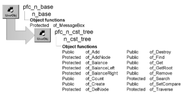

# n_cst_tree

**Description**

Balanced binary tree object. A balanced binary tree provides an alternative to a sorted linked list. N_cst_tree automatically maintains a sorted (no duplicates) balanced binary tree, which is never more than one level out of balance.

**Ancestry**



**Library**

- PFCAPSRV.PBL
- PFEAPSRV.PBL

**Object relationships**

- [n_cst_treenode](n_cst_treenode.md)
- [n_cst_treenodecompare](n_cst_treenodecompare.md)

**Usage**

Use this object to handle list processing in a balanced binary tree.

To use n_cst_tree:

1. Create an instance of n_cst_tree. This example declares a window instance variable:

   ```
   n_cst_tree  inv_tree
   ```

2. (Optional) Specify a customized node comparison object. This example assumes an inv_customcompare instance variable of type n_cst_customcompare (n_cst_customcompare must be a descendant of n_cst_treenodecompare):

   ```
   inv_customcompare = CREATE n_cst_mycompare

   inv_tree.of_SetCompare(inv_customcompare)
   ```

3. Add nodes to the tree. To do this, first create a node, specify a key and data, then call the of_Add function:

   ```
   n_cst_treenode  lnv_node
   Integer  li_return

   lnv_node = CREATE n_cst_treenode

   lnv_node.of_SetKey(sle_1.text)
   lnv_node.of_SetData(sle_1.text)
   li_return = inv_tree.of_Add(lnv_node)
   ```

4. Access items in the tree as appropriate by calling the of_Find function. This example displays the data in a MessageBox:

   ```
   n_cst_treenode  lnv_node, lnv_temp
   Integer  li_return
   Any  la_data

   lnv_temp = CREATE n_cst_treenode

   lnv_temp.of_SetKey(sle_2.text)
   li_return = inv_tree.of_Find(lnv_node, lnv_temp)
   IF li_return < 1 THEN
      MessageBox("Not Found",  &
         "The specified node was not found")
   ELSE
      lnv_node.of_GetData(la_data)
      MessageBox("Found", String(la_data)  &
         + " was found.")
   END IF
   ```

5. (Optional) Remove nodes from the tree by calling the of_Destroy function:

   ```
   n_cst_treenode  lnv_node, lnv_temp
   Integer  li_return
   Long  ll_oldtextcolor

   lnv_temp = CREATE n_cst_treenode

   lnv_temp.of_SetKey(sle_2.text)
   li_return = inv_tree.of_Find(lnv_node, lnv_temp)
   IF li_return < 1 THEN
      ll_oldtextcolor = sle_2.textcolor
      sle_2.textcolor = RGB(255, 0, 0)
      MessageBox("Not Found",  &
         "The specified node was not found")
      sle_2.textcolor = ll_oldtextcolor
      Return
   END IF
   li_return = inv_tree.of_Destroy(lnv_node)
   IF li_return = 1 THEN
      MessageBox("Success",  &
         "Node removed successfully")
   END IF
   ```

**See also**

- [n_cst_list](n_cst_list.md)
- [n_cst_queue](n_cst_queue.md)
- [n_cst_stack](n_cst_stack.md)
- [n_cst_treenode](n_cst_treenode.md)
- [n_cst_treenodecompare](n_cst_treenodecompare.md)

## Instance variables

N_cst_tree includes instance variables:

| Instance variable | Description | Data type | Access | Usage |
| --- | --- | --- | --- | --- |
| inv_compare | Reference to comparison object | n_cst_treenodecompare | Protected | Set with of_SetCompare (default is n_cst_treenodecompare) |
| inv_removednode | Temporary node | n_cst_treenode | Protected | Internal |
| inv_root | Root node of tree | n_cst_treenode | Protected | Internal |
| inv_shiftnode | Temporary node | n_cst_treenode | Protected | Internal |

## Functions

N_cst_tree includes precoded object functions:

- of_Add
- of_AddNode
- of_Balance
- of_BalanceLeft
- of_BalanceRight
- of_Count
- of_Create
- of_DelNode
- of_Destroy
- of_Find
- of_Get
- of_GetRoot
- of_Remove
- of_Search
- of_SetCompare
- of_Traverse

### of_Add

**Description**

Adds a new node to the tree.

**Access**

Public

**Syntax**

```
instancename.of_Add ( node )
```

| Argument | Description |
| --- | --- |
| *instancename* | Instance name of n_cst_tree |
| *node* | N_cst_treenode instance to be added to the tree |

**Return value**

Integer. Returns values as follows:

- **1** Success
- **0** A node with this key already exists in the tree; *node* was not added
- **-1** An error occurred
- **-2** *Node* is invalid

**Usage**

Before calling this function, you need to create the node, add key information, and add data.

**Examples**

This example calls the of_Add function:

```
n_cst_treenode  lnv_node
Integer  li_return

lnv_node = CREATE n_cst_treenode

lnv_node.of_SetKey(sle_1.text)
lnv_node.of_SetData(sle_1.text)
li_return = inv_tree.of_Add(lnv_node)
```

### of_AddNode

**Description**

Finds the proper location for a new node and inserts it into the tree.

**Access**

Protected

**Syntax**

```
instancename.of_AddNode ( newnode, currentnode, height )
```

| Argument | Description |
| --- | --- |
| *instancename* | Instance name of n_cst_tree |
| *newnode* | N_cst_treenode instance containing the node to be added |
| *currentnode* | N_cst_treenode instance containing the current node (passed by reference) |
| *height* | Boolean indicating whether the function changed the height of the tree (TRUE) or not (FALSE) (passed by reference) |

**Return value**

Integer. Returns values as follows:

- **1.** Node was added successfully
- **0.** A node with a matching key already exists in the tree
- **-1.** An error occurred

**Usage**

Internal.

**Examples**

This example calls the of_AddNode function:

```
...
Return of_AddNode  &
  (anv_currentnode, inv_root, lb_height)
```

### of_Balance

**Description**

Recursively balances the tree after a node deletion.

**Access**

Protected

**Syntax**

```
instancename.of_Balance ( node, height )
```

| Argument | Description |
| --- | --- |
| *instancename* | Instance name of n_cst_tree |
| *node* | N_cst_treenode instance referencing the top branch of the node to be balanced (passed by reference) |
| *height* | Boolean indicating whether the function changed the height of the tree (TRUE) or not (passed by reference) |

**Return value**

Integer. Returns 1 if the function succeeds and -1 if an error occurs.

**Usage**

Internal.

**Examples**

This example is from the of_DelNode function:

```
...
ELSE
  of_Balance(lnv_left, ab_height)
  inv_shiftnode.of_SetPrev(lnv_left)
...
```

### of_BalanceLeft

**Description**

Balances the left side of a node.

**Access**

Protected

**Syntax**

```
instancename.of_BalanceLeft ( node, height )
```

| Argument | Description |
| --- | --- |
| *instancename* | Instance name of n_cst_tree |
| *node* | N_cst_treenode instance referencing the node whose left side is to be balanced (passed by reference) |
| *height* | Boolean indicating whether the function changed the height of the tree (TRUE) or not (FALSE) (passed by reference) |

**Return value**

Integer. Returns 1 if the function succeeds and -1 if an error occurs.

**Usage**

Internal.

**Examples**

This example is from the of_DelNode function:

```
...
IF ab_height THEN of_BalanceLeft &
   (anv_currentnode, ab_height)
...
```

### of_BalanceRight

**Description**

Balances the right side of a node.

**Access**

Protected

**Syntax**

```
instancename.of_BalanceRight ( node, height )
```

| Argument | Description |
| --- | --- |
| *instancename* | Instance name of n_cst_tree |
| *node* | N_cst_treenode instance referencing the node whose right side is to be balanced (passed by reference) |
| *height* | Boolean indicating whether the function changed the height of the tree (TRUE) or not (FALSE) (passed by reference) |

**Return value**

Integer. Returns 1 if the function succeeds and -1 if an error occurs.

**Usage**

Internal.

**Examples**

This example is from the of_DelNode function:

```
...
IF ab_height THEN of_BalanceRight &
   (anv_currentnode, ab_height)
...
```

### of_Count

**Description**

Retrieves a count of the number of nodes in the tree.

**Access**

Public

**Syntax**

```
instancename.of_Count ( )
```

| Argument | Description |
| --- | --- |
| *instancename* | Instance name of n_cst_tree |

**Return value**

Long. Returns the number of nodes in the tree.

**Examples**

This example calls the of_Count function:

```
...
ll_count = inv_tree.of_Count()
st_result.text = "Item count: " + String(ll_count)
```

### of_Create

**Description**

Creates a node, returning a reference to the new node.

**Access**

Public

**Syntax**

```
instancename.of_Create ( newnode )
```

| Argument | Description |
| --- | --- |
| *instancename* | Instance name of n_cst_tree |
| *newnode* | N_cst_treenode instance into which the function places a reference to the newly created node (passed by reference) |

**Return value**

Integer. Returns 1 if the function succeeds and -1 if an error occurs.

**Examples**

This example calls the of_Create function:

```
n_cst_treenode  lnv_node
Integer  li_return

inv_tree.of_Create(lnv_node)
lnv_node.of_SetKey(sle_1.text)
lnv_node.of_SetData(sle_1.text)
li_return = inv_tree.of_Add(lnv_node)
```

### of_DelNode

**Description**

Deletes the node whose key matches the key found in the passed argument, and if necessary rebalances the tree.

**Access**

Protected

**Syntax**

```
instancename.of_DelNode ( keynode, currentnode, height )
```

| Argument | Description |
| --- | --- |
| *instancename* | Instance name of n_cst_tree |
| *keynode* | N_cst_treenode instance specifying the key to be deleted |
| *currentnode* | N_cst_treenode instance to be deleted from the tree (passed by reference) |
| *height* | Boolean (passed by reference) |

**Return value**

Integer. Returns 1 if the function succeeds and -1 if an error occurs.

**Usage**

Internal.

**Examples**

This example is from the of_Remove function:

```
...
li_rc = of_DelNode(lnv_keynode, inv_root, lb_height)
anv_currentnode = inv_removednode
DESTROY lnv_keynode
Return li_rc
```

### of_Destroy

**Description**

Destroys the passed node, resetting references to surrounding nodes.

**Access**

Public

**Syntax**

```
instancename.of_Destroy ( { node } )
```

| Argument | Description |
| --- | --- |
| *instancename* | Instance name of n_cst_tree |
| *node* (optional) | N_cst_treenode instance referencing the node to be destroyed. If you omit this argument, the function destroys all nodes in the tree |

**Return value**

Integer. Returns 1 if the function succeeds, -1 if *node* is not found, and -2 if *node* is invalid.

**Examples**

This example calls the of_Destroy function:

```
n_cst_treenode  lnv_node, lnv_temp
Integer  li_return

lnv_temp = CREATE n_cst_treenode

lnv_temp.of_SetKey(sle_2.text)
li_return = inv_tree.of_Find(lnv_node, lnv_temp)
IF li_return < 1 THEN
   MessageBox("Not Found",  &
   "The specified node was not found")
   Return
END IF
li_return = inv_tree.of_Destroy(lnv_node)
IF li_return = 1 THEN
   MessageBox("Success",  &
   "Node removed successfully")
END IF
```

### of_Find

**Description**

Retrieves a reference to a node in the tree based on a specified key value.

**Access**

Public

**Syntax**

```
instancename.of_Find ( foundnode, nodewithkey )
```

| Argument | Description |
| --- | --- |
| *instancename* | Instance name of n_cst_tree |
| *foundnode* | N_cst_treenode instance into which the function places the node if a match is found (passed by reference) |
| *nodewithkey* | N_cst_treenode instance containing the key value used to find the requested node |

**Return value**

Integer. Returns 1 if the function succeeds and -1 if an error occurs.

**Usage**

Use *foundnode* to access the key and data for the node.

**Examples**

This example calls the of_Find function:

```
n_cst_treenode  lnv_node, lnv_temp
Integer  li_return
Any  la_data

lnv_temp = CREATE n_cst_treenode

lnv_temp.of_SetKey(sle_2.text)
li_return = inv_tree.of_Find(lnv_node, lnv_temp)
IF li_return < 1 THEN
  MessageBox("Not Found",  &
     "The specified node was not found")
ELSE
  lnv_node.of_GetData(la_data)
  MessageBox("Found", String(la_data) + " was found")
END IF
```

### of_Get

**Description**

Populates an array containing all nodes in the tree.

**Access**

Public

**Syntax**

```
instancename.of_Get ( allnodes )
```

| Argument | Description |
| --- | --- |
| *instancename* | Instance name of n_cst_tree |
| *allnodes* | N_cst_treenode array into which the function places references to all nodes in the tree (passed by reference) |

**Return value**

Long. Returns the number of elements in *allnodes* if the function succeeds and -1 if an error occurs.

**Examples**

This example calls the of_Get function:

```
n_cst_treenode  lnv_nodes[ ]
Long  ll_return, ll_count
Any  la_data
String  ls_data

lb_1.Reset()
ll_return = inv_tree.of_Get(lnv_nodes)
FOR ll_count = 1 to ll_return
   lnv_nodes[ll_count].of_GetData(la_data)
   ls_data = String(la_data)
   lb_1.AddItem(ls_data)
NEXT
```

### of_GetRoot

**Description**

Retrieves a reference to the root node of a tree.

**Access**

Public

**Syntax**

```
instancename.of_GetRoot ( node )
```

| Argument | Description |
| --- | --- |
| *instancename* | Instance name of n_cst_tree |
| *node* | N_cst_treenode instance into which the function places a reference to the root node of *instancename* (passed by reference) |

**Return value**

Integer. Returns 1 if the function succeeds and -1 if an error occurs.

**Examples**

This example calls the of_GetRoot function:

```
n_cst_treenode  lnv_node
Integer  li_return
Any  la_data

li_return = inv_tree.of_GetRoot(lnv_node)
IF li_return < 1 THEN
   MessageBox("Not Found",  &
      "Root node not found")
ELSE
   lnv_node.of_GetData(la_data)
   MessageBox("Root Node", "Root node is "  &
      + String(la_data))
END IF
```

### of_Remove

**Description**

Removes the specified node from the tree.

**Access**

Public

**Syntax**

```
instancename.of_Remove ( node )
```

| Argument | Description |
| --- | --- |
| *instancename* | Instance name of n_cst_tree |
| *node* | N_cst_treenode instance referencing the node that contains the key and data to be removed (passed by reference) |

**Return value**

Integer. Returns 1 if the function succeeds, -1 if an error occurs, and -2 if *node* is invalid.

**Usage**

In most cases it is better to call of_Destroy to remove and destroy the node.

**Use with care** Due to the tree rotations that may occur while rebalancing the tree following the deletion, the data in the original node may have been moved. This function returns the node that was actually removed, but it may not be the node that was requested to be removed. If you require the removed node’s contents after calling this function, make a copy of the node before calling the function.

**Examples**

This example is from the of_Destroy function:

```
...
li_rc = of_remove(anv_currentnode)
if li_rc = 1 then
   destroy anv_currentnode
end if
return li_rc
```

### of_Search

**Description**

Searches the tree recursively until the specified node is found or the branch ends.

**Access**

Protected

**Syntax**

```
instancename.of_Search ( foundnode, nodewithkey )
```

| Argument | Description |
| --- | --- |
| *instancename* | Instance name of n_cst_tree |
| *foundnode* | N_cst_treenode instance into which the function places the node if a match is found (passed by reference) |
| *nodewithkey* | N_cst_treenode instance containing the key value used to find the requested node |

**Return value**

Integer. Returns 1 if the node was found and -1 if it is not found.

**Usage**

Internal.

**Examples**

This example is from the of_Find function:

```
...
anv_currentnode = inv_root
return of_search(anv_currentnode,anv_keynode)
```

### of_SetCompare

**Description**

Establishes a comparison object other than n_cst_treenodecompare.

**Access**

Public

**Syntax**

```
instancename.of_SetCompare ( comparisonobject )
```

| Argument | Description |
| --- | --- |
| *instancename* | Instance name of n_cst_tree |
| *comparisonobject* | N_cst_treenodecompare or n_cst_treenodecompare descendant that overrides the of_Compare function |

**Return value**

Integer. Returns 1 if the function succeeds, -1 if an error occurs, and -2 if the comparison object has already been set.

**Usage**

N_cst_tree uses the comparison object’s of_Compare function to find and sort nodes. The default comparison object (n_cst_treenodecompare) can handle comparison for simple data types. But if your list’s key items contain some other data type, you must create a customized n_cst_treenodecompare descendant and implement an of_Compare function to handle sort order.

**Examples**

This example calls the of_SetCompare function. It assumes an inv_customcompare instance variable:

```
inv_customcompare = CREATE n_cst_mycompare
inv_tree.of_SetCompare &
  (inv_customcompare)
```

### of_Traverse

**Description**

Walks the tree, creating a sorted array of nodes.

**Access**

Protected

**Syntax**

```
instancename.of_Traverse ( currentnode, foundnodes, count )
```

| Argument | Description |
| --- | --- |
| *instancename* | Instance name of n_cst_tree |
| *currentnode* | N_cst_treenode instance from which the function begins traversing the tree |
| *foundnodes* | N_cst_treenode array into which the function places found nodes in sorted order (passed by reference) |
| *count* | Long into which the function places a count of the elements in *foundnodes* (passed by reference) |

**Return value**

Integer. Returns 1 if the function succeeds and -1 if an error occurs.

**Usage**

Internal.

**Examples**

This example is from the of_Get function:

```
Long ll_cnt = 0

SetPointer(HourGlass!)
IF IsValid(inv_root) THEN
  of_Traverse(inv_root, anv_list, ll_cnt)
END IF
Return ll_cnt
```
