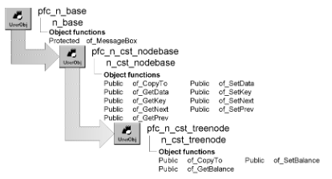

# n_cst_treenode

**Description**

Tree list instance object. Each element in a balanced binary tree is an instance of n_cst_treenode. N_cst_treenode contains balance information as well as functions to copy nodes and balance the tree.

**Ancestry**



**Library**

- PFCAPSRV.PBL
- PFEAPSRV.PBL

**Usage**

Use n_cst_treenode to create nodes for use with n_cst_tree.

To use n_cst_treenode:

1. Declare a variable for your list (an instance variable in this example):

   ```
   n_cst_tree inv_tree
   ```

2. Declare variables for tree nodes (local variables in this example):

   ```
   n_cst_treenode lnv_node
   ```

3. Create the node instance:

   ```
   lnv_node = CREATE n_cst_treenode
   ```

You can also call the n_cst_tree of_Create function to create a tree node instance.

4. Access the node’s key and data values as appropriate:

   ```
   lnv_node.of_SetKey(sle_1.text)
   lnv_node.of_SetData(sle_1.text)
   ```

5. Call tree processing functions as appropriate:

   ```
   li_return = inv_tree.of_Add(lnv_node)
   ```

**See also**

- [n_cst_linkedlistnode](n_cst_linkedlistnode.md)
- [n_cst_tree](n_cst_tree.md)
- [n_cst_treenodecompare](n_cst_treenodecompare.md)

## Instance variables

N_cst_treenode includes instance variables:

| Instance variable | Description | Data type | Access | Usage |
| --- | --- | --- | --- | --- |
| ii_balance | Current tree balance | Integer | Protected | Set with of_SetBalance |

## Functions

N_cst_treenode includes precoded object functions:

|   |
| --- |
| of_CopyTo of_SetBalance |
| of_GetBalance |

### of_CopyTo

**Description**

Copies the data and key of the passed node into the current node.

**Access**

Public

**Syntax**

```
instancename.of_CopyTo ( targetnode )
```

| Argument | Description |
| --- | --- |
| *instancename* | Instance name of n_cst_treenode |
| *targetnode* | N_cst_treenode instance whose data and key are copied to *instancename* (passed by reference) |

**Return value**

Integer. Returns 1 if the function succeeds and -1 if an error occurs.

**Usage**

If you extend n_cst_treenode, be sure to override this function to copy all added data elements as well as the ia_key and ia_data instance variables.

**Examples**

This example calls the of_CopyTo function:

```
n_cst_treenode  lnv_node, lnv_temp, lnv_copy
Long  ll_return
Any  la_data

lnv_temp = CREATE n_cst_treenode

lnv_temp.of_SetKey(sle_2.text)
ll_return = inv_tree.of_Find(lnv_node, lnv_temp)
IF ll_return < 1 THEN
   MessageBox("Not Found",  &
      "The specified node was not found")
   Return
END IF
lnv_copy = CREATE n_cst_treenode
ll_return = lnv_node.of_CopyTo(lnv_copy)
IF ll_return = 1 THEN
   lnv_copy.of_GetData(la_data)
   MessageBox("Success",   &
      "Node copied successfully~r~n"  &
         + "Data is: " + String(la_data))
END IF
```

### of_GetBalance

**Description**

Retrieves the current balance of a tree list.

**Access**

Public

**Syntax**

```
instancename.of_GetBalance ( )
```

| Argument | Description |
| --- | --- |
| *instancename* | Instance name of n_cst_treenode |

**Return value**

Integer. Returns values as follows:

- **1** Right branch is one level higher than the left
- **0** Tree is balanced
- **-1** Left branch is one level higher than the right

**Usage**

Internal.

**Examples**

This example calls the of_GetBalance function:

```
...
choose case anv_currentnode.of_GetBalance()
   case 1
      anv_currentnode.of_SetBalance(0)
      ab_height = false
...
```

### of_SetBalance

**Description**

Sets the current balance in a tree list.

**Access**

Public

**Syntax**

```
instancename.of_SetBalance ( balancelevel )
```

| Argument | Description |
| --- | --- |
| *instancename* | Instance name of n_cst_treenode |
| *balancelevel* | Integer specifying the balance level. Valid values are: |
|  | **• 1** Right branch is one level higher than the left |
|  | **• 0** Tree is balanced |
|  | **• -1** Left branch is one level higher than the right |

**Return value**

Integer. Returns 1 if the function succeeds and -1 if an error occurs.

**Examples**

This example calls the of_SetBalance function:

```
...
anv_newnode.of_SetBalance(0)
anv_currentnode = anv_newnode
...
```
