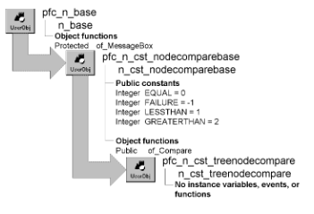

# n_cst_treenodecompare

**Description**

Tree node comparison object. N_cst_tree uses this object to compare values before placement in a tree list.

**Ancestry**



**Library**

- PFCAPSRV.PBL
- PFEAPSRV.PBL

**Usage**

Use this object for customized comparisons with tree lists.

To use a customized descendant of n_cst_treenodecompare:

1. Use the User Object painter to create a customized n_cst_treenodecompare descendant.
2. In the customized n_cst_treenodecompare descendant, implement a Public of_Compare function to compare key values in the two passed nodes. This function should take two arguments of type n_cst_treenode (passed by value) and return Integer values as follows:
   - **LESSTHAN or 1** The key of the first node is less than the key of the second node
   - **EQUAL or 0** The key of the first node is equal to the key of the second node
   - **GREATERTHAN or 2** The key of the first node is greater than the key of the second node

     For an example of the processing you might use when overriding of_Compare, see [n_cst_linkedlistnodecompare](n_cst_linkedlistnodecompare.md).

   - **FAILURE or -1** An error occurred
3. In the object that uses PFC tree processing, define an instance variable that uses your customized n_cst_treenodecompare object as the data type:

   ```
   n_cst_mycompare inv_customcompare
   ```

4. Create an instance of the customized comparison object and call the n_cst_tree of_SetCompare function:

   ```
   inv_customcompare = CREATE n_cst_mycompare

   inv_tree.of_SetCompare(inv_customcompare)
   ```

**See also**

- [n_cst_linkedlistnodecompare](n_cst_linkedlistnodecompare.md)
- [n_cst_tree](n_cst_tree.md)
- [n_cst_treenode](n_cst_treenode.md)
