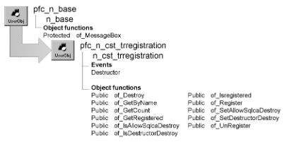

# n_cst_trregistration

**Description**

Transaction registration service.

**Ancestry**



**Library**

- PFCAPSRV.PBL
- PFEAPSRV.PBL

**Object relationships**

n_tr

**Usage**

Use this service to keep track of transactions when your application uses more than one transaction.

To use this service:

1. Register transactions by calling the of_Register function:

   ```
   gnv_app.inv_trregistration.of_Register &
      (itr_security)
   ```

2. Provide and track transaction names through the n_tr of_SetName function:

   ```
   itr_security.of_SetName("Security")
   ```

3. Call n_cst_trregistration functions as needed to access information on registered transactions.
4. (Optional) Unregister transactions by calling the of_UnRegister function:

   ```
   gnv_app.inv_trregistration.of_UnRegister &
      (itr_security)
   ```

When your application closes, this object automatically destroys all open transactions. Use the n_tr of_SetAutoRollback function to specify whether transactions are rolled back or committed before being destroyed.

This service is for use with Transaction objects that inherit from n_tr.

**PFC 7 custom class extension** To further the extendibility of PFC, a new n_cst_trregistrationattrib custom class user object replaces the os_transentry object structure that is now obsolete.

**See also**

- [n_cst_appmanager](n_cst_appmanager.md)
- [n_tr](../08-standard-class-user-objects/n_tr.md)

## Instance variables

N_cst_trregistration includes instance variables:

| Instance variable | Description | Data type | Access | Usage |
| --- | --- | --- | --- | --- |
| ib_allowsqlcadestroy | Indicates whether the service destroys SQLCA | Boolean | Protected | Set with of_SetAllowSqlcaDestroy (default is TRUE) |
| ib_destructordestroy | Indicates whether the service destroys registered transactions in the Destructor event | Boolean | Protected | Set with of_SetDestructorDestroy (default is TRUE) |
| inv_trans[ ] | Structure array that tracks Transaction objects and whether the array slot is used | n_cst_trregistrat ionattrib | Protected | Used to track Transaction objects |
| ii_count | Number of current transactions registered with the service | Integer | Protected | Used to track the number of registered Transaction objects. This value is not always the same as the upperbound of the istr_trans array |

## Events

N_cst_trregistration includes a precoded event:

Destructor

### Destructor

**Description**

Optionally destroys all registered Transaction objects.

**Usage**

Call the of_SetDestructorDestroy function to control whether n_cst_trregistration destroys registered Transaction objects in the Destructor event.

This event ensures that transactions are destroyed when an application terminates. However, it’s best if the application does this explicitly.

## Functions

N_cst_trregistration includes precoded object functions:

- of_Destroy
- of_GetByName
- of_GetCount
- of_GetRegistered
- of_IsAllowSqlcaDestroy
- of_IsDestructorDestroy
- of_IsRegistered
- of_Register
- of_SetAllowSqlcaDestroy
- of_SetDestructorDestroy
- of_UnRegister

### of_Destroy

**Description**

Unregisters and destroys all registered Transaction objects.

**Access**

Public

**Syntax**

```
appname.instancename.of_Destroy ( )
```

| Argument | Description |
| --- | --- |
| *appname* | Instance name of the n_cst_appmanager-based Application object (must be gnv_app) |
| *instancename* | Instance name of n_cst_trregistration (the n_cst_appmanager default is inv_trregistration) |

**Return value**

Integer. Returns the number of destroyed Transaction objects if the function succeeds and -1 if an error occurs.

**Usage**

To prevent this function from destroying SQLCA, call of_SetAllowSqlcaDestroy, passing FALSE.

**Examples**

This example is from the Destructor event:

```
If of_IsDestructorDestroy() Then
   of_Destroy()
End If
```

### of_GetByName

**Description**

Retrieves a reference to a registered Transaction object, given its name.

**Access**

Public

**Syntax**

```
appname.instancename.of_GetByName ( transname, transobject )
```

| Argument | Description |
| --- | --- |
| *appname* | Instance name of the n_cst_appmanager-based Application object (must be gnv_app) |
| *instancename* | Instance name of n_cst_trregistration (the n_cst_appmanager default is inv_trregistration) |
| *transname* | String specifying the name of the Transaction object to retrieve |
| *transobject* | N_tr variable to contain the reference to the Transaction object (passed by reference) |

**Return value**

Integer. Returns 1 if the specified name is a valid registered Transaction object and 0 if it is not.

**Usage**

One use of this function is to pass the name between windows so they can use the same Transaction object.

**Examples**

This example calls the of_GetByName function in a response window’s Open event to use a transaction created by another window. The calling window passes the name via the OpenWithParm function:

```
Integer  li_return
String   ls_name
n_tr  lt_trans

ls_name = Message.StringParm
IF ls_name = "" THEN
   MessageBox("Error","No transaction passed")
   CloseWithReturn(this, -1)
END IF
li_return = &
   gnv_app.inv_trregistration.of_GetByName &
   (ls_name, lt_trans)
IF li_return = 0 THEN
   MessageBox("Error","Transaction not found")
   CloseWithReturn(this, -1)
ELSE
   dw_list.SetTransObject(lt_trans)
END IF
```

### of_GetCount

**Description**

Retrieves the number of registered Transaction objects.

**Access**

Public

**Syntax**

```
appname.instancename.of_GetCount ( )
```

| Argument | Description |
| --- | --- |
| *appname* | Instance name of the n_cst_appmanager-based Application object (must be gnv_app) |
| *instancename* | Instance name of n_cst_trregistration (the n_cst_appmanager default is inv_trregistration) |

**Return value**

Integer. Returns the number of registered Transaction objects.

**Examples**

This example calls the of_GetCount function:

```
Integer   li_count

li_count = gnv_app.inv_trregistration.of_GetCount( )
```

### of_GetRegistered

**Description**

Retrieves all registered Transaction objects.

**Access**

Public

**Syntax**

```
appname.instancename.of_GetRegistered ( transobj )
```

| Argument | Description |
| --- | --- |
| *appname* | Instance name of the n_cst_appmanager-based Application object (must be gnv_app) |
| *instancename* | Instance name of n_cst_trregistration (the n_cst_appmanager default is inv_trregistration) |
| *transobj* | N_tr array into which the function places references to all registered Transaction objects (passed by reference) |

**Return value**

Integer. Returns the number of elements in the *transobj* array.

**Examples**

This example calls the of_GetRegistered function:

```
Integer  li_return
n_tr  ltr_trans[ ]

li_return = &
   gnv_app.inv_trregistration.of_GetRegistered &
   (ltr_trans)
...
```

### of_IsAllowSqlcaDestroy

**Description**

Reports whether the of_Destroy function destroys SQLCA.

**Access**

Public

**Syntax**

```
appname.instancename.of_IsAllowSqlcaDestroy ( )
```

| Argument | Description |
| --- | --- |
| *appname* | Instance name of the n_cst_appmanager-based Application object (must be gnv_app) |
| *instancename* | Instance name of n_cst_trregistration (the n_cst_appmanager default is inv_trregistration) |

**Return value**

Boolean. Returns TRUE if automatic SQLCA destroy is enabled and FALSE if it is not.

**Examples**

This example calls the of_IsAllowSqlcaDestroy function:

```
IF gnv_app.inv_trregistration.of_IsAllowSqlcaDestroy &
   () THEN
   MessageBox("TR Registration",  &
         "Automatic SQLCA destroy enabled")
ELSE
   MessageBox("TR Registration",  &
      "Automatic SQLCA destroy disabled")
END IF
```

### of_IsDestructorDestroy

**Description**

Reports whether the Destructor event destroys registered transactions.

**Access**

Public

**Syntax**

```
appname.instancename.of_IsDestructorDestroy ( )
```

| Argument | Description |
| --- | --- |
| *appname* | Instance name of the n_cst_appmanager-based Application object (must be gnv_app) |
| *instancename* | Instance name of n_cst_trregistration (the n_cst_appmanager default is inv_trregistration) |

**Return value**

Boolean. Returns TRUE if Destructor destroy is enabled and FALSE if it is not.

**Examples**

This example calls the of_IsDestructorDestroy function:

```
IF gnv_app.inv_trregistration.of_IsDestructorDestroy &
   () THEN
   MessageBox("Destructor", "Destroy enabled")
ELSE
   MessageBox("Destructor", "Destroy disabled")
END IF
```

### of_IsRegistered

**Description**

Reports whether a Transaction object is registered with n_cst_trregistration.

**Access**

Public

**Syntax**

```
appname.instancename.of_IsRegistered ( nameortrans )
```

| Argument | Description |
| --- | --- |
| *appname* | Instance name of the n_cst_appmanager-based Application object (must be gnv_app) |
| *instancename* | Instance name of n_cst_trregistration (the n_cst_appmanager default is inv_trregistration) |
| *nameortrans* | Either of the following: |
|  | • String containing the transaction name, as specified in the n_tr of_SetName function |
|  | • N_tr variable specifying the Transaction object |

**Return value**

Boolean. Returns TRUE if *nameortrans* is registered and FALSE if it is not.

**Examples**

This example calls the of_IsRegistered function:

```
IF gnv_app.inv_trregistration.of_IsRegistered &
   (SQLCA) THEN
   MessageBox("Registration", "Registration on")
ELSE
   MessageBox("Registration", "Registration off")
END IF
```

### of_Register

**Description**

Registers a Transaction object.

**Access**

Public

**Syntax**

```
appname.instancename.of_Register ( transobject )
```

| Argument | Description |
| --- | --- |
| *appname* | Instance name of the n_cst_appmanager-based Application object (must be gnv_app) |
| *instancename* | Instance name of n_cst_trregistration (the n_cst_appmanager default is inv_trregistration) |
| *transobject* | N_tr variable specifying the Transaction object to register. This Transaction object must already be created |

**Return value**

Integer. Returns 1 if the function succeeds, 0 if the transaction is already registered, and -1 if an error occurs.

**Examples**

This example calls the of_Register function to register SQLCA.

```
IF SQLCA.of_Connect() <> 0 THEN
   MessageBox("Error","Connect error -- SQLCA")
   HALT
ELSE
   gnv_app.inv_trregistration.of_Register(SQLCA)
END IF
```

### of_SetAllowSqlcaDestroy

**Description**

Specifies whether the of_Destroy function destroys SQLCA.

**Access**

Public

**Syntax**

```
appname.instancename.of_SetAllowSqlcaDestroy ( boolean )
```

| Argument | Description |
| --- | --- |
| *appname* | Instance name of the n_cst_appmanager-based Application object (must be gnv_app) |
| *instancename* | Instance name of n_cst_trregistration (the n_cst_appmanager default is inv_trregistration) |
| *boolean* | Boolean indicating whether the of_Destroy function destroys SQLCA (TRUE) or not (FALSE) |

**Return value**

Integer. Returns 1 if the function succeeds and -1 if an error occurs.

**Usage**

The n_cst_trregistration default for this specification is TRUE, which enables automatic SQLCA destruction.

**Examples**

This example calls the of_SetAllowSqlcaDestroy function:

```
gnv_app.inv_trregistration.of_SetAllowSqlcaDestroy  &
   (FALSE)
```

### of_SetDestructorDestroy

**Description**

Specifies whether the Destructor event destroys registered transactions.

**Access**

Public

**Syntax**

```
appname.instancename.of_SetDestructorDestroy ( boolean )
```

| Argument | Description |
| --- | --- |
| *appname* | Instance name of the n_cst_appmanager-based Application object (must be gnv_app) |
| *instancename* | Instance name of n_cst_trregistration (the n_cst_appmanager default is inv_trregistration) |
| *boolean* | Boolean indicating whether the Destructor event destroys registered transactions (TRUE) or not (FALSE) |

**Return value**

Boolean. Returns TRUE if Destructor destroy is enabled and FALSE if it is not.

**Usage**

The n_cst_trregistration default for this specification is TRUE, which enables automatic transaction destruction.

**Examples**

This example calls the of_SetDestructorDestroy function:

```
gnv_app.inv_trregistration.of_SetDestructorDestroy &
   (FALSE)
```

### of_UnRegister

**Description**

Removes the specified Transaction object or all Transaction objects from the list of registered Transaction objects.

**Access**

Public

**Syntax**

```
appname.instancename.of_UnRegister ( { transobject } )
```

| Argument | Description |
| --- | --- |
| *appname* | Instance name of the n_cst_appmanager-based Application object (must be gnv_app) |
| *instancename* | Instance name of n_cst_trregistration (the n_cst_appmanager default is inv_trregistration) |
| *transobject* (optional) | N_tr-based transaction variable to unregister. If you omit this argument, the function removes all registered Transaction objects |

**Return value**

Integer. Returns the number of unregistered objects if the function succeeds and -1 if an error occurs.

**Examples**

This example calls the of_UnRegister function:

```
...
gnv_app.inv_trregistration.of_UnRegister(itr_sec)
...
```
