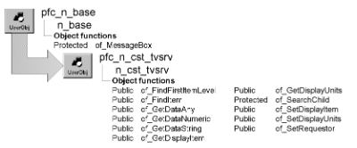

# n_cst_tvsrv

**Description**

TreeView base service.

**Ancestry**



**Library**

- PFCAPSRV.PBL
- PFEAPSRV.PBL

**Object relationships**

u_tvs

**Usage**

To use this service:

1. Enable the service by calling the u_tvs of_SetBase function:

   ```
   tv_1.of_SetBase(TRUE)
   ```

2. Call n_cst_tvsrv functions as needed.

**Descendants**

- [n_cst_tvsrv_levelsource](n_cst_tvsrv_levelsource.md)
- [n_cst_tvsrv_print](n_cst_tvsrv_print.md)

**See also**

n_cst_lvsrv

## Instance variables

N_cst_tvsrv includes instance variables:

| Instance variable | Description | Data type | Access | Usage |
| --- | --- | --- | --- | --- |
| il_queue[ ] |  | Long | Protected |  |
| is_delimiter |  | String | Protected |  |
| is_displayitem | Controls message text displayed for a single row | String | Protected | Call of_SetDisplayItem and of_GetDisplayItem to access |
| is_displayunits | Controls message text displayed for multiple rows | String | Protected | Call of_SetDisplayUnits and of_GetDisplayUnits to access |
| itv_requestor | TreeView control that owns the n_cst_tvsrv instance | u_tvs | Protected | Used to access and control the associated TreeView control |

## Functions

N_cst_tvsrv includes precoded functions:

- of_FindFirstItemLevel
- of_FindItem
- of_GetDataAny
- of_GetDataNumeric
- of_GetDataString
- of_GetDelimiter
- of_GetDisplayItem
- of_GetDisplayUnits
- of_SearchChild
- of_SetDelimiter
- of_SetDisplayItem
- of_SetDisplayUnits
- of_SetRequestor

### of_FindFirstItemLevel

**Description**

Retrieves the first item on a level.

**Access**

Public

**Syntax**

```
tvcontrol.instancename.of_FindFirstItemLevel ( level, handle )
```

| Argument | Description |
| --- | --- |
| *tvcontrol* | Instance name of the u_tvs-based TreeView control |
| *instancename* | Instance name of n_cst_tvsrv (the u_tvs default is inv_base) |
| *level* | Integer specifying the TreeView level for which the first item is returned |
| *handle* | Long containing the handle of the TreeView item at which to begin searching. Specify 0 to retrieve the first item in the next lower level |

**Return value**

Long. Returns the handle of the first item on the level if the function succeeds, 0 if the item is not found, and -1 if an error occurs.

**Examples**

This example calls the of_FindFirstItemLevel function:

```
...
// Retrieve level one on the treeview.
li_rc = tv_1.event pfc_populateitem(0)
// Populate the dual datasource for level one.
ll_itemhandle = &
   tv_1.inv_base.of_FindFirstItemLevel(1, 0)
// Populate level two of the treeview,
//  and start the window with the first
// item on level two selected.
tv_1.SelectItem(ll_itemhandle)
tv_1.ExpandItem(ll_itemhandle)
ll_leveltwoitemhandle = &
   tv_1.inv_base.of_FindFirstItemLevel(2, 0)
tv_1.SelectItem(ll_leveltwoitemhandle)
```

### of_FindItem

**Description**

Searches by label or data for a specified TreeView item.

**Access**

Public

**Syntax**

```
tvcontrol.instancename.of_FindItem ( attribute, target {, beginhandle {, level
{, respectcase {, fullcompare } } } } )
```

| Argument | Description |
| --- | --- |
| *tvcontrol* | Instance name of the u_tvs-based TreeView control |
| *instancename* | Instance name of n_cst_tvsrv (the u_tvs default is inv_base) |
| *attribute* | String specifying the TreeView attribute to search. Valid values are: |
|  | • Label |
|  | • Data |
| *target* | Any variable specifying the label or data that you are searching for |
| *beginhandle* (optional) | Long specifying the handle of the TreeView item from which to begin the search. The default is 0, which starts at the top of the TreeView hierarchy |
| *level* (optional) | Integer specifying the level to search. Specify 0 to search all levels |
| *respectcase* (optional) | Boolean indicating whether the search is case sensitive (TRUE) or not (FALSE). The default is FALSE |
| *fullcompare* (optional) | Boolean indicating whether the specified attribute must match *target* exactly (TRUE) or the attribute can contain *target*. This argument applies only when *target* is a string. The default is FALSE |

**Return value**

Long. Returns the handle of the matching item if the function succeeds, 0 if there are no matching items, and -1 if an error occurs.

**Usage**

This function calls the u_tvs pfc_SearchCompare event to search either the label or Data property. Override pfc_SearchCompare if you want to perform some other type of comparison.

**Levels must have been opened** This function does not find items in levels that have not been opened.

**Examples**

This example calls the of_FindItem function:

```
Long   ll_return

ll_return = tv_test.inv_base.of_FindItem("label", &
   sle_item.text, 0, 0, FALSE, FALSE)
IF ll_return = -1 THEN
   MessageBox("TreeView", "Find error")
ELSEIF ll_return = 0 THEN
   MessageBox("TreeView", "No matches found")
...
```

### of_GetDataAny

**Description**

Retrieves the specified item’s Data property cast to the Any data type.

**Access**

Public

**Syntax**

```
tvcontrol.instancename.of_GetDataAny ( handle )
```

| Argument | Description |
| --- | --- |
| *tvcontrol* | Instance name of the u_tvs-based TreeView control |
| *instancename* | Instance name of n_cst_tvsrv (the u_tvs default is inv_base) |
| *handle* | Long specifying the handle of the item for which the Data property is returned |

**Return value**

Any. Returns the Data property of the specified TreeView item if the function succeeds and -1 if an error occurs.

**Examples**

This example calls the of_GetDataAny function:

```
Long  ll_currenttvitem
Any  la_data

ll_currenttvitem = tv_1.FindItem(currenttreeitem!, 0)
la_data = tv_1.inv_levelsource.of_GetDataAny  &
  (ll_currenttvitem)
MessageBox("TV Data", String(la_data))
```

### of_GetDataNumeric

**Description**

Retrieves the specified item’s Data property cast to a number.

**Access**

Public

**Syntax**

```
tvcontrol.instancename.of_GetDataNumeric ( handle )
```

| Argument | Description |
| --- | --- |
| *tvcontrol* | Instance name of the u_tvs-based TreeView control |
| *instancename* | Instance name of n_cst_tvsrv (the u_tvs default is inv_base) |
| *handle* | Long specifying the handle of the item for which the Data property is returned |

**Return value**

Long. Returns the Data property of the specified TreeView item if the function succeeds and -1 if an error occurs.

**Usage**

Call this function when the Data property always contains a number.

**Examples**

This example calls the of_GetDataNumeric function:

```
Long  ll_currenttvitem
Long  ll_data

ll_currenttvitem = tv_1.FindItem(currenttreeitem!, 0)
ll_data = tv_1.inv_levelsource.of_GetDataNumeric  &
  (ll_currenttvitem)
MessageBox("TV Data", String(ll_data))
```

### of_GetDataString

**Description**

Retrieves the specified item’s Data property cast to a string

**Access**

Public

**Syntax**

```
tvcontrol.instancename.of_GetDataString ( handle )
```

| Argument | Description |
| --- | --- |
| *tvcontrol* | Instance name of the u_tvs-based TreeView control |
| *instancename* | Instance name of n_cst_tvsrv (the u_tvs default is inv_base) |
| *handle* | Long specifying the handle of the item for which the Data property is returned |

**Return value**

String. Returns the Data property of the specified TreeView item if the function succeeds and an empty string if an error occurs.

**Examples**

This example calls the of_GetDataString function:

```
Long  ll_currenttvitem
String  ls_data

ll_currenttvitem = tv_1.FindItem(currenttreeitem!, 0)
ls_data = tv_1.inv_levelsource.of_GetDataString  &
  (ll_currenttvitem)
MessageBox("TV Data", ls_data)
```

### of_GetDelimiter

**Description**

Gets the delimiter character used to separate items in the data attribute of the treeview item.

**Access**

Public

**Syntax**

```
instancename.of_GetDelimiter ( )
```

| Argument | Description |
| --- | --- |
| *instancename* | Instance name of n_cst_tvsrv |

**Return value**

String.

### of_GetDisplayItem

**Description**

Retrieves the display name for single items in the TreeView.

**Access**

Public

**Syntax**

```
tvcontrol.instancename.of_GetDisplayItem ( )
```

| Argument | Description |
| --- | --- |
| *tvcontrol* | Instance name of the u_tvs-based TreeView control |
| *instancename* | Instance name of n_cst_tvsrv (the u_tvs default is inv_base) |

**Return value**

String. Returns the display name for single items in the TreeView.

**Usage**

PFC uses this name in message text when confirming single-item deletion. For example, if this name is *this row*, PFC displays *Are you sure you want to delete*

```
this row?
```

**Examples**

This example calls the of_GetDisplayItem function:

```
String    ls_item

ls_item = tv_1.inv_base.of_GetDisplayItem( )
MessageBox("TreeView", "Item label is: " &
   + ls_item)
```

### of_GetDisplayUnits

**Description**

Retrieves the display name for multiple rows in the TreeView.

**Access**

Public

**Syntax**

```
tvcontrol.instancename.of_GetDisplayUnits ( )
```

| Argument | Description |
| --- | --- |
| *tvcontrol* | Instance name of the u_tvs-based TreeView control |
| *instancename* | Instance name of n_cst_tvsrv (the u_tvs default is inv_base) |

**Return value**

String. Returns the display name for multiple items in the TreeView.

**Usage**

PFC uses this name in message text when confirming multiple item deletion. For example, if this name is *rows*, PFC displays *Are you sure you want to delete*

```
these rows?
```

**Examples**

This example calls the of_GetDisplayUnits function:

```
String    ls_units

ls_units = tv_1.inv_base.of_GetDisplayUnits( )
MessageBox("TreeView", "Unit label is: " &
   + ls_units)
```

### of_SearchChild

**Description**

Searches for a string in either the label or data TreeView item attribute.

**Access**

Protected

**Syntax**

```
tvcontrol.instancename.of_SearchChild ( attribute, target, beginhandle, level
respectcase, fullcompare )
```

| Argument | Description |
| --- | --- |
| *tvcontrol* | Instance name of the u_tvs-based TreeView control |
| *instancename* | Instance name of n_cst_tvsrv (the u_tvs default is inv_base) |
| *attribute* | String specifying the TreeView attribute to search. Valid values are: |
|  | • Label |
|  | • Data |
| *target* | Any variable specifying the label or data to search for |
| *beginhandle* | Long specifying the handle of the TreeView item from which to begin the search |
| *level* | Integer specifying the level to search |
| *respectcase* | Boolean indicating whether the search is case sensitive (TRUE) or not (FALSE) |
| *fullcompare* | Boolean indicating whether the specified attribute must match *target* exactly (TRUE) or the attribute can contain *target* |

**Return value**

Long. Returns the handle of the matching item if the function succeeds, 0 if there are no matching items, and -1 if an error occurs.

**Usage**

Internal.

**Examples**

This example is from the of_FindItem function:

```
...
ll_Found = this.of_SearchChild(as_Attribute,  &
   aa_Target, al_Begin, ai_Level, &
      ab_RespectCase, ab_FullCompare)
...
```

### of_SetDelimiter

**Description**

Sets delimiter used to differentiate the keys placed in the data property of the treeview item.

**Access**

Public

**Syntax**

```
instancename.of_SetDelimiter ( as_delimiter )
```

| Argument | Description |
| --- | --- |
| *instancename* | Instance name of n_cst_tvsrv |
| *as_delimiter* | String. The delimiter used to differentiate the keys of the compound key. |

**Return value**

Integer. SUCCESS = 1 ERROR = -1.

### of_SetDisplayItem

**Description**

Specifies the display name for single items in the TreeView.

**Access**

Public

**Syntax**

```
tvcontrol.instancename.of_SetDisplayItem ( itemname )
```

| Argument | Description |
| --- | --- |
| *tvcontrol* | Instance name of the u_tvs-based TreeView control |
| *instancename* | Instance name of n_cst_tvsrv (the u_tvs default is inv_base) |
| *itemname* | String specifying the display name for single items in the TreeView |

**Return value**

Integer. Returns 1 if the function succeeds and -1 if an error occurs.

**Usage**

PFC uses this name in message text when confirming single-row deletion. For example, if you specify *this row*, PFC displays *Are you sure you want to delete*

```
this row?
```

**Examples**

This example calls the of_SetDisplayItem function:

```
...
tv_1.inv_base.of_SetDisplayItem("the selected row")
...
```

### of_SetDisplayUnits

**Description**

Specifies the display name for multiple items in the TreeView.

**Access**

Public

**Syntax**

```
tvcontrol.instancename.of_SetDisplayUnits ( units )
```

| Argument | Description |
| --- | --- |
| *tvcontrol* | Instance name of the u_tvs-based TreeView control |
| *instancename* | Instance name of n_cst_tvsrv (the u_tvs default is inv_base) |
| *units* | String specifying the display name for multiple rows of the TreeView |

**Return value**

Integer. Returns 1 if the function succeeds and -1 if an error occurs.

**Usage**

PFC uses this name in message text when confirming multiple item deletion. For example, if this name is *rows*, PFC displays *Are you sure you want to delete*

```
these rows?
```

**Examples**

This example calls the of_SetDisplayUnits function:

```
...
tv_1.inv_base.of_SetDisplayUnits("selected rows")
...
```

### of_SetRequestor

**Description**

Associates the requesting object with this instance of n_cst_tvsrv.

**Access**

Public

**Syntax**

```
tvcontrol.instancename.of_SetRequestor ( requestor )
```

| Argument | Description |
| --- | --- |
| *tvcontrol* | Instance name of the u_tvs-based TreeView control |
| *instancename* | Instance name of n_cst_tvsrv (the u_tvs default is inv_base) |
| *requestor* | U_tvs-based TreeView control to be associated with the service |

**Return value**

Integer. Returns 1 if the function succeeds and -1 if an error occurs.

**Examples**

This example is from the u_tvs_of_SetBase function:

```
...
if ab_Switch then
  if IsNull(inv_base) Or not IsValid (inv_base) then
    inv_base = create n_cst_tvsrv
    inv_base.of_SetRequestor(this)
    li_rc = 1
  end if
else
...
```
