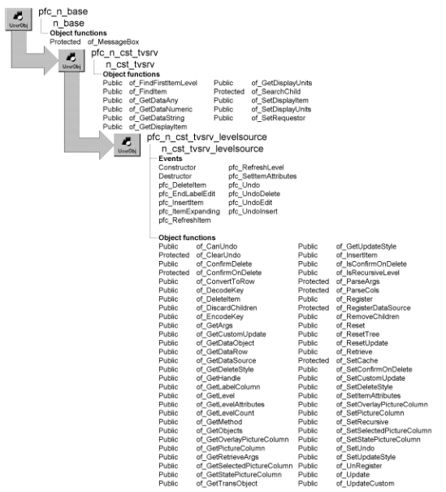

# n_cst_tvsrv_levelsource

**Description**

TreeView data access object. Use this object to display data in a u_tvs control and perform actions on that data. This data can come from a:

SQL statement DataWindow object DataStore DataWindow control PowerObject

**Ancestry**



**Library**

- PFCAPSRV.PBL
- PFEAPSRV.PBL

**Object relationships**

- [n_cst_dwcache](n_cst_dwcache.md)
- [n_cst_tvsrvattrib](../05-global-structures-and-structure-objects/n_cst_tvsrvattrib.md)
- [n_ds](../08-standard-class-user-objects/n_ds.md)
- [n_tr](../08-standard-class-user-objects/n_tr.md)

**Usage**

To use this object:

1. Enable the service using the u_tvs of_SetLevelSource function:

   ```
   this.of_SetLevelSource(TRUE)
   ```

2. Define a data source for each TreeView level by calling the of_Register function, once for each level:

   ```
   this.inv_levelsource.of_Register(1,  &
      "dept_name", "", "d_deptlist", SQLCA, "")
   this.inv_levelsource.of_Register(2, "emp_lname",  &
     ":parent.1.dept_id", "d_empbydept", SQLCA, "")
   ```

3. Call additional functions as needed to control TreeView behavior:

   ```
   this.inv_levelsource.of_SetPictureColumn(1, "1")
   this.inv_levelsource.of_SetSelectedPictureColumn  &
      (1, "2")
   this.inv_levelsource.of_SetPictureColumn(2, "4")
   this.inv_levelsource.of_SetSelectedPictureColumn  &
      (2, "5")
   ```

4. Extend the pfc_Retrieve function, adding logic that handles retrieval arguments and calls the u_tvs of_Retrieve function:

   ```
   Any la_args[20]
   Integer li_level
   TreeViewItem  ltvi_item

   IF IsValid(this.inv_levelsource) THEN
      li_level = of_GetNextLevel(al_parent)
      this.inv_levelsource.of_GetArgs(al_parent,  &
         li_level, la_args)
   END IF
   Return this.of_Retrieve  &
      (al_parent, la_args, ads_data)
   ```

5. Populate the TreeView by calling the u_tvs pfc_Populate event:

   ```
   this.event pfc_Populate(0)
   ```

**See also**

- [n_cst_lvsrv_datasource](n_cst_lvsrv_datasource.md)
- [n_cst_tvsrv](n_cst_tvsrv.md)
- [n_cst_tvsrv_print](n_cst_tvsrv_print.md)
- [u_tvs](../06-standard-visual-user-objects/u_tvs.md)

## Instance variables

N_cst_tvsrv_levelsource includes instance variables:

| Instance variable | Description | Data type | Access | Usage |
| --- | --- | --- | --- | --- |
| BOTTOMUP | Constant set to 2 | Integer | Public | Use with of_SetUpdateStyle |
| BOTTOMUP_TOPDOWN | Constant set to 4 | Integer | Public | Use with of_SetUpdateStyle |
| CACHE_ID | Constant set to "level" | String | Public | Internal |
| CUSTOM | Constant set to 101 | Integer | Public | Use with of_SetUpdateStyle |
| DELETE_ROWS | Constant set to 0 | Integer | Public | Use with of_SetDeleteStyle |
| DISCARD_ROWS | Constant set to 1 | Integer | Public | Use with of_SetDeleteStyle |
| ib_confirmondelete | Indicates whether confirm on delete is enabled | Boolean | Protected | Set with of_SetConfirmOnDelete (default is FALSE) |
| ib_isrefreshing | Indicates whether a refresh is occurring | Boolean | Protected | Internal |
| ib_isundoing | Indicates whether an undo is occurring | Boolean | Protected | Internal |
| ib_undo | Indicates whether undo is enabled | Boolean | Protected | Set with of_SetUndo |
| ii_customupdate | Custom update indicator | Integer | Protected | Set with of_SetCustom Update |
| ii_updatestyle | Indicates how PFC performs updates | Integer | Protected | Set with of_SetUpdateStyle |
| il_undodeletehandle | Deleted item | Long | Protected | Internal |
| il_undodeleteparenthandle | Parent of deleted item | Long | Protected | Internal |
| il_undoedithandle | Modified items | Long | Protected | Internal |
| il_undoinserthandle | Last inserted item | Long | Protected | Internal |
| inv_attrib[ ] | Data source information | n_cst_tvsrvattrib | Protected | Set with of_Register |
| inv_cache | Cached data | n_cst_dwcache | Protected | Internal |
| is_pfckey | Key value for cache | String | Protected | Internal |
| is_undoeditlabeltext | Modified label text | String | Protected | Internal |
| is_undotype | Undo type | String | Protected | Internal |
| itvi_undodeleteitem | Deleted item | TreeViewItem | Protected | Internal |
| TOPDOWN | Constant set to 1 | Integer | Public |  |
| TOPDOWN_BOTTOMUP | Constant set to 3 | Integer | Public |  |
| UNDO_DELETE | Constant set to "Delete" | String | Public | Internal |
| UNDO_EDIT | Constant set to "Edit" | String | Public | Internal |
| UNDO_INSERT | Constant set to "Insert" | String | Public | Internal |

## Events

N_cst_tvsrv_levelsource includes precoded events:

- Constructor
- Destructor
- pfc_DeleteItem
- pfc_EndLabelEdit
- pfc_InsertItem
- pfc_ItemExpanding
- pfc_RefreshItem
- pfc_RefreshLevel
- pfc_SetItemAttributes
- pfc_Undo
- pfc_UndoDelete
- pfc_UndoEdit
- pfc_UndoInsert

### Constructor

**Description**

Enables the caching service.

**Usage**

This event executes when the object is created.

### Destructor

**Description**

Destroys the caching service.

**Usage**

This event executes when the object is destroyed.

### pfc_DeleteItem

**Description**

Deletes the item from the TreeView and the row from the DataStore.

**Syntax**

```
tvcontrol.instancename.EVENT pfc_DeleteItem ( handle )
```

| Argument | Description |
| --- | --- |
| *tvcontrol* | Instance name of the u_tvs-based TreeView control |
| *instancename* | Instance name of n_cst_tvsrv_levelsource (the u_tvs default for this value is inv_levelsource) |
| *handle* | Long specifying the handle of the TreeView item being deleted |

**Return value**

Integer. Returns 1 if the event succeeds and 0 if no action is taken.

**Usage**

This event does not perform processing if refreshing, resetting, or undoing an insert.

**Examples**

This example is from the u_tvs pfc_DeleteItem event:

```
...
If isvalid(inv_levelsource) then
   Return inv_levelsource.event pfc_DeleteItem  &
      (ll_currentitem)
else
   Return this.deleteitem(ll_currentitem)
end if
...
```

### pfc_EndLabelEdit

**Description**

Changes the label column in the associated data source.

**Syntax**

```
tvcontrol.instancename.EVENT pfc_EndLabelEdit ( handle, newlabel )
```

| Argument | Description |
| --- | --- |
| *tvcontrol* | Instance name of the u_tvs-based TreeView control |
| *instancename* | Instance name of n_cst_tvsrv_levelsource (the u_tvs default for this value is inv_levelsource) |
| *handle* | Long specifying the handled of the modified TreeView item |
| *newlabel* | String specifying the udpated label |

**Return value**

Integer. Returns 0 if the label update is allowed and 1 if PowerBuilder should prevent the label update.

**Usage**

PFC allows label update only when the associated label column is updatable. If the label column is a computed column, you must override this event to update the computed column and return a 1.

This event does not update the database.

**Examples**

This example is from the u_tvs EndLabelEdit event:

```
...
if isvalid(inv_levelsource) then
   li_rc = inv_levelsource.event pfc_EndLabelEdit  &
      (handle, newtext)
   // prevent new text from becoming the label
   If li_rc < 1 then Return 1
end if
...
```

### pfc_InsertItem

**Description**

Inserts a new item into the TreeView.

**Syntax**

```
tvcontrol.instancename.EVENT pfc_InsertItem ( parent, datastore, row,
item, position, handle )
```

| Argument | Description |
| --- | --- |
| *tvcontrol* | Instance name of the u_tvs-based TreeView control |
| *instancename* | Instance name of n_cst_tvsrv_levelsource (the u_tvs default for this value is inv_levelsource) |
| *parent* | Long specifying the handle of the TreeView item under which the new item is added. This argument is accessed through the *al_parent* argument |
| *datastore* | N_ds containing the data for the new item. This can be either the DataStore maintained by n_cst_tvsrv_levelsource or another DataStore. If this is another DataStore, the associated DataWindow objects must be the same and the function also adds the row to the DataStore maintained by n_cst_tvsrv_levelsource. This argument is accessed through the *ads_source* argument |
| *row* | Long specifying the row containing the item to be inserted. This argument is accessed through the *al_row* argument |
| *item* | TreeViewItem containing the item to be inserted. This argument is accessed through the *atvi_item* argument |
| *position* | String specifying the position under the current parent in which to insert the new item. Values are: |
|  | • First |
|  | • Last |
|  | • Sort |
|  | • After |
|  | This argument is accessed through the *as_position* argument |
| *handle* | Long containing the handle to the item before the item to be inserted. The function uses this argument if you specify After for *position*. This argument is accessed through the *al_handle* argument |

**Return value**

Integer. Returns the handle of the new item if the function succeeds and -1 if an error occurs.

**Usage**

The u_tvs pfc_InsertItem event calls this event.

**Examples**

This example is from the u_tvs pfc_InsertItem event:

```
...
If isvalid(inv_levelsource) then
   Return inv_levelsource.event &
      pfc_InsertItem(al_parent, ads_source, al_row,  &
        ltvi_new, as_position, al_handle)
else
   Choose Case Lower(as_Position)
   Case INSERT_LAST
       Return this.InsertItemLast(al_Parent,  &
            ltvi_new)
...
```

### pfc_ItemExpanding

**Description**

Populates an item with its children.

**Syntax**

```
tvcontrol.instancename.EVENT pfc_ItemExpanding ( handle )
```

| Argument | Description |
| --- | --- |
| *tvcontrol* | Instance name of the u_tvs-based TreeView control |
| *instancename* | Instance name of n_cst_tvsrv_levelsource (the u_tvs default for this value is inv_levelsource) |
| *handle* | Long specifying the handle of the TreeView item being expanded. This argument is accessed through the *al_handle* argument |

**Usage**

The u_tvs ItemExpanding event calls this event.

**Examples**

This example is from the u_tvs ItemExpanding event:

```
If IsValid(inv_levelsource) Then
   inv_levelsource.event pfc_ItemExpanding(handle)
end if
```

### pfc_RefreshItem

**Description**

Refreshes the specified TreeView item, resetting all properties to the defaults specified in the data source.

**Syntax**

```
tvcontrol.instancename.EVENT pfc_RefreshItem ( handle )
```

| Argument | Description |
| --- | --- |
| *tvcontrol* | Instance name of the u_tvs-based TreeView control |
| *instancename* | Instance name of n_cst_tvsrv_levelsource (the u_tvs default for this value is inv_levelsource) |
| *handle* | Long specifying the handle of the TreeView item to refresh. This argument is accessed through the *al_handle* argument |

**Return value**

Integer. Returns 1 if the event succeeds and -1 if an error occurs.

**Usage**

The u_tvs pfc_RefreshItem event calls this event.

**Examples**

This example is from the u_tvs pfc_RefreshItem event:

```
If isvalid(inv_levelsource) then
   Return inv_levelsource.event  &
      pfc_RefreshItem(al_handle)
End If
```

### pfc_RefreshLevel

**Description**

Refreshes the specified TreeView level, resetting all properties to the defaults specified in the data source.

**Syntax**

```
tvcontrol.instancename.EVENT pfc_RefreshLevel ( level )
```

| Argument | Description |
| --- | --- |
| *tvcontrol* | Instance name of the u_tvs-based TreeView control |
| *instancename* | Instance name of n_cst_tvsrv_levelsource (the u_tvs default for this value is inv_levelsource) |
| *level* | Integer specifying the TreeView level to refresh |

**Return value**

Integer. Returns 1 if the event succeeds and -1 if an error occurs.

**Usage**

The u_tvs pfc_RefreshLevel event calls this event.

**Examples**

This example is from the u_tvs pfc_RefreshLevel event:

```
If isvalid(inv_levelsource) then
   Return inv_levelsource.event pfc_RefreshLevel  &
      (ai_level)
End IF
...
```

### pfc_SetItemAttributes

**Description**

Sets default properties for the TreeView item before insertion.

**Syntax**

```
tvcontrol.instancename.EVENT pfc_SetItemAttributes ( data, row, tvitem )
```

| Argument | Description |
| --- | --- |
| *tvcontrol* | Instance name of the u_tvs-based TreeView control |
| *instancename* | Instance name of n_cst_tvsrv_levelsource (the u_tvs default for this value is inv_levelsource) |
| *data* | N_ds containing the data for the item. This argument is accessed through the *ads_obj* argument |
| *row* | Long specifying the row from which to populate the item. This argument is accessed through the *al_row* argument |
| *tvitem* | TreeViewItem to be inserted. This argument is accessed through the *atvi_item* argument (passed by reference) |

**Usage**

Optionally extend this event to change TreeView item properties before insertion.

### pfc_Undo

**Description**

Restores the last TreeView change.

**Syntax**

```
tvcontrol.instancename.EVENT pfc_Undo ( )
```

| Argument | Description |
| --- | --- |
| *tvcontrol* | Instance name of the u_tvs-based TreeView control |
| *instancename* | Instance name of n_cst_tvsrv_levelsource (the u_tvs default for this value is inv_levelsource) |

**Return value**

Integer. Returns 1 if the event succeeds, 0 if there is nothing to undo, and -1 if an error occurs.

**Examples**

This example is from the u_tvs pfc_Undo event:

```
...
if isvalid(inv_levelsource) then
   li_rc = inv_levelsource.event pfc_Undo()
end if
...
```

### pfc_UndoDelete

**Description**

Restores the last deleted item. This event does not restore children of the last deleted item.

**Syntax**

```
tvcontrol.instancename.EVENT pfc_UndoDelete ( )
```

| Argument | Description |
| --- | --- |
| *tvcontrol* | Instance name of the u_tvs-based TreeView control |
| *instancename* | Instance name of n_cst_tvsrv_levelsource (the u_tvs default for this value is inv_levelsource) |

**Return value**

Integer. Returns 1 if the event succeeds, 0 if there is nothing to undo, and -1 if an error occurs.

**Examples**

This example is from the pfc_Undo event:

```
...
If of_CanUndo(ls_undotype) then
   Choose Case ls_UndoType
   Case UNDO_DELETE
      return this.event pfc_UndoDelete()
...
```

### pfc_UndoEdit

**Description**

Restores a label’s previous value in the associated DataStore.

**Syntax**

```
tvcontrol.instancename.EVENT pfc_UndoEdit ( )
```

| Argument | Description |
| --- | --- |
| *tvcontrol* | Instance name of the u_tvs-based TreeView control |
| *instancename* | Instance name of n_cst_tvsrv_levelsource (the u_tvs default for this value is inv_levelsource) |

**Return value**

Integer. Returns 1 if the event succeeds, 0 if there is nothing to undo, and -1 if an error occurs.

**Usage**

PFC allows label update only when the associated label column is updatable. If the label column is a computed column, you must override this event to update the computed column and return a 1.

**Examples**

This example is from the pfc_Undo event:

```
...
If of_CanUndo(ls_undotype) then
   Choose Case ls_UndoType
   Case UNDO_DELETE
      return this.event pfc_undodelete()
   Case UNDO_INSERT
      return this.event pfc_undoinsert()
   Case UNDO_EDIT
      return this.event pfc_UndoEdit()
...
```

### pfc_UndoInsert

**Description**

Removes the last inserted item.

**Syntax**

```
tvcontrol.instancename.EVENT pfc_UndoInsert ( )
```

| Argument | Description |
| --- | --- |
| *tvcontrol* | Instance name of the u_tvs-based TreeView control |
| *instancename* | Instance name of n_cst_tvsrv_levelsource (the u_tvs default for this value is inv_levelsource) |

**Return value**

Integer. Returns 1 if the event succeeds and -1 if an error occurs.

**Examples**

This example is from the pfc_Undo event:

```
...
Choose Case ls_UndoType
   Case UNDO_DELETE
   return this.event pfc_undodelete()
   Case UNDO_INSERT
   return this.event pfc_UndoInsert()
...
```

## Functions

N_cst_tvsrv_levelsource includes precoded functions:

- of_CanUndo
- of_ClearUndo
- of_ConfirmDelete
- of_ConfirmOnDelete
- of_ConvertToRow
- of_DecodeKey
- of_DeleteItem
- of_DiscardChildren
- of_EncodeKey
- of_GetArgs
- of_GetCustomUpdate
- of_GetDataObject
- of_GetDataRow
- of_GetDataSource
- of_GetDeleteStyle
- of_GetHandle
- of_GetLabelColumn
- of_GetLevel
- of_GetLevelAttributes
- of_GetLevelCount
- of_GetMethod
- of_GetObjects
- of_GetOverlayPictureColumn
- of_GetPictureColumn
- of_GetRetrieveArgs
- of_GetSelectedPictureColumn
- of_GetStatePictureColumn
- of_GetTransObject
- of_GetUpdateStyle
- of_InsertItem
- of_IsConfirmOnDelete
- of_IsRecursiveLevel
- of_ParseArgs
- of_ParseCols
- of_Register
- of_RegisterDataSource
- of_RemoveChildren
- of_Reset
- of_ResetTree
- of_ResetUpdate
- of_Retrieve
- of_SetCache
- of_SetConfirmOnDelete
- of_SetCustomUpdate
- of_SetDeleteStyle
- of_SetItemAttributes
- of_SetOverlayPictureColumn
- of_SetPictureColumn
- of_SetRecursive
- of_SetSelectedPictureColumn
- of_SetStatePictureColumn
- of_SetUndo
- of_SetUpdateStyle
- of_UnRegister
- of_Update
- of_UpdateCustom

### of_CanUndo

**Description**

Reports whether the TreeView can undo the last edit, insertion, or deletion, optionally returning the operation type.

**Access**

Public

**Syntax**

```
tvcontrol.instancename.of_CanUndo ( { undotype } )
```

| Argument | Description |
| --- | --- |
| *tvcontrol* | Instance name of the u_tvs-based TreeView control |
| *instancename* | Instance name of n_cst_tvsrv_levelsource (the u_tvs default is inv_levelsource) |
| *undotype* (optional) | String into which the function places the type of the last operation (passed by reference): |
|  | **• UNDO_EDIT or "Edit"** Edit |
|  | **• UNDO_INSERT or "Insert"** Insertion |
|  | **• UNDO_DELETE or "Delete"** Deletion |

**Return value**

Boolean. Returns TRUE if the last operation can be undone and FALSE if it cannot.

**Examples**

This example calls the of_CanUndo function:

```
IF tv_1.inv_levelsource.of_CanUndo() THEN
   MessageBox("TreeView", "Can undo")
ELSE
   MessageBox("TreeView", "Cannot undo")
END IF
```

### of_ClearUndo

**Description**

Clears the TreeView’s undo properties.

**Access**

Protected

**Syntax**

```
tvcontrol.instancename.of_ClearUndo ( )
```

| Argument | Description |
| --- | --- |
| *tvcontrol* | Instance name of the u_tvs-based TreeView control |
| *instancename* | Instance name of n_cst_tvsrv_levelsource (the u_tvs default is inv_levelsource) |

**Return value**

Integer. Returns 1 if the function succeeds and -1 if an error occurs.

**Usage**

Internal.

**Examples**

This example is from the of_ResetTree function:

```
...
this.of_ClearUndo()
...
```

### of_ConfirmDelete

**Description**

Displays a message box allowing the user to confirm a deletion.

**Access**

Public

**Syntax**

```
tvcontrol.instancename.of_ConfirmDelete ( amount )
```

| Argument | Description |
| --- | --- |
| *tvcontrol* | Instance name of the u_tvs-based TreeView control |
| *instancename* | Instance name of n_cst_tvsrv_levelsource (the u_tvs default is inv_levelsource) |
| *amount* | Long specifying the number of rows to be deleted |

**Return value**

Integer. Returns 1 if deletion should proceed, 2 if deletions should not proceed, and -1 if an error occurs.

**Usage**

Internal.

**Examples**

This example is from the u_tvs of_DeleteItem event:

```
...
if inv_levelsource.of_IsConfirmOnDelete() then
   li_confirm = inv_levelsource.of_ConfirmDelete(1)
      if li_confirm <> CONTINUE_ACTION then
         return PREVENT_ACTION
...
```

### of_ConfirmOnDelete

**Description**

Reports whether a confirmation dialog box displays when the user deletes a row.

**Access**

Protected

**Syntax**

```
tvcontrol.instancename.of_ConfirmOnDelete ( )
```

| Argument | Description |
| --- | --- |
| *tvcontrol* | Instance name of the u_tvs-based TreeView control |
| *instancename* | Instance name of n_cst_tvsrv_levelsource (the u_tvs default is inv_levelsource) |

**Return value**

Boolean. Returns TRUE if confirm on delete is enabled and FALSE if it is disabled.

**Usage**

Internal.

**Examples**

This example is from the n_cst_tvsrv_levelsource of_DeleteItem function:

```
...
if of_ConfirmOnDelete() then
   li_confirm = of_ConfirmDelete(1)
...
```

### of_ConvertToRow

**Description**

Converts an array of data into a row in the DataStore.

**Access**

Public

**Syntax**

```
tvcontrol.instancename.of_ConvertToRow ( parent, colvalues, datastore,
row )
```

| Argument | Description |
| --- | --- |
| *tvcontrol* | Instance name of the u_tvs-based TreeView control |
| *instancename* | Instance name of n_cst_tvsrv_levelsource (the u_tvs default is inv_levelsource) |
| *parent* | Long specifying the handle of the TreeView parent to which the row is added |
| *colvalues* | Any array containing the data to be used for the new row |
| *datastore* | N_ds instance into which the function places the new row (passed by reference) |
| *row* | Long into which the function places the new row number (passed by reference) |

**Return value**

Integer. Returns 1 if the function succeeds and -1 if an error occurs.

**Usage**

You do not need to add a row to the associated DataStore before calling this function.

**Examples**

This example is from the u_tvs of_AddItem function:

```
...
If inv_levelsource.of_ConvertToRow(al_parent,  &
  aa_columnvalues, lds_datastore, ll_row) <> 1 Then
    Destroy lds_datastore
    Return -1
End If
...
```

### of_DecodeKey

**Description**

Retrieves the decoded key from the TreeView item’s data attribute.

**Access**

Public

**Syntax**

```
tvcontrol.instancename.of_DecodeKey ( data )
```

| Argument | Description |
| --- | --- |
| *tvcontrol* | Instance name of the u_tvs-based TreeView control |
| *instancename* | Instance name of n_cst_tvsrv_levelsource (the u_tvs default is inv_levelsource) |
| *data* | String containing the ListView item’s data attribute |

**Return value**

String. Returns the unique key if the function succeeds and ! if an error occurs.

**Usage**

Internal.

**Examples**

This example is from the pfc_UndoDelete event:

```
...
ls_undokey = of_DecodeKey(string(ltvi_undo.data))
...
```

### of_DeleteItem

**Description**

Removes either the specified item or all selected items from a TreeView level and the associated DataStore.

**Access**

Public

**Syntax**

```
tvcontrol.instancename.of_DeleteItem ( handle )
```

| Argument | Description |
| --- | --- |
| *tvcontrol* | Instance name of the u_tvs-based TreeView control |
| *instancename* | Instance name of n_cst_tvsrv_levelsource (the u_tvs default is inv_levelsource) |
| *handle* | Long specifying the handle of the item to be deleted |

**Return value**

Integer. Returns 1 if the function succeeds, 0 if nothing was deleted, and -1 if an error occurs.

**Usage**

The pfc_DeleteItem and pfc_UndoInsert events call this function.

**Examples**

This example is from the pfc_DeleteItem event:

```
...
Return this.of_DeleteItem(al_handle)
...
```

### of_DiscardChildren

**Description**

Removes from the TreeView all items below a specified item, discarding the rows from the associated DataStores.

**Access**

Public

**Syntax**

```
tvcontrol.instancename.of_DiscardChildren ( handle )
```

| Argument | Description |
| --- | --- |
| *tvcontrol* | Instance name of the u_tvs-based TreeView control |
| *instancename* | Instance name of n_cst_tvsrv_levelsource (the u_tvs default is inv_levelsource) |
| *handle* | Long specifying the handle of the item whose children are to be deleted |

**Return value**

Integer. Returns 1 if the function succeeds and -1 if an error occurs.

**Usage**

The pfc_RefreshItem event calls this function.

**Examples**

This example is from the pfc_RefreshItem event:

```
...
IF this.of_DiscardChildren(al_Handle) = -1 THEN
   Return -1
END IF
...
```

### of_EncodeKey

**Description**

Creates an encoded key from the TreeView item’s data attribute. The service uses this key to access rows in the associated DataStore.

**Access**

Public

**Syntax**

```
tvcontrol.instancename.of_EncodeKey ( source, row )
```

| Argument | Description |
| --- | --- |
| *tvcontrol* | Instance name of the u_tvs-based TreeView control |
| *instancename* | Instance name of n_cst_tvsrv_levelsource (the u_tvs default is inv_levelsource) |
| *source* | N_ds containing the DataStore to populate the item |
| *row* | Long specifying the row containing the item |

**Return value**

String. Returns the unique key if the function succeeds and ! if an error occurs.

**Usage**

Internal.

**Examples**

This example is from the of_InsertItem function:

```
...
ls_key = this.of_EncodeKey  &
   (inv_attrib[li_Index].ids_obj, al_row)
...
```

### of_GetArgs

**Description**

Retrieves the retrieval arguments for a specified TreeView level.

**Access**

Public

**Syntax**

```
tvcontrol.instancename.of_GetArgs ( parent, level, arguments )
```

| Argument | Description |
| --- | --- |
| *tvcontrol* | Instance name of the u_tvs-based TreeView control |
| *instancename* | Instance name of n_cst_tvsrv_levelsource (the u_tvs default is inv_levelsource) |
| *parent* | Long containing the handle of the parent of the current TreeView item |
| *level* | Integer specifying the current TreeView level |
| *arguments* | Twenty-element array of the Any data type into which the function places the retrieval arguments |

**Return value**

Integer. Returns 1 if the function succeeds and -1 if an error occurs.

**Examples**

This example is from the u_tvs pfc_Retrieve event:

```
...
If isvalid(inv_levelsource) then
   li_level = of_GetNextLevel(al_parent)
   inv_levelsource.of_GetArgs(al_Parent,  &
      li_Level, aa_Arg)
End If
...
```

### of_GetCustomUpdate

**Description**

Retrieves the current custom update attribute.

**Access**

Public

**Syntax**

```
tvcontrol.instancename.of_GetCustomUpdate ( )
```

| Argument | Description |
| --- | --- |
| *tvcontrol* | Instance name of the u_tvs-based TreeView control |
| *instancename* | Instance name of n_cst_tvsrv_levelsource (the u_tvs default is inv_levelsource) |

**Return value**

Integer. Returns the current custom update attribute.

**Usage**

The level source service architecture allows for multiple custom updates. Define an of_UpdateCustom function in the n_cst_tvsrv_levelsource extension level object and call this function to determine the current custom update style.

**Examples**

This example calls the of_GetCustomUpdate function:

```
IF this.of_GetCustomUpdate() = 1 THEN
   Return this.of_UpdateBottomUp()
ELSE
   Return this.of_UpdateTopDown()
END IF
```

### of_GetDataObject

**Description**

Retrieves the DataWindow object used as the level’s data source.

**Access**

Public

**Syntax**

```
tvcontrol.instancename.of_GetDataObject ( level )
```

| Argument | Description |
| --- | --- |
| *tvcontrol* | Instance name of the u_tvs-based TreeView control |
| *instancename* | Instance name of n_cst_tvsrv_levelsource (the u_tvs default is inv_levelsource) |
| *level* | Integer specifying the level for which the function returns the DataWindow object |

**Return value**

String. Returns the name of the DataWindow object used to store data for display in the TreeView.

**Examples**

This example calls the of_GetDataObject function:

```
String   ls_dataobject

ls_dataobject =  &
   tv_1.inv_levelsource.of_GetDataObject(1)
MessageBox("TreeView", "DataWindow object is: "  &
   + ls_dataobject)
```

### of_GetDataRow

**Description**

Retrieves from the DataStore the row that corresponds to the specified TreeView item.

**Access**

Public

**Syntax**

```
tvcontrol.instancename.of_GetDataRow ( handle, datasource, row )
```

| Argument | Description |
| --- | --- |
| *tvcontrol* | Instance name of the u_tvs-based TreeView control |
| *instancename* | Instance name of n_cst_tvsrv_levelsource (the u_tvs default is inv_levelsource) |
| *handle* | Long specifying the handle for the TreeView item |
| *datasource* | N_ds specifying the DataStore that contains the row (passed by reference) |
| *row* | Long specifying the row in *datasource* that corresponds to *handle* (passed by reference) |

**Return value**

Integer. Returns 1 if the function succeeds and -1 if an error occurs.

**Usage**

By using this function, you can update rows in the DataSource.

**Examples**

This example is from the pfc_EndLabelEdit event:

```
...
If of_GetDataRow(al_handle, lds_obj, ll_Row) = -1 Then
   Return -1
End If
...
```

### of_GetDataSource

**Description**

Retrieves a reference to the DataStore associated with a specified TreeView level.

**Access**

Public

**Syntax**

```
tvcontrol.instancename.of_GetDataSource ( level, datastore )
```

| Argument | Description |
| --- | --- |
| *tvcontrol* | Instance name of the u_tvs-based TreeView control |
| *instancename* | Instance name of n_cst_tvsrv_levelsource (the u_tvs default is inv_levelsource) |
| *level* | Integer specifying the level for which a DataStore reference is returned |
| *datastore* | N_ds variable into which the function places a reference to the DataStore associated with *level* (passed by reference) |

**Return value**

Integer. Returns 1 if the function succeeds and -1 if the DataStore is not found.

**Examples**

This example calls the of_GetDataSource function:

```
Long  ll_current, ll_return
TreeViewItem   ltvi_item
n_ds  lds_datastore

ll_current = tv_test.FindItem (CurrentTreeItem!, 0)
ll_return = tv_test.GetItem(ll_current, ltvi_item)

ll_return = tv_test.inv_levelsource.of_GetDataSource &
   (ltvi_item.level, lds_datastore)
IF ll_return = -1 THEN
   MessageBox("TreeView", "DataStore not found")
ELSE
   MessageBox("TreeView", &
   "Current level is: " &
   + String(ltvi_item.level) &
   + "~r~nDataWindow object is: " &
   + lds_datastore.DataObject)
END IF
```

### of_GetDeleteStyle

**Description**

Retrieves the current delete style.

**Access**

Public

**Syntax**

```
tvcontrol.instancename.of_GetDeleteStyle ( level )
```

| Argument | Description |
| --- | --- |
| *tvcontrol* | Instance name of the u_tvs-based TreeView control |
| *instancename* | Instance name of n_cst_tvsrv_levelsource (the u_tvs default is inv_levelsource) |
| *level* | Integer specifying the TreeView level whose delete style you want |

**Return value**

Integer. Returns the delete style for the level:

- **0 or DELETE_ROWS** Delete rows from the database (default)
- **1 or DISCARD_ROWS** Discard rows from the DataStore buffer

Returns -1 if *level* is not valid.

**Examples**

This example calls the of_GetDeleteStyle function for level 1:

```
Integer  li_style

li_style =  &
   tv_1.inv_levelsource.of_GetDeleteStyle(1)
MessageBox("Delete Style", "Delete style is "  &
   + String(li_style))
```

### of_GetHandle

**Description**

Retrieves the TreeView handle for a specified row in the DataStore.

**Access**

Public

**Syntax**

```
tvcontrol.instancename.of_GetHandle ( datasource, row { , level } )
```

| Argument | Description |
| --- | --- |
| *tvcontrol* | Instance name of the u_tvs-based TreeView control |
| *instancename* | Instance name of n_cst_tvsrv_levelsource (the u_tvs default is inv_levelsource) |
| *datasource* | N_ds specifying the DataStore that contains the row (passed by reference) |
| *row* | Long specifying the row in *datasource* for which the handle is returned |
| *level* (optional) | Integer specifying the level for which a DataStore reference is returned. Specify 0 to search the entire tree. If you don’t specify this argument, the function uses the level for which *datasource* is registered |

**Return value**

Long. Returns the handle associated with *row* if the function succeeds, 0 if *row* is not found, and -1 if an error occurs.

**Examples**

This example is from the pfc_RefreshLevel event:

```
...
For ll_row = 1 to ll_rowcount
   ll_handle = this.of_GetHandle(lds_source,  &
      ll_row, ai_level)
   If ll_handle < 1 Then Continue
...
```

### of_GetLabelColumn

**Description**

Retrieves the name of the column used as the TreeView item label.

**Access**

Public

**Syntax**

```
tvcontrol.instancename.of_GetLabelColumn ( level )
```

| Argument | Description |
| --- | --- |
| *tvcontrol* | Instance name of the u_tvs-based TreeView control |
| *instancename* | Instance name of n_cst_tvsrv_levelsource (the u_tvs default is inv_levelsource) |
| *level* | Integer specifying the level for which the function returns the column used as the item label |

**Return value**

String. Returns the data source column name if the function succeeds and ! if an error occurs.

**Examples**

This example calls the of_GetLabelColumn function:

```
String  ls_col

ls_col = tv_1.inv_levelsource.of_GetLabelColumn()
MessageBox("TreeView", "Label column is: "  &
   + ls_col)
```

### of_GetLevel

**Description**

Retrieves the level for a specified TreeView item.

**Access**

Public

**Syntax**

```
tvcontrol.instancename.of_GetLevel (handle )
```

| Argument | Description |
| --- | --- |
| *tvcontrol* | Instance name of the u_tvs-based TreeView control |
| *instancename* | Instance name of n_cst_tvsrv_levelsource (the u_tvs default is inv_levelsource) |
| *handle* | Either of the following: |
|  | • A long specifying the TreeView item handle for which the function returns the level |
|  | • An n_ds instance containing the DataStore for which the function returns the associated level |

**Return value**

Integer. Returns the level for *handle* if the function succeeds and -1 if an error occurs.

**Examples**

This example calls the of_GetLevel function:

```
Long  ll_currenttvitem
Integer  li_level

ll_currenttvitem = tv_1.FindItem(currenttreeitem!, 0)
li_level = tv_1.inv_levelsource.of_GetLevel  &
  (ll_currenttvitem)
MessageBox("TreeView level", "Level is: "  &
  + String(li_level))
```

### of_GetLevelAttributes

**Description**

Retrieves the attributes used to populate the specified level.

**Access**

Public

**Syntax**

```
tvcontrol.instancename.of_GetLevelAttributes ( level, tvattrib )
```

| Argument | Description |
| --- | --- |
| *tvcontrol* | Instance name of the u_tvs-based TreeView control |
| *instancename* | Instance name of n_cst_tvsrv_levelsource (the u_tvs default is inv_levelsource) |
| *level* | Integer specifying the TreeView level for which the function returns attributes |
| *tvattrib* | N_cst_tvsrvattrib into which the function places the attributes (passed by reference) |

**Return value**

Integer. Returns 1 if the function succeeds and -1 if an error occurs.

**Examples**

This example is from the u_tvs pfc_PreInsert event:

```
...
If isvalid(inv_levelsource) then
   li_newlevel = of_GetNextLevel(al_parent)
   li_maxlevels = inv_levelsource.of_GetLevelCount()
   inv_levelsource.of_GetLevelAttributes  &
      (li_newlevel, lnv_attrib)
...
```

### of_GetLevelCount

**Description**

Retrieves the number of levels defined for the TreeView.

**Access**

Public

**Syntax**

```
tvcontrol.instancename.of_GetLevelCount ( )
```

| Argument | Description |
| --- | --- |
| *tvcontrol* | Instance name of the u_tvs-based TreeView control |
| *instancename* | Instance name of n_cst_tvsrv_levelsource (the u_tvs default is inv_levelsource) |

**Return value**

Integer. Returns the number of levels defined for the TreeView if the function succeeds and -1 if an error occurs.

**Examples**

This example calls the of_GetLevelCount function:

```
Integer  li_levels

li_levels = tv_1.inv_levelsource.of_GetLevelCount()
MessageBox("TreeView", "Level count is: "  &
   + String(li_levels))
```

### of_GetMethod

**Description**

Retrieves the method used to populate the TreeView.

**Access**

Public

**Syntax**

```
tvcontrol.instancename.of_GetMethod ( level )
```

| Argument | Description |
| --- | --- |
| *tvcontrol* | Instance name of the u_tvs-based TreeView control |
| *instancename* | Instance name of n_cst_tvsrv_levelsource (the u_tvs default is inv_levelsource) |
| *level* | Integer specifying the TreeView level for which the function returns the population method |

**Return value**

String. Returns the method used to populate the TreeView:

- DataObjectData
- DataStoreControl
- DataWindowControl
- ImportFile
- PowerObject
- Retrieve
- SQL

**Usage**

The of_Register function controls the method used to populate the TreeView.

**Examples**

This example calls the of_GetMethod function:

```
String  ls_method

ls_method = tv_1.inv_levelsource.of_GetMethod(1)
MessageBox("TreeView", "Method is: " + ls_method)
```

### of_GetObjects

**Description**

Retrieves a list of updatable data sources.

**Access**

Public

**Syntax**

```
tvcontrol.instancename.of_GetObjects ( objects )
```

| Argument | Description |
| --- | --- |
| *tvcontrol* | Instance name of the u_tvs-based TreeView control |
| *instancename* | Instance name of n_cst_tvsrv_levelsource (the u_tvs default is inv_levelsource) |
| *objects* | PowerObject array into which the function places references to updatable objects (passed by reference) |

**Return value**

Integer. Returns the number of elements in the *objects* array if the function succeeds and -1 if an error occurs.

**Usage**

DataStores are the only updatable data source.

**Examples**

This example calls the of_GetObjects function:

```
PowerObject  lpo_obj[ ]
Integer  li_return, li_count
n_ds  lds_data
String  ls_message

li_return = tv_1.inv_levelsource.of_GetObjects  &
   (lpo_obj)
FOR li_count = 1 to li_return
  IF lpo_obj[li_count].TypeOf() = DataStore! THEN
    lds_data = lpo_obj[li_count]
 ls_message += lds_data.DataObject
 ls_message += "~r~n"
   END IF
NEXT
MessageBox("TreeView", ls_message)
```

### of_GetOverlayPictureColumn

**Description**

Retrieves the name or number of the column that specifies the overlay picture.

**Access**

Public

**Syntax**

```
tvcontrol.instancename.of_GetOverlayPictureColumn ( level )
```

| Argument | Description |
| --- | --- |
| *tvcontrol* | Instance name of the u_tvs-based TreeView control |
| *instancename* | Instance name of n_cst_tvsrv_levelsource (the u_tvs default is inv_levelsource) |
| *level* | Integer specifying the TreeView level for which the function returns the overlay picture column |

**Return value**

String. Returns the name of the column that specifies the overlay picture if the function succeeds and ! if an error occurs.

**Examples**

This example calls the of_GetOverlayPictureColumn function:

```
String  ls_column

ls_column =  &
   tv_1.inv_levelsource.of_GetOverlayPictureColumn(1)
MessageBox("TreeView", "Overlay is: " + ls_column)
```

### of_GetPictureColumn

**Description**

Retrieves the name or number of the column that specifies the picture used with unselected items.

**Access**

Public

**Syntax**

```
tvcontrol.instancename.of_GetPictureColumn ( level )
```

| Argument | Description |
| --- | --- |
| *tvcontrol* | Instance name of the u_tvs-based TreeView control |
| *instancename* | Instance name of n_cst_tvsrv_levelsource (the u_tvs default is inv_levelsource) |
| *level* | Integer specifying the TreeView level for which the function returns the picture column |

**Return value**

String. Returns the name of the column that specifies the picture if the function succeeds and ! if an error occurs.

**Examples**

This example calls the of_GetPictureColumn function:

```
String  ls_column

ls_column = &
    tv_1.inv_levelsource.of_GetPictureColumn(1)
MessageBox("TreeView", "Picture is: " + ls_column)
```

### of_GetRetrieveArgs

**Description**

Retrieves the retrieval definition for the specified TreeView level.

**Access**

Public

**Syntax**

```
tvcontrol.instancename.of_GetRetrieveArgs ( level )
```

| Argument | Description |
| --- | --- |
| *tvcontrol* | Instance name of the u_tvs-based TreeView control |
| *instancename* | Instance name of n_cst_tvsrv_levelsource (the u_tvs default is inv_levelsource) |
| *level* | Integer specifying the TreeView level for which the function returns the retrieval arguments |

**Return value**

String. Returns the retrieval definition if the function succeeds and ! if an error occurs.

**Examples**

This example calls the of_GetRetrieveArgs function:

```
String  ls_args

ls_args =  &
   tv_1.inv_levelsource.of_GetRetrieveArgs(2)
MessageBox("TreeView", "Retrieval spec: " + ls_args)
```

### of_GetSelectedPictureColumn

**Description**

Retrieves the name or number of the column that specifies the selected picture.

**Access**

Public

**Syntax**

```
tvcontrol.instancename.of_GetSelectedPictureColumn ( level )
```

| Argument | Description |
| --- | --- |
| *tvcontrol* | Instance name of the u_tvs-based TreeView control |
| *instancename* | Instance name of n_cst_tvsrv_levelsource (the u_tvs default is inv_levelsource) |
| *level* | Integer specifying the TreeView level for which the function returns the selected picture column |

**Return value**

String. Returns the name of the column that specifies the selected picture if the function succeeds and ! if an error occurs.

**Examples**

This example calls the of_GetSelectedPictureColumn function:

```
String  ls_column

ls_column =  &
   tv_1.inv_levelsource.of_GetSelectedPictureColumn(1)
MessageBox("TreeView", "Selected is: " + ls_column)
```

### of_GetStatePictureColumn

**Description**

Retrieves the name or number of the column that specifies the state picture.

**Access**

Public

**Syntax**

```
tvcontrol.instancename.of_GetStatePictureColumn ( level )
```

| Argument | Description |
| --- | --- |
| *tvcontrol* | Instance name of the u_tvs-based TreeView control |
| *instancename* | Instance name of n_cst_tvsrv_levelsource (the u_tvs default is inv_levelsource) |
| *level* | Integer specifying the TreeView level for which the function returns the state picture column |

**Return value**

String. Returns the name of the column that specifies the state picture if the function succeeds and ! if an error occurs.

**Examples**

This example calls the of_GetStatePictureColumn function:

```
String  ls_column

ls_column =  &
   tv_1.inv_levelsource.of_GetStatePictureColumn(2)
MessageBox("TreeView", "State picture is: " +  &
   ls_column)
```

### of_GetTransObject

**Description**

Retrieves the Transaction object for a specified level.

**Access**

Public

**Syntax**

```
tvcontrol.instancename.of_GetTransObject ( level, trans )
```

| Argument | Description |
| --- | --- |
| *tvcontrol* | Instance name of the u_tvs-based TreeView control |
| *instancename* | Instance name of n_cst_tvsrv_levelsource (the u_tvs default is inv_levelsource) |
| *level* | Integer specifying the TreeView level for which the function returns the population method |
| *trans* | N_tr into which the function places a reference to the Transaction object defined for *level* (passed by reference) |

**Return value**

Integer. Returns 1 if the function succeeds and -1 if there was no valid Transaction object for *level*.

**Examples**

This example calls the of_GetTransObject function:

```
Integer  li_return
n_tr  ltr_trans
li_return = tv_1.inv_levelsource.of_GetTransObject  &
   (1, ltr_trans)
...
```

### of_GetUpdateStyle

**Description**

Retrieves the update style for the current TreeView.

**Access**

Public

**Syntax**

```
tvcontrol.instancename.of_GetUpdateStyle ( )
```

| Argument | Description |
| --- | --- |
| *tvcontrol* | Instance name of the u_tvs-based TreeView control |
| *instancename* | Instance name of n_cst_tvsrv_levelsource (the u_tvs default is inv_levelsource) |

**Return value**

Integer. Returns the update style:

- **1 or TOPDOWN**
- **2 or BOTTOMUP**
- **3 or TOPDOWN_BOTTOMUP**
- **4 or BOTTOMUP_TOPDOWN**
- **101 or CUSTOM**

**Examples**

This example calls the of_GetUpdateStyle function:

```
Integer  li_count

li_count = tv_1.inv_levelsource.of_GetUpdateStyle()
MessageBox("Update Style",  &
  + "Update style is " + String(li_count))
```

### of_InsertItem

**Description**

Adds a new item to the TreeView using a row from the data source.

**Access**

Public

**Syntax**

```
tvcontrol.instancename.of_InsertItem ( parent, datastore, row, tvitem,
position, after )
```

| Argument | Description |
| --- | --- |
| *tvcontrol* | Instance name of the u_tvs-based TreeView control |
| *instancename* | Instance name of n_cst_tvsrv_levelsource (the u_tvs default is inv_levelsource) |
| *parent* | Long specifying the handle of the parent TreeView item |
| *datastore* | N_ds containing the data for the new item. This can be either the DataStore maintained by n_cst_tvsrv_levelsource or another DataStore. If this is another DataStore, the associated DataWindow objects must be the same, and the function also adds the row to the DataStore maintained by n_cst_tvsrv_levelsource (passed by reference) |
| *row* | Long specifying the row containing the new item |
| *tvitem* | TreeViewItem containing the item to be added to the TreeView |
| *position* | String specifying the position under the current parent in which to insert the new item. Values are: |
|  | • First |
|  | • Last |
|  | • Sort |
|  | • After |
| *after* | Long containing the handle of the TreeView item after which the function adds the new item. The function uses this argument if you specify After for *position* |

**Return value**

Long. Returns the handle of the new item if the function succeeds and -1 if an error occurs.

**Usage**

Internal.

**Examples**

This example is from the u_tvs pfc_InsertItem event:

```
...
If isvalid(inv_levelsource) then
   Return inv_levelsource.of_InsertItem  &
      (al_parent, ads_source, al_row, ltvi_new,  &
          as_position, al_handle)
End If
...
```

### of_IsConfirmOnDelete

**Description**

Reports whether deletions are confirmed.

**Access**

Public

**Syntax**

```
tvcontrol.instancename.of_IsConfirmOnDelete ( )
```

| Argument | Description |
| --- | --- |
| *tvcontrol* | Instance name of the u_tvs-based TreeView control |
| *instancename* | Instance name of n_cst_tvsrv_levelsource (the u_tvs default is inv_levelsource) |

**Return value**

Boolean. Returns TRUE if deletions are confirmed and FALSE if they are not.

**Examples**

This example calls the of_IsConfirmOnDelete function:

```
IF tv_1.inv_levelsource.of_IsConfirmOnDelete() THEN
   MessageBox("TreeView", "Confirm enabled")
ELSE
   MessageBox("TreeView", "Confirm disabled")
END IF
```

### of_IsRecursiveLevel

**Description**

Reports whether the specified level is recursive.

**Access**

Public

**Syntax**

```
tvcontrol.instancename.of_IsRecursiveLevel ( level )
```

| Argument | Description |
| --- | --- |
| *tvcontrol* | Instance name of the u_tvs-based TreeView control |
| *instancename* | Instance name of n_cst_tvsrv_levelsource (the u_tvs default is inv_levelsource) |
| *level* | Integer specifying the TreeView level the function tests for recursive processing |

**Return value**

Boolean. Returns TRUE if *level* is recursive and FALSE if it is not.

**Examples**

This example calls the of_IsRecursiveLevel function:

```
IF tv_1.inv_levelsource.of_IsRecursiveLevel(2) THEN
   MessageBox("TreeView", "Is recursive")
ELSE
   MessageBox("TreeView", "Is not recursive")
END IF
```

### of_ParseArgs

**Description**

Creates an array of retrieval arguments from a passed string.

**Access**

Protected

**Syntax**

```
tvcontrol.instancename.of_ParseArgs ( argument, level, arglevels,
argcolumns )
```

| Argument | Description |
| --- | --- |
| *tvcontrol* | Instance name of the u_tvs-based TreeView control |
| *instancename* | Instance name of n_cst_tvsrv_levelsource (the u_tvs default is inv_levelsource) |
| *argument* | String containing the retrieval argument |
| *level* | Integer specifying the TreeView level for which the arguments will be used |
| *arglevels* | Integer array into which the function places the TreeView levels used to create the retrieval argument (passed by reference) |
| *argcolumns* | String array into which the function places the columns used in the retrieval argument (passed by reference) |

**Return value**

Integer. Returns 1 if the function succeeds and -1 if an error occurs.

**Usage**

Internal.

**Examples**

This example is from the of_GetArgs function:

```
...
of_ParseArgs(inv_attrib[li_Index].is_RetrieveArgs, &
   ai_Level, li_RetrieveArgLevel,  &
      ls_RetrieveArgColumn)
...
```

### of_ParseCols

**Description**

Creates an array of columns from a passed string.

**Access**

Protected

**Syntax**

```
tvcontrol.instancename.of_ParseCols ( columns, operators, colarray )
```

| Argument | Description |
| --- | --- |
| *tvcontrol* | Instance name of the u_tvs-based TreeView control |
| *instancename* | Instance name of n_cst_tvsrv_levelsource (the u_tvs default is inv_levelsource) |
| *columns* | String containing the column definition string |
| *operators* | String into which the function places the relational operators (passed by reference) |
| *colarray* | String array into which the function places the columns to filter (passed by reference) |

**Return value**

Integer. Returns 1 if the function succeeds and -1 if an error occurs.

**Usage**

Internal.

**Examples**

This example is from the of_Retrieve function:

```
...
Else
   of_ParseCols(inv_attrib[li_index].is_filtercols,  &
      ls_operators, ls_column)
...
```

### of_Register

Registers a data source for the TreeView control. There are six syntaxes.

| To | Use |
| --- | --- |
| Display data retrieved via a DataWindow object | Syntax 1 |
| Display data retrieved via a SQL statement | Syntax 2 |
| Display data from a DataWindow control | Syntax 3 |
| Display data from a DataStore | Syntax 4 |
| Display passed data | Syntax 5 |
| Display data from a file | Syntax 6 |

**Another version of of_Register** There is also an undocumented version of of_Register that is for internal use.

| Syntax 1 | To display data retrieved via a DataWindow object |
| --- | --- |

**Description**

Establishes a TreeView level’s data source by retrieving rows using the specified DataWindow object.

**Access**

Public

**Syntax**

```
tvcontrol.instancename.of_Register ( level, labelcolumn, retrievespec,
dwobject, trans, filterspec )
```

| Argument | Description |
| --- | --- |
| *tvcontrol* | Instance name of the u_tvs-based TreeView control |
| *instancename* | Instance name of n_cst_tvsrv_levelsource (the u_tvs default is inv_levelsource) |
| *level* | Integer specifying the TreeView level associated with this data source |
| *labelcolumn* | String specifying the *dwobject* column that u_tvs uses for TreeView item labels |
| *retrievespec* | String containing the retrieval specification for *dwobject* |
| *dwobject* | String specifying the DataWindow object used to retrieve data |
| *trans* | N_tr Transaction object used to retrieve rows for *dwobject* |
|  | If you do not specify this argument, *dwobject* must have been saved with the data |
| *filterspec* | String containing the filter specification if required |

**Return value**

Integer. Returns values as follows:

- **1** Success
- **-1** Argument validation error
- **-2** *Dwobject* had no key columns assigned
- **-3** A previous level was marked as recursive
- **-4** Column level datatype was not in the data source
- **-5** SetTransObject failed for the data source
- **-7** Cache registration error

**Usage**

Call this function once for each TreeView level.

The *retrieveargs* argument must be in the format:

```
:scope.level.column
```

where:

- *Scope* specifies either level or parent:
  - **Level** An absolute level number
  - **Parent** A number relative to the current level
- *Level* specifies an absolute or relative level number, depending on what you specify for scope:

**Scope specification Level specification**

|   |   |
| --- | --- |
| Level | The value you specify indicates an absolute level number. For example, **:level.1.emp_name** indicates that the retrieval argument comes from the emp_name column of the item’s level-1 ancestor |
| Parent | The value you specify indicates a level relative to the current level. For example, **:parent.2.emp_name** indicates that the retrieval argument comes from the emp_name column of the ancestor two levels above |

- *Column* specifies the DataWindow object column name from which to obtain the values used in retrieval arguments

**Examples**

This example calls the of_Register function:

```
this.of_SetLevelSource(TRUE)
this.inv_levelsource.of_Register(1, "dept_name",  &
  "", "d_deptlist", SQLCA, "")
this.inv_levelsource.of_SetPictureColumn(1, "1")
this.inv_levelsource.of_SetSelectedPictureColumn  &
   (1, "2")
this.inv_levelsource.of_Register(2, "emp_lname",  &
  ":parent.1.dept_id", "d_empbydept", SQLCA, "")
this.inv_levelsource.of_SetPictureColumn(2, "4")
this.inv_levelsource.of_SetSelectedPictureColumn  &
   (2, "5")

this.event pfc_populate(0)
```

| Syntax 2 | To display data retrieved via a SQL statement |
| --- | --- |

**Description**

Establishes a TreeView level’s data source by retrieving rows from the database using the specified SQL statement.

**Access**

Public

**Syntax**

```
tvcontrol.instancename.of_Register ( level, labelcolumn, retrievespec,
trans, sql, filterspec )
```

| Argument | Description |
| --- | --- |
| *tvcontrol* | Instance name of the u_tvs-based TreeView control |
| *instancename* | Instance name of n_cst_tvsrv_levelsource (the u_tvs default is inv_levelsource) |
| *level* | Integer specifying the TreeView level associated with this data source |
| *labelcolumn* | String specifying the column that u_tvs uses for TreeView item labels |
| *retrievespec* | String containing the retrieval arguments if required |
| *trans* | N_tr Transaction object used to retrieve rows for *sql* |
| *sql* | String specifying the SQL SELECT statement used to create the TreeView level’s data source |
| *filterspec* | String containing the filter specification if required |

**Return value**

Integer. Returns values as follows:

- **1.** Success
- **-1.** Argument validation error
- **-2.** A specified key column did not exist
- **-3.** A previous level was marked as recursive
- **-4.** Column level datatype was not in the data source
- **-5.** SetTransObject failed for the data source
- **-7.** Cache registration error

**Usage**

Call this function before calling other functions that customize TreeView display.

**Examples**

This example calls the of_Register function:

```
String  ls_sql

this.of_SetLevelSource(TRUE)
ls_sql = "Select * from department ORDER BY dept_id;"
this.inv_levelsource.of_Register(1, "dept_name",  &
   "", SQLCA, ls_sql, "")
this.inv_levelsource.of_SetPictureColumn(1, "1")
this.inv_levelsource.of_SetSelectedPictureColumn  &
   (1, "2")
this.inv_levelsource.of_Register(2, "emp_lname",  &
  ":parent.1.dept_id", "d_empbydept", SQLCA, "")
this.inv_levelsource.of_SetPictureColumn(2, "4")
this.inv_levelsource.of_SetSelectedPictureColumn  &
  (2, "5")

this.event pfc_populate(0)
```

| Syntax 3 | To display data from a DataWindow control |
| --- | --- |

**Description**

Establishes a TreeView level’s data source using rows contained in the passed DataWindow control.

**Access**

Public

**Syntax**

```
tvcontrol.instancename.of_Register ( level, labelcolumn, retrievespec,
dwcontrol, filterspec )
```

| Argument | Description |
| --- | --- |
| *tvcontrol* | Instance name of the u_tvs-based TreeView control |
| *instancename* | Instance name of n_cst_tvsrv_levelsource (the u_tvs default is inv_levelsource) |
| *level* | Integer specifying the TreeView level associated with this data source |
| *labelcolumn* | String specifying the column that u_tvs uses for TreeView item labels |
| *retrievespec* | String containing the retrieval arguments if required |
| *dwcontrol* | DataWindow control containing data to use in the TreeView level |
| *filterspec* | String containing the filter specification if required |

**Return value**

Integer. Returns values as follows:

- **1** Success
- **-1** Argument validation error
- **-2** The DataWindow object associated with *dwcontrol* had no key columns assigned
- **-3** A previous level was marked as recursive
- **-4** Column level datatype was not in the data source
- **-5** SetTransObject failed for the data source
- **-7** Cache registration error

**Usage**

Call this function before calling other functions that customize TreeView display.

**Examples**

This example calls the of_Register function:

```
this.of_SetLevelSource(TRUE)
this.inv_levelsource.of_Register(1, "dept_name",  &
   "", dw_1, "")
this.inv_levelsource.of_SetPictureColumn(1, "1")
this.inv_levelsource.of_SetSelectedPictureColumn  &
  (1, "2")
this.inv_levelsource.of_Register(2, "emp_lname",  &
  ":parent.1.dept_id", "d_empbydept", SQLCA, "")
this.inv_levelsource.of_SetPictureColumn(2, "4")
this.inv_levelsource.of_SetSelectedPictureColumn  &
  (2, "5")

this.event pfc_populate(0)
```

| Syntax 4 | To display data from a DataStore |
| --- | --- |

**Description**

Establishes a TreeView level’s data source using rows in the passed DataStore.

**Access**

Public

**Syntax**

```
tvcontrol.instancename.of_Register ( level, labelcolumn, retrievespec,
datastore, filterspec )
```

| Argument | Description |
| --- | --- |
| *tvcontrol* | Instance name of the u_tvs-based TreeView control |
| *instancename* | Instance name of n_cst_tvsrv_levelsource (the u_tvs default is inv_levelsource) |
| *level* | Integer specifying the TreeView level associated with this data source |
| *labelcolumn* | String specifying the column that u_tvs uses for TreeView item labels |
| *retrievespec* | String containing the retrieval arguments if required |
| *datastore* | DataStore containing data to use in the TreeView level |
| *filterspec* | String containing the filter specification if required |

**Return value**

Integer. Returns values as follows:

- **1** Success
- **-1** Argument validation error
- **-2** The DataWindow object associated with *datastore* had no key columns assigned
- **-3** A previous level was marked as recursive
- **-4** Column level datatype was not in the data source
- **-5** SetTransObject failed for the data source
- **-7** Cache registration error

**Usage**

Call this function before calling other functions that customize TreeView display.

**Examples**

This example calls the of_Register function:

```
tv_1.of_SetLevelSource(TRUE)
tv_1.inv_levelsource.of_Register(1, "dept_name",  &
  "", ids_datastore, "")
tv_1.inv_levelsource.of_SetPictureColumn(1, "1")
tv_1.inv_levelsource.of_SetSelectedPictureColumn  &
   (1, "2")
tv_1.inv_levelsource.of_Register(2, "emp_lname",  &
  ":parent.1.dept_id", "d_empbydept", SQLCA, "")
tv_1.inv_levelsource.of_SetPictureColumn(2, "4")
tv_1.inv_levelsource.of_SetSelectedPictureColumn  &
  (2, "5")

tv_1.event pfc_populate(0)
```

| Syntax 5 | To display passed data |
| --- | --- |

**Description**

Establishes a TreeView level’s data source using passed data.

**Access**

Public

**Syntax**

```
tvcontrol.instancename.of_Register ( level, labelcolumn, retrievespec,
dwobject, data, filterspec )
```

| Argument | Description |
| --- | --- |
| *tvcontrol* | Instance name of the u_tvs-based TreeView control |
| *instancename* | Instance name of n_cst_tvsrv_levelsource (the u_tvs default is inv_levelsource) |
| *level* | Integer specifying the TreeView level associated with this data source |
| *labelcolumn* | String specifying the column that u_tvs uses for TreeView item labels |
| *retrievespec* | String containing the retrieval arguments if required |
| *dwobject* | String specifying the DataWindow object whose columns correspond to *data* |
| *data* | PowerObject array containing the data to display in the TreeView level |
| *filterspec* | String containing the filter specification if required |

**Return value**

Integer. Returns values as follows:

- **1** Success
- **-1** Argument validation error
- **-2** *Dwobject* had no key columns assigned
- **-3** A previous level was marked as recursive
- **-4** Column level datatype was not in the data source
- **-5** SetTransObject failed for the data source
- **-7** Cache registration error

**Usage**

Call this function before calling other functions that customize TreeView display.

**Elements must match** Errors will occur if the elements of the *data* structure do not exactly match the columns of *dwobject*.

**Examples**

This example calls the of_Register function:

```
tv_1.of_SetLevelSource(TRUE)
tv_1.inv_levelsource.of_Register(1, "dept_name",  &
  "", "d_deptlist", istr_dept, "")
tv_1.inv_levelsource.of_SetPictureColumn(1, "1")
tv_1.inv_levelsource.of_SetSelectedPictureColumn  &
  (1, "2")
tv_1.inv_levelsource.of_Register(2, "emp_lname",  &
  ":parent.1.dept_id", "d_empbydept", SQLCA, "")
tv_1.inv_levelsource.of_SetPictureColumn(2, "4")
tv_1.inv_levelsource.of_SetSelectedPictureColumn  &
  (2, "5")

tv_1.event pfc_populate(0)
```

| Syntax 6 | To display data from a file |
| --- | --- |

**Description**

Establishes a TreeView level’s data source using data from a file.

**Access**

Public

**Syntax**

```
tvcontrol.instancename.of_Register ( level, labelcolumn, retrievespec,
dwobject, file, filterspec )
```

| Argument | Description |
| --- | --- |
| *tvcontrol* | Instance name of the u_tvs-based TreeView control |
| *instancename* | Instance name of n_cst_tvsrv_levelsource (the u_tvs default is inv_levelsource) |
| *level* | Integer specifying the TreeView level associated with this data source |
| *labelcolumn* | String specifying the column that u_tvs uses for TreeView item labels |
| *retrievespec* | String containing the retrieval arguments if required |
| *dwobject* | String specifying the DataWindow object whose columns correspond to the data in *file* |
| *file* | String specifying the file to be used as the TreeView level’s data source |
| *filterspec* | String containing the filter specification if required |

**Return value**

Integer. Returns values as follows:

- **1.** Success
- **-1.** Argument validation error
- **-2.** *Dwobject* had no key columns assigned
- **-3.** A previous level was marked as recursive
- **-4.** Column level datatype was not in the data source
- **-5.** SetTransObject failed for the data source
- **-7.** Cache registration error

**Usage**

Call this function before calling other functions that customize TreeView display.

**Elements must match** Errors will occur if the elements of the lines in *filename* do not exactly match the columns of *dwobject*.

**Examples**

This example calls the of_Register function:

```
tv_1.of_SetLevelSource(TRUE)
ls_file = "c:\pb6i32\pfc\deptlist.txt"
tv_1.inv_levelsource.of_Register(1, "dept_name",  &
  "", "d_deptlist", ls_file, "")
tv_1.inv_levelsource.of_SetPictureColumn(1, "1")
tv_1.inv_levelsource.of_SetSelectedPictureColumn  &
  (1, "2")
tv_1.inv_levelsource.of_Register(2, "emp_lname",  &
  ":parent.1.dept_id", "d_empbydept", SQLCA, "")
tv_1.inv_levelsource.of_SetPictureColumn(2, "4")
tv_1.inv_levelsource.of_SetSelectedPictureColumn  &
  (2, "5")

tv_1.event pfc_populate(0)
```

### of_RegisterDataSource

**Description**

Registers the TreeView data source with n_cst_dwcache (the PFC caching service).

**Access**

Protected

**Syntax**

```
tvcontrol.instancename.of_RegisterDataSource ( level, method, dwobject,
trans, sql, data, dwcontrol, datastore, file )
```

| Argument | Description |
| --- | --- |
| *tvcontrol* | Instance name of the u_tvs-based TreeView control |
| *instancename* | Instance name of n_cst_tvsrv_levelsource (the u_tvs default is inv_levelsource) |
| *level* | Integer specifying the TreeView level associated with this data source |
| *method* | String specifying the data source population method. Values are: |
|  | Retrieve DataObjectData PowerObject DataWindowControl DataStoreControl ImportFile SQL |
| *dwobject* | String specifying the DataWindow object used by the data source |
| *trans* | N_tr specifying the Transaction object used by the data source |
| *sql* | String specifying the SQL statement used as the data source |
| *data* | PowerObject array containing data used as the data source |
| *dwcontrol* | DataWindow control whose associated DataWindow object and data is used as the data source |
| *datastore* | DataStore whose associated DataWindow object and data is used as the data source |
| *file* | String specifying the file used as the data source |

**Return value**

Integer. Returns 1 if the function succeeds and -1 if an error occurs.

**Usage**

Internal.

**Examples**

This example is from the of_Register function:

```
...
li_rc = of_RegisterDataSource(ai_level,  &
   as_method, as_DWobjectname, atr_obj, &
      as_sql, apo_data, adw_control, ads_control, &
         as_importfile)
...
```

### of_RemoveChildren

**Description**

Removes all TreeView items beneath the specified item. This function also removes rows from the associated data source.

**Access**

Public

**Syntax**

```
tvcontrol.instancename.of_RemoveChildren ( handle )
```

| Argument | Description |
| --- | --- |
| *tvcontrol* | Instance name of the u_tvs-based TreeView control |
| *instancename* | Instance name of n_cst_tvsrv_levelsource (the u_tvs default is inv_levelsource) |
| *handle* | Long specifying the TreeView item whose children are removed |

**Return value**

Integer. Returns 1 if the function succeeds and -1 if an error occurs.

**Examples**

This example is from the of_DeleteItem function:

```
...
If of_RemoveChildren(al_Handle) = -1 Then Return -1
...
```

### of_Reset

**Description**

Clears all data from the data source.

**Access**

Public

**Syntax**

```
tvcontrol.instancename.of_Reset ( { level } )
```

| Argument | Description |
| --- | --- |
| *tvcontrol* | Instance name of the u_tvs-based TreeView control |
| *instancename* | Instance name of n_cst_tvsrv_levelsource (the u_tvs default is inv_levelsource) |
| *level* (optional) | Integer specifying the TreeView level to be cleared. Specify 0 to reset all levels (the default is 0) |

**Return value**

Integer. Returns 1 if the function succeeds and -1 if an error occurs.

**Usage**

If *level* is a recursive level, the function resets all levels using that data source.

**Examples**

This example is from the of_ResetTree function:

```
...
If this.of_Reset() <> 1 Then Return -1
...
```

### of_ResetTree

**Description**

Clears data from the TreeView and the associated data source.

**Access**

Public

**Syntax**

```
tvcontrol.instancename.of_ResetTree ( )
```

| Argument | Description |
| --- | --- |
| *tvcontrol* | Instance name of the u_tvs-based TreeView control |
| *instancename* | Instance name of n_cst_tvsrv_levelsource (the u_tvs default is inv_levelsource) |

**Return value**

Integer. Returns 1 if the function succeeds and -1 if an error occurs.

**Examples**

This example calls the of_ResetTree function:

```
tv_1.inv_levelsource.of_ResetTree()
```

### of_ResetUpdate

**Description**

Resets the update flags in the DataStore that contains TreeView data.

**Access**

Public

**Syntax**

```
tvcontrol.instancename.of_ResetUpdate ( { level } )
```

| Argument | Description |
| --- | --- |
| *tvcontrol* | Instance name of the u_tvs-based TreeView control |
| *instancename* | Instance name of n_cst_tvsrv_levelsource (the u_tvs default is inv_levelsource) |
| *level* (optional) | Integer specifying the TreeView level whose data source’s update flags are to be reset. Specify 0 to reset flags for all levels (the default is 0) |

**Return value**

Integer. Returns 1 if the function succeeds and -1 if an error occurs.

**Usage**

If *level* is a recursive level, the function resets update flags for all levels using that data source.

**Examples**

This example calls the of_ResetUpdate function:

```
tv_1.inv_levelsource.of_ResetUpdate()
```

### of_Retrieve

**Description**

Retrieves TreeView data from rows in the DataStore.

**Access**

Public

**Syntax**

```
tvcontrol.instancename.of_Retrieve ( level, arguments, data )
```

| Argument | Description |
| --- | --- |
| *tvcontrol* | Instance name of the u_tvs-based TreeView control |
| *instancename* | Instance name of n_cst_tvsrv_levelsource (the u_tvs default is inv_levelsource) |
| *level* | Integer specifying the TreeView level whose data source is retrieved |
| *arguments* | Twenty-element Any array containing retrieval arguments |
| *data* | N_ds into which the function retrieves data (passed by reference) |

**Return value**

Integer. Returns the number of items retrieved if the function succeeds and -1 if an error occurs.

**Usage**

Specify retrieval arguments by extending the u_tvs pfc_Retrieve event.

**Examples**

This example is from the u_tvs of_Retrieve event:

```
...
If isvalid(inv_levelsource) then
   ll_rows = inv_levelsource.of_Retrieve  &
      (li_level, la_args, ads_data)
End If
...
```

### of_SetCache

**Description**

Enables or disables n_cst_dwcache (the PFC caching service).

**Access**

Protected

**Syntax**

```
tvcontrol.instancename.of_SetCache ( boolean )
```

| Argument | Description |
| --- | --- |
| *tvcontrol* | Instance name of the u_tvs-based TreeView control |
| *instancename* | Instance name of n_cst_tvsrv_levelsource (the u_tvs default is inv_levelsource) |
| *boolean* | Boolean indicating whether to enable (TRUE) or disable (FALSE) n_cst_dwcache |

**Return value**

Integer. Returns 1 if the function succeeds and -1 if an error occurs.

**Usage**

Internal.

**Examples**

This example is from the Constructor event:

```
of_SetCache(True)
...
```

### of_SetConfirmOnDelete

**Description**

Specifies whether n_cst_tvsrv_levelsource displays a confirmation dialog box when users delete items.

**Access**

Public

**Syntax**

```
tvcontrol.instancename.of_SetConfirmOnDelete ( boolean )
```

| Argument | Description |
| --- | --- |
| *tvcontrol* | Instance name of the u_tvs-based TreeView control |
| *instancename* | Instance name of n_cst_tvsrv_levelsource (the u_tvs default is inv_levelsource) |
| *boolean* | Boolean specifying whether to display (TRUE) or not display (FALSE) a deletion confirmation dialog box |

**Return value**

Integer. Returns 1 if the function succeeds and -1 if an error occurs.

**Examples**

This example calls the of_SetConfirmOnDelete function:

```
...
this.inv_levelsource.of_SetConfirmOnDelete(TRUE)
this.event pfc_populateitem(0)
```

### of_SetCustomUpdate

**Description**

Specifies a custom update identifier.

**Access**

Public

**Syntax**

```
tvcontrol.instancename.of_SetCustomUpdate ( id )
```

| Argument | Description |
| --- | --- |
| *tvcontrol* | Instance name of the u_tvs-based TreeView control |
| *instancename* | Instance name of n_cst_tvsrv_levelsource (the u_tvs default is inv_levelsource) |
| *id* | Integer from 1 to 9 specifying the custom update identifier |

**Return value**

Integer. Returns 1 if the function succeeds and -1 if an error occurs.

**Usage**

Call this function when you need to establish more than one custom update sequence. Enable custom update by calling the of_SetUpdateStyle function.

**Examples**

This example calls the of_SetCustomUpdate function:

```
tv_1.inv_levelsource.of_SetCustomUpdate(9)
```

### of_SetDeleteStyle

**Description**

Specifies whether deleted child rows are deleted or discarded.

**Access**

Public

**Syntax**

```
tvcontrol.instancename.of_SetDeleteStyle ( level, style )
```

| Argument | Description |
| --- | --- |
| *tvcontrol* | Instance name of the u_tvs-based TreeView control |
| *instancename* | Instance name of n_cst_tvsrv_levelsource (the u_tvs default is inv_levelsource) |
| *level* | Integer specifying the TreeView level whose deletion style is specified |
| *style* | Integer or n_cst_tvsrv_levelsource constant specifying how to handle deleted children: |
|  | **• DELETE_ROWS or 0** Delete child rows (default) |
|  | **• DISCARD_ROWS or 1** Discard child rows from the DataStore buffer |

**Return value**

Integer. Returns 1 if the function succeeds and -1 if an error occurs.

**Examples**

This example calls the of_SetDeleteStyle function:

```
...
this.inv_levelsource.of_SetDeleteStyle  &
   (this.inv_levelsource.DELETE_ROWS)
this.event pfc_populateitem(0)
```

### of_SetItemAttributes

**Description**

Sets TreeView item default properties using data from the data source.

**Access**

Public

**Syntax**

```
tvcontrol.instancename.of_SetItemAttributes ( datastore, row, item )
```

| Argument | Description |
| --- | --- |
| *tvcontrol* | Instance name of the u_tvs-based TreeView control |
| *instancename* | Instance name of n_cst_tvsrv_levelsource (the u_tvs default is inv_levelsource) |
| *datastore* | N_ds containing the DataStore used to create TreeView item properties |
| *row* | Long specifying the row in *datastore* used to create TreeView item properties |
| *item* | TreeViewItem whose properties are to be set (passed by reference) |

**Return value**

Integer. Returns 1 if the function succeeds and -1 if an error occurs.

**Examples**

This example is from the u_tvs pfc_SetItemAttributes event:

```
If isvalid(inv_levelsource) then
   inv_levelsource.of_SetItemAttributes  &
      (ads_obj, al_row, atvi_item)
End If
...
```

### of_SetOverlayPictureColumn

**Description**

Specifies the name or number of the DataWindow object column that references the overlay picture.

**Access**

Public

**Syntax**

```
tvcontrol.instancename.of_SetOverlayPictureColumn ( level, column )
```

| Argument | Description |
| --- | --- |
| *tvcontrol* | Instance name of the u_tvs-based TreeView control |
| *instancename* | Instance name of n_cst_tvsrv_levelsource (the u_tvs default is inv_levelsource) |
| *level* | Integer specifying the TreeView level whose overlay picture is specified |
| *column* | String specifying one of the following: |
|  | • The DataWindow object column that u_tvs uses for overlay pictures |
|  | • A number, which causes u_tvs to use the TreeView’s picture index |

**Return value**

Integer. Returns 1 if the function succeeds and -1 if an error occurs.

**Usage**

Call of_Register before calling this function.

**Examples**

This example calls the of_SetOverlayPictureColumn function:

```
tv_1.inv_levelsource.of_SetOverlayPictureColumn  &
   (1, "4")
```

### of_SetPictureColumn

**Description**

Specifies the default picture.

**Access**

Public

**Syntax**

```
tvcontrol.instancename.of_SetPictureColumn ( level, column )
```

| Argument | Description |
| --- | --- |
| *tvcontrol* | Instance name of the u_tvs-based TreeView control |
| *instancename* | Instance name of n_cst_tvsrv_levelsource (the u_tvs default is inv_levelsource) |
| *level* | Integer specifying the TreeView level whose picture is specified |
| *column* | String specifying one of the following: |
|  | • The DataWindow object column that u_tvs uses for pictures. This column can contain either a filename or a number, which causes u_tvs to use the TreeView’s picture index |
|  | • A number, which causes u_tvs to use the TreeView’s picture index |

**Return value**

Integer. Returns 1 if the function succeeds and -1 if an error occurs.

**Usage**

Call of_Register before calling this function.

**Examples**

This example calls the of_SetPictureColumn function:

```
...
this.inv_levelsource.of_Register(2, "emp_lname",  &
  ls_keys, "d_empbydept", SQLCA, ":parent.1.dept_id")
this.inv_levelsource.of_SetPictureColumn(2, "4")
...
```

### of_SetRecursive

**Description**

Specifies whether a specified level is recursive.

**Access**

Public

**Syntax**

```
tvcontrol.instancename.of_SetRecursive ( level, boolean )
```

| Argument | Description |
| --- | --- |
| *tvcontrol* | Instance name of the u_tvs-based TreeView control |
| *instancename* | Instance name of n_cst_tvsrv_levelsource (the u_tvs default is inv_levelsource) |
| *level* | Integer specifying the TreeView level |
| *boolean* | Boolean specifying whether *level* is recursive (TRUE) or not (FALSE) |

**Return value**

Integer. Returns 1 if the function succeeds and -1 if an error occurs.

**Usage**

Call this function after calling of_Register. A recursive level is always the lowest level specified.

A recursive level works only if a table has a recursive relationship. In the employee table, for example, there might be a recursive relationship between managers and employees, with each employee row containing a column that points to its manager’s employee ID.

**Examples**

This example calls the of_SetRecursive function:

```
...
this.inv_levelsource.of_SetRecursive(3, TRUE)
...
```

### of_SetSelectedPictureColumn

**Description**

Specifies the name of the DataWindow object column that references the selected picture.

**Access**

Public

**Syntax**

```
tvcontrol.instancename.of_SetSelectedPictureColumn ( level, column )
```

| Argument | Description |
| --- | --- |
| *tvcontrol* | Instance name of the u_tvs-based TreeView control |
| *instancename* | Instance name of n_cst_tvsrv_levelsource (the u_tvs default is inv_levelsource) |
| *level* | Integer specifying the TreeView level whose selected picture is specified |
| *column* | String specifying one of the following: |
|  | • The DataWindow object column that u_tvs uses for selected pictures |
|  | • A number, which causes u_tvs to use the TreeView’s picture index |

**Return value**

Integer. Returns 1 if the function succeeds and -1 if an error occurs.

**Usage**

Call of_Register before calling this function.

**Examples**

This example calls the of_SetSelectedPictureColumn function:

```
...
this.inv_levelsource.of_Register(2, "emp_lname",  &
  ":parent.1.dept_id", "d_empbydept", SQLCA, "")
this.inv_levelsource.of_SetPictureColumn(2, "4")
this.inv_levelsource.of_SetSelectedPictureColumn  &
   (2, "5")
...
```

### of_SetStatePictureColumn

**Description**

Specifies the name of the DataWindow object column that references the state picture.

**Access**

Public

**Syntax**

```
tvcontrol.instancename.of_SetStatePictureColumn ( level, column )
```

| Argument | Description |
| --- | --- |
| *tvcontrol* | Instance name of the u_tvs-based TreeView control |
| *instancename* | Instance name of n_cst_tvsrv_levelsource (the u_tvs default is inv_levelsource) |
| *level* | Integer specifying the TreeView level whose state picture is specified |
| *column* | String specifying one of the following: |
|  | • The DataWindow object column that u_tvs uses for state pictures. This column can contain either a filename or a number, which causes u_tvs to use the TreeView’s picture index |
|  | • A number, which causes u_tvs to use the TreeView’s picture index |

**Return value**

Integer. Returns 1 if the function succeeds and -1 if an error occurs.

**Usage**

Call of_Register before calling this function.

**Examples**

This example calls the of_SetStatePictureColumn function:

```
...
this.inv_levelsource.of_Register(2, "emp_lname",  &
  ls_keys, "d_empbydept", SQLCA, ":parent.1.dept_id")
this.inv_levelsource.of_SetPictureColumn(2, "4")
this.inv_levelsource.of_SetSelectedPictureColumn  &
   (2, "5")
this.inv_levelsource.of_SetStatePictureColumn(2, "11")
...
```

### of_SetUndo

**Description**

Specifies whether n_cst_tvsrv_levelsource enables undo processing.

**Access**

Public

**Syntax**

```
tvcontrol.instancename.of_SetUndo ( boolean )
```

| Argument | Description |
| --- | --- |
| *tvcontrol* | Instance name of the u_tvs-based TreeView control |
| *instancename* | Instance name of n_cst_tvsrv_levelsource (the u_tvs default is inv_levelsource) |
| *boolean* | Boolean specifying whether to enable (TRUE) or disable (FALSE) undo capabilities |

**Return value**

Integer. Returns 1 if the function succeeds and -1 if an error occurs.

**Examples**

This example calls the of_SetUndo function:

```
...
this.inv_levelsource.of_SetUndo(FALSE)
...
```

### of_SetUpdateStyle

**Description**

Specifies the update style.

**Access**

Public

**Syntax**

```
tvcontrol.instancename.of_SetUpdateStyle ( updatestyle )
```

| Argument | Description |
| --- | --- |
| *tvcontrol* | Instance name of the u_tvs-based TreeView control |
| *instancename* | Instance name of n_cst_tvsrv_levelsource (the u_tvs default is inv_levelsource) |
| *updatestyle* | Integer or n_cst_tvsrv_levelsource constant specifying the update style: |

- **1 or TOPDOWN**
- **2 or BOTTOMUP**
- **3 or TOPDOWN_BOTTOMUP**
- **4 or BOTTOMUP_TOPDOWN**
- **101 or CUSTOM**

**Return value**

Integer. Returns 1 if the function succeeds and -1 if an error occurs.

**Usage**

The update style controls the order in which the levelsource service updates DataStores associated with TreeView levels.

If you specify a custom update style, you must also create and code an of_UpdateCustom function in the n_cst_tvsrv_levelsource extension-level object. This function then updates the DataStores in the desired order.

**Examples**

This example calls the of_SetUpdateStyle function:

```
tv_1.inv_levelsource.of_SetUpdateStyle  &
   (tv_1.inv_levelsource.TOPDOWN)
```

### of_UnRegister

**Description**

Removes a data source for the specified level.

**Access**

Public

**Syntax**

```
tvcontrol.instancename.of_UnRegister ( level )
```

| Argument | Description |
| --- | --- |
| *tvcontrol* | Instance name of the u_tvs-based TreeView control |
| *instancename* | Instance name of n_cst_tvsrv_levelsource (the u_tvs default is inv_levelsource) |
| *level* | Integer specifying the TreeView level to unregister |

**Return value**

Integer. Returns 1 if the function succeeds and -1 if an error occurs.

**Examples**

This example calls the of_UnRegister function to unregister level 2:

```
...
tv_1.inv_levelsource.of_UnRegister(2)
...
```

### of_Update

Updates data associated with a TreeView control. There are two syntaxes:

| To | Use |
| --- | --- |
| Update a specified TreeView level | Syntax 1 |
| Update all TreeView levels | Syntax 2 |

| Syntax 1 | To update a specified TreeView level |
| --- | --- |

**Description**

Saves all rows in the DataStore associated with the TreeView level

**Access**

Public

**Syntax**

```
tvcontrol.instancename.of_Update ( level, accept, resetflag )
```

| Argument | Description |
| --- | --- |
| *tvcontrol* | Instance name of the u_tvs-based TreeView control |
| *instancename* | Instance name of n_cst_tvsrv_levelsource (the u_tvs default is inv_levelsource) |
| *level* | Integer specifying the TreeView level whose DataStore is to be updated |
| *accept* | Boolean indicating whether the Update function performs an AcceptText before saving rows to the database |
| *resetflag* | Boolean indicating whether the Update function resets the update flags |

**Return value**

Integer. Returns 1 if the function succeeds and -1 if an error occurs.

**Examples**

This example calls the of_Update function:

```
tv_1.inv_levelsource.of_Update(2, TRUE, TRUE)
```

| Syntax 2 | To update all TreeView levels |
| --- | --- |

**Description**

Saves all rows in all DataStores associated with the TreeView.

**Access**

Public

**Syntax**

```
tvcontrol.instancename.of_Update ( accept, resetflag )
```

| Argument | Description |
| --- | --- |
| *tvcontrol* | Instance name of the u_tvs-based TreeView control |
| *instancename* | Instance name of n_cst_tvsrv_levelsource (the u_tvs default is inv_levelsource) |
| *accept* | Boolean indicating whether the Update function performs an AcceptText before saving rows to the database |
| *resetflag* | Boolean indicating whether the Update function resets the update flags |

**Return value**

Integer. Returns 1 if the function succeeds and -1 if an error occurs.

**Examples**

This example calls the of_Update function:

```
tv_1.inv_levelsource.of_Update(TRUE, TRUE)
```

### of_UpdateCustom

**Description**

Empty function that you extend to implement custom update processing.

**Access**

Public

**Syntax**

```
tvcontrol.instancename.of_UpdateCustom ( id )
```

| Argument | Description |
| --- | --- |
| *tvcontrol* | Instance name of the u_tvs-based TreeView control |
| *instancename* | Instance name of n_cst_tvsrv_levelsource (the u_tvs default is inv_levelsource) |
| *id* | Integer identifying the custom update, as specified in a previously called of_SetCustomUpdate function |

**Return value**

Integer. Returns 1 if the function succeeds and -1 if an error occurs.

**Usage**

The of_Update function calls this function when you set the update style to Custom via the of_SetUpdateStyle function.

You must implement an of_UpdateCustom function in the n_cst_tvsrv_levelsource extension level object. This function checks the passed argument (if there are multiple custom update possibilities) and updates DataStores in the appropriate order.

**Examples**

This example is from the of_Update function:

```
...
CASE CUSTOM
   li_rc = of_UpdateCustom(ii_customupdate)
...
```
