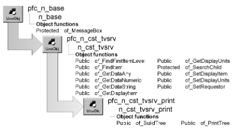

# n_cst_tvsrv_print

**Description**

TreeView print service.

**Ancestry**



**Library**

- PFCAPSRV.PBL
- PFEAPSRV.PBL

**Usage**

To use this service:

1. Enable the service by calling the u_tvs of_SetPrint function:

   ```
   tv_1.of_SetPrint(TRUE)
   ```

2. Call the of_PrintTree function to print TreeView data:

   ```
   String  ls_levelpicts[10]
   String  ls_levelselpicts[10]

   ls_levelpicts[1] = "dept.bmp"
   ls_levelpicts[2] = "emp.bmp"
   ls_levelselpicts[1] = "deptsel.bmp"
   ls_levelselpicts[2] = "empsel.bmp"
   tv_1.inv_print.of_PrintTree(0, TRUE, &
      ls_levelpicts, ls_levelselpicts)
   ```

**See also**

n_cst_tvsrv_levelsource

## Functions

N_cst_tvsrv_print includes precoded functions:

- of_BuildTree
- of_buildtreeparentsiblings
- of_PrintTree

### of_BuildTree

**Description**

Builds the data to be printed.

**Access**

Public

**Syntax**

```
tvcontrol.instancename.of_BuildTree ( handle, pictures, levelpicts )
```

| Argument | Description |
| --- | --- |
| *tvcontrol* | Instance name of the u_tvs-based TreeView control |
| *instancename* | Instance name of n_cst_tvsrv_print (the u_tvs default is inv_print) |
| *handle* | Long containing the handle of the TreeView item from which to start building the data to print |
| *pictures* | String specifying the filenames for all pictures and selected pictures |
| *levelpicts* | String specifying the filenames for pictures and selected pictures to display when using different pictures for each level |

**Return value**

String. Returns a string used to populate a temporary DataStore, which is then printed.

**Usage**

Internal.

**Examples**

This example is from the of_PrintTree function:

```
...
lds_Print = Create n_ds
lds_Print.DataObject = "d_printtree"
If lds_Print.ImportString(of_buildtree(al_Handle,  &
   ls_Picts, ls_LevelPicts)) <= 0 Then Return -1
li_RC = lds_Print.Print(ab_CancelDialog)
...
```

### of_buildtreeparentsiblings

**Description**

Function added by Vipul. The function recursively goes through ancestors of an item and builds a string of flags indicating whether they had siblings or not. These flags would be picked by d_printree's parentsiblings field which helps display lines beween nodes. The Lines between nodes should only appear if there is a sibling waiting to be printed (NextTreeItem)

**Access**

Protected

**Syntax**

```
instancename.of_buildtreeparentsiblings ( al_handle )
```

| Argument | Description |
| --- | --- |
| *instancename* | Instance name of n_cst_tvsrv_print |
| *al_handle* | Long. The handle of the TreeView item to start building the tree. |

**Return value**

String. The ImportString data to populate the DataWindow that will be printed.

### of_PrintTree

Prints data in a TreeView control. There are two syntaxes:

| To | Use |
| --- | --- |
| Print a TreeView using the same picture and selected picture for all levels | Syntax 1 |
| Print a TreeView specifying pictures and selected pictures for each level | Syntax 2 |

**Another version of of_PrintTree** There is also an undocumented version of of_PrintTree that is for internal use.

| Syntax 1 | Print a TreeView using the same pictures for each level |
| --- | --- |

**Description**

Prints TreeView data using the same picture and selected picture for each level.

**Access**

Public

**Syntax**

```
tvcontrol.instancename.of_PrintTree ( { handle {, canceldialog
{, pictname, selectedpictname } } } )
```

| Argument | Description |
| --- | --- |
| *tvcontrol* | Instance name of the u_tvs-based TreeView control |
| *instancename* | Instance name of n_cst_tvsrv_print (the u_tvs default is inv_print) |
| *handle* (optional) | Long specifying the handle of the TreeView item from which to begin printing. The default is 0, which starts at the top of the TreeView hierarchy |
| *canceldialog* (optional) | Boolean specifying whether to display a Cancel dialog. The default is FALSE |
| *pictname* (optional) | String specifying the filename to display as the picture. The default is folder.bmp |
| *selectedpictname* (optional) | String specifying the filename to display as the selected picture. The default is foldopen.bmp |

**Return value**

Integer. Returns 1 if the function succeeds and -1 if an error occurs.

**Usage**

The pictures specified (including the default pictures, folder.bmp and foldopen.bmp) must be in a directory that is accessible at execution time.

**Examples**

This example calls the of_PrintTree function:

```
tv_1.inv_print.of_PrintTree  &
   (0, TRUE, "dept.bmp", "emp.bmp")
```

| Syntax 2 | Print a TreeView specifying pictures for each level |
| --- | --- |

**Description**

Prints TreeView data using the specified pictures and selected pictures for each level.

**Access**

Public

**Syntax**

```
tvcontrol.instancename.of_PrintTree ( { handle {, canceldialog
{, levelpicts, levelselectedpicts } } } } )
```

| Argument | Description |
| --- | --- |
| *tvcontrol* | Instance name of the u_tvs-based TreeView control |
| *instancename* | Instance name of n_cst_tvsrv_print (the u_tvs default is inv_print) |
| *handle* (optional) | Long specifying the handle of the TreeView item from which to begin printing. The default is 0, which starts at the top of the TreeView hierarchy |
| *canceldialog* (optional) | Boolean specifying whether to display a Cancel dialog. The default is FALSE |
| *levelpicts* (optional) | Ten-element string array specifying pictures for items in up to ten levels |
| *levelselectedpicts* (optional) | Ten-element string array specifying selected pictures for items in up to ten levels |

**Return value**

Integer. Returns 1 if the function succeeds and -1 if an error occurs.

**Usage**

The pictures specified (including the default pictures, folder.bmp and foldopen.bmp) must be in a directory that is accessible at execution time.

**Examples**

This example calls the of_PrintTree function:

```
String  ls_levelpicts[10]
String  ls_levelselpicts[10]

ls_levelpicts[1] = "dept.bmp"
ls_levelpicts[2] = "emp.bmp"
ls_levelselpicts[1] = "deptsel.bmp"
ls_levelselpicts[2] = "empsel.bmp"
tv_1.inv_print.of_PrintTree(0, TRUE, &
   ls_levelpicts, ls_levelselpicts)
```
