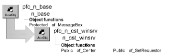

# n_cst_winsrv

**Description**

N_cst_winsrv is the base window services object and serves as the ancestor object for all Window services. In addition to being the ancestor for all other Window services, w_master instantiates this user object as inv_base.

**Ancestry**



**Library**

- PFCWNSRV.PBL
- PFEWNSRV.PBL

**Usage**

Use the functions in this user object to obtain basic information about a DataWindow object and its contents.

To use this object:

1. Enable the service using the w_master of_SetBase function:

   ```
   this.of_SetBase(TRUE)
   ```

2. Call base Window service functions as needed.

**Descendants**

- [n_cst_winsrv_preference](n_cst_winsrv_preference.md)
- [n_cst_winsrv_sheetmanager](n_cst_winsrv_sheetmanager.md)
- [n_cst_winsrv_statusbar](n_cst_winsrv_statusbar.md)

**See also**

- [n_cst_resize](n_cst_resize.md)
- [w_master](../02-window-objects/w_master.md)

## Instance variables

N_cst_winsrv includes one instance variable:

| Instance variable | Description | Data type | Access | Usage |
| --- | --- | --- | --- | --- |
| iw_requestor | Window that owns the n_cst_winsrv instance | w_master | Protected | Use to access and control the associated window |

## Functions

N_cst_winsrv includes precoded object functions:

- of_Center
- of_SetRequestor

### of_Center

**Description**

Centers the window relative to the dimensions of the current display resolution.

**Access**

Public

**Syntax**

```
instancename.of_Center ( )
```

| Argument | Description |
| --- | --- |
| *instancename* | Instance name of n_cst_winsrv (the w_master default is inv_base) |

**Return value**

Integer. Returns 1 if the function succeeds and -1 if an error occurs.

**Examples**

This example from a window Open event calls the of_Center function.

```
Integer  li_return

this.of_SetBase(TRUE)
li_return = this.inv_base.of_Center()
...
```

### of_SetRequestor

**Description**

Associates a window with n_cst_winsrv.

**Access**

Public

**Syntax**

```
instancename.of_SetRequestor ( window )
```

| Argument | Description |
| --- | --- |
| *instancename* | Instance name of n_cst_winsrv (the w_master default is inv_base) |
| *window* | W_master window variable containing the window to be associated with n_cst_winsrv |

**Return value**

Integer. Returns 1 if the function succeeds and -1 if an error occurs.

**Usage**

Internal.

**Examples**

This example is from the w_master of_SetBase function:

```
IF ab_Switch THEN
   IF Not IsValid(inv_base) THEN
       inv_base = Create n_cst_winsrv
       inv_base.of_SetRequestor(this)
   END IF
ELSE
   IF IsValid(inv_base) THEN
       Destroy inv_base
   END IF
END IF
```
