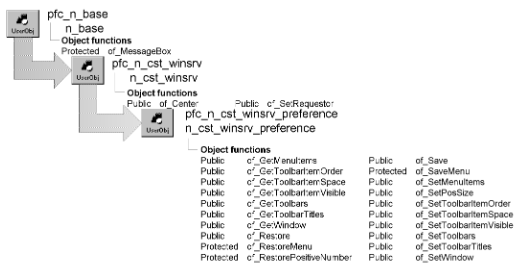

# n_cst_winsrv_preference

**Description**

Window preference service. Using this service, you can save and restore window state information using either an INI file or the Windows registry. W_master instantiates this user object as inv_preference. This service saves the following properties:

ToolBarVisible ToolBarAlignment ToolBarItemOrder Toolbar size (ToolbarHeight and ToolbarWidth) Toolbar position (ToolbarX and ToolbarY) Window size (height and width) Window state Window position (X and Y) Menu item attributes

The service provides functions allowing you to control which properties are restored.

**Ancestry**



**Library**

- PFCWNSRV.PBL
- PFEWNSRV.PBL

**Object relationships**

- [n_cst_conversion](n_cst_conversion.md)
- [n_cst_inifile](n_cst_inifile.md)
- [n_cst_string](n_cst_string.md)
- [n_cst_menu](n_cst_menu.md)

**Usage**

To use the preference service:

1. Create an instance of n_cst_winsrv_preference by calling the w_master of_SetPreference function.
2. Specify the items to be restored by calling one or more of the following functions:
   - The of_SetMenuItems function controls whether the service restores menu item properties
   - The of_SetWindow function controls whether the service restores window properties
   - The of_SetToolbars function controls whether the service restores toolbars
   - The of_SetToolbarTitles function controls whether the service restores toolbar titles
   - The of_SetToolbarItemOrder function controls whether the service restores the order of toolbar items
   - The of_SetToolbarItemSpace function controls whether the service restores the ToolbarItemOrder property
   - The of_SetToolbarItemVisible function controls whether the service restores the ToolbarItemVisible property
3. Call the of_Restore function to reapply previous settings.
4. Before closing the window, call the of_Save function to save window settings in the registry or an INI file.

**See also**

- [n_cst_winsrv](n_cst_winsrv.md)
- [n_cst_resize](n_cst_resize.md)
- [n_cst_winsrv_sheetmanager](n_cst_winsrv_sheetmanager.md)
- [n_cst_winsrv_statusbar](n_cst_winsrv_statusbar.md)
- [w_master](../02-window-objects/w_master.md)

## Instance variables

N_cst_winsrv_preference includes instance variables:

| Instance variable | Description | Data type | Access | Usage |
| --- | --- | --- | --- | --- |
| ib_menuitems | Controls whether the service restores menu item properties | Boolean | Protected | Access through of_GetMenuItems and of_SetMenuItems |
| ib_toolbaritemorder | Controls whether the service restores toolbar item order | Boolean | Protected | Access through of_GetToolbarItemOrder and of_SetToolbarItemOrder |
| ib_toolbaritemspace | Controls whether the service restores the ToolbarItemSpace property | Boolean | Protected | Access through of_GetToolbarItemSpace and of_SetToolbarItemSpace |
| ib_toolbaritemvisible | Controls whether the service restores the ToolbarItemVisible property | Boolean | Protected | Access through of_GetToolbarItemVisible and of_SetToolbarItemVisible |
| ib_toolbars | Controls whether the service restores toolbars | Boolean | Protected | Access through of_GetToolbars and of_SetToolbars |
| ib_toolbartitles | Controls whether the service restores toolbar titles | Boolean | Protected | Access through of_GetToolbarTitles and of_SetToolbarTitles |
| ib_window | Controls whether the service restores window properties | Boolean | Protected | Access through of_GetWindow and of_SetWindow |
| ii_normalstate_height | Stores the window’s height in normal display | Integer | Protected | Internal |
| ii_normalstate_width | Stores the window’s width in normal display | Integer | Protected | Internal |
| ii_normalstate_x | Stores the window’s *x* position in normal display | Integer | Protected | Internal |
| ii_normalstate_y | Stores the window’s *y* position in normal display | Integer | Protected | Internal |

## Functions

N_cst_winsrv_preference includes precoded object functions:

- of_GetMenuItems
- of_GetToolbarItemOrder
- of_GetToolbarItemSpace
- of_GetToolbarItemVisible
- of_GetToolbars
- of_GetToolbarTitles
- of_GetWindow
- of_Restore
- of_RestoreMenu
- of_RestorePositiveNumber
- of_Save
- of_SaveMenu
- of_SetMenuItems
- of_SetPosSize
- of_SetToolbarItemOrder
- of_SetToolbarItemSpace
- of_SetToolbarItemVisible
- of_SetToolbars
- of_SetToolbarTitles
- of_SetWindow

### of_GetMenuItems

**Description**

Reports whether the service restores menu items.

**Access**

Public

**Syntax**

```
instancename.of_GetMenuItems ( )
```

| Argument | Description |
| --- | --- |
| *instancename* | Instance name of n_cst_winsrv_preference (the w_master default is inv_preference) |

**Return value**

Boolean. Returns TRUE if menu items are restored and FALSE if they are not.

**Examples**

This example calls the of_GetMenuItems function:

```
IF parent.inv_preference.of_GetMenuItems() THEN
   MessageBox("Preferences", &
       "Menu item restore is enabled")
ELSE
   MessageBox("Preferences", &
       "Menu item restore is disabled")
END IF
```

### of_GetToolbarItemOrder

**Description**

Reports whether the service restores toolbar item order.

**Access**

Public

**Syntax**

```
instancename.of_GetToolbarItemOrder ( )
```

| Argument | Description |
| --- | --- |
| *instancename* | Instance name of n_cst_winsrv_preference (the w_master default is inv_preference) |

**Return value**

Boolean. Returns TRUE if toolbar item order is restored and FALSE if it is not.

**Examples**

This example calls the of_GetToolbarItemOrder function:

```
IF parent.inv_preference.of_GetToolbarItemOrder() &
   THEN
       MessageBox("Preferences", &
          "Toolbar item order restore is enabled")
ELSE
   MessageBox("Preferences", &
       "Toolbar item order restore is disabled")
END IF
```

### of_GetToolbarItemSpace

**Description**

Reports whether the service restores the ToolbarItemSpace property.

**Access**

Public

**Syntax**

```
instancename.of_GetToolbarItemSpace ( )
```

| Argument | Description |
| --- | --- |
| *instancename* | Instance name of n_cst_winsrv_preference (the w_master default is inv_preference) |

**Return value**

Boolean. Returns TRUE if the ToolbarItemSpace property is restored and FALSE if it is not.

**Examples**

This example calls the of_GetToolbarItemSpace function:

```
IF parent.inv_preference.of_GetToolbarItemSpace() &
   THEN
       MessageBox("Preferences", &
          "ToolbarItemSpace restore is enabled")
ELSE
   MessageBox("Preferences", &
       "ToolbarItemSpace restore is disabled")
END IF
```

### of_GetToolbarItemVisible

**Description**

Reports whether the service restores the ToolbarItemVisible property.

**Access**

Public

**Syntax**

```
instancename.of_GetToolbarItemVisible ( )
```

| Argument | Description |
| --- | --- |
| *instancename* | Instance name of n_cst_winsrv_preference (the w_master default is inv_preference) |

**Return value**

Boolean. Returns TRUE if the ToolbarItemVisible property is restored and FALSE if it is not.

**Examples**

This example calls the of_GetToolbarItemVisible function:

```
IF parent.inv_preference.of_GetToolbarItemVisible() &
   THEN
       MessageBox("Preferences", &
          "ToolbarItemVisible restore is enabled")
ELSE
   MessageBox("Preferences", &
       "ToolbarItemVisible restore is disabled")
END IF
```

### of_GetToolbars

**Description**

Reports whether the service restores toolbars.

**Access**

Public

**Syntax**

```
instancename.of_GetToolbars ( )
```

| Argument | Description |
| --- | --- |
| *instancename* | Instance name of n_cst_winsrv_preference (the w_master default is inv_preference) |

**Return value**

Boolean. Returns TRUE if toolbars are restored and FALSE if they are not.

**Examples**

This example calls the of_GetToolbars function:

```
IF parent.inv_preference.of_GetToolbars() THEN
   MessageBox("Preferences", &
       "Toolbar restore is enabled")
ELSE
   MessageBox("Preferences", &
       "Toolbar restore is disabled")
END IF
```

### of_GetToolbarTitles

**Description**

Reports whether the service restores toolbar titles.

**Access**

Public

**Syntax**

```
instancename.of_GetToolbarTitles ( )
```

| Argument | Description |
| --- | --- |
| *instancename* | Instance name of n_cst_winsrv_preference (the w_master default is inv_preference) |

**Return value**

Boolean. Returns TRUE if toolbar titles are restored and FALSE if they are not.

**Examples**

This example calls the of_GetToolbarTitles function:

```
IF parent.inv_preference.of_GetToolbarTitles() THEN
   MessageBox("Preferences", &
       "Toolbar titles restore is enabled")
ELSE
   MessageBox("Preferences", &
       "Toolbar titles restore is disabled")
END IF
```

### of_GetWindow

**Description**

Reports whether the service restores window properties.

**Access**

Public

**Syntax**

```
instancename.of_GetWindow ( )
```

| Argument | Description |
| --- | --- |
| *instancename* | Instance name of n_cst_winsrv_preference (the w_master default is inv_preference) |

**Return value**

Boolean. Returns TRUE if window properties are restored and FALSE if they are not.

**Examples**

This example calls the of_GetWindow function:

```
IF parent.inv_preference.of_GetWindow() THEN
   MessageBox("Preferences", &
       "Window property restore is enabled")
ELSE
   MessageBox("Preferences", &
       "Window property restore is disabled")
END IF
```

### of_Restore

Restores window, toolbar, and menu settings from the registry or an INI file. There are two syntaxes:

| To | Use |
| --- | --- |
| Restore settings from the registry | Syntax 1 |
| Restore settings from an INI file | Syntax 2 |

**Other versions of of_Restore** There are also two undocumented versions of of_Restore, which are for internal use.

| Syntax 1 | To restore settings from the registry |
| --- | --- |

**Description**

Restores window size, position, toolbar settings, and menu item settings from the registry.

**Access**

Public

**Syntax**

```
instancename.of_Restore ( registrykey )
```

| Argument | Description |
| --- | --- |
| *instancename* | Instance name of n_cst_winsrv_preference (the w_master default is inv_preference) |
| *registrykey* | String specifying the registry key from which to restore settings |

**Return value**

Integer. Returns 1 if the function succeeds and -1 if an error occurs.

**Usage**

Call this function in a window Open event to restore settings to their previous state.

Use Syntax 2 to restore settings from an INI file.

**Examples**

This example calls the of_Restore function to restore settings, as saved in the EISAPP section of the registry:

```
String   ls_appkey
Integer   li_return

ls_appkey = "HKEY_CURRENT_USER\Software\EISAPP"
li_return = &
   this.inv_preference.of_Restore(ls_appkey)
IF li_return = -1 THEN
   MessageBox("Preference", &
        "Unable to restore settings")
END IF
```

| Syntax 2 | To restore settings from an INI file |
| --- | --- |

**Description**

Restores window size, position, toolbar settings, and menu item settings from an INI file.

**Access**

Public

**Syntax**

```
instancename.of_Restore ( inifile, section )
```

| Argument | Description |
| --- | --- |
| *instancename* | Instance name of n_cst_winsrv_preference (the w_master default is inv_preference) |
| *inifile* | String specifying the INI file from which to restore settings |
| *section* | String specifying the INI file section containing the settings |

**Return value**

Integer. Returns 1 if the function succeeds and -1 if an error occurs.

**Usage**

Call this function in a window Open event to restore settings to their previous state.

Use Syntax 1 to restore settings from the registry.

**Examples**

This example calls the of_Restore function to restore settings, as saved in the EISAPP section of the registry:

```
String   ls_inifile
Integer  li_return

ls_inifile = gnv_app.of_GetUserINIFile( )
li_return = this.inv_preference.of_Restore &
   (ls_inifile, "Eisapp")
```

### of_RestoreMenu

**Description**

Restores menu items from the registry or an INI file.

**Access**

Protected

**Syntax**

```
instancename.of_RestoreMenu ( useregistry, keyorinifile, section, menu )
```

| Argument | Description |
| --- | --- |
| *instancename* | Instance name of n_cst_winsrv_preference (the w_master default is inv_preference) |
| *useregistry* | Boolean specifying whether to use the registry (TRUE) or an INI file |
| *keyorinifile* | String specifying either the registry key or the INI file from which to restore settings |
| *section* | String specifying the INI file section containing the settings |
| *menu* | Menu variable specifying the menu to be restored |

**Return value**

Integer. Returns 1 if the function succeeds and -1 if an error occurs.

**Usage**

Internal.

**Examples**

This example is from the of_Restore function:

```
...
IF ib_menuitems THEN
   li_rc = of_RestoreMenu(ab_UseRegistry, &
       as_KeyOrIni, as_IniSection, &
        iw_requestor.MenuId)
END IF
...
```

### of_RestorePositiveNumber

**Description**

Accesses the registry or an INI file and reports whether the specified key value returns a positive or a negative number.

**Access**

Protected

**Syntax**

```
instancename.of_RestorePositiveNumber ( useregistry, keyorinifile,
section, key, value )
```

| Argument | Description |
| --- | --- |
| *instancename* | Instance name of n_cst_winsrv_preference (the w_master default is inv_preference) |
| *useregistry* | Boolean specifying whether to use the registry (TRUE) or an INI file (FALSE) |
| *keyorinifile* | String specifying either the registry key or the INI file from which to restore settings |
| *section* | String specifying the INI file section containing the settings |
| *key* | String specifying the registry or INI file key value |
| *value* | Integer into which the function places the value to be restored |

**Return value**

Boolean. Returns TRUE if *key* contains a positive number and FALSE if it contains a negative number.

**Usage**

Internal.

**Examples**

This example is from the of_Restore function:

```
...
IF NOT of_RestorePositiveNumber &
   (ab_UseRegistry, as_KeyOrIni, as_IniSection, &
       ls_tbindex+’.x’, li_x) THEN &
          lb_toolbarposition=False
...
```

### of_Save

Saves window, toolbar, and menu settings in the registry or an INI file. There are two syntaxes:

| To | Use |
| --- | --- |
| Save settings in the registry | Syntax 1 |
| Save settings in an INI file | Syntax 2 |

**Other versions of of_Save** There are also two undocumented versions of of_Save, which are for internal use.

| Syntax 1 | To save settings in the registry |
| --- | --- |

**Description**

Saves window size, position, toolbar settings, and menu item settings in the registry.

**Access**

Public

**Syntax**

```
instancename.of_Save ( registrykey )
```

| Argument | Description |
| --- | --- |
| *instancename* | Instance name of n_cst_winsrv_preference (the w_master default is inv_preference) |
| *registrykey* | String specifying the registry key in which to save settings |

**Return value**

Integer. Returns 1 if the function succeeds and -1 if an error occurs.

**Usage**

Call this function in a window Close event to save the current settings.

Use Syntax 2 to save settings in an INI file.

**Examples**

This example calls the of_Save function to save settings, as saved in the EISAPP section of the registry:

```
String   ls_appkey
Integer  li_return

ls_appkey = "HKEY_CURRENT_USER\Software\EISAPP"
li_return = this.inv_preference.of_Save(ls_appkey)
IF li_return = -1 THEN
   MessageBox("Preference", &
       "Unable to save settings")
END IF
```

| Syntax 2 | To save settings in an INI file |
| --- | --- |

**Description**

Saves window size, position, toolbar settings, and menu item settings in an INI file.

**Access**

Public

**Syntax**

```
instancename.of_Save ( inifile, section )
```

| Argument | Description |
| --- | --- |
| *instancename* | Instance name of n_cst_winsrv_preference (the w_master default is inv_preference) |
| *inifile* | String specifying the INI file from which to restore settings |
| *section* | String specifying the INI file section containing the settings |

**Return value**

Integer. Returns 1 if the function succeeds and -1 if an error occurs.

**Usage**

Call this function in a window Close event to save current settings.

Use Syntax 1 to save settings in the registry.

**Examples**

This example calls the of_Save function to restore settings, as saved in the EISAPP section of the registry:

```
String   ls_inifile
Integer  li_return

ls_inifile = gnv_app.of_GetUserINIFile( )
li_return = this.inv_preference.of_Save &
   (ls_inifile, "Eisapp")
IF li_return = -1 THEN
   MessageBox("Preference", &
       "Unable to save settings")
END IF
```

### of_SaveMenu

**Description**

Saves menu items in either the registry or an INI file.

**Access**

Protected

**Syntax**

```
instancename.of_SaveMenu ( useregistry, keyorinifile, section, menu )
```

| Argument | Description |
| --- | --- |
| *instancename* | Instance name of n_cst_winsrv_preference (the w_master default is inv_preference) |
| *useregistry* | Boolean specifying whether to use the registry (TRUE) or an INI file |
| *keyorinifile* | String specifying either the registry key or the INI file in which to save settings |
| *section* | String specifying the INI file section to contain the settings |
| *menu* | Menu variable specifying the menu to be saved |

**Return value**

Integer. Returns 1 if the function succeeds and -1 if an error occurs.

**Usage**

Internal.

**Examples**

This example is from the of_Save function:

```
...
IF of_SaveMenu(ab_UseRegistry, as_KeyOrIni, &
   as_IniSection, iw_requestor.MenuId) < 0 THEN
   Return -1
END IF
...
```

### of_SetMenuItems

**Description**

Specifies whether the service restores menu items.

**Access**

Public

**Syntax**

```
instancename.of_SetMenuItems ( boolean )
```

| Argument | Description |
| --- | --- |
| *instancename* | Instance name of n_cst_winsrv_preference (the w_master default is inv_preference) |
| *boolean* | Boolean specifying whether the preference service restores menu items (TRUE) or not (FALSE) |

**Return value**

Integer. Returns 1 if the function succeeds and -1 if an error occurs.

**Examples**

This example calls the of_SetMenuItems function:

```
Integer  li_return

li_return = &
   this.inv_preference.of_SetMenuItems(TRUE)
IF li_return = -1 THEN
   MessageBox("Preference", &
   "Error in of_SetMenuItems")
END IF
```

### of_SetPosSize

**Description**

Stores the current position and size of the associated window.

**Access**

Public

**Syntax**

```
instancename.of_SetPosSize ( )
```

| Argument | Description |
| --- | --- |
| *instancename* | Instance name of n_cst_winsrv_preference (the w_master default is inv_preference) |

**Return value**

Integer. Returns 1 if the function succeeds, 0 if the window state is not Normal!, and -1 if an error occurs.

**Usage**

Internal.

**Examples**

This example is from the of_Save function:

```
...
IF iw_requestor.WindowState=Normal! THEN
   of_SetPosSize( )
END IF
...
```

### of_SetToolbarItemOrder

**Description**

Specifies whether the service restores toolbar item order.

**Access**

Public

**Syntax**

```
instancename.of_SetToolbarItemOrder ( boolean )
```

| Argument | Description |
| --- | --- |
| *instancename* | Instance name of n_cst_winsrv_preference (the w_master default is inv_preference) |
| *boolean* | Boolean specifying whether the preference service restores toolbar item order (TRUE) or not (FALSE) |

**Return value**

Integer. Returns 1 if the function succeeds and -1 if an error occurs.

**Examples**

This example calls the of_SetToolbarItemOrder function:

```
Integer  li_return

li_return = &
   this.inv_preference.of_SetToolbarItemOrder(TRUE)
IF li_return = -1 THEN
   MessageBox("Preference", &
       "Error in of_SetToolbarItemOrder")
END IF
```

### of_SetToolbarItemSpace

**Description**

Specifies whether the service restores the ToolbarItemSpace property.

**Access**

Public

**Syntax**

```
instancename.of_SetToolbarItemSpace ( boolean )
```

| Argument | Description |
| --- | --- |
| *instancename* | Instance name of n_cst_winsrv_preference (the w_master default is inv_preference) |
| *boolean* | Boolean specifying whether the preference service restores toolbar item space (TRUE) or not (FALSE) |

**Return value**

Integer. Returns 1 if the function succeeds and -1 if an error occurs.

**Examples**

This example calls the of_SetToolbarItemSpace function:

```
Integer  li_return

li_return = &
   this.inv_preference.of_SetToolbarItemSpace(TRUE)
IF li_return = -1 THEN
   MessageBox("Preference", &
       "Error in of_SetToolbarItemSpace")
END IF
```

### of_SetToolbarItemVisible

**Description**

Specifies whether the service restores the ToolbarItemVisible property.

**Access**

Public

**Syntax**

```
instancename.of_SetToolbarItemVisible ( boolean )
```

| Argument | Description |
| --- | --- |
| *instancename* | Instance name of n_cst_winsrv_preference (the w_master default is inv_preference) |
| *boolean* | Boolean specifying whether the preference service restores the toolbar item Visible property (TRUE) or not (FALSE) |

**Return value**

Integer. Returns 1 if the function succeeds and -1 if an error occurs.

**Examples**

This example calls the of_SetToolbarItemVisible function:

```
Integer  li_return

li_return = &
   this.inv_preference.of_SetToolbarItemVisible(TRUE)
IF li_return = -1 THEN
   MessageBox("Preference", &
       "Error in of_SetToolbarItemVisible")
END IF
```

### of_SetToolbars

**Description**

Specifies whether the service restores toolbars.

**Access**

Public

**Syntax**

```
instancename.of_SetToolbars ( boolean )
```

| Argument | Description |
| --- | --- |
| *instancename* | Instance name of n_cst_winsrv_preference (the w_master default is inv_preference) |
| *boolean* | Boolean specifying whether the preference service restores toolbars (TRUE) or not (FALSE) |

**Return value**

Integer. Returns 1 if the function succeeds and -1 if an error occurs.

**Examples**

This example calls the of_SetToolbars function:

```
Integer  li_return

li_return = &
   this.inv_preference.of_SetToolbars(TRUE)
IF li_return = -1 THEN
   MessageBox("Preference", "Error in of_SetToolbars")
END IF
```

### of_SetToolbarTitles

**Description**

Specifies whether the service restores toolbar titles.

**Access**

Public

**Syntax**

```
instancename.of_SetToolbarTitles ( boolean )
```

| Argument | Description |
| --- | --- |
| *instancename* | Instance name of n_cst_winsrv_preference (the w_master default is inv_preference) |
| *boolean* | Boolean specifying whether the preference service restores toolbar titles (TRUE) or not (FALSE) |

**Return value**

Integer. Returns 1 if the function succeeds and -1 if an error occurs.

**Examples**

This example calls the of_SetToolbarTitles function:

```
Integer  li_return

li_return = &
   this.inv_preference.of_SetToolbarTitles(TRUE)
IF li_return = -1 THEN
   MessageBox("Preference", &
       "Error in of_SetToolbarTitles")
END IF
```

### of_SetWindow

**Description**

Specifies whether the service restores window properties.

**Access**

Public

**Syntax**

```
instancename.of_SetWindow ( boolean )
```

| Argument | Description |
| --- | --- |
| *instancename* | Instance name of n_cst_winsrv_preference (the w_master default is inv_preference) |
| *boolean* | Boolean specifying whether the preference service restores window properties (TRUE) or not (FALSE) |

**Return value**

Integer. Returns 1 if the function succeeds and -1 if an error occurs.

**Examples**

This example calls the of_SetWindow function:

```
Integer  li_return

li_return = &
   this.inv_preference.of_SetWindow(TRUE)
IF li_return = -1 THEN
   MessageBox("Preference", "Error in of_SetWindow")
END IF
```
