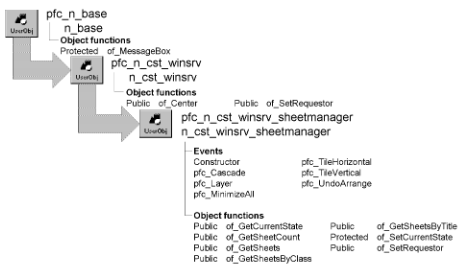

# n_cst_winsrv_sheetmanager

**Description**

Sheet management service. The service provides events that are called by PFC menu items to manage multiple sheet display, including the ability to undo a sheet arrangement command. It also provides functions allowing you to access open sheets.

**Ancestry**



**Library**

- PFCWNSRV.PBL
- PFEWNSRV.PBL

**Object relationships**

w_master

**Usage**

Enable the sheet management service for all multiple-sheet MDI applications. You don’t need this service if your MDI application uses a single-sheet frame.

To use the sheet management service:

1. Create an instance of n_cst_winsrv_sheetmanager by calling the w_frame of_SetSheetManager function.
2. Call n_cst_sheetmanager functions as needed to access information on open sheets.

**PFC 7 custom class extension** To further the extendibility of PFC, a new n_cst_winsrv_sheetmanagerattrib custom class user object replaces the os_sheet object structure that is now obsolete.

**See also**

- [n_cst_resize](n_cst_resize.md)
- [n_cst_winsrv](n_cst_winsrv.md)
- [n_cst_winsrv_preference](n_cst_winsrv_preference.md)
- [n_cst_winsrv_statusbar](n_cst_winsrv_statusbar.md)
- [w_master](../02-window-objects/w_master.md)
- [w_frame](../02-window-objects/w_frame.md)

## Instance variables

N_cst_winsrv_sheetmanager includes instance variables:

| Instance variable | Description | Data type | Access | Usage |
| --- | --- | --- | --- | --- |
| ie_arrange | Current arrange type | ArrangeTypes | Protected | Internal |
| inv_sheet[ ] | Array containing information on the previous state of active sheets | n_cst_winsrv_she etmanagerattrib | Protected | Internal |

## Events

N_cst_winsrv_sheetmanager includes precoded events:

- Constructor
- pfc_Cascade
- pfc_Layer
- pfc_MinimizeAll
- pfc_TileHorizontal
- pfc_TileVertical
- pfc_UndoArrange

### Constructor

**Description**

Initializes the ie_arrange instance variable.

**Usage**

This event executes when the object is created.

### pfc_Cascade

**Description**

Saves information in the istr_sheet array and cascades open sheets.

**Usage**

This event executes when the user selects Window>Cascade from the menu bar of a menu inherited from m_master.

### pfc_Layer

**Description**

Saves information in the istr_sheet array and layers open sheets.

**Usage**

This event executes when the user selects Window>Layer from the menu bar of a menu inherited from m_master.

### pfc_MinimizeAll

**Description**

Saves information in the istr_sheet array and minimizes all open sheets.

**Usage**

This event executes when the user selects Window>Minimize All from the menu bar of a menu inherited from m_master.

### pfc_TileHorizontal

**Description**

Saves information in the istr_sheet array and tiles open sheets horizontally.

**Usage**

This event executes when the user selects Window>Tile Horizontal from the menu bar of a menu inherited from m_master.

### pfc_TileVertical

**Description**

Saves information in the istr_sheet array and tiles open sheets vertically.

**Usage**

This event executes when the user selects Window>Tile Vertical from the menu bar of a menu inherited from m_master.

### pfc_UndoArrange

**Description**

Restores all sheets to their previous state and position, using the information in the istr_sheet array.

**Usage**

This event executes when the user selects Window>Undo Arrange from the menu bar of a menu inherited from m_master.

## Functions

N_cst_winsrv_sheetmanager includes precoded object functions:

- of_GetCurrentState
- of_GetSheetCount
- of_GetSheets
- of_GetSheetsByClass
- of_GetSheetsByTitle
- of_SetCurrentState

### of_GetCurrentState

**Description**

Retrieves the current arrange type for undo.

**Access**

Public

**Syntax**

```
instancename.of_GetCurrentState ( )
```

| Argument | Description |
| --- | --- |
| *instancename* | Instance name of n_cst_winsrv_sheetmanager (the w_frame default is inv_sheetmanager) |

**Return value**

ArrangeTypes enumerated variable. Returns the current arrange state of open windows or NULL if Undo Arrange was the last action.

**Examples**

This example calls the of_GetCurrentState function:

```
ArrangeTypes  lat_arrange

lat_arrange = of_GetCurrentState()
```

### of_GetSheetCount

**Description**

Retrieves the number of sheets open for the current frame.

**Access**

Public

**Syntax**

```
instancename.of_GetSheetCount ( )
```

| Argument | Description |
| --- | --- |
| *instancename* | Instance name of n_cst_winsrv_sheetmanager (the w_frame default is inv_sheetmanager) |

**Return value**

Integer. Returns the number of open sheets for the current frame.

**Examples**

This example, from a frame window Timer event, calls the of_GetSheetCount function:

```
Integer  li_return

li_return = &
   this.inv_sheetmanager.of_GetSheetCount()
this.SetMicroHelp &
   (String(li_return) + " open sheets")
```

### of_GetSheets

**Description**

Populates an array with a frame’s open sheets.

**Access**

Public

**Syntax**

```
instancename.of_GetSheets ( sheets )
```

| Argument | Description |
| --- | --- |
| *instancename* | Instance name of n_cst_winsrv_sheetmanager (the w_frame default is inv_sheetmanager) |
| *sheets* | Array of windows into which the function places the open sheets (passed by reference) |

**Return value**

Integer. Returns the number of open sheets.

**Usage**

Call this function to determine the number of open sheets and to populate an array containing the handles for all open sheets.

**Examples**

This example calls the of_GetSheets function:

```
window   lw_sheet, lw_opensheets[ ]
String   ls_sheet
Integer  li_return

ls_sheet = Message.StringParm
OpenSheet(lw_sheet, ls_sheet, this)
li_return = this.inv_sheetmanager.of_GetSheets &
   (lw_opensheets)
this.SetMicroHelp(String(li_return) + " open sheets")
END IF
```

### of_GetSheetsByClass

**Description**

Returns all open sheets of a specified sheet type.

**Access**

Public

**Syntax**

```
instancename.of_GetSheetsByClass ( sheets, class )
```

| Argument | Description |
| --- | --- |
| *instancename* | Instance name of n_cst_winsrv_sheetmanager (the w_frame default is inv_sheetmanager) |
| *sheets* | Array of windows into which the function places all sheets of the specified class (passed by reference) |
| *class* | String specifying the window class whose open sheets will be returned |

**Return value**

Integer. Returns the number of open sheets of type *class*.

**Usage**

Call this function to determine the number of open sheets for a particular window class.

**Examples**

This example calls the of_GetSheetsByClass function to determine an options sheet is open (this assumes a rule that restricts an application to a single open options sheet):

```
window  lw_sheet, lw_opensheets[ ]
String  ls_sheet
Integer li_return

ls_sheet = Message.StringParm
li_return = &
   this.inv_sheetmanager.of_GetSheetsByClass &
   (lw_opensheets, ls_sheet)
IF li_return > 0 THEN
   lw_opensheets[1].WindowState = Normal!
   lw_opensheets[1].BringToTop = TRUE
ELSE
   OpenSheet(lw_sheet, ls_sheet, this)
END IF
```

### of_GetSheetsByTitle

**Description**

Returns all open sheets with a specified title.

**Access**

Public

**Syntax**

```
instancename.of_GetSheetsByTitle ( sheets, title {, partialmatch } )
```

| Argument | Description |
| --- | --- |
| *instancename* | Instance name of n_cst_winsrv_sheetmanager (the w_frame default is inv_sheetmanager) |
| *sheets* | Array of windows into which the function places all sheets with the specified title (passed by reference) |
| *title* | String containing the title to be searched for |
| *partialmatch* (optional) | Boolean indicating whether the sheet title can contain *title* (TRUE) or must match *title* (FALSE). The default is FALSE |

**Return value**

Integer. Returns the number of open sheets whose titles match the criteria.

**Examples**

This example, from the w_frame pfc_Open event, calls the of_GetSheetsByTitle function to determine if a sheet is already open for the specified employee:

```
window   lw_sheet, lw_opensheets[ ]
String   ls_sheet, ls_title
Integer  li_return
Long     ll_emp_id

ls_sheet = Message.StringParm
ll_emp_id = Message.LongParm
ls_title = "Employee information for " &
   + String(ll_emp_id)
li_return = &
   this.inv_sheetmanager.of_GetSheetsByTitle &
       (lw_opensheets, ls_title, FALSE)
IF li_return > 0 THEN
   lw_opensheets[1].WindowState = Normal!
   lw_opensheets[1].BringToTop = TRUE
ELSE
   OpenSheetWithParm &
       (lw_sheet, ll_emp_id, ls_sheet, this)
END IF
```

### of_SetCurrentState

**Description**

Sets the current arrange type for undo.

**Access**

Protected

**Syntax**

```
instancename.of_SetCurrentState ( arrange )
```

| Argument | Description |
| --- | --- |
| *instancename* | Instance name of n_cst_winsrv_sheetmanager (the w_frame default is inv_sheetmanager) |
| *arrange* | ArrangeTypes variable specifying the current arrange type |

**Return value**

Integer. Returns 1 if the function succeeds and -1 if an error occurs.

**Usage**

Internal.

**Examples**

This example is from the pfc_Cascade event:

```
...
of_SetCurrentState(Cascade!)
li_rc = iw_requestor.ArrangeSheets(Cascade!)
Return li_rc
```
