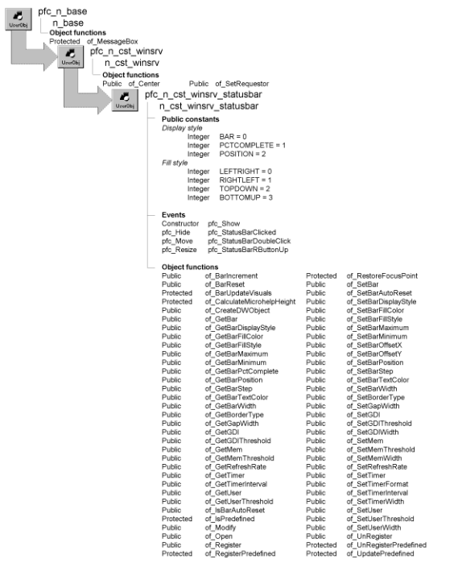

# n_cst_winsrv_statusbar

**Description**

Status bar service. N_cst_winsrv_statusbar provides functions that display memory and time in a frame window’s status bar. This service also includes functions that display a progress bar in the status bar area.

**Ancestry**



**Library**

- PFCWNSRV.PBL
- PFEWNSRV.PBL

**Usage**

Call the functions in this user object to control status bar display.

To use this object:

1. Enable the status bar service by calling the w_frame of_SetStatusBar function:

   ```
   w_frame.of_SetStatusBar(TRUE)
   ```

2. Call n_cst_winsrv_statusbar functions in the w_frame pfc_PreOpen event to specify the items displayed. The service displays items in the order that their associated functions are called, from left to right. For example, the following example displays memory to the left of the date and time:

   ```
   w_frame.inv_statusbar.of_SetMem(TRUE)
   w_frame.inv_statusbar.of_SetTimer(TRUE)
   ```

3. Call other n_cst_winsrv_statusbar functions as appropriate.

**PFC 7 custom class extension** To further the extendibility of PFC, a new n_cst_winsrv_statusbarattrib custom class user object replaces the os_dwobjects object structure that is now obsolete.

**See also**

- [n_cst_resize](n_cst_resize.md)
- [n_cst_winsrv](n_cst_winsrv.md)
- [n_cst_winsrv_preference](n_cst_winsrv_preference.md)
- [n_cst_winsrv_sheetmanager](n_cst_winsrv_sheetmanager.md)
- [w_frame](../02-window-objects/w_frame.md)
- [u_progressbar](../07-custom-visual-user-objects/u_progressbar.md)
- w_statusbar

## Instance variables

N_cst_winsrv_statusbar includes instance variables:

| Instance variable | Description | Data type | Access | Usage |
| --- | --- | --- | --- | --- |
| BAR | Constant set to 0 | Integer | Public | Use with of_SetBarDisplayStyle |
| BITMAP | Constant set to "bitmap" | String | Protected | Internal |
| BOTTOMUP | Constant set to 3 | Integer | Public | Use with of_SetFillStyle |
| ib_bar | Controls progress bar display | Boolean | Protected | Set with of_SetBar |
| ib_barautoreset | Controls progress bar autoreset | Boolean | Protected | Set with of_SetBarAutoReset (default is TRUE) |
| ib_gdi | Indicates whether GDI is displayed | Boolean | Protected | Set with of_SetGDI |
| ib_mem | Indicates whether memory is displayed | Boolean | Protected | Set with of_SetMem |
| ib_timer | Indicates whether time is displayed | Boolean | Protected | Set with of_SetTimer |
| ib_user | Indicates whether user memory is displayed | Boolean | Protected | Set with of_SetUser |
| ienv_object | Environment object | Environment | Protected | Internal |
| ii_bardisplaystyle | Bar display style | Integer | Protected | Set with of_SetBarDisplayStyle (default is BAR) |
| ii_barfillstyle | Bar fill style | Integer | Protected | Set with of_SetBarFillStyle (default is LEFTRIGHT) |
| ii_barheight | Height | Integer | Protected | Internal |
| ii_barmax | Progress bar maximum | Integer | Protected | Set with of_SetBarMaximum (default is 100) |
| ii_barmin | Progress bar minimum | Integer | Protected | Set with of_SetBarMinimum (default is 1) |
| ii_baroffsetx | Bar offset | Integer | Protected | Set with of_SetBarOffsetX (default is 10) |
| ii_baroffsety | Bar offset | Integer | Protected | Set with of_SetBarOffsetY (default is 7) |
| ii_barpctcomplete | Current progress | Integer | Protected | Internal |
| ii_barposition | Progress bar position | Integer | Protected | Set with of_SetBarPosition. Default is 0 |
| ii_barstartx | Progress bar start x | Integer | Protected | Internal |
| ii_barstarty | Progress bar start y | Integer | Protected | Internal |
| ii_barstep | Progress bar step | Integer | Protected | Set with of_SetBarStep (default is 10) |
| ii_barwidth | Progress bar width | Integer | Protected | Set with of_SetBarWidth (default is 200) |
| ii_bordertype | Border type | Integer | Protected | Set with of_SetBorderType (default is 5) |
| ii_gapwidth | Gap width | Integer | Protected | Set with of_SetGapWidth (default is 15) |
| ii_gdiwidth | Width of GDI item | Integer | Protected | Set with of_SetGDIWidth (default is 250) |
| ii_memwidth | Width of memory item | Integer | Protected | Set with of_SetMemWidth (default is 350) |
| ii_refreshrate | Number of seconds between refreshes | Integer | Protected | Set with of_SetRefreshRate (default is 60) |
| ii_timerwidth | Width of timer item | Integer | Protected | Set with of_SetTimerWidth (default is 400) |
| ii_userwidth | Width of user memory item | Integer | Protected | Set with of_SetUserWidth (default is 270) |
| il_barfillcolor | Progress bar fill color | Long | Protected | Set with of_SetBarFillColor (default is 10789024 - medium gray) |
| il_bartextcolor | Progress bar text | Long | Protected | Set with of_SetBarTextColor (default is 0 - black) |
| il_gdithreshold | Threshold under which a warning displays | Long | Protected | Set with of_SetGDIThreshold |
| il_memthreshold | Threshold under which a warning displays | Long | Protected | Set with of_SetMemThreshold |
| il_timerinterval | In milliseconds | Long | Protected | Set with of_SetTimerInterval (default is 1000) |
| il_userthreshold | Threshold under which a warning displays | Long | Protected | Set with of_SetUserThreshold |
| inv_dwobjects [ ] | Status bar items | n_cst_winsrv_statusbar attrib | Protected | Internal |
| is_timerformat | Timer format | String | Protected | Set with of_SetTimerFormat (default is m-d-yy h:mm:ss) |
| iw_statusbar | Status bar window | w_statusbar | Protected | Internal |
| LEFTRIGHT | Constant set to 0 | Integer | Public | Use with of_SetBarFillStyle |
| PCTCOMPLETE | Constant set to 1 | Integer | Public | Use with of_SetBarStyle |
| POSITION | Constant set to 2 | Integer | Public | Use with of_SetBarDisplayStyle |
| PREDEFINED | Constant set to "predefined" | String | Protected | Internal |
| RIGHTLEFT | Constant set to 1 | Integer | Public | Use with of_SetBarFillStyle |
| TEXT | Constant set to "text" | String | Protected | Internal |
| TOPDOWN | Constant set to 2 | Integer | Public | Use with of_SetBarFillStyle |

## Events

N_cst_winsrv_statusbar includes precoded event scripts:

- Constructor
- pfc_Hide
- pfc_Move
- pfc_Resize
- pfc_Show
- pfc_StatusBarClicked
- pfc_StatusBarDoubleClick
- pfc_StatusBarRButtonUp

### Constructor

**Description**

Populates the ienv_environment instance variable.

**Usage**

This event executes when the object is created.

### pfc_Hide

**Description**

Hides the w_statusbar window when the frame window is hidden.

**Return value**

Integer. Returns 1 if the event succeeds and -1 if an error occurs.

**Usage**

The w_frame Hide event calls this event.

### pfc_Move

**Description**

Moves and resizes the w_statusbar window to match the new position and size of the associated frame window.

**Syntax**

```
instancename.Event pfc_Move ( x, y )
```

| Argument | Description |
| --- | --- |
| *instancename* | Instance name of n_cst_winsrv_statusbar |
| *x* | Integer specifying the new x position of the associated frame window. From within the pfc_Move event, access this value through the *ai_xpos* argument |
| *y* | Integer specifying the new y position of the associated frame window. From within the pfc_Move event, access this value through the *ai_ypos* argument |

**Return value**

Integer. Returns 1 if the event succeeds and -1 if an error occurs.

**Usage**

The w_frame Move event calls this event.

### pfc_Resize

**Description**

Resizes the w_statusbar window based on the new size and position of the associated frame window.

**Syntax**

```
instancename.Event pfc_Resize ( sizetype, newwidth, newheight )
```

| Argument | Description |
| --- | --- |
| *instancename* | Instance name of n_cst_winsrv_statusbar |
| *sizetype* | Unsigned Long specifying the type of resize. Values are: |
|  | **• 0** The frame window was resized but was not maximized or minimized |
|  | **• 1** The frame window was minimized |
|  | **• 2** The frame window was maximized |
|  | From within the pfc_Resize event, access this value through the *aul_sizetype* argument |
| *newwidth* | Integer specifying the new window width, in PBUs |
| *newheight* | Integer specifying the new window height, in PBUs |

**Return value**

Integer. Returns 1 if the event succeeds and -1 if an error occurs.

**Usage**

The w_master Resize event calls this event.

### pfc_Show

**Description**

Displays the w_statusbar window.

**Return value**

Integer. Returns 1 if the event succeeds and -1 if an error occurs.

**Usage**

The w_master Show event calls this event.

### pfc_StatusBarClicked

**Description**

Empty user event into which you place code to execute when the user clicks in the status bar window.

**Syntax**

```
instancename.Event pfc_StatusBarClicked ( x, y, name )
```

| Argument | Description |
| --- | --- |
| *instancename* | Instance name of n_cst_winsrv_statusbar |
| *x* | Integer specifying the x position of the mouse click. From within the pfc_StatusBarClicked event, access this value through the *ai_xpos* argument |
| *y* | Integer specifying the x position of the mouse click. From within the pfc_StatusBarClicked event, access this value through the *ai_ypos* argument |
| *name* | String containing the name of the status bar element that was clicked (for example, this argument contains pfc_mem if the user clicks in the memory display). From within the pfc_StatusBarClicked event, access this value through the *as_name* argument |

**Return value**

Integer. Returns 1 if the event succeeds and -1 if an error occurs.

**Examples**

This example shows code you might add to the pfc_StatusBarClicked event to display a popup calculator window. This assumes that you have called the of_Register function to display text for the calculator on the status bar and that you have created a window named w_popcalc:

```
IF as_name = "calc" THEN
   Open(w_popcalc, iw_requestor)
END IF
```

### pfc_StatusBarDoubleClick

**Description**

Empty user event into which you place code to execute when the user double-clicks in the status bar window.

**Syntax**

```
instancename.Event pfc_StatusBarDoubleClick ( x, y, name )
```

| Argument | Description |
| --- | --- |
| *instancename* | Instance name of n_cst_winsrv_statusbar |
| *x* | Integer specifying the x position of the mouse click. From within the pfc_StatusBarDoubleClick event, access this value through the *ai_xpos* argument |
| *y* | Integer specifying the x position of the mouse click. From within the pfc_StatusBarDoubleClick event, access this value through the *ai_ypos* argument |
| *name* | String containing the name of the status bar element that was clicked (for example, this argument contains pfc_mem if the user clicks in the memory display). From within the pfc_StatusBarDoubleClick event, access this value through the *as_name* argument |

**Return value**

Integer. Returns 1 if the event succeeds and -1 if an error occurs.

**Usage**

Add code to this event to perform some action when the user double-clicks in the status bar window.

**Examples**

This example shows code you might add to the pfc_StatusBarDoubleClick event to display a popup calculator window. This assumes that you have called the of_Register function to display text for the calculator on the status bar and that you have created a window named w_popcalc:

```
IF as_name = "calc" THEN
   Open(w_popcalc, iw_requestor)
END IF
```

### pfc_StatusBarRButtonUp

**Description**

Empty user event into which you place code to execute when the user right-clicks in the status bar window.

**Syntax**

```
instancename.Event pfc_StatusBarRButtonUp ( x, y, name )
```

| Argument | Description |
| --- | --- |
| *instancename* | Instance name of n_cst_rtefind |
| *x* | Integer specifying the x position of the mouse click. From within the pfc_StatusBarRButtonUp event, access this value through the *ai_xpos* argument |
| *y* | Integer specifying the x position of the mouse click. From within the pfc_StatusBarRButtonUp event, access this value through the *ai_ypos* argument |
| *name* | String containing the name of the status bar element that was clicked (for example, this argument contains pfc_mem if the user clicks in the memory display). From within the pfc_StatusBarRButtonUp event, access this value through the *as_name* argument |

**Return value**

Integer. Returns 1 if the event succeeds and -1 if an error occurs.

**Examples**

This example shows code you might add to the pfc_StatusBarRButtonUp event to display a popup calculator window. This assumes that you have called the of_Register function to display text for the calculator on the status bar and that you have created a window named w_popcalc:

```
IF as_name = "calc" THEN
   Open(w_popcalc, iw_requestor)
END IF
```

## Functions

N_cst_winsrv_statusbar includes precoded object functions:

- of_BarIncrement
- of_BarReset
- of_BarUpdateVisuals
- of_CalculateMicrohelpHeight
- of_CreateDWObject
- of_GetBar
- of_GetBarDisplayStyle
- of_GetBarFillColor
- of_GetBarFillStyle
- of_GetBarMaximum
- of_GetBarMinimum
- of_GetBarPctComplete
- of_GetBarPosition
- of_GetBarStep
- of_GetBarTextColor
- of_GetBarWidth
- of_GetBorderType
- of_GetGapWidth
- of_GetGDI
- of_GetGDIThreshold
- of_GetMem
- of_GetMemThreshold
- of_GetRefreshRate
- of_GetTimer
- of_GetTimerInterval
- of_GetUser
- of_GetUserThreshold
- of_IsBarAutoReset
- of_IsPredefined
- of_Modify
- of_Open
- of_Register
- of_RegisterPredefined
- of_RestoreFocusPoint
- of_SetBar
- of_SetBarAutoReset
- of_SetBarDisplayStyle
- of_SetBarFillColor
- of_SetBarFillStyle
- of_SetBarMaximum
- of_SetBarMinimum
- of_SetBarOffsetX
- of_SetBarOffsetY
- of_SetBarPosition
- of_SetBarStep
- of_SetBarTextColor
- of_SetBarWidth
- of_SetBorderType
- of_SetGapWidth
- of_SetGDI
- of_SetGDIThreshold
- of_SetGDIWidth
- of_SetMem
- of_SetMemThreshold
- of_SetMemWidth
- of_SetRefreshRate
- of_SetTimer
- of_SetTimerFormat
- of_SetTimerInterval
- of_SetTimerWidth
- of_SetUser
- of_SetUserThreshold
- of_SetUserWidth
- of_UnRegister
- of_UnRegisterPredefined
- of_UpdatePredefined

### of_BarIncrement

**Description**

Increments the progress by either the default increment value or by a specified value.

**Access**

Public

**Syntax**

```
instancename.of_BarIncrement ( { incrementvalue } )
```

| Argument | Description |
| --- | --- |
| *instancename* | Instance name of n_cst_winsrv_statusbar (the w_frame default is inv_statusbar) |
| *incrementvalue* (optional) | Integer specifying the increment value. The default increment value is 10, which you can modify by calling the of_SetBarStep function |

**Return value**

Integer. Returns the current percent complete.

**Examples**

This example calls the of_BarIncrement function:

```
Integer  li_count
w_frame  lw_frame

lw_frame = gnv_app.of_GetFrame()
lw_frame.inv_statusbar.of_SetBar(TRUE)
lw_frame.inv_statusbar.of_SetBarPosition(0)
For li_count = 1 to 100 STEP 1
   lw_frame.inv_statusbar.of_BarIncrement(1)
NEXT
lw_frame.inv_statusbar.of_SetBar(FALSE)
```

### of_BarReset

**Description**

Clears the progress bar displayed in the status bar.

**Access**

Public

**Syntax**

```
instancename.of_BarReset ( )
```

| Argument | Description |
| --- | --- |
| *instancename* | Instance name of n_cst_winsrv_statusbar (the w_frame default is inv_statusbar) |

**Return value**

Integer. Returns 1 if the function succeeds and -1 if an error occurs.

**Examples**

This example is from the of_SetBarPosition function:

```
...
if ldc_completion >= 1 and ib_barautoreset then
   this.post function of_BarReset ()
end if
...
```

### of_BarUpdateVisuals

**Description**

Creates a string used to resize the progress bar and update the display text.

**Access**

Protected

**Syntax**

```
instancename.of_BarUpdateVisuals ( completionvalue )
```

| Argument | Description |
| --- | --- |
| *instancename* | Instance name of n_cst_winsrv_statusbar (the w_frame default is inv_statusbar) |
| *completionvalue* | Decimal specifying the completion value of the progress bar |

**Return value**

String. Returns the Modify string used to set the progress bar if the function succeeds and an empty string if an error occurs.

**Usage**

Internal.

**Examples**

This example is from the of_SetBarPosition function:

```
...
ls_modifyexp = of_BarUpdateVisuals(ldc_completion)
li_rc = of_Modify(ls_visible + ls_modifyexp)
...
```

### of_CalculateMicrohelpHeight

**Description**

Retrieves the environment-specific height of the MicroHelp area.

**Access**

Protected

**Syntax**

```
instancename.of_CalculateMicrohelpHeight ( )
```

| Argument | Description |
| --- | --- |
| *instancename* | Instance name of n_cst_winsrv_statusbar (the w_frame default is inv_statusbar) |

**Return value**

Integer. Returns 1 if the function succeeds and -1 if an error occurs.

**Usage**

Internal.

**Examples**

This example is from the of_CreateDWObject function:

```
...
li_microhelpheight = of_CalculateMicroHelpHeight()
...
```

### of_CreateDWObject

**Description**

Creates and validates the DataWindow syntax used to create the status bar.

**Access**

Public

**Syntax**

```
instancename.of_CreateDWObject ( createstatement, width, height )
```

| Argument | Description |
| --- | --- |
| *instancename* | Instance name of n_cst_winsrv_statusbar (the w_frame default is inv_statusbar) |
| *createstatement* | String into which the function places syntax for the DataWindow Create statement (passed by reference) |
| *width* | Integer into which the function places the width of the created object (passed by reference) |
| *height* | Integer into which the function places the height of the created object (passed by reference) |

**Return value**

Integer. Returns 1 if the function succeeds and -1 if an error occurs.

**Usage**

Call this function to create and validate the string used to create a visual element on the status bar.

**Examples**

This example is from the w_statusbar of_CreateVisuals function:

```
...
li_rc = &
   iw_parentwindow.inv_statusbar.of_CreateDWObject &
       (ls_dwdefinition, ii_winmaxwidth, li_height)
...
```

### of_GetBar

**Description**

Reports whether the status bar includes a progress bar.

**Access**

Public

**Syntax**

```
instancename.of_GetBar ( )
```

| Argument | Description |
| --- | --- |
| *instancename* | Instance name of n_cst_winsrv_statusbar (the w_frame default is inv_statusbar) |

**Return value**

Boolean. Returns TRUE if the status bar includes a progress bar and FALSE if it does not.

**Examples**

This example calls the of_GetBar function:

```
n_cst_conversion   lnv_conversion
Boolean   lb_progressbar
w_frame   lw_frame

lw_frame = gnv_app.of_GetFrame()
lb_progressbar = &
   lw_frame.inv_statusbar.of_GetBar()
MessageBox("Status Bar", &
   "Progress bar is " &
   + lnv_conversion.of_String(lb_progressbar))
```

### of_GetBarDisplayStyle

**Description**

Retrieves the progress bar display style. The display style specifies the information that displays within the bar while tracking progress.

**Access**

Public

**Syntax**

```
instancename.of_GetBarDisplayStyle ( )
```

| Argument | Description |
| --- | --- |
| *instancename* | Instance name of n_cst_winsrv_statusbar (the w_frame default is inv_statusbar) |

**Return value**

Integer. Returns values as follows:

- **0 (BAR)** Progress bar only
- **1 (PCTCOMPLETE)** Progress bar and percent complete, including the percent sign
- **2 (POSITION)** Progress bar and percent complete with no percent sign

**Examples**

This example calls the of_GetBarDisplayStyle function:

```
Integer   li_style
String    ls_style[3] = &
   {"Bar", "% Complete", "Complete"}
w_frame   lw_frame

lw_frame = gnv_app.of_GetFrame()
li_style =  &
  lw_frame.inv_statusbar.of_GetBarDisplayStyle()
MessageBox("Progress Bar", &
   "Bar Style value is " &
   + String(li_style) + "-" + &
      ls_style[li_style + 1])
```

### of_GetBarFillColor

**Description**

Retrieves the progress bar’s current color.

**Access**

Public

**Syntax**

```
instancename.of_GetBarFillColor ( )
```

| Argument | Description |
| --- | --- |
| *instancename* | Instance name of n_cst_winsrv_statusbar (the w_frame default is inv_statusbar) |

**Return value**

Long. Returns the progress bar’s fill color.

**Examples**

This example calls the of_GetBarFillColor function:

```
Long   ll_color
w_frame   lw_frame

lw_frame = gnv_app.of_GetFrame()
ll_color = lw_frame.inv_statusbar.of_GetBarFillColor()
MessageBox("Progress Bar", &
   "Fill color property is " &
   + String(ll_color))
```

### of_GetBarFillStyle

**Description**

Retrieves the progress bar’s fill style.

**Access**

Public

**Syntax**

```
instancename.of_GetBarFillStyle ( )
```

| Argument | Description |
| --- | --- |
| *instancename* | Instance name of n_cst_winsrv_statusbar (the w_frame default is inv_statusbar) |

**Return value**

Integer. Returns values as follows:

- **0 (LEFTRIGHT)** The progress bar fills from left to right
- **1 (RIGHTLEFT)** The progress bar fills from right to left
- **2 (TOPDOWN)** The progress bar fills from top to bottom
- **3 (BOTTOMUP)** The progress bar fills from bottom to top

**Examples**

This example calls the of_GetBarFillStyle function:

```
Integer  li_fillstyle
w_frame  lw_frame

lw_frame = gnv_app.of_GetFrame()
li_fillstyle = &
   lw_frame.inv_statusbar.of_GetBarFillStyle()
MessageBox("Progress Bar", &
   "Fill style is " + String(li_fillstyle))
```

### of_GetBarMaximum

**Description**

Retrieves the maximum increment value used by the progress bar.

**Access**

Public

**Syntax**

```
instancename.of_GetBarMaximum ( )
```

| Argument | Description |
| --- | --- |
| *instancename* | Instance name of n_cst_winsrv_statusbar (the w_frame default is inv_statusbar) |

**Return value**

Integer. Returns the maximum increment value for the progress bar.

**Examples**

This example calls the of_GetBarMaximum function:

```
Integer   li_max
w_frame   lw_frame
lw_frame = gnv_app.of_GetFrame()
li_max = lw_frame.inv_statusbar.of_GetBarMaximum()
MessageBox("Progress Bar", &
   "Max value is " &
       + String(li_max))
```

### of_GetBarMinimum

**Description**

Retrieves the minimum value from which incrementation starts.

**Access**

Public

**Syntax**

```
instancename.of_GetBarMinimum ( )
```

| Argument | Description |
| --- | --- |
| *instancename* | Instance name of n_cst_winsrv_statusbar (the w_frame default is inv_statusbar) |

**Return value**

Integer. Returns the minimum increment value.

**Examples**

This example calls the of_GetBarMinimum function:

```
Integer   li_min
w_frame   lw_frame

lw_frame = gnv_app.of_GetFrame()
li_max = lw_frame.inv_statusbar.of_GetBarMinimum()
MessageBox("Progress Bar", &
   "Min value is " + String(li_min))
```

### of_GetBarPctComplete

**Description**

Retrieves the progress bar’s current percent complete.

**Access**

Public

**Syntax**

```
instancename.of_GetBarPctComplete ( )
```

| Argument | Description |
| --- | --- |
| *instancename* | Instance name of n_cst_winsrv_statusbar (the w_frame default is inv_statusbar) |

**Return value**

Integer. Returns the current percent complete for the progress bar.

**Examples**

This example calls the of_GetBarPctComplete function:

```
Integer   li_count, li_current
w_frame   lw_frame
lw_frame = gnv_app.of_GetFrame()
lw_frame.inv_statusbar.of_SetBar(TRUE)
lw_frame.inv_statusbar.of_SetBarPosition(0)
For li_count = 1 to 100 STEP 1
   lw_frame.inv_statusbar.of_BarIncrement(1)
   li_current = &
       lw_frame.inv_statusbar.of_GetBarPctComplete()
   lw_frame.SetMicroHelp(String(li_current) + "%")
NEXT
lw_frame.inv_statusbar.of_SetBar(FALSE)
```

### of_GetBarPosition

**Description**

Retrieves the progress bar’s current increment value.

**Access**

Public

**Syntax**

```
instancename.of_GetBarPosition ( )
```

| Argument | Description |
| --- | --- |
| *instancename* | Instance name of n_cst_winsrv_statusbar (the w_frame default is inv_statusbar) |

**Return value**

Integer. Returns the current increment value for the progress bar.

**Examples**

This example calls the of_GetBarPosition function:

```
Integer   li_count, li_current
w_frame   lw_frame

lw_frame = gnv_app.of_GetFrame()
lw_frame.inv_statusbar.of_SetBar(TRUE)
lw_frame.inv_statusbar.of_SetBarPosition(0)
For li_count = 1 to 100 STEP 1
   lw_frame.inv_statusbar.of_BarIncrement(1)
   li_current = &
       lw_frame.inv_statusbar.of_GetBarPosition()
   lw_frame.SetMicroHelp(String(li_current) + "%")
NEXT
lw_frame.inv_statusbar.of_SetBar(FALSE)
```

### of_GetBarStep

**Description**

Retrieves the step value that the progress bar uses during a default increment process.

**Access**

Public

**Syntax**

```
instancename.of_GetBarStep ( )
```

| Argument | Description |
| --- | --- |
| *instancename* | Instance name of n_cst_winsrv_statusbar (the w_frame default is inv_statusbar) |

**Return value**

Integer. Returns the step value.

**Examples**

This example calls the of_GetBarStep function:

```
Integer  li_step
w_frame  lw_frame

lw_frame = gnv_app.of_GetFrame()
li_step = lw_frame.inv_statusbar.of_GetBarStep()
MessageBox("Progress Bar", &
   "Step value is " &
        + String(li_step))
```

### of_GetBarTextColor

**Description**

Retrieves the progress bar text color.

**Access**

Public

**Syntax**

```
instancename.of_GetBarTextColor ( )
```

| Argument | Description |
| --- | --- |
| *instancename* | Instance name of n_cst_winsrv_statusbar (the w_frame default is inv_statusbar) |

**Return value**

Long. Returns the progress bar text color.

**Examples**

This example calls the of_GetBarTextColor function:

```
Long   ll_color
w_frame  lw_frame

lw_frame = gnv_app.of_GetFrame()
ll_color = lw_frame.inv_statusbar.of_GetBarTextColor()
MessageBox("Progress Bar", &
   "Text color property is " + String(ll_color))
```

### of_GetBarWidth

**Description**

Retrieves the width of the progress bar area within the status bar.

**Access**

Public

**Syntax**

```
instancename.of_GetBarWidth ( )
```

| Argument | Description |
| --- | --- |
| *instancename* | Instance name of n_cst_winsrv_statusbar (the w_frame default is inv_statusbar) |

**Return value**

Integer. Returns the width of the progress bar area.

**Examples**

This example calls the of_GetBarWidth function:

```
Integer   li_width
w_frame   lw_frame

lw_frame = gnv_app.of_GetFrame()
li_width = &
   lw_frame.inv_statusbar.of_GetBarWidth()
MessageBox("Status Bar", &
   "Progress bar width is " + String(li_width))
```

### of_GetBorderType

**Description**

Retrieves the default border type for new objects on the status bar.

**Access**

Public

**Syntax**

```
instancename.of_GetBorderType ( )
```

| Argument | Description |
| --- | --- |
| *instancename* | Instance name of n_cst_winsrv_statusbar (the w_frame default is inv_statusbar) |

**Return value**

Integer. Returns the border type used when creating new objects on the status bar:

- **0** None
- **1** Shadow
- **2** Rectangle
- **3** Resize
- **4** Line
- **5** 3D lowered
- **6** 3D raised

**Examples**

This example calls the of_GetBorderType function:

```
Integer  li_border
w_frame  lw_frame
String   ls_borderstyle[] = &
   {"None", "Shadow", "Rect", "Resize", &
        "Line", "3D Lowered", "3D Raised" }

lw_frame = gnv_app.of_GetFrame()
li_border = &
   lw_frame.inv_statusbar.of_GetBorderType()
MessageBox("Status Bar", &
   "Progress bar border is " &
        + ls_borderstyle[li_border + 1])
```

### of_GetGapWidth

**Description**

Retrieves the default between-object spacing in PBUs for new objects on the status bar.

**Access**

Public

**Syntax**

```
instancename.of_GetGapWidth ( )
```

| Argument | Description |
| --- | --- |
| *instancename* | Instance name of n_cst_winsrv_statusbar (the w_frame default is inv_statusbar) |

**Return value**

Integer. Returns the default between-object spacing used when creating new objects on the status bar.

**Examples**

This example calls the of_GetGapWidth function:

```
Integer  li_gapwidth
w_frame  lw_frame

lw_frame = gnv_app.of_GetFrame()
li_gapwidth = &
   lw_frame.inv_statusbar.of_GetGapWidth()
MessageBox("Status Bar", &
   "Gap width is " + String(li_gapwidth))
```

### of_GetGDI

**Description**

Indicates whether GDI memory is displayed in the status bar.

**Access**

Public

**Syntax**

```
instancename.of_GetGDI ( )
```

| Argument | Description |
| --- | --- |
| *instancename* | Instance name of n_cst_winsrv_statusbar (the w_frame default is inv_statusbar) |

**Return value**

Boolean. Returns TRUE if GDI memory is displayed and FALSE if it is not.

**Usage**

GDI display is not available in 32-bit Windows.

**Examples**

This example calls the of_GetGDI function:

```
n_cst_conversion  lnv_conversion
Boolean  lb_gdi
w_frame  lw_frame

lw_frame = gnv_app.of_GetFrame()
lb_gdi = &
   lw_frame.inv_statusbar.of_GetGDI()
MessageBox("Status Bar", &
   "GDI display is " &
       + lnv_conversion.of_String(lb_gdi))
```

### of_GetGDIThreshold

**Description**

Retrieves the current GDI threshold value.

**Access**

Public

**Syntax**

```
instancename.of_GetGDIThreshold ( )
```

| Argument | Description |
| --- | --- |
| *instancename* | Instance name of n_cst_winsrv_statusbar (the w_frame default is inv_statusbar) |

**Return value**

Long. Returns the current GDI threshold value.

**Usage**

GDI display is not available in 32-bit Windows.

**Examples**

This example calls the of_GetGDIThreshold function:

```
Integer  li_threshold
w_frame  lw_frame

lw_frame = gnv_app.of_GetFrame()
li_threshold = &
   lw_frame.inv_statusbar.of_GetGDIThreshold()
MessageBox("Status Bar", &
   "GDI threshold is " &
       + String(li_threshold))
```

### of_GetMem

**Description**

Indicates whether free memory is displayed in the status bar.

**Access**

Public

**Syntax**

```
instancename.of_GetMem ( )
```

| Argument | Description |
| --- | --- |
| *instancename* | Instance name of n_cst_winsrv_statusbar (the w_frame default is inv_statusbar) |

**Return value**

Boolean. Returns TRUE if free memory is displayed and FALSE if it is not.

**Examples**

This example calls the of_GetMem function:

```
n_cst_conversion  lnv_conversion
Boolean  lb_mem
w_frame  lw_frame

lw_frame = gnv_app.of_GetFrame()
lb_mem = &
   lw_frame.inv_statusbar.of_GetMem()
MessageBox("Status Bar", &
   "Free memory display is " &
        + lnv_conversion.of_String(lb_mem))
```

### of_GetMemThreshold

**Description**

Retrieves the current free memory threshold value.

**Access**

Public

**Syntax**

```
instancename.of_GetMemThreshold ( )
```

| Argument | Description |
| --- | --- |
| *instancename* | Instance name of n_cst_winsrv_statusbar (the w_frame default is inv_statusbar) |

**Return value**

Long. Returns the current free memory threshold value.

**Examples**

This example calls the of_GetMemThreshold function:

```
Integer  li_threshold
w_frame  lw_frame

lw_frame = gnv_app.of_GetFrame()
li_threshold = &
   lw_frame.inv_statusbar.of_GetMemThreshold()
MessageBox("Status Bar", &
   "Free memory threshold is " &
        + String(li_threshold))
```

### of_GetRefreshRate

**Description**

Retrieves the current refresh rate for all objects but the timer.

**Access**

Public

**Syntax**

```
instancename.of_GetRefreshRate ( )
```

| Argument | Description |
| --- | --- |
| *instancename* | Instance name of n_cst_winsrv_statusbar (the w_frame default is inv_statusbar) |

**Return value**

Integer. Returns the current refresh rate.

**Examples**

This example calls the of_GetRefreshRate function:

```
Integer  li_refresh
w_frame  lw_frame

lw_frame = gnv_app.of_GetFrame()
li_refresh = &
   lw_frame.inv_statusbar.of_GetRefreshRate()
MessageBox("Status Bar", &
   "Refresh rate is " &
       + String(li_refresh))
```

### of_GetTimer

**Description**

Reports whether the time and date is displayed in the status bar.

**Access**

Public

**Syntax**

```
instancename.of_GetTimer ( )
```

| Argument | Description |
| --- | --- |
| *instancename* | Instance name of n_cst_winsrv_statusbar (the w_frame default is inv_statusbar) |

**Return value**

Boolean. Returns TRUE if time and date are displayed and FALSE if they are not.

**Examples**

This example calls the of_GetTimer function:

```
n_cst_conversion  lnv_conversion
Boolean  lb_timer
w_frame  lw_frame

lw_frame = gnv_app.of_GetFrame()
lb_timer = &
   lw_frame.inv_statusbar.of_GetTimer()
MessageBox("Status Bar", &
   "Timer display is " &
        + lnv_conversion.of_String(lb_timer))
```

### of_GetTimerInterval

**Description**

Retrieves the refresh rate for the timer object.

**Access**

Public

**Syntax**

```
instancename.of_GetTimerInterval ( )
```

| Argument | Description |
| --- | --- |
| *instancename* | Instance name of n_cst_winsrv_statusbar (the w_frame default is inv_statusbar) |

**Return value**

Long. Returns the number of milliseconds between timer refreshes.

**Usage**

This function applies to the timer object only. To determine the refresh rate for free memory, GDI memory, and user memory, call the of_GetRefreshRate function.

**Examples**

This example calls the of_GetTimerInterval function:

```
Integer  li_interval
w_frame  lw_frame

lw_frame = gnv_app.of_GetFrame()
li_interval = &
   lw_frame.inv_statusbar.of_GetTimerInterval()
MessageBox("Status Bar", &
   "Timer interval is " &
       + String(li_interval))
```

### of_GetUser

**Description**

Reports whether the user memory is displayed in the status bar.

**Access**

Public

**Syntax**

```
instancename.of_GetUser ( )
```

| Argument | Description |
| --- | --- |
| *instancename* | Instance name of n_cst_winsrv_statusbar (the w_frame default is inv_statusbar) |

**Return value**

Boolean. Returns TRUE if user memory is displayed and FALSE if it is not.

**Usage**

User memory display is not available in 32-bit Windows.

**Examples**

This example calls the of_GetUser function:

```
n_cst_conversion   lnv_conversion
Boolean  lb_user
w_frame  lw_frame

lw_frame = gnv_app.of_GetFrame()
lb_user = &
   lw_frame.inv_statusbar.of_GetUser()
MessageBox("Status Bar", &
   "User memory display is " &
       + lnv_conversion.of_String(lb_user))
```

### of_GetUserThreshold

**Description**

Retrieves the current user memory threshold value.

**Access**

Public

**Syntax**

```
instancename.of_GetUserThreshold ( )
```

| Argument | Description |
| --- | --- |
| *instancename* | Instance name of n_cst_winsrv_statusbar (the w_frame default is inv_statusbar) |

**Return value**

Long. Returns the current user memory threshold value.

**Usage**

User memory display is not available in 32-bit Windows.

**Examples**

This example calls the of_GetUserThreshold function:

```
Integer  li_threshold
w_frame  lw_frame

lw_frame = gnv_app.of_GetFrame()
li_threshold = &
   lw_frame.inv_statusbar.of_GetUserThreshold()
MessageBox("Status Bar", &
   "User memory threshold is " &
        + String(li_threshold))
```

### of_IsBarAutoReset

**Description**

Reports whether the progress bar returns to zero after it reaches the maximum value.

**Access**

Public

**Syntax**

```
instancename.of_IsBarAutoReset ( )
```

| Argument | Description |
| --- | --- |
| *instancename* | Instance name of n_cst_winsrv_statusbar (the w_frame default is inv_statusbar) |

**Return value**

Boolean. Returns TRUE if n_cst_winsrv_statusbar clears the progress bar when it reaches 100% and FALSE if it does not.

**Examples**

This example calls the of_IsBarAutoReset function:

```
n_cst_conversion  lnv_conversion
Boolean  lb_autoclear
w_frame  lw_frame

lw_frame = gnv_app.of_GetFrame()
lb_autoclear = &
   lw_frame.inv_statusbar.of_IsBarAutoReset()
MessageBox("Progress Bar", &
   "Autoclear property is " &
        + lnv_conversion.of_String(lb_autoclear))
```

### of_IsPredefined

**Description**

Determines whether the specified argument is a predefined ID. N_cst_winsrv_statusbar uses predefined IDs for GDI memory, free memory, user memory, the time, and the progress bar.

**Access**

Protected

**Syntax**

```
instancename.of_IsPredefined ( id )
```

| Argument | Description |
| --- | --- |
| *instancename* | Instance name of n_cst_winsrv_statusbar (the w_frame default is inv_statusbar) |
| *id* | String containing the ID to be tested |

**Return value**

Boolean. Returns TRUE if *id* is one of the predefined IDs and FALSE if it is not.

**Usage**

Internal.

**Examples**

This example is from the of_RegisterPredefined function:

```
...
IF NOT of_IsPredefined(Trim(as_id)) THEN
   Return -1
END IF
...
```

### of_Modify

**Description**

Modifies the display of a user-defined status bar object.

**Access**

Public

**Syntax**

```
instancename.of_Modify ( id, newvalue )
```

| Argument | Description |
| --- | --- |
| *instancename* | Instance name of n_cst_winsrv_statusbar (the w_frame default is inv_statusbar) |
| *id* | Either of the following: |
|  | • String containing the identifier specified in the of_Register function that created the status bar object |
|  | • String containing a modify expression to be used on the modification of the object |
| *newvalue* | String containing either the new text or a bitmap filename. Do not specify this argument if *id* contains a modify expression |

**Return value**

Integer. Returns 1 if the function succeeds and -1 if an error occurs.

**Examples**

This example is from the of_SetBarPosition function:

```
...
ls_modifyexp = of_BarUpdateVisuals(ldc_completion)
li_rc = of_Modify(ls_visible + ls_modifyexp)
...
```

### of_Open

**Description**

Opens or closes the w_statusbar window.

**Access**

Public

**Syntax**

```
instancename.of_Open ( boolean )
```

| Argument | Description |
| --- | --- |
| *instancename* | Instance name of n_cst_winsrv_statusbar (the w_frame default is inv_statusbar) |
| *boolean* | Boolean indicating whether to open (TRUE) or close (FALSE) the w_statusbar window |

**Return value**

Integer. Returns 1 if the function succeeds, 0 if no action was taken, and -1 if an error occurs.

**Examples**

This example is from the w_frame pfc_PostOpen event:

```
IF IsValid (inv_statusbar) THEN
   inv_statusbar.of_Open(TRUE)
END IF
```

### of_Register

**Description**

Registers and displays a new status bar object.

**Access**

Public

**Syntax**

```
instancename.of_Register ( id, type, value, width {, bordertype
{, gapwidth } } )
```

| Argument | Description |
| --- | --- |
| *instancename* | Instance name of n_cst_winsrv_statusbar (the w_frame default is inv_statusbar) |
| *id* | String specifying a unique identifier for the status bar object |
| *type* | String specifying whether the object displays text or a bitmap. Valid values are: |
|  | • text |
|  | • bitmap |
| *value* | String specifying either the display text or bitmap name for the object |
| *width* | Integer specifying object width, in PBUs |
| *bordertype* (optional) | Integer specifying the border type. Values are: • 0 None |
|  | • 1 Shadow |
|  | • 2 Rectangle |
|  | • 3 Resize |
|  | • 4 Line |
|  | • 5 3D Lowered (default) |
|  | • 6 3D Raised |
| *gapwidth* (optional) | Integer specifying the number of PBUs between this object and other objects. The default is 15 |

**Return value**

Integer. Returns 1 if the function succeeds and -1 if an error occurs.

**Examples**

This example from a frame Open event calls the of_Register function to enable a popup calculator:

```
...
this.inv_statusbar.of_Register &
   ("calc", "text", "Calculator", 300)
...
```

### of_RegisterPredefined

**Description**

Registers one of the predefined objects:

Timer GDI memory User memory Free memory Progress bar

**Access**

Protected

**Syntax**

```
instancename.of_RegisterPredefined ( id, width )
```

| Argument | Description |
| --- | --- |
| *instancename* | Instance name of n_cst_winsrv_statusbar (the w_frame default is inv_statusbar) |
| *id* | String specifying one of the following: |
|  | **• Pfc_timer** Time and date |
|  | **• Pfc_gdi** GDI memory |
|  | **• Pfc_user** User memory |
|  | **• Pfc_mem** Free memory |
|  | **• Pfc_progress** Progress bar |
| *width* | Integer specifying the object’s width, in PBUs |

**Return value**

Integer. Returns 1 if the function succeeds and -1 if an error occurs.

**Usage**

Internal.

**Examples**

This example is from the of_SetUser function:

```
...
IF ib_user THEN
   li_rc = of_RegisterPreDefined &
       (’pfc_user’, ii_userwidth)
ELSE
   li_rc = of_UnRegisterPreDefined(’pfc_user’)
END IF
Return li_rc
```

### of_RestoreFocusPoint

**Description**

Sets focus to the specified control.

**Access**

Protected

**Syntax**

```
instancename.of_RestoreFocusPoint ( control )
```

| Argument | Description |
| --- | --- |
| *instancename* | Instance name of n_cst_winsrv_statusbar (the w_frame default is inv_statusbar) |
| *control* | GraphicObject referencing the control to which focus is set. If *control* is invalid, the function returns focus to the parent window |

**Return value**

Integer. Returns 1 if the function succeeds and -1 if an error occurs.

**Usage**

Internal.

**Examples**

This example is from the of_Open function:

```
...
IF ab_switch THEN
   lgo_withfocus = GetFocus()
   li_rc = Open(iw_statusbar, iw_requestor)
   of_RestoreFocusPoint(lgo_withfocus)
   IF IsValid(iw_statusbar) THEN
       iw_statusbar.of_SetRefreshRate(ii_refreshrate)
   END IF
...
```

### of_SetBar

**Description**

Enables the display of the progress bar in the status bar.

**Access**

Public

**Syntax**

```
instancename.of_SetBar ( boolean )
```

| Argument | Description |
| --- | --- |
| *instancename* | Instance name of n_cst_winsrv_statusbar (the w_frame default is inv_statusbar) |
| *boolean* | Boolean specifying whether to display the progress bar in the status bar (TRUE) or remove the progress bar from the status bar (FALSE) |

**Return value**

Integer. Returns 1 if the function succeeds and -1 if an error occurs.

**Examples**

This example calls the of_SetBar function:

```
Integer  li_count, li_current
w_frame  lw_frame

lw_frame = gnv_app.of_GetFrame()
lw_frame.inv_statusbar.of_SetBar(TRUE)
lw_frame.inv_statusbar.of_SetBarPosition(0)
For li_count = 1 to 100 STEP 1
   lw_frame.inv_statusbar.of_BarIncrement(1)
   li_current = &
        lw_frame.inv_statusbar.of_GetBarPosition()
   lw_frame.SetMicroHelp(String(li_current) + "%")
NEXT
lw_frame.inv_statusbar.of_SetBar(FALSE)
```

### of_SetBarAutoReset

**Description**

Specifies whether to clear the progress bar when it reaches 100%.

**Access**

Public

**Syntax**

```
instancename.of_SetBarAutoReset ( boolean )
```

| Argument | Description |
| --- | --- |
| *instancename* | Instance name of n_cst_winsrv_statusbar (the w_frame default is inv_statusbar) |
| *boolean* | Boolean specifying whether to clear the status bar when it reaches 100% (TRUE) or leave it visible (FALSE) |

**Return value**

Integer. Returns 1 if the function succeeds and -1 if an error occurs.

**Examples**

This example calls the of_SetBarAutoReset function:

```
w_frame  lw_frame

lw_frame = gnv_app.of_GetFrame()
lw_frame.inv_statusbar.of_SetBarAutoReset(FALSE)
```

### of_SetBarDisplayStyle

**Description**

Establishes a display style for the progress bar.

**Access**

Public

**Syntax**

```
instancename.of_SetBarDisplayStyle ( displaystyle )
```

| Argument | Description |
| --- | --- |
| *instancename* | Instance name of n_cst_winsrv_statusbar (the w_frame default is inv_statusbar) |
| *displaystyle* | Integer or n_cst_winsrv_statusbar constant specifying the progress bar display style: |
|  | **• 0 or BAR (default)** Bar only, no text |
|  | **• 1 or PCTCOMPLETE** Bar displays percent complete, including the percent sign |
|  | **• 2 or POSITION** Bar displays percent complete with no percent sign |

**Return value**

Integer. Returns 1 if the function succeeds and -1 if an error occurs.

**Examples**

This example calls the of_SetBarDisplayStyle function:

```
...
this.inv_statusbar.of_Register &
   ("calc", "text", "Calculator", 300)
this.inv_statusbar.of_SetBar(TRUE)
this.inv_statusbar.of_SetTimer(TRUE)
this.inv_statusbar.of_SetBarDisplayStyle &
   (this.inv_statusbar.PCTCOMPLETE)
...
```

### of_SetBarFillColor

**Description**

Specifies the progress bar color.

**Access**

Public

**Syntax**

```
instancename.of_SetBarFillColor ( color )
```

| Argument | Description |
| --- | --- |
| *instancename* | Instance name of n_cst_winsrv_statusbar (the w_frame default is inv_statusbar) |
| *color* | Long specifying progress bar color |

**Return value**

Integer. Returns 1 if the function succeeds and -1 if an error occurs.

**Examples**

This example calls the of_SetBarFillColor function:

```
w_frame  lw_frame

lw_frame = gnv_app.of_GetFrame()
lw_frame.inv_statusbar.of_SetBarFillColor &
   (RGB(255, 0, 0))
```

### of_SetBarFillStyle

**Description**

Establishes a fill style for the progress bar.

**Access**

Public

**Syntax**

```
instancename.of_SetBarFillStyle ( style )
```

| Argument | Description |
| --- | --- |
| *instancename* | Instance name of n_cst_winsrv_statusbar |
| *style* | Integer or n_cst_winsrv_statusbar constant specifying the fill style: |
|  | **• 0 or TOPDOWN** The bar fills from top to bottom |
|  | **• 1 or BOTTOMUP** The bar fills from bottom to top |
|  | **• 2 or LEFTRIGHT (default)** The bar fills from left to right |
|  | **• 3 or RIGHTLEFT** The bar fills from right to left |

**Return value**

Integer. Returns 1 if the function succeeds and -1 if an error occurs.

**Examples**

This example calls the of_SetBarFillStyle function:

```
w_frame  lw_frame

lw_frame = gnv_app.of_GetFrame()
lw_frame.inv_statusbar.of_SetBarFillStyle &
   (lw_frame.inv_statusbar.RIGHTLEFT)
```

### of_SetBarMaximum

**Description**

Sets the maximum increment value. The progress bar uses this value as the basis for its percent complete calculation.

**Access**

Public

**Syntax**

```
instancename.of_SetBarMaximum ( maximum )
```

| Argument | Description |
| --- | --- |
| *instancename* | Instance name of n_cst_winsrv_statusbar (the w_frame default is inv_statusbar) |
| *maximum* | Integer specifying the maximum increment value (the default is 100) |

**Return value**

Integer. Returns 1 if the function succeeds and -1 if an error occurs.

**Usage**

The of_BarIncrement function uses this value as the dividend in its percent complete calculation (percent complete = current position/maximum).

**Examples**

This example calls the of_SetBarMaximum function:

```
...
lw_frame = gnv_app.of_GetFrame()
li_max = 80
lw_frame.inv_statusbar.of_SetBarMaximum(li_max)
...
```

### of_SetBarMinimum

**Description**

Sets the maximum increment value. The progress bar uses this value as the basis for its percent complete calculation.

**Access**

Public

**Syntax**

```
instancename.of_SetBarMinimum ( maximum )
```

| Argument | Description |
| --- | --- |
| *instancename* | Instance name of n_cst_winsrv_statusbar (the w_frame default is inv_statusbar) |
| *maximum* | Integer specifying the maximum increment value |

**Return value**

Integer. Returns 1 if the function succeeds and -1 if an error occurs.

**Usage**

The default for this value is 100. The of_BarIncrement function uses this value as the dividend in its percent complete calculation (percent complete = current position/maximum).

**Examples**

This example calls the of_SetBarMinimum function:

```
...
lw_frame = gnv_app.of_GetFrame()
li_max = 80
lw_frame.inv_statusbar.of_SetBarMinimum(li_max)
...
```

### of_SetBarOffsetX

**Description**

Specifies a new *x* offset for the progress bar.

**Access**

Public

**Syntax**

```
instancename.of_SetBarOffsetX ( offset )
```

| Argument | Description |
| --- | --- |
| *instancename* | Instance name of n_cst_winsrv_statusbar (the w_frame default is inv_statusbar) |
| *offset* | Integer specifying an *x* offset for the progress bar, in PBUs (the default is 10 PBUs) |

**Return value**

Integer. Returns 1 if the function succeeds and -1 if an error occurs.

**Examples**

This example calls the of_SetBarOffsetX function:

```
...
this.inv_statusbar.of_SetBarOffSetX(20)
this.inv_statusbar.of_SetBarOffSetY(15)
...
```

### of_SetBarOffsetY

**Description**

Specifies a new *y* offset for the progress bar.

**Access**

Public

**Syntax**

```
instancename.of_SetBarOffsetY ( offset )
```

| Argument | Description |
| --- | --- |
| *instancename* | Instance name of n_cst_winsrv_statusbar (the w_frame default is inv_statusbar) |
| *offset* | Integer specifying a *y* offset for the progress bar, in PBUs (the default is 7 PBUs) |

**Return value**

Integer. Returns 1 if the function succeeds and -1 if an error occurs.

**Examples**

This example calls the of_SetBarOffsetY function:

```
...
this.inv_statusbar.of_SetBarOffSetX(20)
this.inv_statusbar.of_SetBarOffSetY(15)
...
```

### of_SetBarPosition

**Description**

Specifies the progress bar’s current position.

**Access**

Public

**Syntax**

```
instancename.of_SetBarPosition ( position )
```

| Argument | Description |
| --- | --- |
| *instancename* | Instance name of n_cst_winsrv_statusbar (the w_frame default is inv_statusbar) |
| *position* | Integer specifying the progress bar position |

**Return value**

Integer. Returns 1 if the function succeeds and -1 if an error occurs.

**Usage**

Call this function to establish an initial position for the progress bar before beginning an incrementation process. If *position* is less than 0, this function sets the position to the minimum. If *position* is greater than the maximum (the default maximum is 100), this function sets the position to the maximum. You modify the default maximum by calling the of_SetBarMaximumimum function.

**Examples**

This example calls the of_SetBarPosition function:

```
Integer  li_count
w_frame  lw_frame

lw_frame = gnv_app.of_GetFrame()
lw_frame.inv_statusbar.of_SetBarPosition(0)
For li_count = 1 to 100 STEP 1
   lw_frame.inv_statusbar.of_BarIncrement(1)))
NEXT
```

### of_SetBarStep

**Description**

Specifies the step value that the progress bar uses during a default increment process.

**Access**

Public

**Syntax**

```
instancename.of_SetBarStep ( stepvalue )
```

| Argument | Description |
| --- | --- |
| *instancename* | Instance name of n_cst_winsrv_statusbar |
| *stepvalue* | Integer specifying the default increment value |

**Return value**

Integer. Returns 1 if the function succeeds and -1 if an error occurs.

**Usage**

The progress bar uses this value as the default when you call of_BarIncrement with no arguments.

**Examples**

This example calls the of_SetBarStep function:

```
Integer  li_return
w_frame  lw_frame

lw_frame = gnv_app.of_GetFrame()
lw_frame.inv_statusbar.of_SetBarStep(5)
```

### of_SetBarTextColor

**Description**

Specifies the progress bar’s color.

**Access**

Public

**Syntax**

```
instancename.of_SetBarTextColor ( color )
```

| Argument | Description |
| --- | --- |
| *instancename* | Instance name of n_cst_winsrv_statusbar (the w_frame default is inv_statusbar) |
| *color* | Long specifying progress bar color |

**Return value**

Integer. Returns 1 if the function succeeds and -1 if an error occurs.

**Examples**

This example calls the of_SetBarTextColor function:

```
w_frame  lw_frame

lw_frame = gnv_app.of_GetFrame()
lw_frame.inv_statusbar.of_SetBarTextColor &
   (RGB(255, 0, 0))
```

### of_SetBarWidth

**Description**

Specifies a new width for the progress bar.

**Access**

Public

**Syntax**

```
instancename.of_SetBarWidth ( width )
```

| Argument | Description |
| --- | --- |
| *instancename* | Instance name of n_cst_winsrv_statusbar (the w_frame default is inv_statusbar) |
| *width* | Integer specifying a new progress bar width, in PBUs |

**Return value**

Integer. Returns 1 if the function succeeds and -1 if an error occurs.

**Examples**

This example calls the of_SetBarWidth function:

```
w_frame  lw_frame

lw_frame = gnv_app.of_GetFrame()
lw_frame.inv_statusbar.of_SetBarWidth(300)
```

### of_SetBorderType

**Description**

Specifies the default border type for new objects on the status bar.

**Access**

Public

**Syntax**

```
instancename.of_SetBorderType ( bordertype )
```

| Argument | Description |
| --- | --- |
| *instancename* | Instance name of n_cst_winsrv_statusbar (the w_frame default is inv_statusbar) |
| *bordertype* | Integer specifying the border type. Values are: |
|  | • 0 None |
|  | • 1 Shadow |
|  | • 2 Rectangle |
|  | • 3 Resize |
|  | • 4 Line |
|  | • 5 3D lowered |
|  | • 6 3D raised |

**Return value**

Integer. Returns 1 if the function succeeds and -1 if an error occurs.

**Examples**

This example calls the of_SetBorderType function:

```
w_frame  lw_frame

lw_frame = gnv_app.of_GetFrame()
lw_frame.inv_statusbar.of_SetBorderType(6)
lw_frame.inv_statusbar.of_Register &
   ("calc", "text", "Calculator", 300)
```

### of_SetGapWidth

**Description**

Specifies the default between-object spacing for new objects on the status bar.

**Access**

Public

**Syntax**

```
instancename.of_SetGapWidth ( width )
```

| Argument | Description |
| --- | --- |
| *instancename* | Instance name of n_cst_winsrv_statusbar (the w_frame default is inv_statusbar) |
| *width* | Integer specifying the default between-object spacing for new status bar objects, in PBUs |

**Return value**

Integer. Returns 1 if the function succeeds and -1 if an error occurs.

**Examples**

This example calls the of_SetGapWidth function:

```
...
this.inv_statusbar.of_SetGapWidth(20)
...
```

### of_SetGDI

**Description**

Controls the display of GDI memory in the status bar.

**Access**

Public

**Syntax**

```
instancename.of_SetGDI ( boolean )
```

| Argument | Description |
| --- | --- |
| *instancename* | Instance name of n_cst_winsrv_statusbar (the w_frame default is inv_statusbar) |
| *boolean* | Boolean specifying whether to display GDI memory in the status bar (TRUE) or remove GDI memory from the status bar (FALSE) |

**Return value**

Integer. Returns 1 if the function succeeds and -1 if an error occurs.

**Usage**

GDI display is not available in 32-bit Windows.

**Examples**

This example calls the of_SetGDI function:

```
w_frame.inv_statusbar.of_SetGDI(TRUE)
```

### of_SetGDIThreshold

**Description**

Establishes a new GDI memory threshold value. The w_statusbar window displays GDI memory in a different color when it goes below the threshold value.

**Access**

Public

**Syntax**

```
instancename.of_SetGDIThreshold ( threshold )
```

| Argument | Description |
| --- | --- |
| *instancename* | Instance name of n_cst_winsrv_statusbar (the w_frame default is inv_statusbar) |
| *threshold* | Long specifying the GDI memory threshold value |

**Return value**

Integer. Returns 1 if the function succeeds and -1 if an error occurs.

**Usage**

GDI display is not available in 32-bit Windows.

**Examples**

This example calls the of_SetGDIThreshold function:

```
Integer   li_threshold
w_frame  lw_frame

lw_frame = gnv_app.of_GetFrame()
li_threshold = &
   lw_frame.inv_statusbar.of_GetGDIThreshold()
MessageBox("Status Bar", &
   "GDI memory threshold is " &
   + String(li_threshold))
```

### of_SetGDIWidth

**Description**

Specifies the width for GDI display.

**Access**

Public

**Syntax**

```
instancename.of_SetGDIWidth ( width )
```

| Argument | Description |
| --- | --- |
| *instancename* | Instance name of n_cst_winsrv_statusbar (the w_frame default is inv_statusbar) |
| *width* | Integer specifying the width, in PBUs, for GDI memory display |

**Return value**

Integer. Returns 1 if the function succeeds and -1 if an error occurs.

**Usage**

GDI display is not available in 32-bit Windows.

**Examples**

This example calls the of_SetGDIWidth function:

```
w_frame   lw_frame

lw_frame = gnv_app.of_GetFrame()
lw_frame.inv_statusbar.of_SetGDIWidth(300)
```

### of_SetMem

**Description**

Controls the display of free memory in the status bar.

**Access**

Public

**Syntax**

```
instancename.of_SetMem ( boolean )
```

| Argument | Description |
| --- | --- |
| *instancename* | Instance name of n_cst_winsrv_statusbar (the w_frame default is inv_statusbar) |
| *boolean* | Boolean specifying whether to display free memory in the status bar (TRUE) or remove free memory from the status bar (FALSE) |

**Return value**

Integer. Returns 1 if the function succeeds and -1 if an error occurs.

**Examples**

This example calls the of_SetMem function:

```
w_frame.inv_statusbar.of_SetMem(TRUE)
```

### of_SetMemThreshold

**Description**

Establishes a new free memory threshold value. The w_statusbar window displays free memory in a different color when it goes below the threshold value.

**Access**

Public

**Syntax**

```
instancename.of_SetMemThreshold ( threshold )
```

| Argument | Description |
| --- | --- |
| *instancename* | Instance name of n_cst_winsrv_statusbar (the w_frame default is inv_statusbar) |
| *threshold* | Long specifying the free memory threshold value |

**Return value**

Integer. Returns 1 if the function succeeds and -1 if an error occurs.

**Examples**

This example calls the of_SetMemThreshold function:

```
w_frame  lw_frame

lw_frame = gnv_app.of_GetFrame()
lw_frame.inv_statusbar.of_SetMemThreshold &
   (12000000)
```

### of_SetMemWidth

**Description**

Specifies the width for free memory display.

**Access**

Public

**Syntax**

```
instancename.of_SetMemWidth ( width )
```

| Argument | Description |
| --- | --- |
| *instancename* | Instance name of n_cst_winsrv_statusbar (the w_frame default is inv_statusbar) |
| *width* | Integer specifying the width, in PBUs, for free memory display |

**Return value**

Integer. Returns 1 if the function succeeds and -1 if an error occurs.

**Examples**

This example calls the of_SetMemWidth function:

```
w_frame  lw_frame

lw_frame = gnv_app.of_GetFrame()
lw_frame.inv_statusbar.of_SetMemWidth(300)
```

### of_SetRefreshRate

**Description**

Sets a new refresh rate for free memory, GDI memory, and user memory.

**Access**

Public

**Syntax**

```
instancename.of_SetRefreshRate ( refreshinterval )
```

| Argument | Description |
| --- | --- |
| *instancename* | Instance name of n_cst_winsrv_statusbar (the w_frame default is inv_statusbar) |
| *refreshinterval* | Integer specifying the number of seconds between refreshes |

**Return value**

Integer. Returns 1 if the function succeeds and -1 if an error occurs.

**Examples**

This example calls the of_SetRefreshRate function:

```
w_frame   lw_frame

lw_frame = gnv_app.of_GetFrame()
lw_frame.inv_statusbar.of_SetRefreshRate(30)
```

### of_SetTimer

**Description**

Enables the display of the date and time in the status bar.

**Access**

Public

**Syntax**

```
instancename.of_SetTimer ( boolean )
```

| Argument | Description |
| --- | --- |
| *instancename* | Instance name of n_cst_winsrv_statusbar (the w_frame default is inv_statusbar) |
| *boolean* | Boolean specifying whether to display the date and time in the status bar (TRUE) or remove date and time display from the status bar (FALSE) |

**Return value**

Integer. Returns 1 if the function succeeds and -1 if an error occurs.

**Usage**

You customize date and time display format by calling the of_SetTimerFormat function.

**Examples**

This example calls the of_SetTimer function:

```
w_frame.inv_statusbar.of_SetTimer(TRUE)
```

### of_SetTimerFormat

**Description**

Specifies a new date and time format for the timer object.

**Access**

Public

**Syntax**

```
instancename.of_SetTimerFormat ( format )
```

| Argument | Description |
| --- | --- |
| *instancename* | Instance name of n_cst_winsrv_statusbar (the w_frame default is inv_statusbar) |
| *format* | String specifying the new date and time format. Sample formats include *mm/dd/yy h:mm:ss*, and *mmm dd, yyyy hh:mm:ss AM/PM* |

**Return value**

Integer. Returns 1 if the function succeeds and -1 if an error occurs.

**Examples**

This example calls the of_SetTimerFormat function:

```
w_frame  lw_frame

lw_frame = gnv_app.of_GetFrame()
lw_frame.inv_statusbar.of_SetTimerInterval(60000)
lw_frame.inv_statusbar.of_SetTimerWidth(650)
lw_frame.inv_statusbar.of_SetTimerFormat &
   ("mmm dd, yyyy hh:mm AM/PM")
```

### of_SetTimerInterval

**Description**

Specifies a new refresh rate for the timer object.

**Access**

Public

**Syntax**

```
instancename.of_SetTimerInterval ( interval )
```

| Argument | Description |
| --- | --- |
| *instancename* | Instance name of n_cst_winsrv_statusbar (the w_frame default is inv_statusbar) |
| *interval* | Long specifying the number of milliseconds between timer refreshes (the default refresh rate is 1000 milliseconds) |

**Return value**

Integer. Returns 1 if the function succeeds and -1 if an error occurs.

**Usage**

This function applies to the timer object only. To update the refresh rate for free memory, GDI memory, and user memory, call the of_SetRefreshRate function.

**Examples**

This example calls the of_SetTimerInterval function:

```
w_frame  lw_frame

lw_frame = gnv_app.of_GetFrame()
lw_frame.inv_statusbar.of_SetTimerInterval(60000)
lw_frame.inv_statusbar.of_SetTimerWidth(650)
lw_frame.inv_statusbar.of_SetTimerFormat &
   ("mmm dd, yyyy hh:mm AM/PM")
```

### of_SetTimerWidth

**Description**

Specifies the width for the timer.

**Access**

Public

**Syntax**

```
instancename.of_SetTimerWidth ( width )
```

| Argument | Description |
| --- | --- |
| *instancename* | Instance name of n_cst_winsrv_statusbar (the w_frame default is inv_statusbar) |
| *width* | Integer specifying the width, in PBUs, for timer display |

**Return value**

Integer. Returns 1 if the function succeeds and -1 if an error occurs.

**Examples**

This example calls the of_SetTimerWidth function:

```
w_frame   lw_frame

lw_frame = gnv_app.of_GetFrame()
lw_frame.inv_statusbar.of_SetTimerInterval(60000)
lw_frame.inv_statusbar.of_SetTimerWidth(650)
lw_frame.inv_statusbar.of_SetTimerFormat &
   "mmm dd, yyyy hh:mm AM/PM")
```

### of_SetUser

**Description**

Enables the display of user memory in the status bar.

**Access**

Public

**Syntax**

```
instancename.of_SetUser ( boolean )
```

| Argument | Description |
| --- | --- |
| *instancename* | Instance name of n_cst_winsrv_statusbar (the w_frame default is inv_statusbar) |
| *boolean* | Boolean specifying whether to display user memory in the status bar (TRUE) or remove user memory from the status bar (FALSE) |

**Return value**

Integer. Returns 1 if the function succeeds and -1 if an error occurs.

**Usage**

User memory display is not available in 32-bit Windows.

**Examples**

This example calls the of_SetUser function:

```
w_frame.inv_statusbar.of_SetUser(TRUE)
```

### of_SetUserThreshold

**Description**

Establishes a new user memory threshold value. The w_statusbar window displays user memory in a different color when it goes below the threshold value.

**Access**

Public

**Syntax**

```
instancename.of_SetUserThreshold ( threshold )
```

| Argument | Description |
| --- | --- |
| *instancename* | Instance name of n_cst_winsrv_statusbar (the w_frame default is inv_statusbar) |
| *threshold* | Long specifying the user memory threshold value |

**Return value**

Integer. Returns 1 if the function succeeds and -1 if an error occurs.

**Usage**

GDI display is not available in 32-bit Windows.

**Examples**

This example calls the of_SetUserThreshold function:

```
w_frame  lw_frame

lw_frame = gnv_app.of_GetFrame()
lw_frame.inv_statusbar.of_SetUserThreshold &
   (12000000)
```

### of_SetUserWidth

**Description**

Specifies the width for user memory display.

**Access**

Public

**Syntax**

```
instancename.of_SetUserWidth ( width )
```

| Argument | Description |
| --- | --- |
| *instancename* | Instance name of n_cst_winsrv_statusbar (the w_frame default is inv_statusbar) |
| *width* | Integer specifying the width, in PBUs, for user memory display |

**Return value**

Integer. Returns 1 if the function succeeds and -1 if an error occurs.

**Examples**

This example calls the of_SetUserWidth function:

```
w_frame  lw_frame

lw_frame = gnv_app.of_GetFrame()
lw_frame.inv_statusbar.of_SetUserWidth(300)
```

### of_UnRegister

**Description**

Removes a user-defined status bar object from the w_statusbar display.

**Access**

Public

**Syntax**

```
instancename.of_UnRegister ( id )
```

| Argument | Description |
| --- | --- |
| *instancename* | Instance name of n_cst_winsrv_statusbar (the w_frame default is inv_statusbar) |
| *id* | String specifying the ID of the user-defined object to remove from the status bar. This is the ID specified in the of_Register function |

**Return value**

Integer. Returns 1 if the function succeeds and -1 if an error occurs.

**Usage**

To remove predefined objects, call the appropriate of_Set function (of_SetGDI, of_SetMem, and so on) passing an argument of FALSE.

**Examples**

This example calls the of_UnRegister function:

```
w_frame  lw_frame

lw_frame = gnv_app.of_GetFrame()
lw_frame.inv_statusbar.of_UnRegister("calc")
```

### of_UnRegisterPredefined

**Description**

Unregisters a predefined status bar object.

**Access**

Protected

**Syntax**

```
instancename.of_UnRegisterPredefined ( id )
```

| Argument | Description |
| --- | --- |
| *instancename* | Instance name of n_cst_winsrv_statusbar (the w_frame default is inv_statusbar) |
| *id* | String specifying one of the following. Values are: |
|  | **• Pfc_timer** Timer |
|  | **• Pfc_gdi** GDI memory |
|  | **• Pfc_user** User memory |
|  | **• Pfc_mem** Free memory |
|  | **• Pfc_progress** Progress bar |

**Return value**

Integer. Returns 1 if the function succeeds and -1 if an error occurs.

**Usage**

Internal.

**Examples**

This example is from the of_SetMem function:

```
...
IF ib_mem THEN
   li_rc = of_RegisterPreDefined &
       (’pfc_mem’, ii_memwidth)
ELSE
   li_rc = of_UnRegisterPreDefined(’pfc_mem’)
END IF
Return li_rc
```

### of_UpdatePredefined

**Description**

Updates a registered predefined status bar object.

**Access**

Public

**Syntax**

```
instancename.of_UpdatePredefined ( id, width )
```

| Argument | Description |
| --- | --- |
| *instancename* | Instance name of n_cst_winsrv_statusbar (the w_frame default is inv_statusbar) |
| *id* | String specifying one of the following. Values are: |
|  | **• Pfc_timer** Timer |
|  | **• Pfc_gdi** GDI memory |
|  | **• Pfc_user** User memory |
|  | **• Pfc_mem** Free memory |
|  | **• Pfc_progress** Progress bar |
| *width* | Integer specifying a new width for the object |

**Return value**

Integer. Returns 1 if the function succeeds and -1 if an error occurs.

**Usage**

Internal.

**Examples**

This example is from the of_SetUserWidth function:

```
IF IsNull(ai_width) Or ai_width < 0 THEN
   Return -1
END IF
ii_userwidth = ai_width
of_UpdatePreDefined(’pfc_user’, ai_width)
Return 1
```
