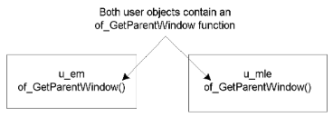
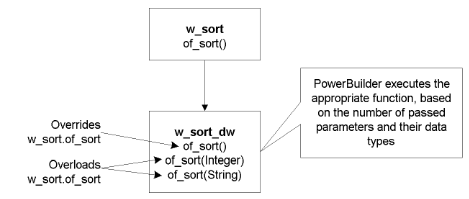
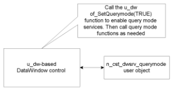
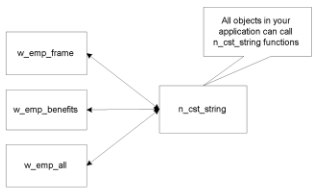
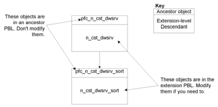
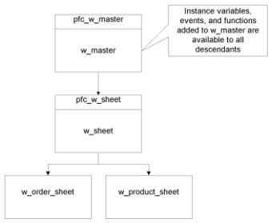
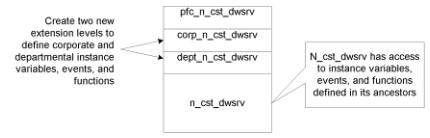

# About the PowerBuilder Foundation Class Library

**About this chapter**

This chapter introduces the PowerBuilder Foundation Class Library (PFC). It includes PFC basics, prerequisite PowerBuilder concepts, object-oriented concepts, and a list of PFC components.

| Contents Topic | Page |
| --- | --- |
| Understanding PFC | 3 |
| Understanding PowerBuilder | 4 |
| How PFC uses object orientation | 8 |
| How PFC uses the extension level | 11 |
| The PFC components | 15 |

## Understanding PFC

The PowerBuilder Foundation Class Library (PFC) is a set of PowerBuilder objects that you customize and use to develop class libraries. You can use these objects to provide corporate, departmental, or application consistency. PFC also includes objects that you use as is for utility purposes, such as debugging.

**PowerBuilder objects**

PFC is written in PowerBuilder and delivered as PowerBuilder objects with supporting PowerScript source code. It uses advanced PowerBuilder object-oriented coding techniques, and features a service-oriented design—that ensures that your application uses the minimum amount of computer resources.

**Read the code** PFC uses many advanced PowerBuilder coding techniques. You can use the PowerBuilder PowerScript editor to examine the objects, instance variables, events, and functions in PFC ancestor objects.

**What this book contains**

This book explains PFC concepts (what things are and why you use them) as well as usage information (how to program using PFC).

**For more information**

For detailed information on PFC objects, instance variables, events, and functions, see the *PFC Object Reference*.

## Understanding PowerBuilder

You use PFC to create advanced, object-oriented PowerBuilder class libraries. To get the most out of PFC and its object-oriented features, you must understand PowerBuilder and its object-oriented features. This section gives an overview of the PowerBuilder concepts with which you should be familiar.

**Building PFC applications out of the box** PFC is designed primarily for building class libraries. But nothing prevents you from using PFC as is to build applications.

For complete information on PowerBuilder concepts, see the *PowerBuilder User’s Guide*.

### PowerBuilder libraries and objects

PFC is delivered as a set of PowerBuilder libraries (PBLs). These libraries contain the ancestor and descendent objects you use to write an application with PFC.

**PowerBuilder libraries**

Before you can use any PFC objects, you must add the PFC libraries to your application’s library search path. PowerBuilder uses the library search path (which you define in the Target properties sheet) to find referenced objects during execution.

**PowerBuilder objects**

These are the main PowerBuilder objects you use with PFC:

| PowerBuilder objects | Purpose |
| --- | --- |
| Windows | The interface between a user and a PowerBuilder application |
| Menus | Lists of commands that a user can select in the currently active window |
| DataWindow objects | Used to retrieve, present, and manipulate data |
| User objects | Reusable components that you define once and use many times |

There are two types of user objects:

- Visual user objects
- Class user objects

**Visual user objects** A visual user object is a reusable visual control or set of visual controls with a predefined behavior. PFC includes two types of visual user objects:

- **Standard visual user objects** PFC provides a full set of standard visual user objects. Each PFC standard visual user object corresponds to a PowerBuilder window control. These objects include predefined behaviors that provide complete integration with PFC services. In particular, the u_dw DataWindow user object, offers extensive functionality and integration with PFC services.
- **Custom visual user objects** PFC also use custom visual user objects. Custom visual user objects contain a group of window controls. These objects provide advanced functionality for use in specific situations.

PFC does not use external visual user objects. For complete information on visual user objects, see the *PowerBuilder User’s Guide*.

**Class user objects** A class user object is a reusable nonvisual control you use to implement processing with no visual component. PFC includes two types of class user objects:

- **Standard class user objects** Inherit their definitions from built-in PowerBuilder system objects. PFC provides standard class user objects for transaction, error, and all other extendable system objects.
- **Custom class user objects** Inherit their definitions from the PowerBuilder NonVisualObject class. Custom class user objects encapsulate data and code. This type of class user object allows you to define an object class from scratch.

  PFC uses custom class user objects to implement many of its services and provides functions to enable instances of these service objects.

  It also provides **reference variables**, which are pointers to an instantiated object. You use a reference variable to access an object’s instance variables, functions, and events.

**Functions**

PowerBuilder supports global functions and object functions. PFC performs much of its processing through user-object functions. A **function** is a collection of PowerScript statements that perform some processing. You pass zero or more arguments to a function, and it may return a value.

For complete information on PFC object functions, see the *PFC Object Reference*.

**Events and user events**

Windows, user objects, and controls each have a predefined set of events. PFC extends this by defining user events for many PFC objects. Events can accept arguments and may return a value.

There are three types of PFC events:

| This type of event | Executes when the user performs |
| --- | --- |
| Predefined PowerBuilder events | An action that causes the operating system to invoke the event |
| Predefined user event | An action (such as selecting a menu item) that causes PFC to trigger the user event |
| Empty user events (you add PowerScript code) | An action (such as selecting a menu item) that causes PFC to trigger the user event |

You can also add code to call, trigger, or post predefined events and user events.

**In this book** Unless otherwise qualified, this book uses the word *event* to refer to all three types.

**Functions and events compared**

Functions and events are similar in many ways: they may accept arguments and return values; they both consist of PowerScript statements; they can be called, triggered, and posted. But there are some differences between functions and events:

| Feature | Functions | Events |
| --- | --- | --- |
| Call to nonexistent method | Invoking a nonexistent function at runtime produces an error | Invoking a nonexistent event with TriggerEvent yields a return value of -1 |
| Processing of ancestor script | Functions override ancestor processing (although they can call ancestor functions using the Super keyword) | Events can extend or override ancestor processing |
| Access | Object functions can be public, private, or protected | Events always have public access |
| Overloading | Functions of the same name can take different arguments | Events cannot be overloaded |

### Object-oriented programming

Object-oriented programming tools support three fundamental principles: inheritance, encapsulation, and polymorphism.

**Inheritance**

**Inheritance** means that objects can be derived from existing objects, with access to their visual component, data, and code. Inheritance saves coding time, maximizes code reuse, and enhances consistency.

**Encapsulation**

**Encapsulation** (also called information hiding) means that an object contains its own data and code, allowing outside access as appropriate. PFC implements encapsulation as follows:

- PFC defines object functions and instance variables as public or protected, depending on the desired degree of outside access. PFC does not use the private access level.
- For readable instance variables, PFC generally provides an *of_Getvariablename* function.
- For Boolean instance variables, PFC generally provides an *of_Isvariablename* function.
- For modifiable instance variables, PFC generally provides an *of_Setvariablename* function.
- In certain cases, PFC defines an instance variable as public, allowing you to access it directly.

**Polymorphism**

**Polymorphism** means that functions with the same name behave differently depending on the referenced object and the number of arguments. PFC supports the following types of polymorphism:

- With **operational polymorphism**, separate unrelated objects define a function with the same name:

  

- With **inclusional polymorphism**, various objects in an inheritance chain define a function with the same name but different arguments:

**Overriding and overloading**

PowerBuilder supports both **function overriding** or **function overloading**:

- In function *overriding*, the descendent function has the same arguments or argument data types.
- In function *overloading*, the descendent function (or an identically named function in the same object) has different arguments or argument data types.

  

## How PFC uses object orientation

PFC uses all facets of PowerBuilder’s object-oriented capabilities.

**Principles**

PFC uses the three principles of object orientation:

| PFC uses | To |
| --- | --- |
| Inheritance | Implement a hierarchy of windows, menus, and user objects |
| Encapsulation | Isolate each object’s data and code |
| Polymorphism | Provide same-named functions (within one object, within an inheritance hierarchy, and among multiple objects) |

**Services**

PFC uses windows, standard class user objects, and custom class user objects to implement an object-oriented design by isolating related types of processing (such as DataWindow caching, row selection, and window resizing). These related groups of processing are called **services**. Most services are implemented as custom class user objects. PFC service types include:

| Service category | Service |
| --- | --- |
| Application services | Application preferences |
|  | DataWindow caching |
|  | Debug |
|  | Error message |
|  | Most recently used object |
|  | Security |
|  | Transaction registration |
| Window services | Base |
|  | Preferences |
|  | Sheet manager |
|  | Status bar |
| DataWindow services | Base |
|  | DataWindow resize |
|  | Drop-down search |
|  | Filter |
|  | Find |
|  | Linkage |
|  | Multitable update |
|  | Properties |
|  | Querymode |
|  | Report |
|  | Required column |
|  | Resize |
|  | Row manager |
|  | Row selection |
|  | Sort |
| DataStore services | Base |
|  | Multitable update |
|  | Print preview |
|  | Report |
| Global services | File |
|  | INI file |
|  | Logical unit of work |
|  | MetaClass |
|  | Menu |
|  | Numerical |
|  | Platform |
|  | Resize |
|  | RTE find |
|  | Selection |
|  | SQL |
|  | SQL Spy |
|  | String |

**Enabling services selectively** Selectively instantiating service objects provides you with complete flexibility in the PFC functionality used by your application—and allows your applications to use fewer resources. PFC automatically destroys all service objects created by an application.

Enabling services selectively has many benefits, including:

- Minimizing the number of ancestor objects typically found in a deep inheritance chain
- Minimizing application overhead (use only the services you need)
- Building both simple and complex applications
- Ease of use and maintenance (you do not have to write multiple scripts to override ancestor processing)

**Delegation** PFC’s service orientation reflects the object-oriented concept of **delegation**, which divides the main object and its implementation into separate object hierarchies.

PFC uses two types of relationships for delegation:

- **Aggregate relationship** The service object cannot function apart from its owning object. This is sometimes called a whole-part relationship. For example, the u_dw DataWindow visual user object uses the n_cst_dwsrv_querymode user object for query mode services:

  

- **Associative relationship** The service object can function alone. For example, string services are provided by the n_cst_string user object and are available to objects throughout your application:

  

For more information on PFC service types and how to use them, see Chapter 4, “Using PFC Services”.

## How PFC uses the extension level

No class library can meet your needs right out of the box. You typically modify PFC objects to integrate application-wide functions and objects. Without the PFC extension level, this could present a problem whenever a new version of PFC is released: applying the new version would overwrite your customizations, forcing you to reapply these changes manually.

**A separate extension level**

PFC implements an **extension level** in all its inheritance hierarchies. All extension objects reside in separate PBLs, which are not affected when you upgrade to the latest version:

| Contents | Ancestor level | Extension level |
| --- | --- | --- |
| Application and global services | PFCAPSRV.PBL | PFEAPSRV.PBL |
| DataWindow services | PFCDWSRV.PBL | PFEDWSRV.PBL |
| Visual and standard class user objects | PFCMAIN.PBL | PFEMAIN.PBL |
| Utility services | PFCUTIL.PBL | PFEUTIL.PBL |
| Window services | PFCWNSRV.PBL | PFEWNSRV.PBL |

Objects in the ancestor-level libraries contain all instance variables, events, and functions; objects in the extension-level libraries are unmodified descendants of corresponding objects in the ancestor library. But through inheritance they have access to the ancestor’s instance variables, events, and functions.

To see the instance variables, events, and functions available to a descendent object, use the PowerBuilder Browser.

Using an extension level has two major advantages:

- You can add site-, department-, and application-specific logic to extension level objects
- The extension PBLs are not affected when upgrading to the latest version

**Obsolete objects** The PFCOLD.PBL library contains obsolete objects. If you have an existing PFC application, you may need to add this library to your application target library list.

**What you do**

You customize your PFC application by modifying objects at the extension level. *You do not modify ancestor objects.* Your application’s objects use extension-level user objects and inherit from extension-level windows:

**The PFC object- naming convention**

PFC uses the following object-naming convention:

| Level | Name | Contains |
| --- | --- | --- |
| Ancestor objects | Use the prefix pfc_ | All instance variables, events, and functions |
| Extension-level objects | Have the same name as their ancestor but without the prefix pfc_ | Unmodified descendants of PFC ancestor objects |

For example, the ancestor for the DataWindow selection service object is pfc_n_cst_dwsrv; the extension-level descendant is n_cst_dwsrv. Pfc_n_cst_dwsrv contains all code for the service; n_cst_dwsrv is an unmodified descendant to which you may add application-specific instance variables and code.

**PFC-defined user events** PFC-defined user events also use the pfc_ prefix. This makes it easy for you to distinguish your application’s user events from PFC’s user events.

**PFC documentation uses extension-level names** PFC documentation always uses the extension-level name when referring to a service object. For example, this book refers to w_master when discussing the base-class window, not to pfc_w_master. But it’s important to remember that the instance variables, events, and functions available to w_master are actually defined in pfc_w_master.

For complete information on PFC object-naming conventions, see the *PFC Object Reference*.

**Sample extension scenario**

PFC’s object hierarchies allow you to add extension logic at each level. Because pfc_w_sheet inherits from w_master, for example, instance variables, functions, and events you add to w_master are available to all descendent windows:

**Adding extension levels**

The extension layer provides for reusability within an application and effectively insulates individual applications from PFC upgrades. But large installations that have department-wide (and perhaps corporate-wide) standards must extend this strategy further to implement additional levels containing corporate and departmental standards and business rules.

If you are using PFC in an organization, you may want to create additional extension levels to contain corporate or departmental variables, events, and functions. Applications still use objects in PFC extension libraries but now have access to additional ancestor instance variables, events, and functions:

## The PFC components

PFC is made up of the following:

- A set of PBLs (libraries)

  You must ensure that the objects in these PBLs are available to PFC-based applications by adding them to the application target library list.

- A database
- Code examples
- A sample application

**The PFC PBLs**

PFC is distributed with PBLs containing ancestor objects and PBLs containing extension-level objects. Each ancestor level/extension level set contains objects that perform related services:

| Libraries | Contents |
| --- | --- |
| PFCAPSRV.PBL PFEAPSRV.PBL | Application manager, application service objects, and other global service objects |
| PFCDWSRV.PBL PFEDWSRV.PBL | DataWindow services, including user objects and utility windows |
| PFCMAIN.PBL PFEMAIN.PBL | Standard visual user object, custom visual user object, and standard class user objects |
| PFCUTIL.PBL | Utility objects and services |
| PFEUTIL.PBL |  |
| PFCWNSRV.PBL | Window services, including user objects, and utility windows |
| PFEWNSRV.PBL |  |
| PFCOLD.PBL | Obsolete PFC objects (base and extension-level objects) |

**Use the Library painter** Use the PowerBuilder Library painter to see a list of all objects in PFC libraries.

**The PFC database**

PFC ships with the pfc.db local database. This database contains the following tables:

| Table | Usage |
| --- | --- |
| Messages | Error message service |
| Security_apps | Security service |
| Security_groupings | Security service |
| Security_info | Security service |
| Security_template | Security service |
| Security_users | Security service |

The PFC local database is intended for developer use only. If your application uses the error message service or security service, you should copy these tables to a server database, as described in “Deploying database tables”.

**The PFC code examples**

Use the PFC code examples to view PFC objects and services in action and learn how to code and implement most common PFC functionality. The PFC code example interface provides extensive cross-reference and usage information.

The Examples app is in the `examples` folder of the [2025-Solution](https://github.com/OpenSourcePFCLibraries/2025-Solution) repository; its [README](https://github.com/OpenSourcePFCLibraries/2025-Solution/blob/master/examples/README.md) describes setting it up. Each example's help topic is in [PFCEXAMP.pdf](https://github.com/OpenSourcePFCLibraries/Example-application-help-file/releases/latest/download/PFCEXAMP.pdf).

**The PFC sample application**

Use PEAT (the PFC sample application) to see an example of PFC used in a project estimation and tracking system.

PEAT is in the `demoapp` folder of the 2025-Solution repository; its [README](https://github.com/OpenSourcePFCLibraries/2025-Solution/blob/master/demoapp/README.md) describes setting it up. Both applications show their menus as a ribbon, use a UI theme, and use SVG images, as described in “Giving a PFC application a current look” in [Chapter 6](06-using-pfc-windows-and-menus.md#giving-a-pfc-application-a-current-look).
