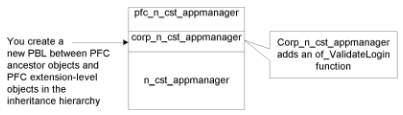
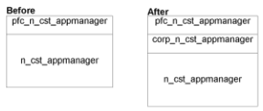
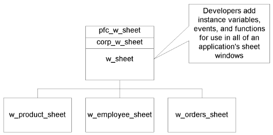
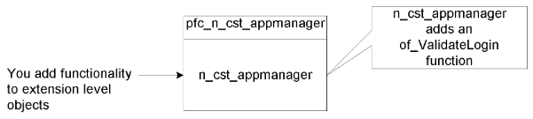
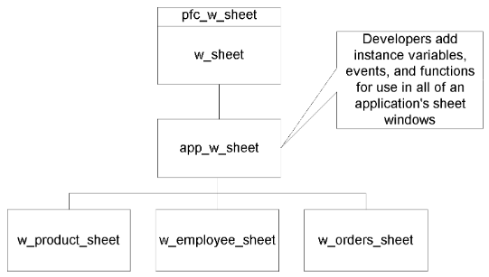

# Designing a Class Library

**About this chapter**

This chapter explains how to use PFC as the basis for your own class library.

| Contents Topic | Page |
| --- | --- |
| Using PFC to design a class library | 19 |
| Choosing an extension strategy | 20 |
| Defining a new service | 24 |

## Using PFC to design a class library

PFC is a foundation upon which you build class libraries, leveraging PFC’s extensible service-oriented architecture to customize behavior and extend capabilities—and even define your own services.

**The object administrator**

PowerBuilder users who use PFC to design class libraries are **object administrators**. Object administrators can be:

- **Corporate and departmental analysts** Create PFC-based class libraries to enable consistency and enhance functionality
- **Consultants** Create PFC-based class libraries to add value to their services
- **Vendors** Use PFC as the basis for advanced class libraries that meet the needs of a specific set of developers

**Your role**

As object administrator, you will use PFC in a different way from developers. You will customize and enhance PFC functionality for use by all developers. You need a thorough understanding of PFC, as well as of your organization’s needs. Based on anticipated usage, you will extend PFC by adding and customizing objects, services, instance variables, events, and functions.

Your first step is to choose a PFC extension strategy.

## Choosing an extension strategy

Although there are many ways in which sites extend and implement PFC, there are two main PFC extension strategies:

- Create an intermediate extension level
- Use the existing PFC extension level

**Using separate physical files**

Regardless of strategy, each PFC application should have its own set of physical files. You cannot share ancestor files (those whose name starts with PFC). This is because of internal interdependencies of high-level extension objects, such as w_master.

For example, assume that applications 1 and 2 have their own sets of PFE extension-level libraries but share ancestor libraries. Application 1 adds a function of_SetData to w_master in its version of PFEMAIN.PBL; this function is available to all descendants of w_master, including pfc_w_main, pfc_w_frame, and pfc_w_sheet in the shared ancestor libraries. Application 2 then regenerates the application.

Because application 2 has no of_SetData function in its PFEMAIN.PBL, all internal references to of_SetData are removed from w_master descendants, resulting in execution time and compiler errors for application 1.

### Creating an intermediate extension level

To create objects that accommodate corporate or departmental usage but that also allow developers to freely add application-wide code to the extension level, you can define one or more intermediate extension levels. These intermediate extension-level objects contain site- and department-specific instance variables, events, and functions.

Following this strategy, you create a new extension level between the PFC ancestor level and the PFC extension level. Then you redefine the PFC extension hierarchy so that intermediate extension level objects descend from PFC ancestor objects and PFC extension level objects descend from objects in the intermediate extension level. Because PFC objects use the data type of PFC extension level objects when declaring reference variables, these changes become available immediately.

For example, you might create a customized descendant of pfc_n_cst_appmanager:



**Advantages**

This strategy has two advantages:

- Changes made to the objects in the intermediate extension level are available to descendent objects in the PFC extension level
- The developer has complete control over the PFC extension level

**Naming standards** You should give objects in the intermediate extension level a standard prefix that reflects their usage. For example, if the intermediate extension level contains additional class library functionality, use classlib_ as the prefix; if the intermediate extension level contains corporate extensions, use corp_ as the prefix.

**What you do**

You add, modify, and extend PFC through objects in the intermediate extension level.

To implement an intermediate extension level, you can use the Library Extender or create intermediate extension level objects manually.



**Use the Library Extender** It’s best to use the Library Extender to create intermediate extension levels.

See “Library Extender”.

**To manually create an additional extension level and redefine the inheritance hierarchy:**

1. Create a PBL to contain intermediate extension level objects.
2. Define objects in the intermediate extension level (by inheriting from objects in the PFC ancestor level) and define instance variables, functions, and events as necessary. You can also define new objects in the intermediate extension level.
3. Define instance variables, events, and functions in the extension level objects as necessary.
4. Redefine the inheritance hierarchy by creating new PFC extension-level objects that inherit from the newly defined extension level (instead of inheriting from the PFC ancestor level).

**How developers work**

This type of extension level usage gives developers complete control of the PFC extension level. They can:

- Modify and use extension-level user objects
- Modify and inherit from extension-level windows, including w_master
- Modify and inherit from extension-level menus (optionally using them directly)

For example, developers might add application-specific functionality to w_sheet and use it as the ancestor for all sheet windows:



### Using the existing PFC extension level

Following this strategy, you add corporate or departmental modifications to the PFC extension level. *Developers do not use the extension level*.



**Advantages**

This strategy has two advantages:

- Developers can share a common set of PBLs during the development phase
- Users can share a common set of PBDs when deploying multiple PFC applications

**Disadvantages**

This strategy has several disadvantages:

- Developers cannot modify extension level objects. Changes are lost when the object administrator creates a new version
- There is only one extension level. Corporate, departmental, and class library extensions must all exist at the same level
- Developers cannot extend extension level objects. Because PFC uses the data type of PFC extension level objects when declaring reference variables, changes to descendent objects are not automatically available throughout PFC

**What you do**

You add, modify, and extend PFC through objects in the PFC extension level.

To create a new service, you add the object to the extension level and there is no need for an ancestor object.

**How developers work**

When working with this extension strategy, developers use PFC services but do not modify any objects in the PFC extension level.

All developer extensions must be done through inheritance. For example, developers might add application-specific functionality to an application sheet window and use it as the ancestor for all sheet windows:



## Defining a new service

After researching your requirements, you may need to define a new service. This might be an associative service (working with a main object such as a DataWindow, DataStore, or window) or an aggregate service for use anywhere in an application.

**Where to define it** If you are *using the existing PFC extension level*, define your new service in one or more separate PBLs.

If you are *creating an extension level*, define your ancestor object in the intermediate extension level (the corporate level in the example ahead) and your extension level object in the PFC extension level.

**To define an associative service:**

1. Create a custom class user object that contains the necessary instance variables, functions, and events. For example, define a DataWindow service to perform automatic row insertion. In this case, the object should inherit from n_cst_dwsrv.
2. Save this user object in the intermediate extension level. For example, if you have an intermediate level for corporate objects, it might be named corp_n_cst_dwsrv_autorowinsert.
3. Create a descendent user object in the extension level. For example, n_cst_dwsrv_autorowinsert. Add no code to this object.
4. Add an instance variable to the main object in the intermediate extension level. This variable should use the data type of the extension level object. For example, update corp_u_dw by adding an inv_autorowinsert instance variable of type n_cst_dwsrv_autorowinsert.
5. Add a function to the main object in the intermediate extension level. This function should create or destroy an instance of your user object as specified by a passed boolean argument. For example, of_SetAutoRowInsert might create or destroy an instance of n_cst_dwsrv_autorowinsert as follows:

   ```
   // Function name: of_SetAutoRowInsert
   // Arguments: ab_switch (boolean by value)
   // Returns: 1 = Success
   //          0 = Already instantiated
   //         -1 = Argument was NULL
   IF IsNull(ab_switch) THEN
     Return -1
   END IF
   IF ab_switch THEN
     IF IsNull(inv_autorowinsert) OR  &
       NOT IsValid(inv_autorowinsert) THEN
        inv_autorowinsert = CREATE n_cst_autorowinsert
        // of_SetRequestor = defined in ancestor
        inv_autorowinsert.of_SetRequestor(this)
        Return 1
     END IF
   ELSE
     IF IsValid(inv_autorowinsert) THEN
       DESTROY inv_autorowinsert
       Return 1
     END IF
   END IF
   Return 0
   ```

6. Add code to the Destructor event of the main object in the intermediate extension level. This code should destroy your user object:

   ```
   this.of_SetAutoRowInsert(FALSE)
   ```

7. Add code as necessary to events in the main object. This code should call events on the service object, if enabled. For example, the automatic row insertion service might add the following code to the RowFocusChanging event:

   ```
   IF IsValid(inv_autorowinsert) THEN
      inv_autorowinsert.Event corp_FocusChanging &
         (currentrow, newrow)
   END IF
   ```

**To define an aggregate service:**

1. Create a custom class user object that contains the necessary instance variables, functions, and events. Optionally assign the AutoInstantiate property to this object.
2. Save this user object in the intermediate extension level.
3. Create a descendent user object in the extension level. Add no code to this object.
4. Use this object in event and function scripts as necessary. Reference variables for this object should use the data type of the extension level object.
