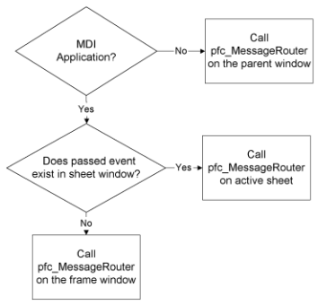
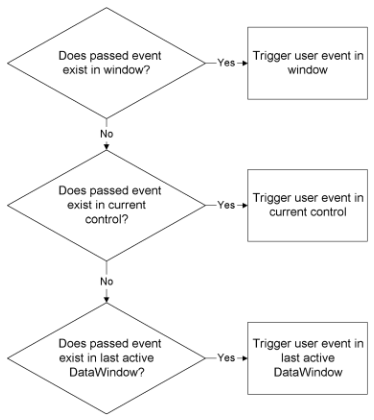

# PFC Programming Basics

**About this chapter**

This chapter explains basic PFC programming practices and tells you how to get started with a PFC application.

**Assumptions** This chapter and all remaining chapters in this manual assume an intermediate extension level strategy, which allows the developer to modify and extend objects in the PFC extension level.

| Contents Topic | Page |
| --- | --- |
| Setting up the application manager | 29 |
| Building applications | 33 |
| Using attribute objects | 38 |
| Using PFC constants | 40 |
| The message router | 41 |
| Transaction management with PFC | 43 |
| Calling ancestor functions and events | 45 |
| Adding online Help to an application | 46 |
| Installing PFC upgrades | 47 |

## Setting up the application manager

The first step in creating an application with PFC is configuring and enabling the application manager, n_cst_appmanager. Within the application manager, you code logic that would otherwise be in the Application object.

The application manager also has instance variables and functions to maintain application attributes, such as the frame window, application and user INI files or registry keys, and the application Help file.

**To set up the application manager:**

1. Define an application target library list that contains PFC PBLs:
- PFCAPSRV.PBL
- PFCDWSRV.PBL
- PFCMAIN.PBL
- PFCUTIL.PBL
- PFCWNSRV.PBL
- PFEAPSRV.PBL
- PFEDWSRV.PBL
- PFEMAIN.PBL
- PFEUTIL.PBL
- PFEWNSRV.PBL

**PFCOLD.PBL** If your application uses obsolete PFC objects from a previous release of PFC, include PFCOLD.PBL in the library list.

2. From the Application painter, display the Variable view and declare a global variable, gnv_app, of type n_cst_appmanager:

   ```
   n_cst_appmanager   gnv_app
   ```

**The variable name must be gnv_app** PFC objects, functions, and events require that you define the application manager as gnv_app, with a data type of n_cst_appmanager (or an n_cst_appmanager descendant).

3. In the painter Script view, add PowerScript code to your application’s Open event to create n_cst_appmanager and call the pfc_Open event:

   ```
   gnv_app = CREATE n_cst_appmanager
   gnv_app.Event pfc_Open(commandline)
   ```

4. Add code to your application’s Close event to call the pfc_Close event and destroy n_cst_appmanager:

   ```
   gnv_app.Event pfc_Close( )
   DESTROY gnv_app
   ```

5. Add code to your application’s SystemError event to call the pfc_SystemError event:

   ```
   gnv_app.Event pfc_SystemError( )
   ```

6. Close the Application painter and save the changes.
7. Display the User Object painter and open n_cst_appmanager, found in PFEAPSRV.PBL. (Optionally, use an application-specific descendant of n_cst_appmanager.)
8. Call n_cst_appmanager functions in the Constructor event to initialize instance variables for version, company, and INI file.
9. Call n_cst_appmanager functions in the pfc_Open event to enable the application services you want:

   | To enable this service | Call this function |
   | --- | --- |
   | Application preference | of_SetAppPreference |
   | DataWindow caching | of_SetDWCache |
   | Error | of_SetError |
   | Most recently used object | of_SetMRU |
   | Transaction registration | of_SetTrRegistration |
   | Security | of_SetSecurity |
   | Debug | of_SetDebug |

10. Add code to the pfc_Open user event to open your application’s initial window (typically the frame window), optionally including a call to the of_Splash function, which displays a splash screen.
11. (Optional) Add code to the pfc_PreAbout, pfc_PreLogonDlg, and pfc_PreSplash events to customize elements of the About box, logon dialog box, and splash screen.
12. (Optional) Add code to the pfc_Idle, pfc_ConnectionBegin, and pfc_ConnectionEnd events. If so:
    - Call pfc_Idle from the application’s Idle event.
    - Call pfc_ConnectionBegin from the application’s ConnectionBegin event.
    - Call pfc_ConnectionEnd from the application’s ConnectionEnd event.
13. Save n_cst_appmanager.

**To display a splash screen:**

- Call the of_Splash function just before opening the initial window in the pfc_Open event:

  ```
  this.of_Splash(1)
  Open(w_tut_frame)
  ```

**To display a logon screen:**

1. Call the of_LogonDlg in the frame window’s Open event:

   ```
   Integer  li_return
   li_return = gnv_app.of_LogonDlg( )
   IF li_return = 1 THEN
          this.SetMicroHelp("Logon successful")
   ELSE
          MessageBox("Logon", "Logon failed")
          Close(this)
   END IF
   ```

Of_LogonDlg displays the w_logon dialog box, which prompts for user ID and password and calls the n_cst_appmanager pfc_Logon event when the user clicks OK.

Alternatively, you can call the of_LogonDlg function in the n_cst_appmanager pfc_Open event, immediately after opening the frame window. Do not call of_LogonDlg immediately after calling of_Splash.

2. Add script to the n_cst_appmanager pfc_Logon event to log the user on to the database. This example assumes an INI file that contains all information except user ID and password; it also assumes you’ve associated SQLCA with n_tr, PFC’s customized Transaction object:

   ```
   Integer  li_return
   String  ls_inifile, ls_userid, ls_password

   ls_inifile = gnv_app.of_GetAppIniFile()
   IF SQLCA.of_Init(ls_inifile,"Database") = -1 THEN
          Return -1
   END IF
   // as_userid and as_password are arguments
   // to the pfc_Logon event
   SQLCA.of_SetUser(as_userid, as_password)
   IF SQLCA.of_Connect() = -1 THEN
          Return -1
   ELSE
          gnv_app.of_SetUserID(as_userid)
          Return 1
   END IF
   ```

## Building applications

**Building MDI applications**

To build an MDI application with PFC, use the w_frame and w_sheet windows as the ancestors for your frame and sheet windows. To define events, functions, and instance variables for all your application’s sheets, add them to w_sheet.

You must also define menu items for all sheet windows in an ancestor sheet menu (m_master, m_frame, or an application-specific sheet-menu ancestor, depending on your menu strategy).

For information on the strategies you can use to implement menus under PFC, see “Using menus with PFC”.

**To build an MDI application with PFC:**

1. Add application-specific modifications to w_frame, optionally creating a frame window that inherits from w_frame.
2. (Optional) Add ancestor instance variables, functions, and user events to w_sheet.
3. Create sheet windows that inherit from w_sheet.
4. Create a frame menu according to your menu strategy, optionally using m_frame, PFC’s frame menu.
5. Associate the frame window with the customized frame menu.
6. Create sheet menus according to your menu strategy.
7. Associate sheet windows with sheet menus.
8. Open the frame window in the n_cst_appmanager pfc_Open user event.
9. (Optional) Enable frame window services as necessary:
   - Enable the status bar service by calling the w_frame of_SetStatusBar function
   - Enable the sheet manager service by calling the w_frame of_SetSheetManager function

**To open sheet windows in an MDI application:**

1. Add code to the Clicked event for the menu items that open sheet windows. This code should assign the sheet window name to Message.StringParm and call the of_SendMessage function, passing the pfc_Open event name:

   ```
   n_cst_menu lnv_menu
   Message.StringParm = "w_products"
   lnv_menu.of_SendMessage(this, "pfc_Open")
   ```

2. Add code to the w_frame pfc_Open event that accesses Message.StringParm and opens the specified sheet window:

   ```
   String  ls_sheet
   w_sheet lw_sheet

   ls_sheet = Message.StringParm
   OpenSheet(lw_sheet, ls_sheet, this, 0, Layered!)
   ```

**Building SDI applications**

To build an SDI application with PFC, use the w_main window as the ancestor for your main windows. To implement events, functions, and instance variables so they are available in all windows, add them to w_main.

If your windows use menus, you must also define menus for each window.

For information on the strategies you can use to implement menus under PFC, see “Using menus with PFC”.

**To build an SDI application with PFC:**

1. Create a main window that inherits from w_main, optionally modifying w_main directly.
2. Create a main menu according to your menu strategy.
3. Create additional windows and menus as appropriate.
4. Open the main window in the n_cst_appmanager pfc_Open user event.

**Programming using PFC functions**

Almost all PFC functions are object functions. This means they are defined within a PowerBuilder object (Window, Menu, or user object). Encapsulating functions within a PowerBuilder object enables you to quickly see which functions apply to the object.

PFC uses the Set/Get/Is naming convention to control access to instance variables:

- of_Set functions allow you to set the value of an instance variable
- of_Get functions allow you to access a nonboolean instance variable
- of_Is functions allow you to determine the state of a boolean instance variable

**Other types of instance variable access** PFC also declares certain instance variables as public, allowing you to access them directly. Additionally, some variables are for internal use only and are not accessible via function call.

In addition to the Set/Get/Is convention, PFC uses a Register/UnRegister convention when defining a set of entities to be affected by a service. For example, you call the u_calculator object’s of_Register function to define the DataWindow columns that use a drop-down calculator.

**Object qualification** PFC uses access levels (public, private, protected) to control your access to functions designed for internal use.

When you call these functions from outside the object, use dot notation to qualify the function name. Qualify the function name with the reference variable used to create the object (in some cases you qualify the function name with the actual object name).

**To call PFC object functions:**

1. Ensure that the object has been created.

   PowerBuilder creates windows, menus, and visual user objects when the window opens. You create most class user objects using an of_Set*servicename* function (defined in u_dw, n_cst_appmanager, w_master, or u_dw).

   For example, the following u_dw object function creates the sort service (n_cst_dwsrv_sort user object) and saves a reference to it in u_dw’s inv_sort instance variable. You typically code these functions in the DataWindow’s Constructor event:

   ```
   this.of_SetSort(TRUE)
   ```

**Autoinstantiated objects** Certain PFC objects use PowerBuilder’s autoinstantiate feature. These objects have no Set functions; PowerBuilder instantiates them automatically when you declare them as variables.

2. Call object functions from your application, as appropriate.

   This example specifies that the sort service will use DataWindow column header names, sort on displayed values, implement point-and-click sorting, and display a drag-drop style dialog box when the user selects View>Sort from the menu bar:

   ```
   this.inv_sort.of_SetColumnNameSource &
          (this.inv_sort.HEADER)
   this.inv_sort.of_SetUseDisplay(TRUE)
   this.inv_sort.of_SetColumnHeader(TRUE)
   this.inv_sort.of_SetStyle &
          (this.inv_sort.DRAGDROP)
   ```

**Function overloading** PFC uses function overloading to provide a rich, flexible application programming interface. It implements function overloading in two ways:

- **Multiple syntaxes** Multiple functions contain arguments that use different data types or are in a different order. This allows PFC to handle many types of data in function arguments
- **Optional arguments** Multiple functions contain an increasing number of arguments with the same data types and in the same order. This allows PFC to provide defaults for commonly used arguments

**Overloaded functions for internal use only** In addition to a series of Public overloaded functions, PFC often provides a Protected version, which the other versions call internally. For example, the n_cst_dwsrv_report of_AddLine function has four Public versions, and one Protected version that is called by the other four. Although you can call Protected versions in some cases, they are intended for internal use only and are subject to change.

**Programming using PFC events**

PFC includes precoded events and user events, which perform processing to implement PFC services. It also includes empty user events, which allow you to add application-specific code to perform application-specific tasks.

All events have public access and you can use dot notation to call them.

**Using precoded events and user events**

PFC includes extensive precoded functionality. This means that by enabling a PFC service, PFC objects detect the enabled service and perform the processing defined in the precoded events.

An example of a precoded event is the u_dw Clicked event, which calls certain DataWindow service functions if they are enabled.

You can extend these events; do not override them.

For information on accessing the return value from an ancestor event, see “Calling ancestor functions and events”.

**Using empty user events**

PFC includes empty user events into which you can add application-specific code. Many of these events are triggered by menu items, using the message router. Others are meant to be triggered by application-specific code.

An example of an empty user event is the u_dw pfc_Retrieve event, to which you add logic that retrieves rows:

```
Return this.Retrieve()
```

For complete information on PFC user events, see the *PFC Object Reference*.

**How PFC uses events**

When using events in the context of services, PFC typically behaves as follows:

1. Within the event on the requestor object, call the corresponding event on the service object, passing arguments as appropriate. For example, the u_dw Clicked event calls the n_cst_dwsrv_sort pfc_Clicked event, passing the x position, y position, row, and DW object (that is, the arguments to the DataWindow Clicked event).
2. The event on the service object performs the required action, calling other object functions as appropriate. For example, the n_cst_dwsrv_sort pfc_Clicked event performs extensive processing, including calls to n_cst_dwsrv_sort functions.

**Use the events** Although you can usually call PFC object functions directly, it’s easier to call the corresponding events since they already contain error checking.

**Using PFC pre-event processes**

PFC includes many pre-event processes, to which you add code that customizes or extends the functionality of the associated event. For example, you add code to the pfc_PreRMBMenu event to control the items that appear in a pop-up menu. Other events that feature pre-event processing include:

- pfc_PreAbout
- pfc_PreClose
- pfc_PreLogonDlg
- pfc_PreOpen
- pfc_PrePageSetupDlg
- pfc_PrePrintDlg
- pfc_PreRestoreRow
- pfc_PreSplash
- pfc_PreToolbar
- pfc_PreUpdate

Typically, these events are passed an autoinstantiated user object by reference. This user object contains properties used to control processing in the associated event. You modify user object properties to modify or extend processing. In some cases, you will need to modify additional objects. For example, to control the display of an additional field in the About box, you might:

1. Extend the n_cst_aboutattrib user object by adding an instance variable that contains the value to be displayed in the w_about window (a user ID in the example ahead).
2. Add the field to the w_about window (sle_userid in the example ahead).
3. Add code to the w_about Open event that accesses the n_cst_aboutattrib user object (available as the inv_aboutattrib instance variable) and copies the user ID to the SingleLineEdit:

   ```
   sle_userid.text = inv_aboutattrib.is_userid
   ```

4. Add code to the n_cst_appmanager pfc_PreAbout event to initialize the value:

   ```
   anv_aboutattrib.is_userid = this.of_GetUserID()
   ```

To display w_about, call the application manager of_About function.

## Using attribute objects

PFC provides a number of attribute-only user objects. These user objects:

- Contain public instance variables
- Are autoinstantiated
- Have names that end with *attrib*
- Are often used to pass information to PFC pre-event processes, such as pfc_PreAbout
- Are extensible (you can define additional instance variables)

Because you can extend these objects, PFC uses them instead of structures.

In addition to defining additional public instance variables, you can also use access levels and object functions to further customize the object’s behavior.

Attribute objects include:

| Attribute object | Associated with | Usage |
| --- | --- | --- |
| n_cst_aboutattrib | Pfc_PreAbout (n_cst_appmanager) | Open w_about by calling the n_cst_appmanager of_About function |
| n_cst_calculatorattrib | Constructor (u_calculator) | Internal |
| n_cst_calendarattrib | Constructor (u_calendar) | Internal |
| n_cst_columnattrib | ListView data access objects | Set with of_RegisterReportColumn |
| n_cst_dberrorattrib | Logical unit of work service (n_cst_luw) | Internal |
| n_cst_dirattrib | File service objects | Internal |
| n_cst_dssrv_multitableattrib | DataStore multitable update service | Internal |
| n_cst_dwcacheattrib | Caching service | Internal |
| n_cst_dwobjectattrib | Of_Describe (n_cst_dssrv and n_cst_dwsrv) | Of_Describe returns DataWindow properties in this object |
| n_cst_dwpropertyattrib | DataWindow Properties objects | Internal |
| n_cst_dwsrv_dropdownsearchattrib | Search service for DropDownDataWindows and DropDownListBoxes | Internal |
| n_cst_dwsrv_multitableattrib | DataWindow multitable update service | Internal |
| n_cst_dwsrv_querymodeattrib | Service to enable or disable query mode | Internal |
| n_cst_dwsrv_resizeattrib | DataWindow resize service | Set with n_cst_dwsrv_resize of_register function |
| n_cst_errorattrib | Error message service | Used to pass display information to w_message |
| n_cst_filterattrib | DataWindow filter service | Used to pass information to filter dialog boxes |
| n_cst_findattrib | DataWindow find service | Used to pass information to Find dialog box |
| n_cst_infoattrib | DataWindow Properties objects | Internal |
| n_cst_itemattrib | PFC ListBox, PictureListBox, and TreeView | Internal |
| n_cst_linkageattrib | DataWindow linkage service | Internal |
| n_cst_logonattrib | Pfc_PreLogonDlg (n_cst_appmanager) | Open w_logon by calling the n_cst_appmanager of_LogonDlg function |
| n_cst_lvsrvattrib | ListView data access objects | Set with of_Register |
| n_cst_mruattrib | MRU service | Use in the window’s pfc_MRUProcess and pfc_PreMRUSave events |
| n_cst_propertyattrib | DataWindow Properties objects | Internal |
| n_cst_resizeattrib | Resize service | Internal |
| n_cst_restorerowattrib | DataWindow row manager service | Internal |
| n_cst_returnattrib | DataWindow filter and sort services | Internal |
| n_cst_selectionattrib | Selection service | Populated with arguments to the n_cst_selection of_Open function |
| n_cst_sortattrib | DataWindow sort service | Used to pass information to the sort dialog boxes |
| n_cst_splashattrib | Pfc_PreSplash event (n_cst_appmanager) | Open w_splash by calling the n_cst_appmanager of_Splash function |
| n_cst_sqlattrib | SQL service | Contains the components of a SQL SELECT statement |
| n_cst_textstyleattrib | PFC RichTextEdit control | Use to get and set text properties (bold, italic, and so on) |
| n_cst_tmgregisterattrib | Timing service | Internal |
| n_cst_toolbarattrib | Pfc_PreToolbars event (w_frame) | Open w_toolbars by calling the w_frame pfc_Toolbars event |
| n_cst_trregistrationattrib | Transaction registration service | Used to track Transaction objects |
| n_cst_tvattrib | TreeView service | Internal |
| n_cst_tvsrvattrib | TreeView data access object | Set with of_Register |
| n_cst_winsrv_sheetmanagerattrib | Sheet management service | Internal |
| n_cst_winsrv_statusbarattrib | Status bar service | Internal |
| n_cst_zoomattrib | DataWindow print preview service | Internal |

## Using PFC constants

Many PFC objects include instance variables that are declared as constants. You can use these instance variables to create more readable code. For example, both of the following functions set the DataWindow linkage style, but the second is easier to understand:

```
// 1 = Filter linkage style.
dw_emp.inv_linkage.of_SetStyle(1)

// FILTER is a constant instance variable
// that is initialized to 1.
dw_emp.inv_linkage.of_SetStyle  &
   (dw_emp.inv_linkage.FILTER)
```

**Coding conventions** The PFC convention is to code constants in all caps.

## The message router

PFC uses a **message router** to handle communication between menus and windows. This customized message-passing mechanism is built into all PFC menus and windows.

**Using the message router**

Although you can use the message router to communicate between any object and a window, it is typically used to pass messages from menus to windows. It implements a customized searching algorithm to determine the appropriate object to receive the message.

By using the message router:

- Your menu script only needs to know the user event to call; it doesn’t need to know the current window or the associated control name.
- Your windows do not need to maintain user events that simply call DataWindow user events. This reduces the number of user events maintained by the window.

**Message = user event** The message passed by a message router function is actually a string containing the name of a user event to be triggered by the window or one of its controls.

**Built-in debugging messages**

The message router includes built-in debugging messages to provide error information.

**How of_SendMessage works**

When the user selects a menu item, the item’s Clicked event script calls the menu’s of_SendMessage function, passing the name of the user event to be called. Of_SendMessage calls the n_cst_menu of_SendMessage function, which calls the window’s pfc_MessageRouter event, which in turn calls the specified user event.

Of_SendMessage calls the pfc_MessageRouter user event differently depending on whether the application is MDI or SDI:



**How pfc_ MessageRouter works**

The pfc_MessageRouter user event calls the passed user event in the window, the active control, and the last active DataWindow:



**Pass messages between menus and windows** The message router is primarily a mechanism to communicate between menus and windows. Except for CommandButtons inside DataWindows, you cannot use buttons to call the pfc_MessageRouter event. This is because the message routine calls the GetFocus event to access the current control, which, after you click a CommandButton, is the button itself.

## Transaction management with PFC

One of PowerBuilder’s key strengths is its ability to access a variety of DBMSs quickly and easily. PowerBuilder uses the transaction object as a communications area between PowerScript and the database. SQLCA is the default PowerBuilder Transaction object.

**The n_tr user object**

PFC includes the **n_tr** user object. N_tr is a customized Transaction object that inherits from the Transaction system object. This customized Transaction object includes instance variables, events, and functions to encapsulate and extend database communication.

N_tr helps you manage transactions by providing a standard set of functions for performing database connects, disconnects, commits, and rollbacks. Use n_tr functions instead of native SQL transaction management statements. For example, to connect to the database, use of_Connect instead of the CONNECT statement.

**Two ways to use n_tr**

You use n_tr in two ways:

- **As a replacement for SQLCA** Use the Application painter’s Properties dialog box to specify that the default SQLCA will be of data type n_tr
- **In addition to SQLCA** Define an instance variable of type n_tr and create it programmatically

If your application requires more than one Transaction object, you will use both of these methods.

If using more than one Transaction object, you can use the transaction registration service to perform functions such as committing all open transactions or rolling back all open transactions.

See Chapter 4, “Using PFC Services”.

**To associate n_tr with SQLCA:**

1. Access the Application painter.
2. Display the Properties view, click the Additional Properties button and select the Variable Types tab.
3. Type n_tr in the SQLCA box.
4. Click OK.

**To use n_tr:**

1. If you are using a Transaction object other than SQLCA, create it.

   This example assumes an itr_security instance variable of type n_tr.

   ```
   itr_security = CREATE n_tr
   ```

2. Initialize the ib_autorollback instance variable, which specifies what to do if the application closes (or the object is otherwise destroyed) while the transaction is still connected:

   ```
   itr_security.of_SetAutoRollback(FALSE)
   ```

**Initialize ib_autorollback in the extension level** You can enforce transaction consistency by initializing ib_autorollback in the n_tr Constructor event.

3. Initialize Transaction object fields using the of_Init function:

   ```
   String   ls_inifile

   ls_inifile = gnv_app.of_GetAppIniFile()
   IF SQLCA.of_Init(ls_inifile,"Database") = -1 THEN
          MessageBox("Database",  &
             "Error initializing from " + ls_inifile)
          HALT CLOSE
   END IF
   ```

4. Connect to the database by calling the of_Connect function:

   ```
   IF SQLCA.of_Connect() = -1 THEN
          MessageBox("Database", &
             "Unable to connect using " + ls_inifile)
          HALT CLOSE
   ELSE
          gnv_app.of_GetFrame().SetMicroHelp &
             ("Connection complete")
   END IF
   ```

5. Call n_tr functions as needed.

## Calling ancestor functions and events

In extending ancestor functions and events, you may need to call the ancestor method and continue processing based on its return value. This is especially important when extending PFC events (those that begin with the pfc_ prefix) that use return codes. You must check the return code to ensure that ancestor processing succeeded before performing descendent processing.

**Overriding ancestor events** To extend a PFC event that uses a return code, you must override the event and call the ancestor event explicitly, as shown in this discussion.

Use the following syntax to call an ancestor event, passing arguments and receiving a return code:*result* = Super::Event *eventname* ( *arguments ...* )

Use the following syntax to call an ancestor function, passing arguments and receiving a return code:*result* = Super::Function *functionname* ( *arguments ...* )

This example overrides the u_dw pfc_Update event, writing to an update log if the ancestor event processes successfully:

```
Integer  li_return

// Call ancestor event, passing
// descendant's arguments.
li_return = Super::Event pfc_Update &
       (ab_accepttext, ab_resetflag)
IF li_return = 1 THEN
    // ue_WriteLog is a user-defined event.
       li_return = this.Event ue_WriteLog
END IF
Return li_return
```

## Adding online Help to an application

Online Help is an important part of any application. PFC provides functions and events to enable online Help in your application.

For information on PFC dialog Help, see “Deploying PFC dialog box Help”.

**To enable online Help in a PFC application:**

1. Within n_cst_appmanager or a descendant, you can use the Properties view to assign the complete name of the Help file to the is_helpfile instance variable.

   Alternatively, you can call the of_SetHelpFile function to establish the Help filename. You usually do this in the Constructor event:

   ```
   this.of_SetHelpFile("c:\eis\eisapp.hlp")
   ```

2. Specify the Help topic associated with the window. The pfc_PreOpen event is a good place for this:

   ```
   Long  ll_helpid

   ll_helpid = 1020  // 1020 is a Help topic ID
   ia_helptypeid = ll_helpid
   ```

This allows you to provide detailed online Help for selected windows. You can set ia_helptypeid to either a long (which PFC interprets as a Help topic ID) or a string (which PFC interprets as a search keyword).

3. (Optional) If you are not using a descendant of PFC’s m_master menu, add calls to the window’s pfc_Help user event in your menu’s Help menu items. Pfc_Help is defined in w_master so it is available in all PFC windows.
4. For dialog boxes, call the pfc_Help user event in the Help button’s Clicked event:

   ```
   Parent.Event pfc_Help( )
   ```

**PFC handles window-level Help automatically** The message router calls the active window’s pfc_Help user event when the user selects Help>Help Topics from the menu bar of a menu descended from m_master.

## Installing PFC upgrades

Updates to PFC are published in the open source PFC repository on GitHub ([OpenSourcePFCLibraries](https://github.com/OpenSourcePFCLibraries)). (When PFC was a Sybase product, updates were included in PowerBuilder maintenance releases.) The way you apply PFC maintenance depends on your PFC usage:

- **No modifications to either PFC level** If there is no modification to either the PFC ancestor level or the PFC extension level, you can simply install the new set of PBLs over the existing PBLs

  **Always make a backup copy** *Always* make a backup copy of all PFC PBLs before installing updated PBLs. These instructions assume that you have made a backup.

- **One or more intermediate extension levels or developer code in the PFC extension level** If you have changed any of the levels below the PFC ancestor level, you must ensure that extensions and other modifications are not overwritten, as described in the discussion below.

**To upgrade to the latest PFC release:**

1. Move all extension-level PBLs to a directory that will not be overwritten by the install procedure.

   **PFC ancestor objects** You should never modify PFC ancestor objects (objects with the pfc_prefix). These instructions assume no modifications have been made to PFC ancestor objects.

2. Determine your current version. You can find the current version at the top of the current PFC *readme.txt* file or in instance variables defined in pfc_n_cst_debug. The version is in the format *majorrevision*.*minorrevision*.*fixesrevision.*
3. Run the install procedure, placing the PFC PBLs in the current PFC directory and overwriting the current PFC ancestor PBLs.
4. Merge existing extension objects with new extension objects. Review the newly installed *readme.txt* file to see a list of new extension objects. There are two methods of merging existing extension objects with new extension objects:
   - **Copy new objects to customized extension PBLs** Copy each new object from the newly installed PFC extension level PBL to your customized extension PBL. Then copy the customized extension PBLs back to their original directory, overwriting the newly installed PFC extension PBLs.
   - **Copy existing objects to the new PFC extension PBL** Copy all objects from the customized extension PBLs to the appropriate newly installed PFC extension PBL.
5. Start PowerBuilder.
6. Adjust the application target library list if necessary.
7. Perform a full rebuild of the target.
