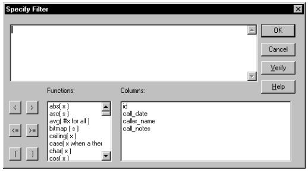
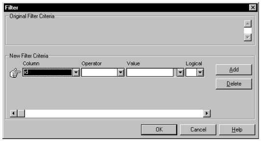
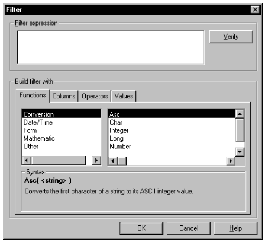
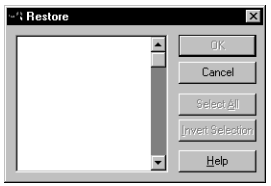
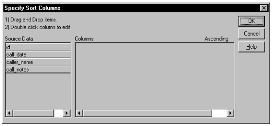
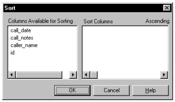
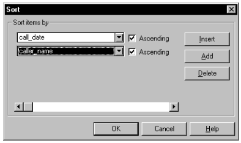
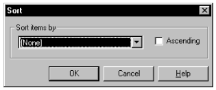

# Using PFC Services

**About this chapter**

This chapter explains PFC services and how to use them.

| Contents Topic | Page |
| --- | --- |
| Application services | 49 |
| DataWindow services | 63 |
| Window services | 89 |
| Menu service | 95 |
| Resize service | 96 |
| Conversion service | 98 |
| Date/Time service | 99 |
| File service | 101 |
| INI file service | 102 |
| Numerical service | 103 |
| Platform service | 105 |
| Selection service | 106 |
| SQL parsing service | 108 |
| String-handling service | 109 |
| Metaclass service | 111 |
| Logical unit of work service | 111 |
| List service | 114 |
| Timing service | 126 |

## Application services

PFC provides the following application services:

DataWindow caching Debugging Error Application preference Most recently used object

Security Transaction registration

You control application services through n_cst_appmanager, the application manager. Use application manager functions to enable and disable application services. Because they are scoped to the application manager, which you define as a global variable, application services are available from anywhere within your application.

### DataWindow caching service

**Overview**

The DataWindow caching service buffers data for DataWindow objects. By keeping rows in memory, the DataWindow caching service helps to reduce database access, optimizing application performance. The DataWindow caching service supports the following data sources:

- DataWindow object (using either data retrieved from the database or data stored with the DataWindow object)
- SQL statement
- DataWindow control
- DataStore control
- Rows from an array
- A file

The DataWindow caching service uses PowerBuilder DataStores to buffer data.

PFC enables DataWindow caching through the n_cst_dwcache user object.

**PFC code is in ancestor-level objects** This book always refers to extension-level objects (such as n_cst_dwcache). All PFC code is actually in ancestor-level objects (such as pfc_n_cst_dwcache).

**Usage**

Use DataWindow caching to minimize database access and optimize performance.

**To enable DataWindow caching:**

- Call the n_cst_appmanager of_SetDWCache function:

  ```
  gnv_app.of_SetDWCache(TRUE)
  ```

**To use DataWindow caching:**

1. Cache data by calling the of_Register function, passing different arguments depending on the data to be cached:
   - To cache rows retrieved from the database via a DataWindow object, pass an identifier, a Transaction object, the DataWindow object name, and arguments if any
   - To cache rows retrieved from the database via a SQL statement, pass an identifier, a Transaction object, and the SQL statement
   - To cache rows in an array, pass an identifier, the DataWindow object name, and the data
   - To cache rows from a DataWindow control, pass an identifier and the DataWindow control
   - To cache rows from a DataStore, pass an identifier and the DataStore instance
   - To cache rows from a file, pass an identifier and the filename
2. To determine if a DataWindow object is already registered with the caching service, call the of_IsRegistered function, passing the object’s identifier.
3. To access cached data from, call the of_GetRegistered function. This example assumes an ids_datastore instance variable:

   ```
   gnv_app.inv_dwcache.of_GetRegistered  &
          ("d_emplist", ids_datastore)
   ids_datastore.ShareData(dw_emplist)
   ```

4. To re-retrieve data for a cached DataWindow, call the of_Refresh function.
5. To stop caching, call the of_UnRegister function.
6. (Optional) Disable the DataWindow caching service by calling the n_cst_appmanager of_SetDWCache function:

   ```
   gnv_app.of_SetDWCache(FALSE)
   ```

In most cases, you do not disable DataWindow caching explicitly. PFC destroys n_cst_dwcache automatically when your application shuts down.

### Debugging service

**Overview**

The debugging service automatically displays messages when PFC encounters conditions that indicate an error.

The PFC message router uses the debugging service to control the display of error messages when a passed event does not exist.

**Development tool only** The PFC debugging service is a development tool only. Do not enable it in production applications.

**Usage**

Use the debugging service to help you solve problems in the PFC development environment.

**To use the debugging service:**

1. Enable the debugging service by calling the n_cst_appmanager of_SetDebug function:

   ```
   gnv_app.of_SetDebug(TRUE)
   ```

2. PFC objects check for the target’s debugging status and, in certain conditions, display error messages.
3. (Optional) Disable the debugging service by calling the n_cst_appmanager of_SetDebug function:

   ```
   gnv_app.of_SetDebug(FALSE)
   ```

In most cases, you do not disable the debugging service explicitly.

For information on SQL Spy and the DataWindow Property window (two debugging utilities supplied with PFC) see Chapter 7, “PFC Utilities”.

### Application preference service

**Overview**

You use the application preference service to save and restore application and user information using either an INI file or the Windows registry. Saving and loading application settings has two advantages:

- **Persistence** By saving application state, users don’t have to reset their application preferences each time they start the application
- **Ease of maintenance** By externalizing application settings, you can update application settings without updating code in n_cst_appmanager

PFC enables the application preference service through the n_cst_apppreference user object.

This service saves the following application information:

User key MicroHelp Help file Version Logo bitmap Copyright notice DDETimeOut property DisplayName property DWMessageTitle property MicrohelpDefault property RightToLeft property ToolbarFrameTitle property ToolbarPopMenuText property ToolbarSheetTitle property ToolbarUserControl property

The application preference service can also save the following user information:

ToolbarText property ToolbarTips property User ID

**Saving and loading settings**

The application preference service automatically loads settings when the application opens and stores them when the application closes. This information is stored in either the registry (available on Windows) or an INI file (available on all platforms), which you specify as follows:

- **Registry** Call the of_SetUserKey function, specifying the registry key that contains application preference information.
- **INI file** Call the of_SetUserINIFile function, specifying the INI file that contains application preference information.

**To use the application preference service:**

1. Enable the application preference service by calling the n_cst_appmanager of_SetAppPref function:

   ```
   gnv_app.of_SetAppPref(TRUE)
   ```

2. Specify the platform-specific repository for application preferences. This example from an application manager Constructor event saves application preferences in the registry or INI file, depending on the execution platform. It assumes you’ve already established n_cst_appmanager specifications for application key, user key, application INI file, and user INI file:

   ```
   IF this.of_IsRegistryAvailable() THEN
          this.inv_apppref.of_SetAppKey  &
         (this.of_GetAppKey())
          this.inv_apppref.of_SetUserKey  &
         (this.of_GetUserKey())
   ELSE
          this.inv_apppref.of_SetAppINIFile  &
         (this.of_GetAppINIFile())
          this.inv_apppref.of_SetUserINIFile  &
         (this.of_GetUserINIFile())
   END IF
   ```

3. Specify the types of information to save by calling the of_SetRestoreApp and of_SetRestoreUser functions:

   ```
   this.inv_apppref.of_SetRestoreApp(TRUE)
   this.inv_apppref.of_SetRestoreUser(TRUE)
   ```

### Most recently used object service

**Overview**

You use the most recently used (MRU) object service to display a list of most recently used windows on the File menu. By default this list displays up to five items, but, you can increase this number.

PFC enables the MRU service through the n_cst_mru user object.

The MRU service automatically loads MRU information when the application opens. The service saves information in either the registry (available on Windows) or an INI file (available on all platforms), which you specify as follows:

- **Registry** Call the of_SetUserKey function, specifying the registry key that contains MRU information
- **INI file** Call the of_SetUserINIFile function, specifying the INI file that contains MRU information

**You must write processing code**

To use the MRU service, you must extend the following window events in all windows that are to display on the file menu as MRU objects:

- **Pfc_MRUProcess** Add code that uses the passed MRU information to open the specified window
- **Pfc_PreMRUSave** Add code that saves MRU information
- **Pfc_MRURestore** Add code that restores MRU information

**Use IDs to identify groups of windows**

You specify IDs to identify windows or groups of windows that appear together on the file menu. By using IDs you can restrict and customize MRU display. For example, when displaying a particular sheet, you might want to restrict MRU display to instances of that sheet only. In other applications, you might want all sheets to display the same MRU items.

**Integration with PFC menus**

The PFC m_master menu includes five MRU items at the end of the File menu. You can add more MRU items if necessary.

If your application uses non-PFC menus, use m_master as a model in creating your own MRU menu items.

**To use the MRU service:**

1. Enable the MRU service by calling the n_cst_appmanager of_SetMRU function:

   ```
   gnv_app.of_SetMRU(TRUE)
   ```

2. Specify where MRU information is to be saved by calling either the n_cst_mru of_SetUserKey function (on Windows platforms) or the of_SetUserINIFile function (all platforms). This example from an application manager Constructor event saves MRU information in the registry or INI file. It assumes you’ve already established the n_cst_appmanager user key or user INI file:

   ```
   IF this.of_IsRegistryAvailable() THEN
          this.inv_mru.of_SetUserKey  &
         this.of_GetUserKey())
   ELSE
          this.inv_mru.of_SetUserINIFile  &
         (this.of_GetUserINIFile())
   END IF
   ```

3. Register IDs to be tracked by the MRU service by calling the n_cst_mru of_Register function. (An ID is the identifier that the window uses to retrieve information through the MRU service.) This is an example of code you can add to the pfc_PreOpen event of the MDI frame window:

   ```
   IF IsValid(gnv_app.inv_mru) THEN
          gnv_app.inv_mru.of_Register("myapp")
   END IF
   ```

4. Extend the pfc_MRUProcess event in each window that uses MRU processing, adding code to open the window or sheet passing the necessary arguments (be sure to add similar code to the frame window if you want to specify MRU items on the frame menu):

   ```
   Window lw_frame, lw_window
   n_cst_menu lnv_menu
   n_cst_mruattrib lnv_mruattrib

   // Check parameters.
   IF IsNull(ai_row) THEN
          Return -1
   END IF
   IF NOT IsValid(gnv_app.inv_mru) THEN
          Return -1
   END IF
   // Retrieve row from DataStore.
   gnv_app.inv_mru.of_GetItem &
      (ai_row, lnv_mruattrib)
   // Get the MDI frame, if necessary.
   lnv_menu.of_GetMDIFrame(this.menuid, lw_frame)
   OpenSheet(lw_window, &
      lnv_mruattrib.is_classname, lw_frame)
   Return 1
   ```

**Performing other actions in the pfc_MRUProcess event** To see other types of processing you can perform in the pfc_MRUProcess event, see the comments in the pfc_w_master pfc_MRUProcess event.

5. Extend the pfc_PreMRUSave event in each window that uses the MRU service. In this event, populate the n_cst_mruattrib object with the ID, classname, key, item text, and MicroHelp to be saved:

   ```
   anv_mruattrib.is_id = "myapp"
   anv_mruattrib.is_classname = this.ClassName()
   anv_mruattrib.is_menuitemname = this.Title
   anv_mruattrib.is_menuitemkey = this.ClassName()
   anv_mruattrib.is_menuitemmhelp =  &
      "Opens " + this.Title
   Return 1
   ```

6. Extend the pfc_MRURestore event in each window that uses the MRU service. In this event, set the ID of the information you want to display on the menu:

   ```
   If IsValid(gnv_app.inv_mru) Then
      Return gnv_app.inv_mru.of_Restore("myapp", This)
   End If
   ```

7. Call the pfc_MRUSave event to save MRU information. You can call this event when the window opens, when information is saved, or when the window closes (this example is from the pfc_PreOpen event):

   ```
   this.Event pfc_MRUSave()
   ```

### Error message service

**Overview**

The error message service provides many features for displaying and logging your application’s error messages. You can display messages in either the PowerBuilder MessageBox or in the PFC w_message dialog box. Both display options offer the following features:

- **Message logging** Message logging to a file, including multiplatform support. PFC automatically logs messages whose severity is greater than a specified level
- **MAPI support** Automatic error notification via e-mail (MAPI-compliant e-mail systems only). PFC automatically sends e-mail notification for messages whose severity is greater than a specified level
- **Message database** Access to a database of predefined messages (which can reside in either a database or a file). Predefined messages provide standardization of message text, elimination of duplicate messages, and ease of localization
- **Symbolic parameter replacement** Messages can have arguments that are replaced at execution time
- **Unattended option** Messages are logged (or e-mailed) but do not display

If you use the w_message dialog box, you have additional options:

- **User input and print buttons** The user can print messages and can optionally add comments (this is especially useful when logging messages and when using the automatic e-mail notification feature)
- **Automatic close** The w_message dialog box will close automatically after a specified number of seconds

**W_message bitmaps** If you use the w_message dialog box, the bitmaps it uses must be available at execution time.

**Usage**

Use the error service to handle all of your application’s message and error handling. If you are keeping messages in a database, you can either use the messages tables in PFC.DB or pipe it to your application’s database.

**Using the messages table** In most cases you should copy the messages table to your application’s database. This table contains predefined PFC error messages as well as those that you define.

**To use the error message service:**

1. Create an instance of n_cst_error by calling the n_cst_appmanager of_SetError function (this example is from an n_cst_appmanager pfc_Open event):

   ```
   this.of_SetError(TRUE)
   ```

2. Specify the error message source:
   - If the source is a file, call the following function:

     ```
     this.inv_error.of_SetPredefinedSource &
            ("c:\eisapp\eiserr.txt")
     ```

   - If the source is a database, call the following function:

     ```
     this.inv_error.of_SetPredefinedSource &
            (itr_error)
     ```

**The error message source** When using a file as the error message source, the file must contain all rows found in the PFC.DB messages table; columns must be delimited by tabs.

PFC uses predefined messages in certain situations. If you enable the error message service and receive message display errors, make sure the error message source has been established correctly.

Additional user-defined messages must conform to the format of the messages table (also used by the d_definedmessages DataWindow object).

3. (Optional) Specify the name of the log file (to disable logging, call of_SetLogFile passing an empty string):

   ```
   this.inv_error.of_SetLogFile &
          ("c:\workingdir\errlog.txt")
   ```

4. (Optional) Specify the user ID (used in message logging):

   ```
   this.inv_error.of_SetUser &
   (this.of_GetUserID())
   ```

5. (Optional) Specify the types of messages for which the error service will provide automatic notification and logging:

   ```
   this.inv_error.of_SetNotifySeverity(5)
   this.inv_error.of_SetLogSeverity(4)
   ```

6. (Optional) If your application uses the error service’s automatic notification feature, specify the current user’s e-mail ID and password. Also specify the e-mail IDs of the users to be notified automatically. This example assumes a mechanism for storing e-mail IDs and user passwords:

   ```
   this.inv_error.of_SetNotifyConnection &
          (ims_mailsess)
   this.inv_error.of_SetNotifyWho(is_autonotify)
   ```

**N_cst_appmanager pfc_Open** The steps listed above can all be coded in the n_cst_appmanager pfc_Open event.

7. In your application error checking, call the of_Message function to display messages, with optional logging and notification. The of_Message function allows you to either use the message database or specify message text dynamically. This example uses the message database:

   ```
   gnv_app.inv_error.of_Message &
   ("EIS0210")
   ```

**To use symbolic parameters (predefined messages only)**

1. Define messages in the messages table. Type % to mark the places to be replaced at runtime with symbolic parameters. For example:

   ```
   EIS1030   Unable to find the file % in %
   ```

2. Create an array of replacement arguments:

   ```
   String  ls_parms[ ]

   ls_parms[1] = "logfile.txt"
   ls_parms[2] = "c:\windows\system"
   ```

3. Call of_Message, passing the array:

   ```
   gnv_app.inv_error.of_Message("EIS1030", ls_parms)
   ```

PFC displays the message, replacing the first % with the first element in the ls_parms array and the second % with the second element in the ls_parms array.

### Security service

**Overview**

PFC’s security feature can handle many of your application’s security needs. It includes administrative components and a runtime security object, n_cst_security.

**Usage**

To use the PFC security system, you must first define users and groups, associate them with windows, menus, user objects, and controls, and then add code to your application.

**To use the security service:**

1. Define users and groups, as described in Chapter 7, “PFC Utilities”.
2. Define security for your application’s window controls, menus, user objects, and controls, as described in Chapter 7, “PFC Utilities”.
3. Create the security object by calling the n_cst_appmanager of_SetSecurity function (this example is from an n_cst_appmanager pfc_Open event):

   ```
   this.of_SetSecurity(TRUE)
   ```

4. Establish a Transaction object for the security database. This example assumes an itr_sec instance variable of type n_tr on n_cst_appmanager:

   ```
   itr_sec = CREATE n_tr
   CONNECT using itr_sec;
   ```

5. Initialize the security object by calling the of_InitSecurity function:

   ```
   this.inv_security.of_InitSecurity  &
          (itr_sec, "EISAPP", &
      gnv_app.of_GetUserID(), "Default")
   ```

**N_cst_appmanager pfc_Open** The steps listed above can all be coded in the n_cst_appmanager pfc_Open event.

6. Disconnect from the database and destroy the Transaction object when the application closes. This example might be coded in the n_cst_appmanager pfc_Close event:

   ```
   DISCONNECT using itr_sec;
   Destroy itr_sec
   ```

7. In the Open or pfc_PreOpen events of windows for which you want to apply security, call the of_SetSecurity function:

   ```
   IF NOT &
   gnv_app.inv_security.of_SetSecurity(this) THEN
      MessageBox("Security", &
         "Unable to set security")
      Close(this)
   END IF
   ```

**Other places to call of_SetSecurity** You might also call the n_cst_security of_SetSecurity function from the Constructor event of a DataWindow, visual user object, or menu for which you want to implement security.

The rest of this section describes features that are available in PFC 2025 and later. They are not available in the 2019 and 2022 versions of PFC.

**Group membership from an identity provider (PFC 2025 and later)** By default, of_InitSecurity reads the groups a user belongs to from the security database. If users sign in through an identity provider, such as an OpenID Connect server, you can pass the groups the provider reports instead, using the of_InitSecurity syntax that takes an array of group names. The identity provider is then the only source of group membership: the user doesn't need to be defined in the security database, and groups that aren't defined there are ignored. Group definitions (name and priority) and the settings for windows and controls still come from the security database.

```
string ls_groups[]
// ls_groups holds the user's groups from the identity provider,
// mapped to the group names in the security database
this.inv_security.of_InitSecurity &
   (itr_sec, "EISAPP", gnv_app.of_GetUserID(), ls_groups, "")
```

Group names in the security database are limited to 16 characters, so you may need to map longer identity provider group names to PFC group names. To sign users in with OpenID Connect and get their groups, use the n_cst_appmanager of_OpenIDLogonDlg function, which opens w_openid_logon (see the *PFC Object Reference*). When membership comes from an identity provider, set the Security Administrator's ExternalGroupMembership option, as described in Chapter 7, "PFC Utilities".

**Keeping restrictions in place (PFC 2025 and later)** of_SetSecurity applies the settings when you call it. Code that later sets a control's Enabled or Visible property, for example to enable a Save button when data changes, can undo them. There are two ways to prevent that:

- Before enabling or showing a control, check whether the user's settings allow it, with of_IsEnabledAllowed or of_IsVisibleAllowed:

  ```
  cb_save.Enabled = lb_changed AND &
     gnv_app.inv_security.of_IsEnabledAllowed(cb_save)
  ```

- After code changes several controls, call of_ApplyRestrictions. It applies the Disable and Invisible settings again, but never enables or shows anything. (Calling of_SetSecurity again is not the same: it also enables and shows controls whose setting is Enable, undoing your application's own state.)

  ```
  gnv_app.inv_security.of_ApplyRestrictions(this)
  ```

PFC's Window menu and MRU service call of_ApplyRestrictions themselves after they enable or show menu items.

**Control types PFC doesn't list (PFC 2025 and later)** The security service secures controls of types it doesn't recognize, such as types added in a later PowerBuilder release, through their Visible property only: a setting of Enable shows the control, and Invisible or Disable hide it, because the service can't disable a control without knowing its type. In earlier versions, PFC displays a message and ends the application when it finds such a control.

**Deny by default (PFC 2025 and later)** By default, the security service only changes the controls that have a setting for the user; all other controls are left as you designed them. For least-privilege security, you can give a default status to everything that has no setting, so the security database only needs to grant access (Enable). Call the n_cst_security of_SetDefaultStatus function after of_InitSecurity:

```
gnv_app.inv_security.of_SetDefaultStatus &
   (gnv_app.inv_security.DISABLE)
```

With DISABLE, controls and menu items that have no setting for the user are disabled; with INVISIBLE, they're hidden. NOTSET (the default) turns this off. of_SetSecurity then applies the default after the settings, also to windows that have no settings at all. The default only restricts: it never shows a control you hid or enables one you disabled.

The default applies to:

- Interactive controls, such as command buttons, edit controls, list boxes, and DataWindow controls, including the controls inside user objects and tabs
- Menu items that have no submenu, and their toolbar buttons

These are left as designed: static text, lines and shapes, group boxes, pictures, progress bars, animations, the MDI client, status bar, MDI tabbed bar, and ribbon bar, user objects and tabs themselves, cascading menu items, menu separators, and DataWindow columns (columns change only with explicit settings). To change which objects the default applies to, override the n_cst_security of_IsDefaultEligible function.

of_ApplyRestrictions, of_IsEnabledAllowed, and of_IsVisibleAllowed use the default too. Calling of_SetSecurity for a single object (for example, from a user object's Constructor event) applies only the settings, not the default.

### Transaction registration service

**Overview**

The transaction registration service tracks the transaction objects used by your application. This service is for use with Transaction objects based on n_tr.

PFC enables transaction registration through the n_cst_trregistration user object.

**Usage**

Use this service to keep track of transactions when your application uses more than one transaction.

When your application closes, this object automatically destroys all open registered transactions. Set the n_tr ib_autorollback instance variable to TRUE to cause closing transactions to COMMIT; set ib_autorollback to FALSE to cause a ROLLBACK. You set this instance variable with the n_tr of_SetAutoRollback function.

**To enable the transaction registration service:**

- Call the n_cst_appmanager of_SetTrRegistration function:

  ```
  gnv_app.of_SetTrRegistration(TRUE)
  ```

The application manager destroys the transaction registration service automatically when the application closes.

**To register a transaction:**

- Call the n_cst_trregistration of_Register function:

  ```
  gnv_app.inv_trregistration.of_Register(SQLCA)
  ```

**To control whether the transaction registration service commits or rolls back open transactions when it is destroyed:**

- Call the n_tr of_SetAutoRollback function:

  ```
  SQLCA.of_SetAutoRollback(TRUE)
  ```

If you set autorollback to TRUE and the object is still connected, the service rolls back open transactions when it is destroyed; if you set it to FALSE, it commits open transactions. However, to ensure that transactions close properly, your application should issue COMMITs, ROLLBACKS, and DISCONNECTs explicitly.

**To establish a transaction name:**

- Call the n_tr of_SetName function:

  ```
  itr_security.of_SetName("Security")
  ```

**To close all transactions explicitly:**

1. In the application manager pfc_Close event (or some other appropriate place), call the n_cst_trregistration of_GetRegistered function:

   ```
   n_tr   ltr_trans[]
   Integer  li_max, li_count

   li_max =  &
      this.inv_trregistration.of_GetRegistered  &
        (ltr_trans)
   ```

2. Loop through the n_tr array, committing and destroying transactions as appropriate:

   ```
   FOR li_count = 1 to li_max
   COMMIT using ltr_trans[li_count];
   DESTROY ltr_trans[li_count]
   NEXT
   ```

## DataWindow services

Most production-strength PowerBuilder applications make intense use of DataWindow controls. PFC provides a wide variety of DataWindow services that you can use to add production-strength features to an application. Many of these services require little or no coding on your part.

PFC implements DataWindow services through a set of custom class user objects that descend from a common ancestor. The ancestor object contains functions, events, and instance variables that are required by multiple services. Each DataWindow service contains additional functions, events, and instance variables.

**Accessing DataWindow services**

To access DataWindow services, you create DataWindow objects that are based on the u_dw user object. U_dw contains:

- Functions to enable and disable DataWindow services
- Instance variables that allow you to reference each service’s functions, events, and instance variables (this type of instance variable is called a **reference variable**)
- Precoded events and user events that call the DataWindow service’s functions and events
- Empty user events to which you add code to perform application-specific processing

**Use u_dw for all DataWindow controls** Use the u_dw user object for all of your application’s DataWindow controls.

**Enabling DataWindow services**

Each DataWindow control enables only the required DataWindow services. This minimizes application overhead.

The following table lists DataWindow services and how they are implemented:

| DataWindow service | Implementation |
| --- | --- |
| Basic DataWindow service (ancestor for all other services) | n_cst_dwsrv |
| Drop-down search service | n_cst_dwsrv_dropdownsearch |
| Filter service | n_cst_dwsrv_filter |
| Find and replace service | n_cst_dwsrv_find |
| Linkage service | n_cst_dwsrv_linkage |
| Multitable update service | n_cst_dwsrv_multitable |
| Print preview service | n_cst_dwsrv_printpreview |
| DataWindow property service | n_cst_dwsrv_property |
| Querymode service | n_cst_dwsrv_querymode |
| Reporting service | n_cst_dwsrv_report |
| Required column service | n_cst_dwsrv_reqcolumn |
| DataWindow resize service | n_cst_dwsrv_resize |
| Row management service | n_cst_dwsrv_rowmanager |
| Row selection service | n_cst_dwsrv_rowselection |
| Sort service | n_cst_dwsrv_sort |

### DataWindow services ancestor

**Overview**

The DataWindow services ancestor contains instance variables, events, and functions for use by all other DataWindow services. You can use many of the ancestor functions too.

PFC enables basic DataWindow services through the n_cst_dwsrv user object.

**DataStore services** This service is available to the n_ds DataStore via the n_cst_dssrv user object.

**Usage**

Use this service for general DataWindow functionality, including:

- Getting and setting DataWindow information
- As an alternative to the Modify and Describe PowerScript functions
- DataWindow service defaults

**Ancestor functions are available in the descendants** Because the n_cst_dwsrv user object is the ancestor for all DataWindow services, its functions are also available through any of the descendent DataWindow service user objects.

**To enable basic DataWindow services:**

- Call the u_dw of_SetBase function:

  ```
  dw_emplist.of_SetBase(TRUE)
  ```

U_dw destroys the service automatically when the DataWindow is destroyed.

**To access DataWindow information:**

- Call one of the following n_cst_dwsrv functions:

  | Function | When to call |
  | --- | --- |
  | of_Describe | To access information on DataWindow attributes and columns |
  | of_GetHeaderName | To determine the header name for a specified DataWindow column |
  | of_GetHeight | To determine a column’s height |
  | of_GetObjects | To access the names of the objects within a DataWindow |
  | of_GetWidth | To determine a column’s width |
  | of_GetItem of_GetItemAny | To retrieve data for a DataWindow column, regardless of data type |

**To set DataWindow data:**

- Call one of the following n_cst_dwsrv functions:

  | Function | When to call |
  | --- | --- |
  | of_Modify | To set DataWindow attributes and columns |
  | of_SetItem | To set or modify the display value for a DataWindow column, regardless of datatype |

**To refresh all DropDownDataWindows in a DataWindow:**

- Call the of_PopulateDDDWs function:

  ```
  Integer li_return

  li_return = &
         dw_emplist.inv_base.of_PopulateDDDWs()
  gnv_app.of_GetFrame().SetMicroHelp &
         (String(li_return) + " DDDW columns
  refreshed")
  ```

**To access DataWindow service defaults:**

- Call one of the following n_cst_dwsrv functions:

  | Function | When to call |
  | --- | --- |
  | of_GetColumnDisplayName | To determine when DataWindow services display when referring to columns |
  | of_GetColumnNameStyle | To determine what DataWindow services display when referring to columns |
  | of_GetDefaultHeaderSuffix | To determine the default DataWindow suffix for header columns |
  | of_GetDisplayItem of_GetDisplayUnits | To determine the text displayed when displaying CloseQuery message |
  | of_SetColumnDisplayNameStyle | To specify what DataWindow services display when referring to columns: |
  |  | • DataWindow column names |
  |  | • Database column names |
  |  | • DataWindow column header names |
  | of_SetDefaultHeaderSuffix | To specify the default DataWindow suffix for header columns (_t is the default) |
  | of_SetDisplayItem of_SetDisplayUnits | To specify the text displayed when displaying CloseQuery message |

### Drop-down DataWindow search service

**Overview**

The PFC drop-down DataWindow search service automatically scrolls drop-down DataWindows to items that begin with the typed letter. For example, when a user types S in a drop-down DataWindow, this service automatically scrolls the list to the first item that begins with S. If the user then types A, the service scrolls to the first item that begins with A.

PFC enables the drop-down DataWindow search service through the n_cst_dwsrv_dropdownsearch user object.

**Usage**

You establish drop-down DataWindow search functionality by enabling the service and adding code to two DataWindow events.

**To enable the drop-down DataWindow search service:**

1. Call the u_dw of_SetDropDownSearch function:

   ```
   this.of_SetDropDownSearch(TRUE)
   ```

U_dw destroys the service automatically when the DataWindow is destroyed.

2. In the DataWindow control’s EditChanged event, add a call to the n_cst_dropdownsearch pfc_EditChanged event:

   ```
   this.inv_dropdownsearch.Event pfc_EditChanged &
          (row, dwo, data)
   ```

3. In the DataWindow control’s ItemFocusChanged event, add a call to the n_cst_dwsrv_dropdownsearch pfc_ItemFocusChanged event:

   ```
   this.inv_dropdownsearch.Event &
          pfc_ItemFocusChanged(row, dwo)
   ```

4. Specify the DropDownDataWindow column for which the service is enabled by calling the of_AddColumn function:

   ```
   this.inv_dropdownsearch.of_AddColumn("dept_id")
   ```

### Filter service

**Overview**

The PFC filter service allows you to provide easy-to-use filter capabilities in a DataWindow.

Use this service to add filter capabilities to your application.

PFC enables the filter service through the n_cst_dwsrv_filter user object.

**Usage**

The filter service displays Filter dialog boxes automatically. All you do is enable the service and specify the filter style you want. You can choose among three styles of filter dialog boxes:

- Default PowerBuilder Filter dialog box:

  

- Drop-down list box interface (w_filtersimple):

  

- Tabbed interface (w_filterextended):

  

**To enable the filter service:**

- Call the u_dw of_SetFilter function, set the Transaction object, and specify that Filter dialog boxes use DataWindow column header names:

  ```
  dw_emp.of_SetFilter(TRUE)
  dw_emp.of_SetTransObject(SQLCA)
  dw_emp.inv_filter.of_SetColumnDisplayNameStyle &
     (dw_emp.inv_filter.HEADER)
  ```

**Filtering by column header** If you filter by column header, make sure that all columns added to the DataWindow have headers, and that these conform to the naming scheme for headers. The default naming scheme uses the suffix _t, but you can change this by calling the of_SetDefaultHeaderSuffix function.

U_dw destroys the service automatically when the DataWindow is destroyed.

**To specify the filter style:**

- Call the of_SetStyle function, specifying the Filter dialog box type:

  ```
  dw_emplist.inv_filter.of_SetStyle  &
     (dw_emp.inv_filter.SIMPLE)
  ```

**To display the filter dialog box:**

- Call the pfc_FilterDlg event:

  ```
  dw_emplist.inv_filter.Event pfc_FilterDlg( )
  ```

You do not typically call this event. In most cases, the user displays the Filter dialog box by selecting View>Filter from the menu bar.

### Find and replace service

**Overview**

The PFC find service allows you to add find and replace functionality to your application’s DataWindows.

PFC enables the find and replace service through the n_cst_dwsrv_find user object.

**Usage**

You can use the find service to add find and replace functionality to DataWindows, displaying either the w_find dialog box or the w_replace dialog box. These boxes display automatically if you’ve enabled the find service and the user selects Edit>Find or Edit>Replace from the menu bar of a menu that descends from PFC’s m_master menu.

**To enable the find service:**

- Call the u_dw of_SetFind function:

  ```
  dw_emplist.of_SetFind(TRUE)
  ```

U_dw destroys the service automatically when the DataWindow is destroyed.

**To display the w_find dialog box:**

- Call the u_dw pfc_FindDlg event:

  ```
  dw_emplist.Event pfc_FindDlg()
  ```

You do not typically call this event. In most cases, the user displays the w_find dialog box by selecting Edit>Find from the menu bar.

**To display the w_replace dialog box:**

- Call the u_dw pfc_ReplaceDlg event:

  ```
  dw_emplist.Event pfc_ReplaceDlg()
  ```

You do not typically call this event. In most cases, the user displays the w_replace dialog box by selecting Edit>Replace from the menu bar.

### Linkage service

**Overview**

The PFC linkage service helps you to create master/detail windows and other types of windows that require coordinated processing.

The linkage service contains the following features:

- **Linkage style** Controls whether detail DataWindows retrieve rows, filter rows, or scroll to the appropriate row
- **Update style** Controls how the linkage service updates DataWindows (top-down, bottom-up, top-down then bottom-up, bottom-up then top-down, or a developer-specified custom update)
- **Confirm on row change** When the master changes rows, this option displays a confirmation dialog if modifications made to detail DataWindows will be lost
- **Confirm on delete** Displays a confirmation dialog when the user deletes rows
- **Cascading key changes** The linkage service automatically updates detail DataWindows when you change a key value on the master
- **Delete style** When you delete a master row, this option specifies whether the linkage service deletes detail rows, discards detail rows, or leaves them alone
- **Extended update** Allows you to integrate other controls (such as ListViews, TreeViews, and DataStores) into the default save process

The linkage service is completed integrated with n_cst_luw and with the w_master pfc_Save process.

**Sharing data between DataWindows** You can use the PowerScript ShareData function to share data between master and detail DataWindows. However, do not insert rows into the detail DataWindow when sharing data.

PFC enables the linkage service through the n_cst_dwsrv_linkage user object.

**Usage**

You can use the linkage service to coordinate any type of processing among DataWindows. However, the most common use is for master/detail processing.

**To enable the linkage service:**

- Call the u_dw of_SetLinkage function:

  ```
  dw_emplist.of_SetLinkage(TRUE)
  ```

U_dw destroys the service automatically when the DataWindow is destroyed.

**To use the linkage service to coordinate Master/Detail processing:**

1. Enable the linkage service for both the master and detail DataWindows by calling the u_dw of_SetLinkage function, once for each DataWindow:

   ```
   dw_master.of_SetLinkage(TRUE)
   dw_detail.of_SetLinkage(TRUE)
   ```

2. Call the u_dw of_SetTransObject function to establish the Transaction object for the master and detail DataWindows:

   ```
   dw_master.inv_linkage.of_SetTransObject(SQLCA)
   ```

3. Link the detail to the master by calling the of_SetMaster function in the detail DataWindow:

   ```
   dw_detail.inv_linkage.of_SetMaster(dw_master)
   ```

4. Register the related columns by calling the of_Register function:

   ```
   dw_detail.inv_linkage.of_Register &
          ("emp_id","emp_id")
   ```

5. (Optional) Specify that the service updates DataWindows from the bottom of the linkage chain on up (the default is to update top down):

   ```
   dw_detail.inv_linkage.of_SetUpdateStyle  &

     (dw_detail.inv_linkage.BOTTOMUP)
   ```

6. Establish the action taken by the detail when a row changes in the master by calling the of_SetStyle function.

   This example specifies that the detail DataWindow retrieves a row whenever the master changes:

   ```
   dw_detail.inv_linkage.of_SetStyle  &
     (dw_detail.inv_linkage.RETRIEVE)
   ```

7. Call the master DataWindow’s of_Retrieve function:

   ```
   IF dw_master.of_Retrieve( ) = -1 THEN
          MessageBox("Error","Retrieve error")
   ELSE
          dw_master.SetFocus( )
   END IF
   ```

**Previous steps can be in one script** You can code the previous steps in a single event, such as the window Open event.

8. Add retrieval logic to the master DataWindow’s pfc_Retrieve event:

   ```
   Return this.Retrieve( )
   ```

**Retrieving rows** If the linkage service refreshes detail rows via retrieval, you only need to code a Retrieve function for the master DataWindow. With the filter and scroll options, you must also code Retrieve functions in detail DataWindows.

**To enable confirm on row change (retrieval style only):**

1. Call the of_SetUpdateOnRowChange function for the detail DataWindow:

   ```
   dw_detail.inv_linkage.of_SetUpdateOnRowChange(TRUE)
   ```

2. Call the of_SetConfirmOnRowChange function for the detail DataWindow:

   ```
   dw_detail.inv_linkage.of_SetConfirmOnRowChange  &
      (TRUE)
   ```

**To enable confirm on delete:**

1. Call the of_SetUpdateOnRowChange function for the detail DataWindow:

   ```
   dw_detail.inv_linkage.of_SetUpdateOnRowChange(TRUE)
   ```

2. Call the of_SetConfirmOnDelete function for the detail DataWindow:

   ```
   dw_detail.inv_linkage.of_SetConfirmOnDelete(TRUE)
   ```

**To enable cascading key changes:**

- Call the of_SetSyncOnKeyChange function for every DataWindow in the linkage chain:

  ```
  dw_master.inv_linkage.of_SetSyncOnKeyChange(TRUE)
  dw_detail.inv_linkage.of_SetSyncOnKeyChange(TRUE)
  ```

**To specify deletion style:**

- Call the of_SetDeleteStyle function for all master DataWindows in the linkage chain:

  ```
  dw_master.inv_linkage.of_SetDeleteStyle  &

     (dw_cust.inv_linkage.DISCARD_ROWS)
  ```

**To enable extended update:**

- Call the of_SetOtherSaveObjects function to add other controls to the default save process:

  ```
  PowerObject  lpo_objs[ ]

  // This example adds the lv_salesinfo ListView
  // to the save process.
  lpo_objs[1] = lv_salesinfo
  dw_master.inv_linkage.of_SetOtherSaveObjects  &
    (lpo_objs)
  ```

### Multitable update service

**Overview**

The PFC multitable update service makes it easy for you to update DataWindows containing columns from multiple tables.

PFC enables multitable update services through the n_cst_dwsrv_multitable user object.

**DataStore services** This service is available to the n_ds DataStore via the n_cst_dssrv_multitable user object.

**Usage**

Use this service when you need to update rows for a DataWindow that contains data from more than one table. When you call the w_master pfc_Save event, PFC updates all specified tables in all DataWindows on the window.

**To enable the multitable update service:**

- Call the u_dw of_SetMultiTable function:

  ```
  dw_emplist.of_SetMultiTable(TRUE)
  ```

U_dw destroys the service automatically when the DataWindow is destroyed.

**To specify the tables to be updated:**

- Call the of_Register function once for each table to be updated in a multitable update:

  ```
  String  ls_projcols[ ] =  &
         {"proj_id"}
  String  ls_taskcols[ ] =  &
         {"proj_id", "task_id"}

  dw_project.inv_multitable.of_Register  &
         ("project", ls_projcols)
  dw_project.inv_multitable.of_Register  &
         ("task", ls_taskcols)
  ```

**(Optional) To update a DataWindow that contains data from multiple database tables:**

- Call the w_master pfc_Save event:

  ```
  Integer  li_return

  li_return = w_sheet.Event pfc_Save()
  ...
  ```

### Print preview service

**Overview**

The PFC print preview service enables you to provide DataWindow print preview capabilities:

- Print preview
- First page, next page, previous page, last page
- Zoom

Menus that descend from PFC’s m_master menu have automatic access to this functionality.

PFC enables the print preview service through the n_cst_dwsrv_printpreview user object.

**DataStore services** This service is available to the n_ds DataStore via the n_cst_dssrv_printpreview user object.

**Usage**

Use this service to provide print preview capabilities in your applications. Users enter print preview mode by selecting File>Print Preview from the menu bar.

**To enable the print preview service:**

- Call the u_dw of_SetPrintPreview function:

  ```
  dw_emplist.of_SetPrintPreview(TRUE)
  ```

U_dw destroys the service automatically when the DataWindow is destroyed.

### DataWindow properties service

**Overview**

The DataWindow properties service enables display of the DataWindow Properties window, which allows you to:

- Selectively enable and disable DataWindow services
- View the PFC syntax for the selected service
- Access and modify DataWindow properties interactively, including:

DataWindow buffers Row and column status Statistics Properties of all objects on the DataWindow object

See “DataWindow Properties window”.

**Usage**

Use this service to enable display of the DataWindow Properties window.

**To enable the DataWindow properties service:**

1. Call the u_dw of_SetProperty function:

   ```
   dw_emplist.of_SetProperty(TRUE)
   ```

U_dw destroys the service automatically when the DataWindow is destroyed.

2. When the DataWindow displays, right-click and select DataWindow Properties.

   The DataWindow Properties window displays.

### Query mode service

**Overview**

The PFC query mode service makes it easier for you to provide query mode capabilities in applications. The service also helps users to understand and use query mode.

While in query mode, users can right-click to display a pop-up menu with options that display columns, operators, and values.

For complete information on DataWindow query mode, see the *PowerBuilder User’s Guide*.

PFC enables the query mode service through the n_cst_dwsrv_querymode user object.

**Usage**

Use this service for the following:

- Beginning and ending query mode
- Specifying the columns eligible for query mode
- Saving queries to a file and loading previously saved queries

**To enable the query mode service:**

- Call the u_dw of_SetQuerymode function:

  ```
  dw_emplist.of_SetQuerymode(TRUE)
  ```

U_dw destroys the service automatically when the DataWindow is destroyed.

**To begin query mode:**

- Call the of_SetEnabled function, passing TRUE:

  ```
  dw_emplist.inv_querymode.of_SetEnabled(TRUE)
  ```

**To end query mode:**

- Call the of_SetEnabled function, passing FALSE:

  ```
  dw_emplist.inv_querymode.of_SetEnabled(FALSE)
  ```

**To specify columns eligible for query mode:**

- Call the of_SetQueryCols function, passing an array listing the columns eligible for query mode:

  ```
  String  ls_cols[]

  ls_cols[1] = "emp_dept_id"
  ls_cols[2] = "emp_id"
  dw_emplist.inv_querymode.of_SetQueryCols(ls_cols)
  ```

When you call of_SetEnabled, the query mode service protects ineligible columns.

**To save a query to a file:**

1. Start query mode by calling of_SetEnabled (TRUE).
2. Allow the user to specify query mode criteria.
3. Call the of_Save function.

   This function displays a dialog box that prompts the user for the name of the file in which to save the query.

**To load a query from a file:**

- Call the of_Load function.

  This function displays a dialog box that prompts the user to select a saved query from disk. If the user selects a file, this function uses the selected file to determine selection criteria.

### Reporting service

**Overview**

The PFC reporting service allows you to provide enhanced viewing and printing capabilities in an application’s DataWindows.

Many of this service’s functions provide the option of either executing the DataWindow Modify function or returning Modify syntax for use as input to your own Modify function. If you code more than two consecutive report service functions, consider returning the Modify syntax, concatenating the strings and issuing the Modify function from within your own code.

**DataWindows must use PBUs or pixels** To use this service, the DataWindow object must use PBUs or pixels as the DataWindow Unit. It does not work with DataWindows that use thousandths of an inch or thousandths of a centimeter as the DataWindow Unit.

PFC enables reporting services through the n_cst_dwsrv_report user object.

**DataStore services** This service is available to the n_ds DataStore via the n_cst_dssrv_report user object.

**Usage**

Use this service for the following:

- Adding items to a DataWindow
- Creating a composite DataWindow out of one or more individual DataWindows (allowing multiple DataWindows to print as a single report)
- Formatting and printing
- Setting background, color, and border
- Zooming a DataWindow relative to its current size

**To enable the reporting service:**

- Call the u_dw of_SetReport function:

  ```
  dw_emplist.of_SetReport(TRUE)
  ```

U_dw destroys the service automatically when the DataWindow is destroyed.

**To add items to a DataWindow:**

- Call one of the following n_cst_dwsrv_report functions:

  | Function | What it does |
  | --- | --- |
  | of_AddCompute | Adds a computed column |
  | of_AddLine | Adds a line |
  | of_AddPicture | Adds a bitmap |
  | of_AddText | Adds text |

**To create a composite DataWindow:**

1. Call the of_CreateComposite function, passing information on the DataWindows to be included in the composite:

   ```
   String   ls_dws[ ], ls_trailfooter[ ]
   String   ls_slide[ ]

   String   ls_return
   Integer  li_return
   Boolean  lb_vertical
   Border   lbo_border[ ]

   lb_vertical = TRUE
   ls_dws[1] = "d_employee"
   ls_dws[2] = "d_benefits"
   ls_trailfooter[1] = "No"
   ls_trailfooter[2] = "Yes"
   ls_slide[1] = "AllAbove"
   ls_slide[2] = "AllAbove"
   lbo_border[1] = Lowered!
   lbo_border[2] = Lowered!

   li_Return = &
          dw_composite.inv_report.of_CreateComposite &
          (ls_dws, lb_vertical, ls_trailfooter, &
          ls_slide, lbo_border)
   IF li_Return = 1 THEN
          dw_composite.SetTransObject(SQLCA)
          dw_composite.Event pfc_Retrieve( )
   END IF
   ```

2. Print or display the composite DataWindow as appropriate.

   ```
   dw_composite.inv_report.of_PrintReport &
          (TRUE, FALSE)
   ```

**To print a DataWindow:**

- Call the of_PrintReport function.

**To set defaults, color, and border:**

- Call one of the following n_cst_dwsrv_report functions:

  | Function | What it does |
  | --- | --- |
  | of_SetDefaultBackColor of_SetDefaultBorder of_SetDefaultCharset of_SetDefaultColor of_SetDefaultFontFace of_SetDefaultFontSize | Modifies DataWindow defaults |
  | of_SetBorder | Modifies the border for one or more objects in a DataWindow |
  | of_SetColor | Modifies the color and background color (if applicable) of one or more objects in a DataWindow |

**To control DataWindow zoom:**

- Call the of_SetRelativeZoom function.

  **Zoom is relative to the current display** Of_SetRelativeZoom modifies zoom percentage relative to the current zoom percentage. For example, if a DataWindow is currently displayed at 80% and you specify of_SetRelativeZoom (50), the function changes the zoom percentage to 40%.

### Required column service

**Overview**

The PFC required column service. This service enables and disables default DataWindow processing for required fields. This makes it easier for your application to handle interdependent fields within a DataWindow.

This service applies only to DataWindow columns that use the nilisnull property. For example, EditMasks don’t have this property, so the required column service doesn’t apply to edit masks.

PFC enables the required column service through the n_cst_dwsrv_reqcolumn user object.

**Usage**

DataWindow required fields processing can interfere with the user-directed interface offered by a GUI application. The required column service allows you to defer required fields processing until the user completes data entry.

The service allows you to specify columns for which PowerBuilder should still perform required fields processing.

**Required fields checking** When you call the window’s pfc_Save event, it automatically performs required fields checking before updating the database.

**To enable the required column service:**

- Call the u_dw of_SetReqColumn function:

  ```
  dw_emplist.of_SetReqColumn(TRUE)
  ```

U_dw destroys the service automatically when the DataWindow is destroyed.

**To override the service for certain columns:**

- Call the of_RegisterSkipColumn to specify which columns should retain standard PowerBuilder required fields processing:

  ```
  dw_emplist.inv_reqcolumn.of_RegisterSkipColumn  &
         ("dept_id")
  ```

### Row management service

**Overview**

The PFC row management service allows you to insert and delete rows. The row management service also provides a function to undo row deletions.

PFC enables the row management service through the n_cst_dwsrv_rowmanager user object.

**Usage**

Use this service for the following:

- Adding an empty row to the end of the DataWindow
- Inserting an empty row between two existing rows
- Deleting one or more rows
- Displaying a dialog box allowing you to restore deleted rows

**To enable the row management service:**

- Call the u_dw of_SetRowManager function:

  ```
  dw_emplist.of_SetRowManager(TRUE)
  ```

U_dw destroys the service automatically when the DataWindow is destroyed.

**To add an empty row to the end of the DataWindow:**

- Call the pfc_AddRow event:

  ```
  Long  ll_return

  ll_return =  &
         dw_emplist.inv_rowmanager.Event pfc_AddRow()
  IF ll_return = -1 THEN
         MessageBox("Error", "Error adding empty row")
  END IF
  ```

PFC calls this event automatically when the user selects Add from the m_dw pop-up menu.

**To insert an empty row between two existing rows:**

- Call the pfc_InsertRow event.

  This example inserts before the current row:

  ```
  Long  ll_return

  ll_return = dw_emplist.inv_rowmanager.Event &
         pfc_InsertRow()
  IF ll_return = -1 THEN
         MessageBox("Error", "Insert error")
  END IF
  ```

PFC calls this event automatically when the user selects Insert from the m_dw pop-up menu.

**To delete rows:**

- Call the pfc_DeleteRow event.

  This example deletes the current row or all selected rows:

  ```
  Long  ll_return

  ll_return =  &
         dw_emplist.inv_rowmanager.pfc_DeleteRow()
  IF ll_return = -1 THEN
         MessageBox("Error", "Deletion error")
  END IF
  ```

PFC calls this event automatically when the user selects Delete from the m_dw pop-up menu.

To allow users to select multiple rows, use the row selection service.

**To restore deleted rows:**

- Call the pfc_RestoreRow event.

  This event calls the of_UnDelete function, which displays the w_restorerow dialog box, allowing users to restore deleted rows:

  

### Row selection service

**Overview**

The PFC row selection service allows you to provide single-, multi-, and extended selection capabilities in a DataWindow.

PFC enables the row selection service through the n_cst_dwsrv_rowselection user object.

**Usage**

The row selection service handles all row selection automatically. All you have to do is enable the service and specify the desired selection style:

- **Single-row selection** Handles row selection when your DataWindow allows one row to be selected at a time.
- **Multirow selection** Handles row selection by allowing your runtime users to select multiple rows with single clicks. These rows can be contiguous or noncontiguous.

  When multirow selection is enabled, runtime users toggle a row’s selected state by clicking it. This capability is similar to a list box’s MultiSelect attribute.

- **Extended selection** Handles row selection by allowing your runtime users to select multiple rows with SHIFT+click and CTRL+click.

  When extended selection is enabled, runtime users select multiple contiguous rows using SHIFT+click and noncontiguous rows using CTRL+click. This capability is similar to a list box’s ExtendedSelect attribute.

**To enable the row selection service:**

- Call the u_dw of_SetRowSelect function:

  ```
  dw_emplist.of_SetRowSelect(TRUE)
  ```

U_dw destroys the service automatically when the DataWindow is destroyed.

**To specify the row selection style:**

- Call the of_SetStyle function, passing the selection style you want. This example enables extended selection:

  ```
  dw_emplist.inv_rowselect.of_SetStyle  &
         (dw_emplist.inv_rowselect.EXTENDED)
  ```

### DataWindow resize service

**Overview**

The DataWindow resize service allows you to resize the columns in a DataWindow control when the user resizes the window.

Use this service to add resize capabilities to the columns that display in a DataWindow.

PFC enables the DataWindow resize service through the n_cst_dwsrv_resize user object.

**Usage**

You use the DataWindow resize service to enable resizing of the objects displayed in a DataWindow object (so that when the user resizes the window, this service resizes DataWindow contents automatically).

**Presentation styles** You cannot use the DataWindow resize service with DataWindow objects that have the Composite or RichTextEdit presentation style.

This service provides two resizing options:

- **For simple resizing** Call the of_Register function passing n_cst_dwsrv_resize constants, such as FIXEDBOTTOM
- **For total control over resizing** Implement weighted resize by calling the of_Register function with explicit specifications for moving and scaling

**To enable the DataWindow resize service:**

1. Call the u_dw of_SetResize function, set the Transaction object, and specify that Sort dialog boxes use DataWindow column header names:

   ```
   dw_emp.of_SetResize(TRUE)
   ```

U_dw destroys the service automatically when the DataWindow is destroyed.

2. (Optional) Specify the DataWindow control’s original size by calling the of_SetOrigSize function. You call this function if an MDI application opens MDI sheets with an enumeration other than Original!:

   ```
   this.inv_resize.of_SetOrigSize  &
          (this.width, this.height)
   ```

3. (Optional) Call the of_SetMinSize function to specify a minimum size below which the DataWindow resize service no longer resizes DataWindow contents:

   ```
   this.inv_resize.of_SetMinSize  &
          (this.width-50, this.height-100)
   ```

4. Specify the columns to be resized and how they should be resized by calling the of_Register function:

   ```
   this.inv_resize.of_Register("emp_fname",  &
          0, 0, 50, 50)
   this.inv_resize.of_Register("emp_lname",  &
          100, 0, 50, 50)
   ```

5. Enable the window resize service and register the DataWindow control (this example is from a window Open event):

   ```
   this.of_SetResize(TRUE)
   this.inv_resize.of_Register(dw_1, 0, 0, 100, 100)
   ```

6. (Optional) Call the of_UnRegister function to remove columns from the resize list.

### Sort service

**Overview**

The PFC sort service allows you to provide easy-to-use sort capabilities in a DataWindow.

Use this service to add sort capabilities to your application. For example, you might add a menu item that calls the pfc_SortDlg event.

PFC enables the sort service through the n_cst_dwsrv_sort user object.

**Usage**

The sort service displays Sort dialog boxes automatically. All you do is enable the service and specify the sort style you want. You can choose among four styles of sort dialog boxes:

- Default PowerBuilder Sort dialog box:

  

- Drag and drop sorting (w_sortdragdrop dialog box):

  

- Multicolumn sorting (w_sortmulti dialog box):

  

- Single-column sort (pfc_w_sortsingle dialog box):

  

Additionally, you can allow the user to sort by clicking on column headings (for column header sorting, the column header object must be in the primary header band of the DataWindow)

**To enable the sort service:**

- Call the u_dw of_SetSort function and specify that Sort dialog boxes use DataWindow column header names:

  ```
  dw_emp.of_SetSort(TRUE)
  dw_emp.inv_sort.of_SetColumnDisplayNameStyle  &
     (dw_emp.inv_sort.HEADER)
  ```

**Sorting by column header** If you sort by column header, make sure that all columns added to the DataWindow have headers, and that these conform to the naming scheme for headers. The default naming scheme uses the suffix _t, but you can change this by calling the of_SetDefaultHeaderSuffix function.

U_dw destroys the service automatically when the DataWindow is destroyed.

**To specify whether PFC sort dialog boxes sort on display values or data values:**

- Call the of_SetUseDisplay function:

  ```
  dw_emp.inv_sort.of_SetUseDisplay(TRUE)
  ```

**To specify the sort style:**

- Call the of_SetStyle function, specifying the Sort dialog box type:

  ```
  dw_emp.inv_sort.of_SetStyle  &
     (dw_emp.inv_sort.DRAGDROP)
  ```

**To display the Sort dialog box:**

- Call the u_dw pfc_SortDlg event:

  ```
  dw_emplist.Event pfc_SortDlg( )
  ```

You do not typically call this event. In most cases, the user displays the Sort dialog box by selecting View>Sort from the menu bar of a menu that descends from PFC’s m_master menu.

## Window services

PFC implements window services through:

- Functions, events, and instance variables coded in w_master and its descendants
- Custom class user objects

To access window services, you create windows that descend from one of PFC’s w_master descendants:

- w_child
- w_frame
- w_main
- w_popup
- w_response
- w_sheet

W_master contains:

- Functions to enable and disable window services implemented as custom class user objects
- Instance variables that allow you to reference each custom class user object’s functions, events, and instance variables (this type of instance variable is called a reference variable)
- Precoded events and user events that perform window services and call custom class user object functions
- Empty user events to which you add code to perform application-specific processing

**Inherit from windows in the extension level** When using windows, always inherit from windows with the w_ prefix (don’t inherit from windows with the pfc_ prefix). Pfc_ prefixed objects are subject to change when you upgrade PFC versions.

The following table lists window services and how they are implemented:

| Window service | Implementation |
| --- | --- |
| Basic window service | Implemented in n_cst_winsrv and as well as functions and user events in PFC windows |
| Preference service | n_cst_winsrv_preference |
| Sheet management service | n_cst_winsrv_sheetmanager |
| Status bar service | n_cst_winsrv_statusbar |

### Basic window services

**Overview**

PFC windows include:

- Window functions
- Precoded events and user events
- Empty user events

These functions and events are available to all of your application’s windows. PFC implements much of this functionality automatically when you use PFC windows in conjunction with PFC visual user objects and menus that descend from PFC’s m_master menu.

**Automatic CloseQuery processing** PFC window services include automatic CloseQuery processing for all DataWindows in a window. This processing saves all pending changes if the user clicks Yes in the Save Changes dialog box.

If you want to implement application-specific save processing, override the CloseQuery event in your application’s windows. (To do this globally, override CloseQuery in w_master or disable CloseQuery processing by setting the w_master ib_disableclosequery instance variable to TRUE.)

**Usage**

Basic PFC window functionality includes:

- Message router and menu integration
- Empty user events, which are triggered by PFC menu items
- Toolbar control (w_frame only)
- Automatic save processing, implemented through the logical unit of work service

For information on using a specific PFC window type, see the window’s discussion in the *PFC Object Reference*.

**To use the message router from a menu item script:**

- Call the of_SendMessage menu function, passing the user event to be called:

  ```
  of_SendMessage("pfc_CheckStatus")
  ```

The of_SendMessage function passes the request to n_cst_menu of_SendMessage function, which calls the current window’s pfc_MessageRouter user event, which calls the specified user event automatically.

**To use the message router from within a nonmenu function or event:**

- Call the active window’s pfc_MessageRouter user event, passing the user event to be called:

  ```
  this.Event pfc_MessageRouter("pfc_CheckStatus")
  ```

The pfc_MessageRouter event passes the request to the current window, which triggers the specified user event automatically.

**PFC menus use the message router** PFC menus use the of_SendMessage menu function to call PFC user events on a window.

**To use empty user events:**

- Add code to the PFC user event that performs the intended processing. This example, which you might code in the pfc_PageSetup user event, displays a PageSetup dialog box for the current DataWindow:

  ```
  Integer  li_return

  li_return = idw_active.Event pfc_PageSetup()
  IF li_return > 0 THEN
         li_return = idw_active.Event &
            pfc_PrintImmediate()
  END IF
  ```

The discussions in the *PFC Object Reference* show which events require additional coding.

**To display a dialog box that allows users to control toolbars:**

- Call the frame window’s pfc_Toolbars user event:

  ```
  gnv_app.of_GetFrame().Event pfc_Toolbars()
  ```

This dialog box displays automatically when the user selects Tools>Customize Toolbars from a menu that descends from PFC’s m_master menu.

**To save changes to the database:**

- Call the window’s pfc_Save user event:

  ```
  Integer  li_return

  li_return = this.Event pfc_Save()
  ```

PFC menus call this user event when the user selects File>Save from a menu that descends from PFC’s m_master menu. Additionally, the w_master CloseQuery event calls pfc_Save if the user clicks Yes when prompted to save changes.

**To center a window on the screen:**

1. Enable the base window service:

   ```
   this.of_SetBase(TRUE)
   ```

2. Call the n_cst_winsrv of_Center function:

   ```
   this.inv_base.of_Center()
   ```

### Preference service

**Overview**

The PFC preference service provides functionality that automatically saves and restores a user’s window settings using either the registry or an INI file. The preference services saves:

- Size
- Position
- Toolbar settings

PFC enables the preference service through the n_cst_winsrv_preference user object.

**Usage**

Use this service to save and restore window settings.

**Automatic resetting** If you enable the preference service, windows descended from w_master save and restore settings automatically.

**To enable the window preference service:**

- Call the w_master of_SetPreference function. This function is available in all windows developed with PFC (w_master is the ancestor of all PFC windows):

  ```
  this.of_SetPreference(TRUE)
  ```

PFC destroys the service automatically when the window closes.

**To specify which window settings to restore, call one or more of the following functions:**

- Call the following functions as needed:
- of_SetToolbarItemOrder
- of_SetToolbarItemSpace
- of_SetToolbarItemVisible
- of_SetToolbars
- of_SetToolbarTitles
- of_SetWindow

### Sheet management service

**Overview**

The PFC sheet management service provides functions that help you manage multiple sheets in an MDI application. When you enable the sheet management service, PFC enables these items on the Window menu:

- Minimize All Windows
- Undo Arrange Icons

PFC enables the sheet management service through the n_cst_winsrv_sheetmanager user object.

**Usage**

Use this service to manage multiple sheets in MDI applications.

**To enable the window sheet management service:**

- Call the w_frame of_SetSheetManager function. This function is available in all windows that descend from w_frame:

  ```
  this.of_SetSheetManager(TRUE)
  ```

PFC destroys the service automatically when the frame window closes.

**To access sheet information:**

- Call the following functions as needed:
- of_GetSheetCount
- of_GetSheets
- of_GetSheetsByClass
- of_GetSheetsByTitle

PFC destroys the service automatically when the frame window closes.

### Status bar service

**Overview**

The PFC status bar service displays date, time, and memory information in the lower-right corner of an MDI frame window. Other status bar service features include:

- Threshold monitoring for GDI and free memory
- Progress bar support
- Display of developer-specific text

For information on progress bar display, see “Using the progress bar control”.

PFC enables the status bar service through the n_cst_winsrv_statusbar user object. Status bar information displays in the w_statusbar pop-up window.

You call n_cst_winsrv_statusbar functions to control the items displayed.

**Usage**

Use this service to display status bar information in an MDI frame window.

If necessary, you can call w_statusbar functions to modify status bar information via PowerScript code.

**To enable the window status bar service:**

1. Call the w_frame of_SetStatusBar function. This function is available in all windows that descend from w_frame:

   ```
   this.of_SetStatusBar(TRUE)
   ```

PFC destroys the service automatically when the frame window closes.

2. Call n_cst_winsrv_statusbar functions in the w_frame pfc_PreOpen event to specify the items displayed. The service displays items in the order that their associated functions are called, from left to right. For example, the following example displays memory to the left of the date and time:

   ```
   this.inv_statusbar.of_SetMem(TRUE)
   this.inv_statusbar.of_SetTimer(TRUE)
   ```

3. Call other n_cst_winsrv_statusbar function as appropriate.

## Menu service

**Overview**

The PFC menu service provides functions that help you communicate between a menu and a window. It also provides functions that return information on an MDI frame and toolbar items. You use the menu service functions within menu item scripts.

PFC enables the menu service through the n_cst_menu user object.

**Usage**

Use this service in non-PFC menus to access the frame window and to communicate with windows.

**To enable the menu service:**

- Declare a variable of type n_cst_menu:

  ```
  n_cst_menu  lnv_menu
  ```

This can be a menu-level instance variable or a local variable within each menu item script.

Because PFC defines this object with the autoinstantiate option, you don’t need to code CREATE or DESTROY statements.

**To use the message router:**

- Call the of_SendMessage function from within a menu item script:

  ```
  n_cst_menu  lnv_menu

  Message.StringParm = "w_emplist"
  lnv_menu.of_SendMessage(this, "pfc_Open")
  ```

**To access the frame window:**

- Call the of_GetMDIFrame function from within a menu item script (this example accesses the MDI frame to use in calling a frame-level event):

  ```
  n_cst_menu  lnv_menu
  w_frame  lw_frame

  // This is an alternative to of_SendMessage.
  lnv_menu.of_GetMDIFrame(this, lw_frame)
  Message.StringParm = "w_emplist"
  lw_frame.Event pfc_Open()
  ```

## Resize service

**Overview**

The PFC resize service provides functions that automatically move and resize controls when the user resizes a window, tab, or tab page. This service allows you to control how and whether controls resize when the window, tab, or tab page resizes.

PFC enables the resize service through the n_cst_resize user object.

You use n_cst_dwsrv_resize, the DataWindow resize service to move and resize columns within a DataWindow.

**Usage**

Use this service to control window resizing. It provides two resizing options:

- **For simple resizing** Call the of_Register function passing n_cst_resize constants, such as FIXEDBOTTOM
- **For total control over resizing** Implement weighted resize by calling the of_Register function with explicit specifications for moving and scaling

**To enable the resize service:**

- Call the w_master, u_tab, or u_tabpg of_SetResize function:

  ```
  this.of_SetResize(TRUE)
  ```

PFC destroys the service automatically when the window or tab closes.

**To register resizable controls:**

- Call the of_Register function specifying how the control should respond when the window or tab resize. For each registered control, you specify how much the control should move during resize and how much the control should scale during resize. This example lets a DataWindow control expand down and to the right:

  ```
  this.inv_resize.of_Register(dw_emplist,  &
         0, 100, 100, 100)
  ```

**To specify a minimum size below which the resize service no longer resizes controls:**

- Call the of_SetMinSize function, specifying a minimum size. You might place this code in the window Open event, specifying a minimum size somewhat smaller than the original size:

  ```
  Integer   li_return

  li_return = this.inv_resize.of_SetMinSize  &
         (this.width - 200, this.height - 150)
  ```

**To use the resize service with sheets in an MDI application:**

- Use either of the following methods:
  - Open sheets in their original size:

    ```
    OpenSheet(w_emp, "w_emplist", w_frame,  &
       0 , Original!)
    ```

  - If you open sheets with any other enumeration, call the of_SetOrigSize function before registering controls with the resize service. The call to of_SetOrigSize passes what the width and height would have been had the sheet opened in the original size:

    ```
    this.inv_resize.of_SetOrigSize(1200, 1000)
    ```

## Conversion service

**Overview**

The PFC conversion service provides functions that you can call to convert values from one data type to another. For example, you can call the of_Boolean function to convert an integer or a string into a boolean value.

PFC enables the conversion service through the n_cst_conversion user object. N_cst_conversion uses the PowerBuilder autoinstantiate option, which eliminates the need for CREATE and DESTROY statements.

**Usage**

You can use conversion service functions to convert:

| From | To |
| --- | --- |
| Integer or String | Boolean |
| Boolean, ToolbarAlignment, or SQLPreviewType | String |
| Boolean | Integer |
| String | ToolbarAlignment |
| Button | String |
| Icon | String |
| String | SQLPreviewType |

For complete information on conversion service functions, see the discussion about n_cst_conversion in the *PFC Object Reference*.

**Defining n_cst_conversion**

Define n_cst_conversion as a global, instance, or local variable, as appropriate for your application:

| Usage of conversion functions | Variable type |
| --- | --- |
| Throughout your application | Global variable or as an instance variable on n_cst_appmanager |
| Within a single object | Instance variable for the object |
| Within a single script | Local variable |

**To enable the conversion service:**

- Declare a variable of type n_cst_conversion.

  ```
  n_cst_conversion   inv_conversion
  ```

Because PFC defines this object with the autoinstantiate option, you don’t need to code CREATE or DESTROY statements.

**To call a conversion service function:**

- Call the function, using dot notation to specify the object instance.

  This example assumes an inv_conversion instance variable:

  ```
  String   ls_checked

  ls_checked = inv_conversion.of_String  &
         (cbx_confirmed.Enabled)
  MessageBox("Conversion", "CheckBox is: "  &
         + ls_checked)
  ```

## Date/Time service

**Overview**

The PFC date/time service provides functions that you can call to perform calculations with dates. For example, you can call the of_SecondsAfter function to determine the number of seconds between two date/time values.

PFC enables the date/time service through the n_cst_datetime user object. N_cst_datetime uses the PowerBuilder autoinstantiate option, which eliminates the need for CREATE and DESTROY statements.

**Usage**

You can use the date/time service to perform many date and time calculations. Functions you can perform with the date/time service include:

- Convert a Julian date to a Gregorian date (Gregorian dates use the Date datatype)
- Convert seconds to hours
- Convert seconds to days
- Convert a Gregorian date to a Julian date
- Determine the number of years between two date/time values
- Determine the number of months between two date/time values
- Determine the number of weeks between two date/time values
- Determine the number of seconds between two date/time values
- Determine the number of milliseconds between two date/time values
- Determine if a date is valid
- Determine if a date falls on a weekday
- Determine if a date falls on a weekend
- Halt processing until a specified date/time

Define n_cst_datetime as a global, instance, or local variable, as appropriate for your application.

| Usage of date/time functions | Variable type |
| --- | --- |
| Throughout your application | Global variable or as an instance variable on n_cst_appmanager |
| Within a single object | Instance variable for the object |
| Within a single script | Local variable |

**To enable the date/time service:**

- Declare a variable of type n_cst_datetime:

  ```
  n_cst_datetime   inv_datetime
  ```

Because PFC defines this object with the autoinstantiate option, you don’t need to code CREATE or DESTROY statements.

**To call a date/time service function:**

- Call the function, using dot notation to specify the object instance.

  This example assumes an inv_datetime instance variable:

  ```
  Long   ll_seconds, ll_days

  ll_seconds = Long(sle_seconds.Text)
  ll_days = inv_datetime.of_Days(ll_seconds)

  MessageBox("Date/Time", &
    String(ll_seconds) + " seconds is equal to " + &
      String(ll_days) + " days.")
  ```

## File service

**Overview**

The PFC file service provides functions that you can call to add file-management functionality to an application. For example, you can call the of_FileRename function to rename a file.

The file service includes support for many platform-specific types of operations, automatically calling the appropriate external function.

PFC enables the file service through the n_cst_filesrv user object and its platform-specific descendants.

**Usage**

Actions you can perform with the file service include:

- Assembling a concatenated filename
- Creating and deleting directories
- Reading, writing, renaming, and copying files, including files larger than 32,765 bytes
- Accessing file information, including date and time
- Creating and sorting a list of all files in a directory

Define n_cst_filesrv as a global, instance, or local variable, as appropriate for your application:

**Usage of file service functions Variable type**

|   |   |
| --- | --- |
| Throughout your application | Global variable or as an instance variable on n_cst_appmanager |
| Within a single object | Instance variable for the object |
| Within a single script | Local variable |

Because PFC instantiates a platform-specific descendant of n_cst_filesrv, it does not use the autoinstantiate feature. You must explicitly destroy the n_cst_filesrv instance when you are through.

**To enable the file service:**

1. Declare a variable of type n_cst_filesrv:

   ```
   n_cst_filesrv  inv_filesrv
   ```

2. Call the f_set_filesrv global function:

   ```
   f_SetFilesrv(inv_filesrv, TRUE)
   ```

The f_SetFilesrv global function automatically creates the platform-specific n_cst_filesrv descendant.

3. Destroy the n_cst_filesrv object when you are through:

   ```
   DESTROY inv_filesrv
   ```

**To call a file service function:**

- Call the function, using dot notation to specify the object instance.

  This example calls the of_FileRead function to access the contents of the file specified in the sle_filename SingleLineEdit. The example assumes an inv_filesrv instance variable:

  ```
  Integer  li_return
  String   ls_file[ ]

  li_return = inv_filesrv.of_FileRead  &
     (sle_filename.text, ls_file)
  CHOOSE CASE li_return
     CASE -1
        MessageBox("Error", "Error accessing file")
     CASE ELSE
        // File processing goes here
  END CHOOSE
  ```

**To destroy the file service:**

- Use the DESTROY statement:

  ```
  DESTROY inv_filesrv
  ```

## INI file service

**Overview**

The PFC INI file service provides functions that you can call to read from and write to INI files.

PFC enables the INI file service through the n_cst_inifile user object.

**Usage**

You can use the INI file service to:

- Retrieve all keys for an INI-file section
- Retrieve all sections for an INI file
- Remove a line from the INI file
- Remove an entire section from the INI file

**Using ProfileInt, ProfileString, and SetProfileString** Use the ProfileInt, ProfileString, and SetProfileString PowerScript functions to access INI file entries one at a time.

The INI file service is not case sensitive.

**To enable the INI file service:**

- Declare a variable of type n_cst_inifile:

  ```
  n_cst_inifile  inv_ini_handler
  ```

Because PFC defines this object with the autoinstantiate option, you don’t need to code CREATE or DESTROY statements.

**To use the INI file service:**

- Call n_cst_inifile object functions as needed, using dot notation to specify the object instance.

  This example, which displays all of an INI file section’s keys in a ListBox, assumes an inv_ini_handler instance variable:

  ```
  String   ls_keys[ ]
  Integer  li_count, li_size

  li_size = inv_ini_handler.of_GetKeys  &
         (gnv_app.of_GetAppINIFile(), "CustApp",
  ls_keys)
  lb_keys.Reset( )
  FOR li_count = 1 to li_size
         lb_keys.AddItem(ls_keys[li_count])
  NEXT
  ```

## Numerical service

**Overview**

The PFC numerical service provides functions that you can call to access binary data. For example, you can call the of_GetBit function to determine if a specified bit is on or off.

PFC enables the numerical service through the n_cst_numerical user object.

**Usage**

You can use numerical service functions to:

- Determine whether a specified bit is on or off
- Convert a base 10 number to binary
- Convert a binary number to base 10

**Use this object with the Windows SDK** The Windows Software Development Kit (SDK) includes many functions that return bit values. Use the of_GetBit function to access these values.

Define n_cst_numerical as a global, instance, or local variable, as appropriate for your application:

| Usage of numerical functions | Variable type |
| --- | --- |
| Throughout your application | Global variable or as an instance variable on n_cst_appmanager |
| Within a single object | Instance variable for the object |
| Within a single script | Local variable |

**To enable the numerical service:**

- Declare a variable of type n_cst_numerical:

  ```
  n_cst_numerical  inv_numerical
  ```

Because PFC defines this object with the autoinstantiate option, you don’t need to code CREATE or DESTROY statements.

**To call a numerical service function:**

- Call the function, using dot notation to specify the object instance.

  This example assumes an inv_numerical instance variable:

  ```
  Long    ll_base10
  String  ls_binary

  ll_base10 = Long(sle_base10.text)
  ls_binary = inv_numerical.of_Binary(ll_base10)
  MessageBox("Numerical",  &
         String(ll_base10) + " base 10 is equal to " &
            + ls_binary + " in binary.")
  ```

## Platform service

**Overview**

The PFC platform service provides functions that you can call to add platform-specific functionality to an application. You can use this service’s functions on multiple platforms without recoding or adding conditional logic that checks for the current platform. For example, you can call the of_GetFreeMemory function to determine the amount of remaining memory; the platform service automatically calls the appropriate external function for the current platform.

PFC enables platform services through the n_cst_platform user object and its platform-specific descendants.

**Print and Page Setup dialog boxes** PFC enables the Print and Page Setup dialog boxes through the platform service.

**Usage**

Functions you can perform with the platform service include:

- Determining the amount of free memory
- Determining the amount of free system resources
- Determining the height and width, in PBUs, given a text string

Define n_cst_platform as a global, instance, or local variable, as appropriate for your application:

| Usage of platform functions | Variable type |
| --- | --- |
| Throughout your application | Global variable or as an instance variable on n_cst_appmanager |
| Within a single object | Instance variable for the object |
| Within a single script | Local variable |

Because PFC instantiates a platform-specific descendant of n_cst_platform, it does not use the autoinstantiate feature. You must explicitly destroy the n_cst_platform instance when you are through.

**To enable the platform service:**

1. Declare a variable of type n_cst_platform:

   ```
   n_cst_platform  inv_platform
   ```

2. Call the f_SetPlatform global function:

   ```
   f_SetPlatform(inv_platform, TRUE)
   ```

The f_SetPlatform global function automatically creates the platform-specific n_cst_platform descendant.

**To call a platform service function:**

- Call the function, using dot notation to specify the object instance.

  This example calls the of_GetFreememory function and displays this value in the status bar. The example assumes an inv_platform instance variable:

  ```
  Long  ll_free_memory

  ll_free_memory =  &
         inv_platform.of_GetFreeMemory()
  gnv_app.of_GetFrame().SetMicroHelp &
         ("Free memory: " + String(ll_free_memory) )
  ```

**To destroy the platform service:**

- Use the DESTROY statement:

  ```
  DESTROY inv_platform
  ```

## Selection service

**Overview**

The PFC selection service provides a function that displays the w_selection dialog box, which allows users to select a row. When the user clicks OK, the function returns the values in one or more columns for the selected row.

PFC enables the selection service through the n_cst_selection user object.

**Usage**

You use the selection service’s of_Open function to display a dialog box allowing users to choose an item that your application then processes.

There are three basic versions of the of_Open function. Each displays different information in w_selection:

- W_selection retrieves and displays all rows for a specified DataWindow object
- W_selection displays a passed set of rows
- W_selection displays rows that have been saved as part of the passed DataWindow object

Define n_cst_selection as a global, instance, or local variable, as appropriate for your application:

| Usage of selection service functions | Variable type |
| --- | --- |
| Throughout your application | Global variable or as an instance variable on n_cst_appmanager |
| Within a single object | Instance variable for the object |
| Within a single script | Local variable |

**To enable the selection service:**

- Declare a variable of type n_cst_selection:

  ```
  n_cst_selection  inv_selection
  ```

Because PFC defines this object with the autoinstantiate option, you don’t need to code CREATE or DESTROY statements.

**To use the selection service:**

1. Declare variables used by of_Open:

   ```
   n_cst_selection  lnv_selection
   Any  la_selected[ ]
   String ls_columns[ ]
   Integer  li_count
   ```

2. Specify the columns whose values are to be returned:

   ```
   ls_columns[1] = "emp_id"
   ls_columns[2] = "emp_lname"
   ls_columns[3] = "emp_fname"
   ```

3. Display the w_selection window by calling the of_Open function (this version of of_Open causes w_selection to retrieve all rows in the specified DataWindow object):

   ```
   lnv_selection.of_Open  &
      ("d_empall", la_selected, SQLCA, ls_columns)
   ```

4. Access the returned column values as appropriate (this example displays returned values in a ListBox):

   ```
   FOR li_count = 1 to UpperBound(la_selected)
      lb_selected.AddItem  &
         (String(la_selected[li_count]))
   NEXT
   ```

## SQL parsing service

**Overview**

The PFC SQL parsing service provides functions that you can call to assemble and parse SQL statements.

PFC enables the SQL parsing service through the n_cst_sql user object.

**Usage**

You can use the SQL parsing service to:

- Build a SQL statement from its component parts
- Parse a SQL statement into its component parts

Define n_cst_sql as a global, instance, or local variable, as appropriate for your application:

| Usage of SQL parsing functions | Variable type |
| --- | --- |
| Throughout your application | Global variable or as an instance variable on n_cst_appmanager |
| Within a single object | Instance variable for the object |
| Within a single script | Local variable |

**To enable the SQL parsing service:**

- Declare a variable of type n_cst_sql:

  ```
  n_cst_sql   inv_sql
  ```

Because PFC defines this object with the autoinstantiate option, you don’t need to code CREATE or DESTROY statements.

**To build a SQL statement from its component parts:**

- Call the of_Assemble function, using dot notation to specify the object instance.

  This example assumes an inv_sql instance variable:

  ```
  String  ls_sql
  n_cst_sqlattrib  lnv_sqlattrib[ ]

  lnv_sqlattrib[1].s_verb = sle_verb.text
  lnv_sqlattrib[1].s_tables = sle_tables.text
  lnv_sqlattrib[1].s_columns = sle_columns.text
  lnv_sqlattrib[1].s_values = sle_values.text
  lnv_sqlattrib[1].s_where = sle_where.text
  lnv_sqlattrib[1].s_order = sle_order.text
  lnv_sqlattrib[1].s_group = sle_group.text
  lnv_sqlattrib[1].s_having = sle_having.text
  ls_sql = inv_sql.of_Assemble(lstr_sql)
  MessageBox("SQL", ls_sql)
  ```

**To parse a SQL statement into its component parts:**

- Call the of_Parse function, using dot notation to specify the object instance.

  This example assumes an inv_sql instance variable:

  ```
  String   ls_sql
  Integer  li_return
  n_cst_sqlattrib  lnv_sqlattrib[ ]

  li_return = inv_sql.of_Parse  &
         (mle_sql.text, lnv_sqlattrib)
  IF li_return > 0 THEN
         sle_verb.text= lnv_sqlattrib[1].s_verb
         sle_tables.text = lnv_sqlattrib[1].s_tables
         sle_columns.text =
  lnv_sqlattrib[1].s_columns
         sle_values.text = lnv_sqlattrib[1].s_values
         sle_where.text = lnv_sqlattrib[1].s_where
         sle_order.text = lnv_sqlattrib[1].s_order
         sle_group.text = lnv_sqlattrib[1].s_group
         sle_having.text= lnv_sqlattrib[1].s_having
  END IF
  ```

## String-handling service

**Overview**

The PFC string-handling service provides functions that you can call to operate on strings.

PFC enables the string-handling service through the n_cst_string user object.

**Usage**

You can use the string-handling service to perform many string operations, including:

- Separating a delimited string into an array
- Converting an array into a delimited string
- Determining if a string is lowercase, uppercase, alphabetic, or alphanumeric.
- Global replacing
- Counting the number of occurrences of a specified string
- Removing spaces and nonprintable characters from the beginning or end of a string
- Determining if a string is a comparison or arithmetic operator
- Converting all the words in a string to initial cap

Define n_cst_string as a global, instance, or local variable, as appropriate for your application:

**Usage of string-handling functions Variable type**

|   |   |
| --- | --- |
| Throughout your application | Global variable or as an instance variable on n_cst_appmanager |
| Within a single object | Instance variable for the object |
| Within a single script | Local variable |

**To enable the string-handling service:**

- Declare a variable of type n_cst_string:

  ```
  n_cst_string  inv_string
  ```

Because PFC defines this object with the autoinstantiate option, you don’t need to code CREATE or DESTROY statements.

**To call a string-handling service function:**

- Call the function, using dot notation to specify the object instance.

  This example, which is from the n_cst_dwsrv_report of_AddText function, calls the of_ParseToArray function to convert the as_text string into elements in the ls_line array. The example uses an lnv_string local variable:

  ```
  n_cst_string  lnv_string
  Integer  li_newlines
  String  ls_line[ ]
  ...
  li_newlines = lnv_string.of_ParseToArray  &
         (as_text, "~r~n", ls_line)
  ```

## Metaclass service

**Overview**

The metaclass service contains functions that provide information on the functions, events, and variables defined within another object.

PFC enables the string-handling service through the n_cst_metaclass user object.

**Usage**

The most common use of the metaclass service is to determine whether an object function or event exists before calling it.

**To use the metaclass service:**

1. Create a variable of type n_cst_metaclass:

   ```
   boolean  lb_defined
   n_cst_metaclass  lnv_metaclass
   classdefinition  lcd_obj
   String ls_args[ ]
   Integer  li_rc
   ```

Because PFC defines this object with the autoinstantiate option, there is no need to code CREATE or DESTROY statements.

2. Call n_cst_metaclass functions as needed:

   ```
   lcd_obj = FindClassDefinition("w_sheet")
   lb_defined = lnv_metaclass.of_isFunctionDefined &
     (lcd_obj,"of_Validation", ls_args)
   If lb_defined Then
      // Qualify with instance of w_sheet descendant.
      li_rc = w_sheet.Function Dynamic &
        of_Validation ()
          If li_rc < 0 Then Return -1
   End If
   ```

## Logical unit of work service

**Overview**

The logical unit of work service provides support for self-updating objects. A self-updating object encapsulates all required update functionality by implementing a set of functions (self-updating object API) that n_cst_luw calls during the save process. These functions call events that update the object as appropriate. The logical unit of work service calls these functions automatically as part of the default save process.

PFC includes several self-updating objects, including:

- U_dw
- N_ds
- U_lvs
- U_tab
- U_tvs
- U_base
- W_master

Examine these objects to see implementations of the self-updating object API.

The default w_master pfc_Save process uses the logical unit of work service to update all updatable self-updating objects on a window.

See “Using the pfc_Save process”.

### Implementing self-updating objects

The logical unit of work service updates all referenced, updatable self-updating objects.

**Most self-updating objects are not updatable by default** To ensure backward compatibility, u_dw is the only self-updating object that is updatable by default.

The functions that make up the complete self-updating object API are:

| Function | Purpose |
| --- | --- |
| of_AcceptText | Calls the pfc_AcceptText event, which calls AcceptText functions as appropriate |
| of_UpdatesPending | Calls the pfc_UpdatesPending event, which determines whether the object has been updated |
| of_Validation | Calls the pfc_Validation event, which validates data for the object |
| of_UpdatePrep | Calls the pfc_UpdatePrep event, which prepares the object for update as appropriate |
| of_Update | Calls the pfc_Update event, which updates the database |
| of_PostUpdate | Calls the pfc_PostUpdate event, which performs post-update processing as appropriate |

Use the Browser for information on the signatures of these functions and events.

**Writing your own self- updating objects**

To write a self-updating object, implement the functions listed above and ensure that a reference to the object is in the array passed to the corresponding n_cst_luw functions.

**Extending the save process**

By default, the w_master pfc_Save process updates all modified DataWindows within the window. You can extend this process as follows:

- **Other self-updating objects** You can define other self-updating objects as updatable by calling the of_SetUpdateable function in the object’s Constructor event. This example is from a u_lvs-based ListView:

  ```
  this.of_SetUpdateable(TRUE)
  ```

Now the logical unit of work service will call functions to update the u_lvs data source as part of a default save process.

- **DataStores** You can add one or more DataStores to the list of objects to be updated by calling the w_master of_SetUpdateObjects function:

  ```
  PowerObject  lpo_objs[ ]
  Integer  li_count

  lpo_objs = this.control
  li_count = UpperBound(lpo_objs)
  li_count++
  lpo_objs[li_count] = ids_data
  this.of_SetUpdateObjects(lpo_objs)
  ```

- **Additional windows** You can add one or more windows to the list of objects to be updated by calling the w_master of_SetUpdateObjects function:

  ```
  PowerObject  lpo_objs[ ]
  Integer  li_count

  lpo_objs = this.control
  li_count = UpperBound(lpo_objs)
  li_count++
  // Update w_other as well as this window
  lpo_objs[li_count] = w_other
  this.of_SetUpdateObjects(lpo_objs)
  ```

## List service

**Overview**

Many applications need to maintain information in linked lists. The PFC list service provides objects and functions you use to create and manipulate linked lists. It supports these types of lists:

- Basic linked list (sorted or unsorted)
- Stack (LIFO)
- Queue (FIFO)
- Tree (balanced binary tree)

**A list is made up of nodes**

A linked list is made up of **nodes**. Each node contains:

- A reference to the previous item in the list
- A reference to the next item in the list
- A key
- Data
- Balance information (tree lists only)

When adding a node to a linked list, you provide the key and data; the service objects maintain references to the previous and next items.

**About sorted lists**

A tree list is sorted automatically. You can also use the n_cst_list object to maintain a sorted linked list.

### Using a basic list

A basic linked list differs from a stack and a queue in that nodes are not removed as they are accessed.

PFC enables basic list processing through the n_cst_list user object.

**Creating a basic list**

When you create a basic list, you create and populate instances of n_cst_linkedlistnode and add them to the list.

**To create a basic list:**

1. Declare an instance variable of type n_cst_list:

   ```
   n_cst_list  inv_list
   ```

Because PFC defines this object with the autoinstantiate option, you don’t need to code CREATE or DESTROY statements.

2. Add nodes to the list. To do this, create an instance of n_cst_linkedlistnode, specify a key and data by calling the n_cst_node of_SetKey and of_SetData functions, then add the node to the list by calling of_Add. This example adds a list item using a SingleLineEdit as the source:

   ```
   n_cst_linkedlistnode  lnv_node
   Integer  li_return

   lnv_node = CREATE n_cst_linkedlistnode
   lnv_node.of_SetKey(sle_1.text)
   lnv_node.of_SetData(sle_1.text)
   li_return = inv_list.of_Add(lnv_node)
   ```

**Creating a sorted list**

The default PFC sorted list object maintains a list of nodes in ascending order, by key value. Duplicates are allowed by default; but you can disallow them if necessary. A sorted list differs from a stack and a queue in that nodes are not removed as they are accessed.

You can customize sort processing by extending the n_cst_linkedlistnodecompare of_Compare function.

See “Creating a comparison object”.

PFC enables sorted list processing through the n_cst_list user object.

**To create a sorted list:**

1. Declare an instance variable of type n_cst_list:

   ```
   n_cst_list  inv_sortedlist
   ```

2. Specify that the list is sorted:

   ```
   inv_sortedlist.of_SetSorted(TRUE)
   ```

3. (Optional) Specify whether the list allows duplicate entries (by default, duplicates are allowed):

   ```
   inv_sortedlist.of_SetDuplicatesAllowed(FALSE)
   ```

4. (Optional) Specify a customized node comparison object. This example assumes an inv_customcompare instance variable of type n_cst_customcompare:

   ```
   inv_customecompare = CREATE n_cst_customcompare
   inv_sortedlist.of_SetCompare(n_cst_customcompare)
   ```

5. Add nodes to the list. To do this, first create an instance of n_cst_linkedlistnode, specify a key and data by calling the n_cst_node of_SetKey and of_SetData functions, then add the node to the list by calling of_Add. This example adds a sorted list item using a SingleLineEdit as the source:

   ```
   n_cst_linkedlistnode  lnv_node
   Integer  li_return

   lnv_node = CREATE n_cst_linkedlistnode
   lnv_node.of_SetKey(sle_1.text)
   lnv_node.of_SetData(sle_1.text)
   li_return = inv_list.of_Add(lnv_node)
   ```

**Finding nodes in a list**

To find nodes you must first know the key. PFC does not remove list nodes as they are accessed.

**To find a node in a sorted list:**

1. Define variables for two nodes:

   ```
   n_cst_linkedlistnode  lnv_node, lnv_temp
   ```

2. Create one of the nodes:

   ```
   lnv_temp = CREATE n_cst_linkedlistnode
   ```

3. Populate the empty node with the key of the node you want to find:

   ```
   lnv_temp.of_SetKey(sle_2.text)
   ```

4. Call the of_Find function to access the requested node. This function’s first argument returns a reference to the requested node:

   ```
   inv_list.of_Find(lnv_node, lnv_temp)
   ```

5. Access the key and data of the found node by calling the n_cst_linkedlistnode of_GetKey and of_GetData functions.
6. Destroy the temporary node:

   ```
   DESTROY lnv_temp
   ```

**Do not destroy lnv_node** The lnv_node variable is a reference to the node in the list. If you destroy it, the list becomes corrupted. Instead, use of_Remove as described in the next procedure.

**Accessing the entire list at once**

You can use the of_Get function to retrieve all nodes in the list.

**To retrieve the entire list in one function call:**

1. Define an array of type n_cst_linkedlistnode to contain the retrieved nodes:

   ```
   n_cst_linkedlistnode  lnv_nodes[ ]
   Integer  li_return, li_count
   Any  la_data
   String  ls_data
   ```

2. Call the of_Get function:

   ```
   li_return = inv_list.of_Get(lnv_nodes)
   ```

3. Process the nodes as appropriate. This example displays node data in a ListBox:

   ```
   lb_1.Reset()
   FOR li_count = 1 to li_return
          lnv_nodes[li_count].of_GetData(la_data)
          ls_data = String(la_data)
          lb_1.AddItem(ls_data)
   NEXT
   ```

This technique also applies to stacks, queues, and trees.

**Removing nodes from a list**

You must explicitly remove nodes from a list (they are not removed automatically, as in a stack or a queue).

**To remove a node from a list:**

1. Define variables for two nodes:

   ```
   n_cst_linkedlistnode  lnv_node, lnv_temp
   ```

2. Create one of the nodes:

   ```
   lnv_temp = CREATE n_cst_linkedlistnode
   ```

3. Populate the empty node with the key of the node you want to remove:

   ```
   lnv_temp.of_SetKey(sle_2.text)
   ```

4. Call the of_Find function to access the requested node. This function returns a reference to the requested node (the first argument):

   ```
   inv_list.of_Find(lnv_node, lnv_temp)
   ```

5. Remove the node from the list by calling the of_Remove function:

   ```
   inv_list.of_Remove(lnv_node)
   ```

6. Destroy the temporary node:

   ```
   DESTROY lnv_temp
   ```

**Destroying a list**

When you no longer need the list, destroy the list and all of its nodes.

**To destroy a list and all of its nodes:**

- Destroy all nodes in the list by calling of_Destroy:

  ```
  Long  ll_count

  ll_count = inv_list.of_Destroy()
  MessageBox("Destroy List",  &
         String(ll_count) + " nodes destroyed")
  ```

### Using a stack

A stack maintains a last-in first-out (LIFO) list. When you add a new node to the stack, the stack object places it at the beginning; when you get a node from the stack, the stack object accesses it from the beginning of the list, removing it in the process.

PFC enables stack processing through the n_cst_stack user object.

**Creating a stack**

When you create a stack, you create and populate instances of n_cst_linkedlistnode and push them onto the stack.

**To create a stack:**

1. Declare an instance variable of type n_cst_stack:

   ```
   n_cst_stack   inv_stack
   ```

Because PFC defines this object with the autoinstantiate option, you don’t need to code CREATE or DESTROY statements.

2. Add nodes to the stack. To do this, create an instance of the node, specify a key and data by calling the n_cst_linkedlistnode of_SetKey and of_SetData functions, then add the node to the stack by calling of_Push (this example creates a stack using a SingleLineEdit as the source):

   ```
   n_cst_linkedlistnode  lnv_node
   Integer  li_return
   lnv_node = CREATE n_cst_linkedlistnode
   lnv_node.of_SetKey(sle_1.text)
   lnv_node.of_SetData(sle_1.text)
   li_return = inv_stack.of_Push(lnv_node)
   ```

**Removing nodes from a stack**

You can only access a node from the beginning of the stack (the last node added). You pop a stack to access a node.

**To remove a node from the stack:**

1. Declare a variable of type n_cst_linkedlistnode to contain the node you want to remove from the stack:

   ```
   n_cst_linkedlistnode  lnv_node
   ```

2. Remove the node from the stack by calling of_Pop:

   ```
   inv_stack.of_Pop(lnv_node)
   ```

3. Access the key and data as necessary by calling the n_cst_linkedlistnode of_GetKey and of_GetData functions:

   ```
   Any  la_key

   IF IsValid(lnv_node) THEN
          lnv_node.of_GetKey(la_key)
          MessageBox("Stack",  &
         "Key is " + String(la_key))
   ELSE
          MessageBox("Stack", "List is empty")
   END IF
   ```

**Destroying a stack**

When you no longer need the stack, destroy the stack and all of its nodes.

**To destroy a stack:**

- Destroy all nodes in the stack by calling of_Destroy:

  ```
  Long  ll_count

  ll_count = inv_stack.of_Destroy()
  MessageBox("Destroy",  &
         String(ll_count) + " nodes destroyed")
  ```

### Using a queue

A queue maintains a first-in, first-out (FIFO) list. When you add a new node to the queue, the queue object places it at the end; when you get a node from the queue, the queue object accesses it from the beginning of the list, removing it in the process.

PFC enables queue processing through the n_cst_queue user object.

**Creating a queue**

When you create a queue, you create and populate instances of n_cst_linkedlistnode and add them to the queue.

**To create a queue:**

1. Declare an instance variable of type n_cst_queue:

   ```
   n_cst_queue   inv_queue
   ```

Because PFC defines this object with the autoinstantiate option, you don’t need to code CREATE or DESTROY statements.

2. Add nodes to the queue. To do this, create an instance of the node, specify a key and data by calling the n_cst_linkedlistnode of_SetKey and of_SetData functions, then add the node to the queue by calling of_Put. This example creates a queue using a SingleLineEdit as the source:

   ```
   n_cst_linkedlistnode  lnv_node
   Integer  li_return

   lnv_node = CREATE n_cst_linkedlistnode
   lnv_node.of_SetKey(sle_1.text)
   lnv_node.of_SetData(sle_1.text)
   li_return = inv_queue.of_Put(lnv_node)
   ```

**Removing nodes from a queue**

You can only access nodes from the beginning of a queue (the oldest node in the list).

**To remove a node from the queue:**

1. Declare a variable of type n_cst_linkedlistnode to contain the node you want to remove from the queue:

   ```
   n_cst_linkedlistnode  lnv_node
   ```

2. Remove the node from the queue by calling of_Get:

   ```
   inv_queue.of_Get(lnv_node)
   ```

3. Access the key and data as necessary by calling the n_cst_node of_GetKey and of_GetData functions:

   ```
   Any  la_key

   IF IsValid(lnv_node) THEN
   lnv_node.of_GetKey(la_key)
   MessageBox("Queue",  &
         "Key is " + String(la_key))
   ELSE
   MessageBox("Queue", "List is empty")
   END IF
   ```

**Destroying a queue**

When you no longer need the queue, destroy the list and all of its nodes.

**To destroy a queue:**

- Destroy all nodes in the queue by calling of_Destroy:

  ```
  Long  ll_count

  ll_count = inv_queue.of_Destroy()
  MessageBox("Destroy All",  &
         String(ll_count) + " nodes destroyed")
  ```

### Using a tree

The PFC tree list object maintains a balanced binary tree of nodes in ascending order, by key value. This object provides all the functionality of a sorted list with no duplicates allowed. It differs from a stack and a queue in that nodes are not removed as they are accessed.

The balanced binary tree maintained by the PFC tree list object is never more than one level out of balance. Because the tree structure reduces the number of nodes that must be searched during find operations, it provides better performance than a sorted list.

You can customize sort processing by extending the n_cst_treenodecompare of_Compare function. See “Creating a comparison object”.

PFC enables tree processing through the n_cst_tree user object.

**Creating a tree**

When you create a tree, you create and populate instances of n_cst_treenode and add them to the tree.

**To create a tree:**

1. Declare an instance variable of type n_cst_tree:

   ```
   n_cst_tree  inv_tree
   ```

Because PFC defines this object with the autoinstantiate option, you don’t need to code CREATE or DESTROY statements.

2. (Optional) Specify a customized node comparison object. This example assumes an inv_customcompare instance variable of type n_cst_customcompare:

   ```
   inv_customecompare = CREATE n_cst_customcompare
   inv_tree.of_SetCompare(inv_customcompare)
   ```

3. Add nodes to the tree. To do this, create an instance of the node by calling of_Create, specify a key and data by calling the n_cst_treenode of_SetKey and of_SetData functions, then add the node to the tree by calling the of_Add function. This example creates a tree using a SingleLineEdit as the source:

   ```
   n_cst_treenode  lnv_node
   Integer  li_return

   inv_tree.of_Create(lnv_node)
   lnv_node.of_SetKey(sle_1.text)
   lnv_node.of_SetData(sle_1.text)
   li_return = inv_tree.of_Add(lnv_node)
   ```

**Finding nodes in a tree**

You find nodes in a balanced binary tree. They aren’t removed from the list as they are accessed.

**To find a node in a tree list:**

1. Create an empty node:

   ```
   n_cst_treenode  lnv_node, lnv_temp

   inv_tree.of_Create(lnv_temp)
   ```

2. Populate the empty node with the key of the node you want to find:

   ```
   lnv_temp.of_SetKey(li_key)
   ```

3. Call the of_Find function to access the requested node. This function’s first argument returns a reference to the requested node:

   ```
   inv_tree.of_Find(lnv_node, lnv_temp)
   ```

4. Access the key and data of the found node by calling the n_cst_node of_GetKey and of_GetData functions.
5. Destroy the temporary node:

   ```
   DESTROY lnv_temp
   ```

**Do not destroy lnv_node** The lnv_node variable is a reference to the node in the tree list. If you destroy it, the list becomes corrupted. Instead, use of_Remove as described in the next procedure.

**Removing nodes from a tree**

You must explicitly remove nodes from a tree list (they are not removed automatically, as in a stack or a queue).

**To remove a node from a tree list:**

1. Create an empty node:

   ```
   n_cst_treenode  lnv_node, lnv_temp

   inv_tree.of_Create(lnv_temp)
   ```

2. Populate the empty node with the key of the node you want to delete:

   ```
   lnv_temp.of_SetKey(li_key)
   ```

3. Call the of_Find function to access the requested node. This function returns a reference to the requested node (the first argument):

   ```
   inv_tree.of_Find(lnv_node, lnv_temp)
   ```

4. Remove the node from the tree list by calling the of_Remove function:

   ```
   inv_tree.of_Remove(lnv_node)
   ```

5. Destroy the temporary node:

   ```
   DESTROY lnv_temp
   ```

**Destroying a tree**

When you no longer need the tree list, destroy the list and all of its nodes.

**To destroy a tree list:**

- Destroy all nodes in the tree list by calling of_Destroy:

  ```
  Long  ll_count

  ll_count = inv_tree.of_Destroy()
  MessageBox("Destroy All",  &
         String(ll_count) + " nodes destroyed")
  ```

### Creating a comparison object

At the core of any sort processing is a greater than/less than comparison. The PFC sorted list and tree list objects use the n_cst_nodecompare of_Compare function to perform this comparison. By default, the n_cst_nodecompare of_Compare function performs a comparison of two nodes as follows:

- Compares key values (not data values)
- Works for simple data types only (that is, all but object instances and enumerated data types)
- Returns values that the sorted list and tree list objects use to maintain an ascending sorted list

If your sorted list requires different comparison logic, you must inherit from n_cst_nodecompare and override the of_Compare function.

**Custom comparison objects**

If your sorted list requires different comparison logic, you need to create a descendant of n_cst_nodecompare with an overridden of_Compare function and enable that object at execution time.

**To create a customized comparison object:**

1. Use the User Object painter to create a customized n_cst_nodecompare descendant.
2. In the customized n_cst_nodecompare descendant, implement a Public of_Compare function to compare key values in the two passed nodes. This function should take two arguments of type n_cst_node (passed by value) and return Integer values as follows:
   - **1** The key of the second node is greater than the key of the first node
   - **0** The key of the second node is equal to the key of the first node
   - **-1** The key of the second node is less than the key of the first node

In this example, each passed node contains a reference to a custom class user object with state and last name instance variables to compare:

```
Any  la_key1, la_key2
String  ls_keytype1, ls_keytype2
n_cst_empinfo  lnv_emp1, lnv_emp2

IF NOT IsValid(anv_node1) THEN Return -3
IF NOT IsValid(anv_node2) THEN Return -3

anv_node1.of_GetKey(la_key1)
IF IsNull(la_key1) THEN Return -4
anv_node2.of_GetKey(la_key2)
IF IsNull(la_key2) THEN Return -4
ls_keytype1 = ClassName(la_key1)
ls_keytype2 = ClassName(la_key2)

// Check data type of node data.
IF ls_keytype1 = "" THEN Return -6
IF IsNull(ls_keytype1) THEN Return -6
IF ls_keytype1 <> "n_cst_empinfo" THEN Return -6
IF ls_keytype2 = "" THEN Return -6
IF IsNull(ls_keytype2) THEN Return -6
IF ls_keytype2 <> "n_cst_empinfo" THEN Return -6

lnv_emp1 = la_key1 // Cast to n_cst_empinfo
lnv_emp2 = la_key2
// First compare State.
// Additional error checking omitted.
IF lnv_emp1.is_state < lnv_emp2.is_state THEN
       Return -1
ELSEIF lnv_emp1.is_state > lnv_emp2.is_state THEN
       Return 1
ELSE   // States are equal.  Compare last name.
       IF lnv_emp1.is_lname < lnv_emp2.is_lname THEN
          Return -1
       ELSEIF  &
      lnv_emp1.is_lname > lnv_emp2.is_lname THEN
         Return 1
       ELSE  // State and lname are equal.
          Return 0
       END IF
END IF
```

**To enable a customized comparison object at execution time:**

1. In the object that uses PFC list processing, define an instance variable that uses your customized n_cst_nodecompare object as the data type:

   ```
   n_cst_customcompare   inv_customcompare
   ```

2. Create an instance of the customized comparison object and call the n_cst_list of_SetCompare function:

   ```
   inv_customcompare = CREATE n_cst_customcompare

   inv_sortedlist.of_SetCompare(inv_customcompare)
   ```

3. Initialize objects before adding them to the list. In the example ahead, you create an array of n_cst_empinfo objects and initialize them with last name, first name, and state.
4. Create nodes, set node values, and add them to the list as necessary:

   ```
   n_cst_node  lnv_node
   Integer   li_i

   FOR li_i = 1 TO UpperBound(inv_empinfo)
   inv_tree.of_Create(lnv_node)
   lnv_node.of_SetKey(inv_empinfo[li_i])
   lnv_node.of_SetData(inv_empinfo[li_i])
   inv_tree.of_Add(lnv_node)
   NEXT
   ```

## Timing service

**Overview**

The timing service works with PFC’s n_tmg Timing object to provide single and multiple timers. These timers are especially useful with standard class and custom class user objects.

PFC enables the timing service through n_tmg, n_cst_tmgsingle, and n_cst_tmgmultiple.

**Using single timers**

Use n_cst_tmgsingle to maintain a single timer. You establish the timer by calling the of_Register function, specifying the object to be notified, the event to be notified, and the timer interval.

**To use a single timer:**

1. Establish an instance variable of type n_tmg:

   ```
   n_tmg  itmg_timer
   ```

2. Create the instance of n_tmg:

   ```
   itmg_timer = CREATE n_tmg
   ```

3. Enable the single timer service:

   ```
   itmg_timer.of_SetSingle(TRUE)
   ```

4. Register the object and event to be notified (the object is a window in this example):

   ```
   itmg_timer.inv_single.of_Register  &
      (this, "ue_showtimer", 15)
   ```

5. Code the event to receive notification from n_cst_tmgsingle (ue_showtimer in this example).

**Using multiple timers**

Use n_cst_tmgmultiple to maintain multiple timers. You establish each timer by calling the of_Register function, specifying the object to be notified, the event to be notified, and the timer interval.

**To use multiple timers:**

1. Establish an instance variable of type n_tmg:

   ```
   n_tmg  itmg_timer
   ```

2. Create the instance of n_tmg:

   ```
   itmg_timer = CREATE n_tmg
   ```

3. Enable the multiple timer service:

   ```
   itmg_timer.of_SetMultiple(TRUE)
   ```

4. Register the objects and events to be notified:

   ```
   itmg_timer.inv_multiple.of_Register  &
      (iw_sheet1, "ue_timer", 7)
   itmg_timer.inv_multiple.of_Register  &
      (iw_sheet2, "ue_timer", 11)
   itmg_timer.inv_multiple.of_Register  &
      (iw_sheet3, "ue_timer", 13)
   ```

5. Code the events to receive notification from n_cst_tmgmultiple (ue_timer in this example).
