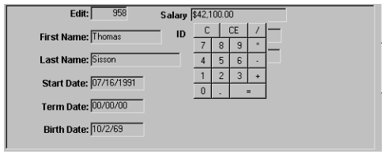
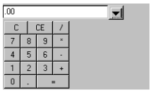
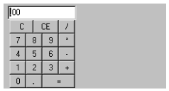
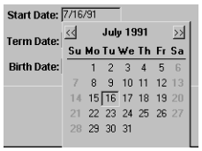
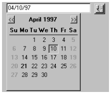

# Using PFC Visual Controls

**About this chapter**

This chapter explains how to use PFC standard visual user objects and custom visual user objects.

| Contents Topic | Page |
| --- | --- |
| About PFC visual controls | 129 |
| Using standard visual user objects | 130 |
| Using custom visual user objects | 169 |

## About PFC visual controls

PFC contains two types of visual controls:

- **Standard visual user objects** Consist of a single PowerBuilder control. PFC adds logic to enhance the control’s functionality and reusability. The u_lb ListBox control is an example of a standard visual user object.
- **Custom visual user objects** Consist of several controls that function as a unit. PFC adds logic to perform the appropriate processing. The u_calculator calculator control is an example of a custom visual object.

**Standard class user objects** PFC also features a set of standard *class* user objects, such as n_tr (transaction), n_cn (connection), and n_msg (message).

For information on using standard class user objects, see Chapter 3, “PFC Programming Basics”.

## Using standard visual user objects

PFC contains standard visual user objects for all window controls. Standard visual user objects include:

- Basic window controls (such as CommandButton, RadioButton, and CheckBox)
- More complex window controls (such as DataWindow, ListView, TreeView, RichTextEdit, and Tab)

### Using basic functionality

A standard visual user object inherits its definition from one standard PowerBuilder control. PFC extends each control as appropriate, and you can extend them further.

The PFC standard visual user objects include the following basic functionality, depending on their type:

- **Cut, copy, and paste** Editable controls include Cut, Copy, Paste, and other editing functions.
- **Pop-up menu** Editable controls include code in the RButtonUp event to display a pop-up menu. This menu enables users to Cut, Copy, and Paste text into the current visual control.
- **Autoscroll** The DropDownListBox and DropDownPictureListBox controls provide functionality that scrolls the list automatically as the user types.
- **Selection inversion** The ListBox and PictureListBox controls provide functionality that invert the current selection.
- **Autoselect** Certain editable controls provide functionality that select text automatically when the control receives focus.
- **MicroHelp display** Most controls contain precoded functionality in the GetFocus event to display a tag value in the microhelp area of an MDI frame

For how to place a standard visual user object on a window, see the *PowerBuilder User’s Guide*.

#### Cut, copy, paste, and other editing functions

All editable PFC standard visual user objects include user events that perform text editing functions. Editable PFC visual user objects include:

| Control | PFC visual user object |
| --- | --- |
| DropDownListBox | u_ddlb |
| DropDownPictureListBox | u_ddplb |
| DataWindow | u_dw |
| EditMask | u_em |
| MultiLineEdit | u_mle |
| OLE custom control | u_oc |
| RichTextEdit | u_rte |
| SingleLineEdit | u_sle |

PFC implements text editing functions by defining user events as appropriate for editable standard visual user objects:

| Text editing function | User event |
| --- | --- |
| Clear | pfc_Clear |
| Copy | pfc_Copy |
| Cut | pfc_Cut |
| Paste | pfc_Paste |
| Select All | pfc_SelectAll |
| Undo | pfc_Undo |
| Paste Special | pfc_PasteSpecial (u_oc only) |

When you use the PFC standard visual user objects as window controls, editing functions are enabled automatically when you use a menu that descends from the PFC m_master menu. M_master includes an Edit menu that has menu items for all editing functions. These Edit menu items use the message router to call the appropriate user event in the current control. You can also add code to command buttons and other controls to call these user events.

#### Using right-mouse button support

All editable PFC standard visual user objects include right mouse button support, displaying one of the following pop-up menus:

| Menu | Used by |
| --- | --- |
| m_edit | U_ddlb U_ddplb U_em U_mle U_rte U_sle |
| m_dw | U_dw |
| m_lvs | U_lvs |
| m_oc | U_oc |
| m_tvs | U_tvs |

These pop-up menus all include standard text editing functions. However, text editing functions are not enabled or visible in all pop-up menus by default.

**Customizing menu display**

All controls that provide right-mouse button support include a pfc_PreRMBMenu event for customizing the items that appear on a pop-up menu. PFC calls this event after the menu is created but before it is displayed.

**To customize pop-up menu display:**

1. (Optional) Use the Menu painter to create additional items for the pop-up menu.
2. After placing the user object in a window, add logic to the pfc_PreRMBMenu event to hide or disable menu items. This example disables the m_dw Insert, Add Row, and Delete menu items (am_dw is an argument passed by reference to pfc_PreRMBMenu):

   ```
   am_dw.m_table.m_insert.Enabled = FALSE
   am_dw.m_table.m_addrow.Enabled = FALSE
   am_dw.m_table.m_delete.Enabled = FALSE
   ```

**Disabling right-mouse button support**

You can disable right-mouse button support entirely. You may want to do this for a read-only control, for example.

**To disable right-mouse button support for editable controls:**

- After placing the user object in a window, add code to the control’s Constructor event to set the ib_rmbmenu instance variable to FALSE:

  ```
  this.ib_rmbmenu = FALSE
  ```

**U_dw disables items automatically** The u_dw DataWindow control disables pop-up menu items automatically for read-only DataWindow objects.

#### Using autoscroll in drop-down lists

The u_ddlb DropDownListBox and u_ddplb DropDownPictureListBox controls feature autoscrolling: if you press r, the control scrolls to the first entry beginning with r, selecting the remaining text; if you then press i, the control scrolls to the first entry beginning with ri.

This capability differs from the standard DropDownListBox and DropDownPictureListBox behavior, which scrolls based on the first letter only: if you press r, the control scrolls to the first entry beginning with r; if you then press i, the control scrolls to the first entry beginning with i.

For information on autoscroll in DropDownDataWindows, see “Drop-down DataWindow search service”.

By default, autoscroll is disabled.

**To enable autoscroll:**

- After placing the user object in a window, add code to the Constructor event to set the ib_search instance variable to TRUE:

  ```
  this.ib_search = TRUE
  ```

#### Using autoselect

These editable controls feature automatic selection:

- U_ddlb
- U_ddplb
- U_em
- U_mle
- U_sle

When autoselect is enabled, PFC automatically selects all text in the control when it receives focus.

By default, autoselect is disabled.

**To enable autoselect:**

- After placing the user object in a window, add code to the Constructor event to set the ib_autoselect instance variable to TRUE:

  ```
  this.ib_autoselect = TRUE
  ```

#### Using selection inversion in list boxes

The u_lb ListBox and the u_plb PictureListBox controls feature selection inversion. When you call the control’s pfc_InvertSelect event, PFC highlights previously unhighlighted items and unhighlights previously highlighted items. Selection inversion is a feature found in many Windows 95 applications.

**Extended select or multiselect** To use this feature, you must enable either the Extended Select property or the Multi Select property for the control.

**To enable selection inversion, use either of the following techniques:**

1. Add a menu item that uses the message router to call the pfc_InvertSelection event. This example adds an Invert Selection menu item that calls the of_SendMessage function to trigger the pfc_InvertSelection event (this method requires that the ListBox or PictureListBox have focus when the user selects the menu item):

   ```
   of_SendMessage("pfc_InvertSelection")
   ```

2. Add a window control that calls the pfc_InvertSelection event directly (this example is from a CommandButton Clicked event):

   ```
   lb_choices.Event pfc_InvertSelection()
   ```

#### Using the GetFocus event

PFC standard visual controls include logic in the GetFocus event to provide focus-related functionality. This event calls the window’s pfc_ControlGotFocus user event, which (when MicroHelp display is enabled) updates MicroHelp for controls placed on descendants of w_sheet.

The w_sheet window extends the pfc_ControlGotFocus user event to add automatic MicroHelp display. This feature displays text from the control’s tag value in the MDI frame’s status bar.

**To update MicroHelp automatically in a sheet window:**

1. Call the n_cst_appmanager of_SetMicroHelp function to enable MicroHelp display:

   ```
   gnv_app.of_SetMicroHelp(TRUE)
   ```

2. Define tag values for each of the sheet’s controls. Use the following format:

   ```
   MicroHelp=tagtext
   ```

PFC uses the specified tag text to update MicroHelp automatically when the control gets focus. If there are multiple items in the tag, separate them with semicolons.

### Using advanced functionality

To get the most out of PFC, you need to program using advanced controls for which PFC provides additional capabilities:

| Control | PFC visual user object |
| --- | --- |
| DataWindow | U_dw |
| ListView | U_lvs |
| TreeView | U_tvs |
| RichTextEdit | U_rte |
| OleControl | U_oc |
| Tab | U_tab |
| Tab page | U_tabpg |

#### Using the u_dw DataWindow control

Most production-strength PowerBuilder applications make intense use of DataWindow controls. The u_dw DataWindow control contains extensive built-in methods including:

- Functions to enable and disable DataWindow services
- A function to set the Transaction object
- Events to retrieve rows for DataWindows and DropDownDataWindows
- Events to control DataWindow update
- Events to control printing

**Integration with PFC menus** Many of the events described in this section are called automatically by menus that descend from the PFC m_master menu. For example, when you select File>Save from the menu bar, PFC calls the pfc_Save event.

**Enabling DataWindow services**

PFC provides a variety of DataWindow services that you can use to add production-strength features to an application. Many of these services require little or no coding on your part.

**To use DataWindow services:**

1. Place the u_dw DataWindow visual user object on the window.
2. Determine which DataWindow services are appropriate for the DataWindow object displayed in the u_dw-DataWindow control.
3. Enable the appropriate DataWindow services, using the u_dw of_Set*servicename* functions (this example from the DataWindow control’s Constructor event enables the row selection, row management, and sort services):

   ```
   this.of_SetRowSelect(TRUE)
   this.of_SetRowManager(TRUE)
   this.of_SetSort(TRUE)
   ```

4. Establish the Transaction object for the DataWindow:

   ```
   this.of_SetTransObject(SQLCA)
   ```

5. Call other functions as necessary to initialize services (this example sets the row selection style, specifies the Sort dialog box style, and enables column header sorting):

   ```
   this.inv_rowselect.of_SetStyle &
     (this.inv_rowselect.EXTENDED)
   this.inv_sort.of_SetStyle &
     (this.inv_sort.DRAGDROP)
   this.inv_sort.of_SetColumnHeader(TRUE)
   ```

6. Call DataWindow service events and functions as necessary in your application’s functions and events. In many cases you don’t have to code anything to realize the service’s benefits. This example calls the pfc_SortDlg event to display the Sort dialog box:

   ```
   dw_list.Event pfc_SortDlg()
   ```

**Disabling services** The u_dw Destructor event destroys enabled services automatically. In most cases you don’t destroy a service explicitly.

For specific usage information on individual DataWindow services, see “DataWindow services”.

**Setting the Transaction object**

As shown in the preceding example, you establish a DataWindow’s Transaction object by calling the u_dw of_SetTransObject function.

The of_SetTransObject function ensures that the passed Transaction object is valid, sets the Transaction object, and saves a reference to the Transaction object in the itr_object instance variable.

The Transaction object must be of type n_tr.

**When using the linkage service** For DataWindows that use the linkage service, call the n_cst_dwsrv_linkage of_SetTransObject function on the top-level DataWindow after all DataWindows have been created and you have established the linkage chain.

For more information on the linkage service, see “Linkage service”.

**Retrieving rows**

Because many DataWindow services rely on the u_dw pfc_Retrieve event to retrieve data, it’s best to code the PowerScript Retrieve function in the u_dw pfc_Retrieve event. To retrieve rows, your code then calls the u_dw of_Retrieve function, which calls either the pfc_Retrieve event or the n_cst_dwsrv_linkage of_Retrieve function as appropriate.

**To retrieve rows for a DataWindow:**

1. Call the of_Retrieve function (this example is from a DataWindow Constructor event):

   ```
   Long  ll_return

   ll_return = this.of_Retrieve()
   ```

2. Add code to the pfc_Retrieve event that calls the PowerScript Retrieve function, returning the return code:

   ```
   Return this.Retrieve()
   ```

**Retrieving rows with the linkage service** When using the linkage service to *retrieve* detail DataWindow rows, code the pfc_Retrieve function for the top-level DataWindow only. When using the linkage service to *filter or scroll* detail DataWindow rows, code the pfc_Retrieve event for all DataWindows in the linkage chain.

**To retrieve rows in a DropDownDataWindow:**

1. Add code to the DataWindow control’s pfc_PopulateDDDW event. This code should retrieve rows for the specified DropDownDataWindow:

   ```
   IF as_colname = "dept_id" THEN
     adwc_obj.SetTransObject(SQLCA)
     Return adwc_obj.Retrieve()
   ELSE
     Return 0
   END IF
   ```

2. If the DataWindow control is using no other DataWindow services, enable n_cst_dwsrv the base DataWindow service (this example is from the DataWindow control’s Constructor event):

   ```
   this.of_SetBase(TRUE)
   this.of_SetTransObject(SQLCA)
   this.of_Retrieve()
   ```

3. Call the n_cst_dwsrv of_PopulateDDDWs or of_PopulateDDDW function to update all DropDownDataWindows or a specified DropDownDataWindow:

   ```
   dw_1.inv_base.of_PopulateDDDWs()
   // Alternatively, you could call:
   // dw_1.inv_base.of_PopulateDDDW("dept_id")
   ```

**Controlling DataWindow updates**

**Basic DataWindow updates** PFC provides two ways to update DataWindows:

- **U_dw pfc_Update event** Updates a single DataWindow without any logical unit of work service processing, automatically calling the n_cst_dwsrv_multitable of_Update function if the multitable update service is enabled
- **W_master pfc_Save event** Uses the logical unit of work service to call the u_dw of_Updatefunction for all DataWindows on the window. For non-PFC DataWindow controls, the logical unit of work service calls the PowerScript Update function

  **W_master is the ancestor of all PFC windows** Because w_master is the ancestor of all PFC windows, the pfc_Save event is available to all windows in your application.

**To update a single DataWindow:**

- Call the u_dw pfc_Update event:

  ```
  IF dw_emplist.Event pfc_Update &
     (TRUE, TRUE) = 1 THEN
        SQLCA.of_Commit()
  ELSE
     SQLCA.of_Rollback()
  END IF
  ```

**To update all DataWindows on a window:**

- Call the w_master pfc_Save event:

  ```
  Integer li_return

  li_return = w_emp.Event pfc_Save()
  IF li_return < 0 THEN
    MessageBox("Update Failed", &
      "Update failed. Return code was " &
        + String(li_return))
  ELSE
    gnv_app.of_GetFrame().SetMicroHelp &
      ("Update succeeded")
  END IF
  ```

**Automatic CloseQuery processing** If any of a window’s DataWindows has pending updates and the user closes the window, PFC displays a Save Changes dialog box automatically. If the user chooses to save changes, CloseQuery processing calls the window’s pfc_Save event.

For more information on using pfc_Save, see “Using the pfc_Save process”.

**Declaring nonupdatable DataWindows** You can declare a DataWindow as nonupdatable, thus removing it from the pfc_Save update sequence and the PFC default CloseQuery processing.

**Shared DataWindows** If your window includes DataWindows that share data, only one DataWindow control should be updatable. All others that share data should be nonupdatable.

**To declare a DataWindow as nonupdatable:**

- Call the u_dw of_SetUpdatable function:

  ```
  dw_emplist.of_SetUpdateable(FALSE)
  ```

**Printing DataWindows**

PFC provides events that allow you to print DataWindows. You can:

- Display a Print dialog box, allowing you to choose options before printing

  PFC uses the s_printdlgattrib structure to pass DataWindow properties to the n_cst_platform of_PrintDlg function. You can use the pfc_PrePrintDlg event to further customize the initial contents of the Print dialog box by modifying elements in the s_printdlgattrib structure.

  The elements in the s_printdlgattrib structure reflect selected DataWindow Print properties (such as collate, page numbers, and number of copies).

- Print a DataWindow without displaying the Print dialog box
- Display a Page Setup dialog box that allows you to specify print settings

  PFC uses the s_pagesetupattrib structure to pass DataWindow properties to the n_cst_platform of_PageSetupDlg function. You can use the pfc_PrePageSetupDlg event to further customize the initial contents of the Page Setup dialog box by modifying elements in the s_pagesetupdlgattrib structure.

  The elements in the s_pagesetupattrib structure reflect selected DataWindow Print properties (such as margins, paper size, and orientation).

**To display the Print dialog box:**

1. (Optional) Add code to the pfc_PrePrintDlg event to modify the information used by the pfc_PrintDlg function (this example provides a default for the number of copies specification):

   ```
   astr_printdlg.l_copies = 1
   ```

2. Call the pfc_Print event:

   ```
   dw_emp.Event pfc_Print()
   ```

**To print a DataWindow without displaying the Print dialog box:**

- Call the pfc_PrintImmediate event:

  ```
  dw_emp.Event pfc_PrintImmediate()
  ```

**Comparing File**>**Print with the Print button** When you select File>Print from the menu bar, PFC calls the pfc_Print event. When you click the Print toolbar button, PFC calls the pfc_PrintImmediate event.

**To display the Page Setup dialog box:**

1. (Optional) Add code to the pfc_PrePageSetupDlg event to modify the information used by the pfc_PageSetupDlg function (this example specifies the initial value for the orientation specification):

   ```
   astr_pagesetup.b_portraitorientation = TRUE
   ```

2. Call the pfc_PageSetup event:

   ```
   dw_emp.Event pfc_PageSetup()
   ```

#### Using the u_lvs ListView control

The u_lvs ListView control makes it easy for you to display and update database data in a ListView. U_lvs includes services that you enable to obtain the features you need:

- **Base service** Provides find functionality and other basic services
- **Data source service** Controls the display and update of database data in a ListView. Also controls the bitmaps displayed with ListView data
- **Sort service** Provides column-header sort functionality (report view only)

**The u_lv ListView control** PFC also includes u_lv, a non-service-based ListView that includes many of the same features as u_lvs. U_lv was the PFC ListView control in previous releases and is not documented here.

**Displaying database data in a ListView**

You use the ListView data source service to associate a ListView with a data source (not to be confused with an ODBC data source). A data source can be:

- DataWindow object (using either data retrieved from the database or data stored with the DataWindow object)
- SQL statement
- DataWindow control
- DataStore control
- Rows from an array
- A file

The ListView data source service (implemented through the n_cst_lvsrv_datasource custom class user object) maintains the ListView’s data source in a DataStore and uses it to populate the ListView. You can also specify which columns from the DataWindow object should display when the ListView is in Report view.

**To establish the initial ListView display:**

1. Add a u_lvs user object to the window.
2. Enable the ListView data source service (this example also enables the ListView sort service):

   ```
   this.of_SetDataSource(TRUE)
   this.of_SetSort(TRUE)
   ```

3. Call the n_cst_lvsrv_datasource of_Register function. This example specifies the DataWindow object, Transaction object, and label column (this example is from a ListView Constructor event):

   ```
   this.inv_datasource.of_Register("emp_lname", &
          "d_emplist", SQLCA)
   ```

The ListView data source service uses the DataWindow caching service to maintain the data.

4. (Optional) Specify whether right mouse button support is enabled:

   ```
   this.of_SetRMBMenu(TRUE)
   ```

5. (Optional) Specify additional columns to display in Report view (this example displays all columns) and establish picture information:

   ```
   this.inv_datasource.of_RegisterReportColumn()
   this.inv_datasource.of_SetPictureColumn("1")
   ```

6. (Optional) Declare the ListView as eligible for update via the logical unit of work service and the w_master pfc_Save process:

   ```
   this.of_SetUpdateable(TRUE)
   ```

7. (Optional) Specify whether PFC asks the user to confirm deletions:

   ```
   this.inv_datasource.of_SetConfirmOnDelete(TRUE)
   ```

8. Retrieve data from the database and add rows to the ListView:

   ```
   this.Event pfc_Populate()
   ```

9. Extend the pfc_Retrieve event, adding code that calls the of_Retrieve function, which allows you to specify retrieval arguments:

   ```
   Any   la_args[20]

   Return this.of_Retrieve(la_args, ads_data)
   ```

**Deleting items from the ListView**

You can delete items from the ListView, optionally deleting them from the data source and the database.

**To remove items from the ListView, allowing them to remain in the u_lvs DataStore and the database:**

1. Enable the ListView’s Delete Items property.
2. Call the PowerScript DeleteItem function:

   ```
   Integer  li_index
   li_index = lv_list.SelectedIndex()

   lv_list.DeleteItem(li_index)
   ```

**Redisplaying deleted rows** To redisplay all rows in the data source, call the of_Reset function followed by the pfc_Populate event.

**To delete selected items from the ListView and the database:**

1. Enable the ListView’s Delete Items property.
2. Call the pfc_Delete event:

   ```
   lv_1.Event pfc_Delete()
   ```

3. Call the logical unit of work service of_Save function to update the database (this example is from a user event defined for the ListView control):

   ```
   PowerObject  lpo_obj[ ]
   n_tr  ltr_obj[ ]

   IF NOT IsValid(inv_luw) THEN
      inv_luw = CREATE n_cst_luw
   END IF
   lpo_obj[1] = this
   ltr_obj[1] = SQLCA

   // Error processing omitted to save space
   inv_luw.of_Save(lpo_obj, ltr_obj)
   ```

**Inserting items into the ListView**

You can use a ListView to insert items into the database. But because the ListView control allows updates to the label column only, you cannot add information into all the columns displayed in Report view. To get around this, you need another mechanism (such as a dialog box) to acquire enough information to update the DataWindow, the ListView, and the database.

**To insert a row into the database using a ListView:**

1. Create a mechanism (such as a dialog box) that collects information needed to add a new row.
2. Use the information you gathered to call the of_InsertItem function. This example assumes you added information to a temporary DataStore, which is used as input to of_InsertItem:

   ```
   lv_dept.of_InsertItem(ids_newrow, 1)
   ```

**Using pictures**

ListViews allow you to specify up to three different pictures to display with an item:

- **Default picture** An image that appears with a Listview item
- **State picture** An image that appears to the left of the original image
- **Overlay picture** An image (typically an icon or cursor) that appears on top of a ListView item’s original image, indicating a difference between the ListView item and other items

U_lvs allows you to set up the initial picture display using the following:

- **Picture index** Each index entry points to a bitmap file or PowerBuilder system bitmap that the ListView uses for picture display. You define entries in the picture index using the ListView’s property sheet. This approach results in all ListView items displaying the same picture
- **DataWindow column** A column specifying row-specific display information. The column can come directly from the database or can be a DataWindow computed column. It can contain either of the following:
  - A string specifying the name of a bitmap file that the ListView uses when displaying the corresponding row
  - An integer specifying the picture index the ListView uses when displaying the corresponding row

Using a DataWindow column allows you to customize ListView item display.

For more on ListViews, see *Application Techniques*.

**To use the picture index to specify ListView pictures:**

1. Establish the picture index using the ListView’s property sheet.
2. Enable the ListView data source service:

   ```
   this.of_SetDataSource(TRUE)
   ```

3. Specify the appropriate picture index entries by calling n_cst_lvsrv_datasource functions, passing the picture index:

   ```
   this.inv_datasource.of_SetPictureColumn('1')
   this.inv_datasource.of_SetOverlayPictureColumn('1')
   this.inv_datasource.of_SetStatePictureColumn('1')
   ```

**To use DataWindow columns to specify ListView pictures:**

1. Establish database or DataWindow columns and populate them with bitmap names (String or Character data type) or picture index specifications (Integer data type).
2. Enable the ListView data source service:

   ```
   this.of_SetDataSource(TRUE)
   ```

3. Specify the appropriate pictures by calling n_cst_lvsrv_datasource functions, passing the DataWindow column names:

   ```
   this.inv_datasource.of_SetPictureColumn  &
      ('picture_name')
   this.inv_datasource.of_SetOverlayPictureColumn  &
      ('picture_overlay')
   this.inv_datasource.of_SetStatePictureColumn  &
      ('picture_state')
   ```

**Bitmaps must exist** The files named in the retrieved rows must exist in a directory accessible to the application.

#### Using the u_tvs TreeView control

The u_tvs TreeView control makes it easy for you to use DataWindows to display and update hierarchical database data in a TreeView. U_tvs includes services that you enable to obtain the features you need:

- **Base service** Provides basic services
- **Level source service** Controls the display and update of database data in a TreeView level. Also controls the bitmaps displayed with TreeView data

**The u_tv TreeView control** PFC also includes u_tv, a non-service-based TreeView that includes many of the same features as u_tvs. U_tv was the PFC TreeView control in previous releases and is not documented here.

**Basic use**

You use the TreeView level source service to associate each TreeView level with a data source (not to be confused with an ODBC data source). A data source can be:

- DataWindow object (using either data retrieved from the database or data stored with the DataWindow object)
- SQL statement
- DataWindow control
- DataStore control
- Rows from an array
- A file

The TreeView level source service (implemented through the n_cst_tvsrv_levelsource custom class user object) maintains each TreeView level’s data source in a DataStore and uses it to populate the TreeView level.

**Establishing the level’s data source** You establish a level’s data source by calling the n_cst_tvsrv_levelsource of_Register function. This function includes an argument that specifies how a level relates to the levels above it. This argument must be in the format :*scope*.*level*.*column* where:

- *Scope* specifies one of the following literals:
  - Level
  - Parent
- *Level* specifies an absolute or relative level number, depending on what you specify for *scope*:

  | Scope specification | Level specification | Example |
  | --- | --- | --- |
  | Level | The value you specify indicates an absolute level number | `:level.1.emp_name` indicates that the retrieval argument is from the emp_name column of the item’s level-1 ancestor |
  | Parent | The value you specify indicates a level relative to the current level | `:parent.2.emp_name` indicates that the retrieval argument comes from the emp_name column of the ancestor two levels above |

- *Column* specifies the DataWindow object column name from which to obtain the values used in retrieval arguments.

For example, the following string specifies that the retrieval argument is from the emp_name column of the item’s level-1 ancestor:

```
:level.1.emp_name
```

**Multiple retrieval arguments** If a DataWindow object has multiple retrieval arguments, you specify the *scope.level.column* argument multiple times within the same string. For example, the following string specifies that the retrieval arguments are from the region column two levels higher and the states_state_id column one level higher:

```
":parent.2.region, :parent.1.states_state_id"
```

**To display a TreeView:**

1. Add a u_tvs user object to the window.
2. Enable the level source service using the u_tvs of_SetLevelSource function:

   ```
   this.of_SetLevelSource(TRUE)
   ```

3. Define a data source for each TreeView level by calling the of_Register function, once for each level:

   ```
   this.inv_levelsource.of_Register(1,  &
      "dept_name", "", "d_deptlist", SQLCA, "")
   this.inv_levelsource.of_Register(2, "emp_lname",  &
     ":parent.1.dept_id", "d_empbydept", SQLCA, "")
   ```

4. Call additional functions as necessary to control TreeView behavior:

   ```
   this.inv_levelsource.of_SetPictureColumn(1, "1")
   this.inv_levelsource.of_SetSelectedPictureColumn  &
      (1, "2")
   this.inv_levelsource.of_SetPictureColumn(2, "4")
   this.inv_levelsource.of_SetSelectedPictureColumn  &
      (2, "5")
   ```

5. (Optional) Specify whether right mouse button support is enabled:

   ```
   this.of_SetRMBMenu(TRUE)
   ```

6. (Optional) Declare the TreeView as eligible for update via the logical unit of work service and the w_master pfc_Save process:
7. Populate the TreeView by calling the u_tvs pfc_Populate event:

   ```
   this.event pfc_Populate(0)
   ```

8. Extend the pfc_Retrieve event, adding code that calls the of_Retrieve function, specifying retrieval arguments as returned by the n_cst_tvsrv_levelsource of_GetArgs function:

   ```
   Any   la_args[20]
   Integer   li_level

   IF IsValid(inv_levelsource) THEN
          li_level = this.of_GetNextLevel(al_parent)
          this.inv_levelsource.of_GetArgs(al_parent, &
         li_level, la_args)
   END IF

   Return this.of_Retrieve(al_parent, la_args,  &
      ads_data)
   ```

**Deleting items from a TreeView**

You can delete items from the TreeView, optionally deleting them from the data source and the database.

**To remove items from the TreeView (allowing them to remain in the data source and the database):**

1. Enable the TreeView’s Delete Items property.
2. Call the PowerScript DeleteItem function:

   ```
   Long  ll_tvi

   ll_tvi = this.FindItem(CurrentTreeItem!, 0)
   ```

**Redisplaying deleted rows** To redisplay these rows, call the u_tvs pfc_RefreshLevel event.

**To delete items from the TreeView and the database:**

1. Enable the TreeView’s Delete Items property.
2. Call the pfc_Delete event:

   ```
   tv_1.Event pfc_Delete()
   ```

3. Call the logical unit of work service of_Save function to update the database (this example is from a user event defined for the TreeView control):

   ```
   PowerObject  lpo_obj[ ]
   n_tr  ltr_obj[ ]

   IF NOT IsValid(inv_luw) THEN
      inv_luw = CREATE n_cst_luw
   END IF
   lpo_obj[1] = this
   ltr_obj[1] = SQLCA

   // Error processing omitted to save space
   inv_luw.of_Save(lpo_obj, ltr_obj)
   ```

**Inserting items into a TreeView**

You can use a TreeView to insert new items into the database. But because the TreeView control displays a single field only, you typically need another mechanism (such as a dialog box) to acquire enough information to update the DataWindow, the TreeView, and the database.

**To insert a row into the database using a TreeView:**

1. Create a mechanism (such as a dialog box) that collects information needed to add a new row.
2. Use the information you gathered to call the of_InsertItem function. This example assumes you added information to a temporary DataStore, which is used as input to of_InsertItem:

   ```
   Long  ll_handle
   TreeViewItem  ltvi_item
   Long  ll_return

   ll_handle = tv_1.FindItem(CurrentTreeItem! , 0)
   ll_return = tv_1.of_InsertItem  &
      (ll_handle, ids_data, 1, "Sorted", 0)
   ```

**Using recursion to populate a TreeView**

The u_tvs TreeView control allows you to display multiple levels from a single table that has a recursive relationship. In the employee table, for example, there might be a recursive relationship between managers and employees, with each employee row containing a column that points to its manager’s employee ID.

You indicate a recursive relationship through an argument to the n_cst_tvsrv_levelsource of_Register function. A recursive level is always the lowest level specified.

**To use recursion to populate a TreeView:**

1. Create DataWindow objects to display high-level information as well as the recursive data. In the table that follows, the d_empmanagerrecursive DataWindow object handles all levels of manager below the department head using recursive data:

   | DataWindow object | Contents | Pseudo WHERE clause |
   | --- | --- | --- |
   | d_dept | Departments | None |
   | d_empdeptmanager | Department heads | employee.emp_id = department.dept_head_id |
   | d_empmanagerrecursive | Managers and their employees | employee.manager_id = manager.emp_id |

2. Create a window that has a TreeView based on u_tvs.
3. Enable the level source service:

   ```
   this.of_SetLevelSource(TRUE)
   ```

4. Call the of_Register function to establish the hierarchy and recursive levels. Then call the pfc_Populate function to retrieve data (this example is from the TreeView’s Constructor event):

   ```
   this.inv_levelsource.of_Register(1, "dept_name", &
      "", "d_dept", SQLCA, "")
   this.inv_levelsource.of_Register(2,  &
      "dept_head_id", ":Level.1.dept_head_id",  &
         "d_empdeptmanager", SQLCA, "")
   this.inv_levelsource.of_Register(3, "emp_lname", &
       ":Parent.1.emp_id", "d_empmanagerrecursive", &
          SQLCA, "")
   ```

5. Call the n_cst_tvsrv_levelsource of_SetRecursive function for the bottom level:

   ```
   this.inv_levelsource.of_SetRecursive(3, TRUE)
   ```

6. Code other processing as necessary.

**Using pictures**

A TreeView consists of items that are associated with one or more pictures, which are used in different ways:

| Picture | Usage |
| --- | --- |
| Default | Represents a TreeView item in its normal mode |
| Selected | Represents a selected TreeView item |
| State | Appears to the left of the TreeView item indicating that the item is not in its normal mode, for example changed or unavailable |
| Overlay | Appears on top of a TreeView item |

For more on how you specify pictures, see “Using pictures”.

**To use the picture index to specify TreeView pictures:**

1. Using either the Window painter or the User Object painter, specify default pictures for the TreeView. PFC uses this picture index for default, selected, and overlay pictures.
2. Using either the Window painter or the User Object painter, specify state pictures for the TreeView.
3. Enable the level source service:

   ```
   this.of_SetLevelSource(TRUE)
   ```

4. Associate pictures with TreeView levels by calling n_cst_tvsrv_levelsource functions:

   ```
   this.inv_levelsource.of_SetPictureColumn(1, "1")
   this.inv_levelsource.of_SetSelectedPictureColumn  &
      (1, "2")
   this.inv_levelsource.of_SetPictureColumn(2, "4")
   this.inv_levelsource.of_SetSelectedPictureColumn  &
      (2, "5")
   ```

**To use DataWindow columns to specify TreeView pictures:**

1. Establish database or DataWindow columns and populate them with bitmap names (String or Character data type) or picture index specifications (Integer data type).
2. Enable the TreeView level source service:

   ```
   this.of_SetLevelSource(TRUE)
   ```

3. Specify the appropriate pictures by calling n_cst_tvsrv_levelsource functions, passing the DataWindow column names:

   ```
   this.inv_levelsource.of_SetPictureColumn  &
      (1, 'picture_name')
   this.inv_levelsource.of_SetSelectedPictureColumn  &
      (1, 'picture_overlay')
   ```

**Bitmaps must exist** The files named in the retrieved rows must exist in a directory accessible to the application.

For more information on TreeView pictures, see the *PowerBuilder User’s Guide*.

**Coordinating a TreeView and other controls**

One of the most popular uses for TreeViews is to perform coordinated processing with a ListView. The Microsoft Explorer is an example of this type of usage.

Another powerful possibility is to coordinate processing between a TreeView and a DataWindow.

**To coordinate a TreeView and a ListView:**

1. Create DataWindow objects to display information for all levels of the TreeView (this example uses region, state, customer, and employee information from the PFC example database).
2. Create a window that has a TreeView based on u_tvs and a ListView based on u_lvs.
3. Define pictures for the TreeView and ListView.
4. Enable the TreeView level source service:

   ```
   this.of_SetLevelSource(TRUE)
   ```

5. Register level source information for all TreeView levels (this example is from the TreeView Constructor event):

   ```
   this.inv_levelsource.of_Register(1,  &
       "sales_regions_region", "", "d_region",  &
             SQLCA, "")
   this.inv_levelsource.of_SetPictureColumn(1, "1")
   this.inv_levelsource.of_SetSelectedPictureColumn  &
          (1, "7")

   this.inv_levelsource.of_Register(2,  &
      "states_state_name",  &
         ":parent.1.sales_regions_region", &
            "d_regionstate", SQLCA, "")
   this.inv_levelsource.of_SetPictureColumn(2, "2")
   this.inv_levelsource.of_SetSelectedPictureColumn  &
          (2, "7")
   this.inv_levelsource.of_Register(3,  &
      "customer_company_name",  &
          ":parent.2.sales_regions_region,  &
             :parent.1.states_state_id",  &
                "d_regionstatecust", SQLCA, "")
   this.inv_levelsource.of_SetPictureColumn(3, "3")
   this.inv_levelsource.of_SetSelectedPictureColumn  &
          (3, "7")

   this.inv_levelsource.of_Register(4,  &
      "employee_emp_lname", ":parent.1.customer_id", &
         "d_regionstatecustrep", SQLCA, "")
   this.inv_levelsource.of_SetPictureColumn(4, "4")
   this.inv_levelsource.of_SetSelectedPictureColumn  &
      (4, "7")

   this.inv_levelsource.of_Register(5,  &
      "order_id_string", ":parent.2.customer_id,  &
          :parent.1.employee_emp_id", &
            "d_regionstatecustrepord", SQLCA, "")
   this.inv_levelsource.of_SetPictureColumn(5, "5")
   this.inv_levelsource.of_SetSelectedPictureColumn  &
      (5, "7")
   ```

6. Call the pfc_Populate event:

   ```
   this.Event pfc_Populate(0)
   ```

7. Extend the pfc_Retrieve event:

   ```
   Any la_args[20]
   Integer li_level

   IF IsValid(inv_levelsource) THEN
          li_level = of_GetNextLevel(al_parent)
          inv_levelsource.of_GetArgs(al_parent,  &
             li_level, la_args)
   END IF
   Return of_Retrieve(al_parent, la_args, ads_data)
   ```

8. Extend the TreeView’s SelectionChanged event to call the ListView’s pfc_Populate event:

   ```
   lv_1.Event pfc_Populate()
   ```

9. Enable ListView services and specify processing options (this example is from the ListView Constructor event):

   ```
   this.of_SetDataSource(TRUE)
   this.of_SetSort(TRUE)
   this.inv_sort.of_SetColumnHeader(TRUE)
   this.of_SetRMBMenu(TRUE)
   ```

10. Override the ListView’s pfc_Populate event:

    ```
    Integer   li_RC, li_level
    Long  ll_handle
    String  ls_dataobject
    String  ls_labelcolumn, ls_picturecolumn
    TreeViewItem   ltvi_selecteditem
    n_tr  ltr_obj
    n_cst_tvsrvattrib   lnv_tvattrib

    // Display current tree item children in the LV
    ll_handle = tv_1.FindItem(CurrentTreeItem!, 0)
    tv_1.GetItem(ll_handle, ltvi_selecteditem)

    li_level = ltvi_selecteditem.Level + 1

    // Normal registration
    ls_dataobject =  &
       tv_1.inv_levelsource.of_GetDataObject(li_level)
    ls_labelcolumn =  &
       tv_1.inv_levelsource.of_GetLabelColumn(li_level)
    ls_picturecolumn = &
       tv_1.inv_levelsource.of_GetPictureColumn  &
         (li_level)
    tv_1.inv_levelsource.of_GetTransObject(li_level,  &
        ltr_obj)

    // Level 3 registration.
    tv_1.inv_levelsource.of_GetLevelAttributes  &
       (li_level, lnv_tvattrib)

    // Set the ListView items
    Choose Case ltvi_selecteditem.Level
    Case 1
      li_RC =  lv_1.inv_datasource.of_Register  &
        (ls_labelcolumn, ls_dataobject, ltr_obj)
      li_RC =  &
        lv_1.inv_datasource.of_SetPictureColumn  &
          (ls_picturecolumn)
    Case 2
      li_RC = lv_1.inv_datasource.of_Register  &
        (ls_labelcolumn, ls_dataobject, ltr_obj)
      li_RC =  &
       lv_1.inv_datasource.of_SetPictureColumn  &
         (ls_picturecolumn)
    Case 3
      li_RC =  lv_1.inv_datasource.of_Register  &
        (lnv_tvattrib.is_labelcolumn, &
          lnv_tvattrib.is_dataobject, &
            lnv_tvattrib.itr_obj)
      li_RC =  &
        lv_1.inv_datasource.of_SetPictureColumn  &
         (lnv_tvattrib.is_picturecolumn)
    Case 4
      li_RC = lv_1.inv_datasource.of_Register  &
       (ls_labelcolumn, ls_dataobject, ltr_obj)
      li_RC =  &
        lv_1.inv_datasource.of_SetPictureColumn  &
         (ls_picturecolumn)
    Case 5  // Not in the tree so register normally
      li_RC = lv_1.inv_datasource.of_Register  &
        ("product_description",  &
           "d_regionstatecustreporditm", SQLCA)
      li_RC =  &
        lv_1.inv_datasource.of_SetPictureColumn  &
          ("product_picture_name")
    End Choose
    // Add all the visible columns of the datasource
    // to the report view.
    lv_1.inv_datasource.of_RegisterReportColumn()

    Return Super::Event pfc_Populate()
    ```

11. Extend the ListView’s pfc_Retrieve event:

    ```
    Long   ll_handle
    Any   la_args[20]
    TreeViewItem  tvi_item

    ll_handle = tv_1.FindItem(CurrentTreeItem!, 0)
    tv_1.GetItem(ll_handle, ltvi_item)

    If ltvi_item.Level < 5 Then
           tv_1.inv_levelsource.of_GetArgs  &
          (ll_handle, (ltvi_item.Level + 1), la_Args)
    Else
           la_Args[1] = Integer(ltvi_item.Label)
    End If

    Return of_Retrieve(la_args, ads_data)
    ```

12. Add code to the ListView’s DoubleClicked event to coordinate display with the TreeView:

    ```
    Integer  li_level
    Long  ll_currenttvitem, ll_selectedtreehandle
    String  ls_lvlabel
    ListViewItem  llvi_selectedlvitem
    TreeViewItem  ltvi_newtreeitem
    TreeViewItem ltvi_startingtreeitem

    // Get the ListView item that was doubleclicked.
    this.GetItem(index, llvi_selectedlvitem)
    ls_lvlabel = llvi_selectedlvitem.label

    // Determine which TreeView item is currently
    // selected and get it.
    ll_currenttvitem = tv_1.FindItem  &
      (CurrentTreeItem!, 0)
    tv_1.GetItem(ll_currenttvitem,  &
      ltvi_startingtreeitem)

    // Set a local variable to the level of the
    // currently selected TreeView item.
    li_level = ltvi_startingtreeitem.level

    // Determine if the currently selected TreeView
    // item has been expanded. If it hasn't, expand it.
    // (expanding also populates). This loads the
    //  TreeView with the ListView information.
    IF ltvi_startingtreeitem.expanded = FALSE THEN
           tv_1.ExpandItem(ll_currenttvitem)
    END IF

    // Get the handle of the TreeView item that
    // corresponds to the ListView item that was
    // doubleclicked.
    ll_selectedtreehandle =  &
      tv_1.inv_base.of_FindItem ("label", ls_lvlabel, &
        ll_currenttvitem, (li_level + 1), TRUE, TRUE)

    // Get the state information of the TreeView item
    // that corresponds to the ListView item that was
    // doubleclicked.
    tv_1.GetItem(ll_selectedtreehandle,  &
      ltvi_newtreeitem)

    // Select and Expand the selected TreeView item.
    IF ltvi_newtreeitem.expanded = FALSE THEN
           tv_1.SelectItem(ll_selectedtreehandle)
           tv_1.ExpandItem(ll_selectedtreehandle)
    END IF
    ```

**To coordinate a TreeView and a DataWindow control:**

1. Create DataWindow objects to display information for all levels of the TreeView (this example uses region, state, customer, and employee information from the PFC example database).
2. Create a window that has a TreeView based on u_tvs and a DataWindow based on u_dw.
3. Define pictures for the TreeView.
4. Enable the TreeView level source service:

   ```
   this.of_SetLevelSource(TRUE)
   ```

5. Register level source information for all TreeView levels (this example is from the TreeView Constructor event):

   ```
   this.inv_levelsource.of_Register(1,  &
     "sales_regions_region", "", "d_region",  &
        SQLCA, "")
   this.inv_levelsource.of_SetPictureColumn(1, "1")
   this.inv_levelsource.of_SetSelectedPictureColumn  &
     (1, "7")

   this.inv_levelsource.of_Register(2, &
     "states_state_name",  &
       ":parent.1.sales_regions_region",  &
         "d_regionstate", SQLCA, "")
   this.inv_levelsource.of_SetPictureColumn(2, "2")
   this.inv_levelsource.of_SetSelectedPictureColumn  &
     (2, "7")

   this.inv_levelsource.of_Register(3,  &
      "customer_company_name",  &
        ":parent.2.sales_regions_region,  &
          :parent.1.states_state_id",  &
            "d_regionstatecust", SQLCA, "")
   this.inv_levelsource.of_SetPictureColumn(3, "3")
   this.inv_levelsource.of_SetSelectedPictureColumn  &
     (3, "7")

   this.inv_levelsource.of_Register(4,  &
     "employee_emp_lname", ":parent.1.customer_id", &
       "d_regionstatecustrep", SQLCA, "")
   this.inv_levelsource.of_SetPictureColumn(4, "4")
   this.inv_levelsource.of_SetSelectedPictureColumn  &
     (4, "7")

   this.inv_levelsource.of_Register(5,  &
     "order_id_string", ":parent.2.customer_id,  &
       :parent.1.employee_emp_id", &
         "d_regionstatecustrepord", SQLCA, "")
   this.inv_levelsource.of_SetPictureColumn(5, "5")
   this.inv_levelsource.of_SetSelectedPictureColumn  &
     (5, "7")
   ```

6. Call the pfc_Populate event:

   ```
   this.Event pfc_Populate(0)
   ```

7. Extend the pfc_Retrieve event:

   ```
   Any la_args[20]
   Integer li_level

   IF IsValid(inv_levelsource) THEN
          li_level = of_GetNextLevel(al_parent)
          inv_levelsource.of_GetArgs(al_parent,  &
             li_level, la_args)
   END IF
   Return of_Retrieve(al_parent, la_args, ads_data)
   ```

8. Extend the TreeView’s SelectionChanging event to reset the DataWindow control’s DataObject property and populate it with the selected TreeView item:

   ```
   n_ds  lds_datastore
   TreeViewItemltvi_new
   Long  ll_dsrow

   // Get the DataStore and row for the new item
   IF inv_levelsource.of_GetDataRow(newhandle,  &
       lds_datastore, ll_dsrow) = -1 THEN
          MessageBox("Error", &
          "Error in of_GetDataRow", Exclamation!)
   END IF
   // Set dw_1 to use the new DataStore
   dw_1.Reset()
   dw_1.DataObject = lds_datastore.DataObject

   // Copy the row for the selected item
   // in the DataStore.
   lds_datastore.RowsCopy(ll_dsrow, ll_dsrow,  &
      Primary!, dw_1, 1, Primary!)

   // Set status flag of new row to what
   // it was in the TreeView level datasource.
   // The new row is copied as NewModified!
   CHOOSE CASE lds_datastore.GetItemStatus  &
     (ll_dsrow, 0, Primary!)
   CASE New!
     dw_1.SetItemStatus(1, 0, Primary!, NotModified!)
   CASE DataModified!
     dw_1.SetItemStatus(1, 0, Primary!, DataModified!)
   CASE NotModified!
     dw_1.SetItemStatus(1, 0, Primary!, DataModified!)
     dw_1.SetItemStatus(1, 0, Primary!, NotModified!)
   END CHOOSE
   ```

**Printing a TreeView**

U_tvs allows you to print TreeViews, optionally displaying a cancel dialog box and customized level pictures.

**To print a TreeView:**

1. Enable the TreeView print service:

   ```
   tv_deptemp.of_SetPrint(TRUE)
   ```

2. Call the of_PrintTree function:

   ```
   tv_deptemp.inv_print.of_PrintTree()
   ```

#### Using the u_rte RichTextEdit control

You use the PowerBuilder RichTextEdit control to enhance an application with word processing capabilities. The PFC u_rte control makes it easier for you to work with a RichTextEdit control. U_rte allows you to:

- Display new documents, optionally inserting them into the current document
- Insert pictures into documents, optionally displaying a dialog box prompting the user for the filename
- Print documents
- Add Find and Replace capabilities to a RichTextEdit control
- Control text properties

For complete information on the PowerBuilder RichTextEdit control, see the *PowerBuilder User’s Guide* and *Application Techniques*.

**Displaying rich text documents**

U_rte provides events that allow the user to specify the rich text document to open:

- **pfc_Open** Replaces the current document with the selected document, prompting the user before discarding the current document
- **pfc_InsertFile** Inserts the selected document into the current document. The RichTextEdit control replaces the current selection when the file is inserted

You can also populate the RichTextEdit control by calling the PowerScript InsertDocument function.

**To display a document (replacing the current document):**

- Call the pfc_Open event:

  ```
  rte_doc.Event pfc_Open()
  ```

**To insert a document into the current document:**

- Call the pfc_InsertFile function:

  ```
  rte_doc.Event pfc_InsertFile()
  ```

**The InsertDocument PowerScript function** You can also call the PowerScript InsertDocument function to display a document. If you use this function to display a file in an empty control, you must also call the of_SetFileName function to specify the name of the file associated with the RichTextEdit control.

**Inserting pictures**

U_rte provides an event that displays a dialog box for the user to choose a bitmap to insert at the current cursor position. The RichTextEdit control replaces the current selection when the bitmap is inserted.

**To display the Insert Picture dialog box:**

- Call the pfc_InsertPicture event:

  ```
  rte_doc.Event pfc_InsertPicture()
  ```

**Tracking the picture’s filename** If you want to track the filename of the inserted picture, call the of_InsertPicture function instead of the pfc_InsertPicture event.

**Printing rich text documents**

U_rte provides events that allow you to print the data in RichTextEdit controls. You can:

- Display a Print dialog box, allowing you to choose options before printing

  PFC uses the s_printdlgattrib structure to pass properties to the n_cst_platform of_PrintDlg function. You can use the pfc_PrePrintDlg event to further customize the contents of the Print dialog box by modifying elements in the s_printdlgattrib structure.

  The values in the s_printdlgattrib structure reflect selected RichTextEdit Print properties (such as collate, page numbers, and number of copies).

- Print a RichTextEdit control without displaying the Print dialog box

U_rte also provides functions that allow you to control the printing of page numbers.

**To display the Print dialog box:**

1. (Optional) Add code to the pfc_PrePrintDlg event to modify the information used by the pfc_PrintDlg function (this example provides a default for the number of copies specification):

   ```
   astr_printdlg.l_copies = 1
   ```

2. Call the pfc_Print event:

   ```
   rte_doc.Event pfc_Print()
   ```

**To print a RichTextEdit control without displaying the Print dialog box:**

- Call the pfc_PrintImmediate event:

  ```
  rte_doc.Event pfc_PrintImmediate()
  ```

**To control the printing of page numbers:**

1. (Optional) Specify the page number upon which page numbers should first appear. For example, many styles suppress the page number on the first page of a document:

   ```
   rte_doc.of_SetStartPageNumber(2)
   ```

2. Identify the name of the field into which PFC places the page number (this example assumes an input field named PAGENUM):

   ```
   rte_doc.of_SetPageInputField("PAGENUM")
   ```

**To print continuous pages when sharing data with a DataWindow or DataStore:**

1. Perform all the steps necessary for the RichText file to share data with the DataWindow or DataStore:

   ```
   ids_empdata = CREATE n_ds

   ids_empdata.DataObject = "d_sharerte"
   ids_empdata.of_SetTransObject(SQLCA)
   IF ids_empdata.Retrieve() = -1 THEN
     MessageBox("Retrieve", "Retrieve error")
   END IF

   rte_doc.DataSource(ids_empdata)
   ```

2. Call the of_SetContinuousPages function:

   ```
   rte_doc.of_SetContinuousPages(TRUE)
   ```

3. Print the document:

   ```
   rte_doc.Event pfc_Print( )
   ```

For more information on sharing data between a RichTextEdit control and a DataWindow or DataStore, see *Application Techniques*.

**Using the RTE find service**

U_rte features a find and replace service that you can use to enhance a RichTextEdit control. Once the service is enabled, PFC displays Find and Replace dialog boxes when the user selects Edit>Find or Edit>Replace from the menu bar of a menu that descends from the PFC m_master menu and the RichTextEdit control has focus.

You can also display Find and Replace dialog boxes programmatically.

**To display the Find dialog box:**

1. Enable the Find service:

   ```
   rte_doc.of_SetFind(TRUE)
   ```

2. Call the pfc_FindDlg event:

   ```
   rte_doc.Event pfc_FindDlg()
   ```

**To display the Replace dialog box:**

1. Enable the Find service:

   ```
   rte_doc.of_SetFind(TRUE)
   ```

2. Call the pfc_ReplaceDlg event:

   ```
   rte_doc.Event pfc_ReplaceDlg()
   ```

**Controlling text properties**

U_rte allows you to access properties for selected text in a RichTextEdit control. This feature allows you to change a single property at a time, leaving the other properties as is. This differs from the PowerScript SetTextStyle function, which requires that you specify all possible text properties.

**To set text properties:**

1. (Optional) Establish a mechanism that allows the user to specify text properties (the example ahead uses checkboxes).
2. Call the of_SetTextStyle*xxx* functions to set text properties:

   ```
   SetRedraw(FALSE)

   rte_doc.of_SetTextStyleBold(cbx_bold.Checked)
   rte_doc.of_SetTextStyleItalic(cbx_italic.Checked)
   rte_doc.of_SetTextStyleUnderline &
     (cbx_underline.Checked)
   rte_doc.of_SetTextStyleStrikeout &
     (cbx_strikeout.Checked)
   rte_doc.of_SetTextStyleSubscript &
     (cbx_subscript.Checked)
   rte_doc.of_SetTextStyleSuperscript &
     (cbx_superscript.Checked)

   SetRedraw(TRUE)
   ```

**To access text properties:**

1. (Optional) Establish a mechanism that displays text properties (the example ahead uses checkboxes).
2. Call the of_GetTextStyle function:

   ```
   n_cst_textstyleattrib lnv_style

   rte_doc.of_GetTextStyle &
     (lnv_style)
   cbx_bold.Checked = lnv_style.ib_bold
   cbx_italic.Checked = lnv_style.ib_italic
   cbx_underline.Checked = &
     lnv_style.ib_underlined
   cbx_strikeout.Checked = lnv_style.ib_strikeout
   cbx_subscript.Checked = lnv_style.ib_subscript
   cbx_superscript.Checked = &
     lnv_style.ib_superscript
   ```

#### Using the u_oc OLE control

PFC provides functions and events that offer basic control over an OLE control based on u_oc. In addition to standard support for editable controls (such as cut, copy, paste, and right-mouse button support), u_oc includes Paste Special functionality, support for in-place and off-site activation, and update links functionality.

For complete information on programming with the OLE control, see *Application Techniques*.

**Displaying the Insert Object dialog box**

You display the Insert Object dialog box to change the object or the server application.

**To display the Insert Object dialog box:**

1. Create a window that has an OLE control based on u_oc.
2. Call the pfc_InsertObject event:

   ```
   ole_1.Event pfc_InsertObject()
   ```

**Activating an object in place**

When you activate an object in place, the user interacts with the object inside the PowerBuilder application’s window.

1. Create a window that has an OLE control based on u_oc.
2. Call the pfc_EditObject event:

   ```
   ole_1.Event pfc_EditObject()
   ```

**Activating the object offsite**

When you activate an object offsite, the server application opens and the object becomes an open document in the server’s window.

1. Create a window that has an OLE control based on u_oc.
2. Call the pfc_OpenObject event:

   ```
   ole_1.Event pfc_OpenObject()
   ```

**Updating the linked object**

When you update a linked object, PowerBuilder attempts to find a file linked to an OLE container. If the linked file is not found, a dialog displays and lets the user bring up a second dialog for finding the file or changing the link.

1. Create a window that has an OLE control based on u_oc.
2. Call the pfc_UpdateLinks event:

   ```
   ole_1.Event pfc_UpdateLinks()
   ```

#### Using the u_tab Tab control and the u_tabpg user object

Many current applications use Tab controls and tab pages to enhance their user interface. The u_tab Tab control and the u_tabpg user object provide basic PFC functionality. And they both implement the resize service, which you enable differently depending on how the tab is defined.

**About Tab controls and tab pages**

**Tab control** A Tab control is a control that you place in a window or user object that contains tab pages. Part of the area in the Tab control is for the tabs associated with the tab pages. Any space left is occupied by the tab pages themselves.

PFC provides the u_tab Tab control, which you can use as an ancestor for Tab controls.

**Tab page** A tab page contains other controls and is one of several pages within a Tab control. All tab pages in a Tab control occupy the same area of the control, and only one is visible at a time. The active tab page covers the other tab pages. There are different ways to approach tab page definition. You can define:

- **An embedded tab page** In the Window or User Object painter, Select Insert>TabPage from the Tab control’s pop-up menu and add controls to those pages. An embedded tab page is of class UserObject but is not reusable.
- **A tab page user object** In the User Object painter, create a custom visual user object and add the controls that will display on the tab page. To add a tab page user object to a Tab control, Select Insert>User Object from the Tab control’s pop-up menu. A tab page defined as an independent user object is reusable.

  PFC provides the u_tabpg custom visual user object, which you can use as the ancestor for tab pages.

You can mix and match the two methods—one Tab control can contain both embedded tab pages and tab page user objects. But non-PFC tab pages do not have support for PFC features, such as resizing and the message router.

For more information on programming with Tab controls and tab pages, see *Application Techniques*.

**Using u_tab**

When using u_tab, you always:

- Work with a descendant of u_tab
- Create the complete Tab control (including tab pages) in the User Object painter

**To create a Tab control:**

1. Create a user object based on u_tab.
2. Add embedded tab pages and tab page user objects. For embedded tab pages, you add controls as necessary. Tab page user objects must be completely defined; you cannot add or modify controls from within the Tab control.
3. Create, override, and extend tab-page events and functions as necessary.
4. Create, override, and extend tab-level events and functions as necessary. Then call events in the tab pages, optionally defining user events on the Tab control that call the tab page events.
5. Add the user object to a window.

**Using u_tabpg**

When using u_tabpg, you always work with a descendant of u_tabpg within the User Object painter.

**To create a tab page:**

1. Create a user object based on u_tabpg.
2. Add controls as necessary.
3. Add PowerScript code for the controls as necessary.
4. Create, override, and extend tab page events and functions as necessary.
5. Add the tab page user object to one of the following:
   - U_tab-based user object
   - Standard visual user object of type Tab
   - Tab control within the Window painter

**Using the resize service with u_tab descendants**

You can use the resize service to add dynamic resize capabilities to tab pages.

How you enable the resize service differs depending on whether the Tab control contains embedded tab pages or tab page user objects based on u_tabpg. If a Tab control contains both embedded tab pages and tab page user objects, you can combine the first two procedures that follow.

When using the Create on Demand option for tab page user objects, you must also perform the third procedure to ensure that controls display properly.

**To enable the resize service for a Tab control when using embedded tab pages:**

1. Use the User Object painter to create a Tab control based on u_tab.
2. Define embedded tab pages.
3. Enable the resize service for the Tab control (this example is from the Constructor event):

   ```
   this.of_SetResize(TRUE)
   ```

4. Register controls within the tab pages:

   ```
   this.inv_resize.of_Register &
     (this.tabpage_1.mle_1, &
        this.inv_resize.SCALETOBOTTOM)
   this.inv_resize.of_Register &
     (this.tabpage_2.dw_1, &
        this.inv_resize.SCALETOBOTTOM)
   ```

5. Add the user object to a window.
6. Enable the resize service for the window and register affected controls (this example is from the window’s Constructor event):

   ```
   this.of_SetResize(TRUE)
   this.inv_resize.of_Register(tab_1, "Scale")
   this.inv_resize.of_Register &
     (cb_cancel, &
        this.inv_resize.FIXEDTOBOTTOM)
   this.inv_resize.of_Register &
     (cb_ok, this.inv_resize.FIXEDTOBOTTOM)
   this.inv_resize.of_SetMinSize &
     (this.width - 100, this.height - 100)
   ```

**To enable the resize service for a Tab control when using tab page user objects based on u_tabpg:**

1. Use the User Object painter to create a tab page based on u_tabpg.
2. Enable the resize service for the tab page (this example is from the Constructor event):

   ```
   this.of_SetResize(TRUE)
   ```

3. Register controls within the tab page:

   ```
   this.inv_resize.of_Register &
     (this.dw_1, 0, 0, 100, 100))
   ```

4. Add the tab page user object to a Tab control.

   **If there are no embedded tab pages** If a Tab control contains only tab page user objects based on u_tabpg (but not embedded tab pages), you need not enable the resize service for the Tab control.

5. If the Tab control is a user object, add it to a window.
6. Enable the resize service for the window and register affected controls (this example is from the Constructor event):

   ```
   this.of_SetResize(TRUE)
   this.inv_resize.of_Register &
     (tab_1, 0, 0, 100, 100)
   this.inv_resize.of_Register &
     (cb_cancel, &
   this.inv_resize.FIXEDTOBOTTOM)
   this.inv_resize.of_Register &
     (cb_ok, &
   this.inv_resize.FIXEDTOBOTTOM)
   this.inv_resize.of_SetMinSize &
     (this.width - 100, this.height - 100)
   ```

**To use the resize service with tab page user objects that have the Create on Demand property:**

1. In the User Object painter, display the Position tab of the object’s property sheet to determine what the size will be at creation time.
2. Specify the original size by calling the of_SetOrigSize function (this example is from the tab page’s Constructor event):

   ```
   this.inv_resize.of_SetOrigSize(1637, 457)
   ```

3. Register tab page controls:

   ```
   this.inv_resize.of_Register &
     (this.dw_1, 0, 0, 100, 100))
   ```

4. Trigger the Resize event on the UserObject (this example is from the Tab control’s Constructor event):

   ```
   // The Resize event moves registered
   // objects, as appropriate.
   this.tabpage_1.TriggerEvent(Resize!)
   ```

## Using custom visual user objects

PFC includes custom visual user objects that you can use to enhance applications:

- **A calculator:** u_calculator
- **A calendar:** u_calendar
- **A splitbar:** u_st_splitbar
- **A progress bar:** u_progressbar

### Using the calculator control

You use u_calculator (the PFC calculator control) to provide any of the following:

- Drop-down calculator for numeric columns in a DataWindow:

  

- Drop-down calculator for numeric or decimal values in an EditMask:

  

- Standalone calculator for use with an EditMask:

  

Users make calculations using the drop-down calculator. To enter numbers they either click the calculator’s buttons or use the numeric keypad with NumLock turned on. The calculator automatically enters calculation results into the associated field.

The PFC calculator control includes functions that allow you to control certain aspects of calculator behavior. For example, you call the of_SetCloseOnClick function to control whether the drop-down calculator closes when the user clicks the equal sign.

**Using a drop-down calculator with a DataWindow control**

The PFC calculator control works with DataWindow columns that have a numeric or decimal data type and are registered with u_calculator.

Depending on the registration option, the calculator displays when a registered column gets focus, when the user clicks the drop-down arrow, or when your code calls the pfc_DDCalculator event.

**Controlling the visual cue** To control the visual cue that displays in a DataWindow column for which the drop-down calculator is enabled, you supply an argument to the of_Register function:

| Argument | Result |
| --- | --- |
| NONE | If the column uses the: |
|  | • DropDownListBox edit style, the calculator displays automatically when the column gets the focus |
|  | • Edit or EditMask edit style, the calculator displays when you call the pf_DDCalculator event |
| DDLB | Of_Register converts all registered columns to the DropDownListBox edit style. The calculator displays when the user clicks the down arrow, which disappears when the calculator displays |
| DDLB_WITHARROW | Of_Register converts all registered columns to the DropDownListBox edit style. The calculator displays when the user clicks the down arrow, which remains when the calculator displays |

**Column edit styles** When the service converts columns to the DropDownListBox edit style, properties that do not apply to DropDownListBoxes are lost. Because of this, you typically use the drop-down calculator with columns that already use the DropDownListBox edit style, calling of_Register passing NONE.

**To use a drop-down calculator with DataWindow columns:**

1. Find out which numeric or decimal DataWindow columns are appropriate for use with a drop-down calculator. For example, a salary column might use a calculator for use when determining raises. These columns must use the DropDownListBox, Edit, or EditMask edit style.
2. Place a u_dw-based DataWindow control on the window or user object.
3. Enable the drop-down calculator by calling the u_dw of_SetDropdownCalculator function (this example is from a DataWindow Constructor event):

   ```
   this.of_SetDropDownCalculator(TRUE)
   ```

4. Register columns one by one or all at once by calling the of_Register function. Of_Register includes an optional argument specifying the drop-down style:

   ```
   this.iuo_calculator.of_Register("salary", &
         this.iuo_calculator.NONE)
   ```

5. Call additional functions as necessary to customize calculator behavior:

   ```
   this.iuo_calculator.of_SetCloseOnClick(FALSE)
   this.iuo_calculator.of_SetInitialValue(TRUE)
   ```

**Displaying the calculator programmatically**

You can also display the drop-down calculator programmatically. This works with all of_Register options and is required for Edit and EditMask columns when using the NONE option.

**To display the drop-down calculator programmatically:**

1. Place a u_dw-based DataWindow control on the window or user object.
2. Enable the drop-down calculator by calling the u_dw of_SetDropdownCalculator function (this example is from a DataWindow Constructor event):

   ```
   this.of_SetDropDownCalculator(TRUE)
   ```

3. Register columns to be displayed programmatically by calling the of_Register function. Of_Register includes an argument specifying the drop-down style. Programmatic display works best with the NONE style but can be used with any drop-down style:

   ```
   this.iuo_calculator.of_Register("salary", &
      this.iuo_calculator.NONE)
   ```

4. Define a user event or visual control (such as a command button) that sets focus in the DataWindow control and calls the u_dw pfc_DDCalculator event:

   ```
   IF dw_1.SetColumn("salary") = 1 THEN
     dw_1.Event pfc_DDCalculator( )
   END IF
   ```

**Using a drop-down calculator with an EditMask control**

You can use a drop-down calculator with EditMask controls that use the numeric or decimal option type.

**To use a drop-down calculator with an EditMask control:**

1. Place a u_em-based EditMask control on the window or user object.
2. Enable the drop-down calculator by calling the u_em of_SetDropdownCalculator function (this example is from an EditMask Constructor event):

   ```
   this.of_SetDropDownCalculator(TRUE)
   ```

3. Call additional functions as necessary to customize calculator behavior:

   ```
   this.iuo_calculator.of_SetCloseOnClick(FALSE)
   this.iuo_calculator.of_SetInitialValue(TRUE)
   ```

4. Define a user event or visual control (such as a picture button) that displays the drop-down calculator by calling the u_em pfc_DDCalculator event:

   ```
   em_1.Event pfc_DDCalculator( )
   ```

**Using a standalone calculator**

You can create a standalone calculator by placing u_calculator directly on a window or user object.

**To create a standalone calculator:**

1. Place a u_em-based EditMask control on the window or user object.
2. Place an instance of u_calculator on the window or user object.
3. Associate the drop-down calculator with the EditMask by calling the u_calculator of_SetRequestor function (this example is from a u_calculator instance’s Constructor event):

   ```
   this.of_SetRequestor(parent.em_1)
   ```

**Setting calculator options**

The PFC calculator control provides options that you can set to control calculator behavior:

- **Close on click** Controls whether the drop-down calculator closes when the user clicks the equal sign:

  ```
  this.of_SetDropDownCalculator(TRUE)
  ...
  this.iuo_calculator.of_SetCloseOnClick(TRUE)
  ```

- **Initial value** Controls whether the calculator initializes blank fields with a zero when it first displays:

  ```
  this.of_SetDropDownCalculator(TRUE)
  ...
  this.iuo_calculator.of_SetInitialValue(TRUE)
  ```

**Use the Constructor event** You typically call the functions that control these behaviors in the u_dw or u_em Constructor event.

The examples in this discussion are from the Constructor event of a u_dw-based DataWindow control.

### Using the calendar control

You use u_calendar (the PFC calendar control) to provide a drop-down calendar for date values in any of the following:

- U_dw-based DataWindow control:

  

- U_em-based EditMask control:

  

Users enter dates by clicking on the drop-down calendar, automatically entering the selected date in the associated field. They change months by clicking the >> and &lt;&lt; buttons and can also navigate the calendar with keyboard arrow keys.

By default, all days appear with the same characteristics. You can specify a different color for Saturdays and Sundays as well as whether Saturdays and Sundays should appear bold. The calendar also allows you to highlight holidays and other marked days.

The PFC calendar control includes functions that allow you to control certain aspects of calendar behavior. For example, you call the of_SetInitialValue function to control whether the drop-down calendar initializes blank fields with the current date when it first displays.

**Using a drop-down calendar with a DataWindow control**

The drop-down calendar works with DataWindow columns that have a date data type and are registered with u_calendar.

Depending on the registration option, the calendar displays when a registered column gets focus, when the user clicks the drop-down arrow, or when your code calls the pfc_DDCalendar event.

**Controlling the visual cue** To control the visual cue that displays in a DataWindow column for which the drop-down calendar is enabled, you supply an argument to the of_Register function:

| Argument | Result |
| --- | --- |
| NONE | If the column uses the: |
|  | • DropDownListBox edit style, the calendar displays automatically when the column gets the focus |
|  | • Edit or EditMask edit style, the calendar displays when you call the pf_DDCalendar event |
| DDLB | Of_Register converts all registered columns to the DropDownListBox edit style. The calendar displays when the user clicks the down arrow, which disappears when the calendar displays |
| DDLB_WITHARROW | Of_Register converts all registered columns to the DropDownListBox edit style. The calendar displays when the user clicks the down arrow, which remains when the calendar displays |

**Column edit styles** When the service converts columns to the DropDownListBox edit style, properties that do not apply to DropDownListBoxes are lost. So you typically use the drop-down calendar with columns that already use the DropDownListBox edit style, calling of_Register passing NONE.

**To use a drop-down calendar with DataWindow columns:**

1. Find which date DataWindow columns are appropriate for use with a drop-down calendar. For example, a requested delivery date column might use a drop-down calendar. These columns must use the DropDownListBox, Edit, or EditMask edit style.
2. Place a u_dw-based DataWindow control on the window or user object.
3. Enable the drop-down calendar by calling the u_dw of_SetDropdownCalendar function (this example is from a DataWindow Constructor event):

   ```
   this.of_SetDropDownCalendar(TRUE)
   ```

4. Register columns one by one or all at once by calling the of_Register function. Of_Register includes an optional argument specifying the drop-down style:

   ```
   this.iuo_calendar.of_Register("salary" &
      this.iuo_calendar.NONE)
   ```

5. (Optional) Establish the font style and color for weekend days:

   ```
   this.iuo_calendar.of_SetSaturdayBold(TRUE)
   this.iuo_calendar.of_SetSaturdayColor &
     (RGB(0, 255, 0))
   this.iuo_calendar.of_SetSundayBold(TRUE)
   this.iuo_calendar.of_SetSundayColor &
     (RGB(0, 255, 0))
   ```

6. (Optional) Establish a list of holidays with their font style and color (this example shows holidays for one year only):

   ```
   Date  ld_holidays[11]

   ld_holidays[1] = 1997-01-01
   ld_holidays[2] = 1997-02-17
   ld_holidays[3] = 1997-04-21
   ld_holidays[4] = 1997-05-26
   ld_holidays[5] = 1997-07-04
   ld_holidays[6] = 1997-09-01
   ld_holidays[7] = 1997-10-13
   ld_holidays[8] = 1997-11-27
   ld_holidays[9] = 1997-11-28
   ld_holidays[10] = 1997-12-25
   ld_holidays[11] = 1997-12-26
   ...
   this.iuo_calendar.of_SetHoliday(ld_holidays)
   this.iuo_calendar.of_SetHolidayBold(TRUE)
   this.iuo_calendar.of_SetHolidayColor &
     (RGB(0, 255, 0))
   ```

7. (Optional) Establish a list of marked days with their font style and color:

   ```
   Date  ld_holidays[11], ld_marked_days[12]

   ld_marked_days[1] = 1996-06-13
   ld_marked_days[2] = 1996-03-16
   ld_marked_days[3] = 1996-09-23
   ld_marked_days[4] = 1996-09-14
   ld_marked_days[5] = 1997-06-13
   ld_marked_days[6] = 1997-03-16
   ld_marked_days[7] = 1997-09-23
   ld_marked_days[8] = 1997-09-14
   ld_marked_days[9] = 1998-06-13
   ld_marked_days[10] = 1998-03-16
   ld_marked_days[11] = 1998-09-23
   ld_marked_days[12] = 1998-09-14
   ...
   this.iuo_calendar.of_SetMarkedDay(ld_marked_days)
   this.iuo_calendar.of_SetMarkedDayBold(TRUE)
   this.iuo_calendar.of_SetMarkedDayColor &
     (RGB(255, 0, 0))
   ```

**Ensuring consistency** To ensure that all users see the same calendar display, define display characteristics, holidays, and marked days in the u_calendar (extension-level object) Constructor event.

8. (Optional) Call additional functions as necessary to customize calendar behavior:

   ```
   this.iuo_calendar.of_SetAlwaysRedraw(TRUE)
   this.iuo_calendar.of_SetInitialValue(TRUE)
   ```

**Displaying the calendar programmatically**

You can also display the drop-down calendar programmatically. This works with all of_SetRegister options and is required for Edit and EditMask columns when using the NONE option.

**To display the drop-down calendar programmatically:**

1. Place a u_dw-based DataWindow control on the window or user object.
2. Enable the drop-down calendar by calling the u_dw of_SetDropdownCalendar function (this example is from a DataWindow Constructor event):

   ```
   this.of_SetDropDownCalendar(TRUE)
   ```

3. Register columns to be displayed programmatically by calling the of_Register function. Of_Register includes an argument specifying the drop-down style. Programmatic display works best with the NONE style but can be used with any drop-down style:

   ```
   this.iuo_calendar.of_Register("start_date" &
     this.iuo_calendar.NONE)
   ```

4. Define a user event or visual control (such as a command button) that sets focus in the DataWindow control and calls the u_dw pfc_DDCalendar event:

   ```
   IF dw_1.SetColumn("start_date") = 1 THEN
     dw_1.Event pfc_DDCalendar( )
   END IF
   ```

**Using a drop-down calendar with an EditMask control**

You can use a drop-down calculator with EditMask controls that use the date option type.

**To use a drop-down calendar with an EditMask control:**

1. Place a u_em-based EditMask control on the window or user object.
2. Enable the drop-down calendar by calling the u_em of_SetDropdownCalendar function (this example is from an EditMask Constructor event):

   ```
   this.of_SetDropDownCalendar(TRUE)
   ```

3. (Optional) Establish the font style and color for weekend days:

   ```
   this.iuo_calendar.of_SetSaturdayBold(TRUE)
   this.iuo_calendar.of_SetSaturdayColor &
     (RGB(0, 255, 0))
   this.iuo_calendar.of_SetSundayBold(TRUE)
   this.iuo_calendar.of_SetSundayColor &
     (RGB(0, 255, 0))
   ```

4. (Optional) Establish a list of holidays with their font style and color (this example shows holidays for one year only):

   ```
   Date  ld_holidays[11]

   ld_holidays[1] = 1997-01-01
   ld_holidays[2] = 1997-02-17
   ld_holidays[3] = 1997-04-21
   ld_holidays[4] = 1997-05-26
   ld_holidays[5] = 1997-07-04
   ld_holidays[6] = 1997-09-01
   ld_holidays[7] = 1997-10-13
   ld_holidays[8] = 1997-11-27
   ld_holidays[9] = 1997-11-28
   ld_holidays[10] = 1997-12-25
   ld_holidays[11] = 1997-12-26
   ...
   this.iuo_calendar.of_SetHoliday(ld_holidays)
   this.iuo_calendar.of_SetHolidayBold(TRUE)
   this.iuo_calendar.of_SetHolidayColor &
     (RGB(0, 255, 0))
   ```

5. (Optional) Establish a list of marked days with their font style and color:

   ```
   Date  ld_holidays[11], ld_marked_days[12]

   ld_marked_days[1] = 1996-06-13
   ld_marked_days[2] = 1996-03-16
   ld_marked_days[3] = 1996-09-23
   ld_marked_days[4] = 1996-09-14
   ld_marked_days[5] = 1997-06-13
   ld_marked_days[6] = 1997-03-16
   ld_marked_days[7] = 1997-09-23
   ld_marked_days[8] = 1997-09-14
   ld_marked_days[9] = 1998-06-13
   ld_marked_days[10] = 1998-03-16
   ld_marked_days[11] = 1998-09-23
   ld_marked_days[12] = 1998-09-14
   ...
   this.iuo_calendar.of_SetMarkedDay(ld_marked_days)
   this.iuo_calendar.of_SetMarkedDayBold(TRUE)
   this.iuo_calendar.of_SetMarkedDayColor &
   (RGB(255, 0, 0))
   ```

6. (Optional) Call additional functions as necessary to customize calendar behavior:

   ```
   this.iuo_calendar.of_SetAlwaysRedraw(TRUE)
   this.iuo_calendar.of_SetInitialValue(TRUE)
   ```

7. Define a user event or visual control (such as a picture button) that displays the drop-down calendar by calling the u_em pfc_DDCalendar event:

   ```
   em_1.Event pfc_DDCalendar( )
   ```

**Establishing weekend display options**

The PFC calendar control allows you to specify distinct colors and/or bold for Saturdays and Sundays.

**To establish weekend display options:**

1. Specify whether Saturdays appear in bold by calling the of_SetSaturdayBold function:

   ```
   this.iuo_calendar.of_SetSaturdayBold(TRUE)
   ```

2. Specify a color for Saturdays by calling the of_SetSaturdayColor function:

   ```
   this.iuo_calendar.of_SetSaturdayColor &
      (RGB(0, 255, 0))
   ```

3. Specify whether Sundays appear in bold by calling the of_SetSundayBold function:

   ```
   this.iuo_calendar.of_SetSundayBold(TRUE)
   ```

4. Specify a color for Sundays by calling the of_SetSundayColor function:

   ```
   this.iuo_calendar.of_SetSundayColor &
      (RGB(0, 255, 0))
   ```

**Establishing holidays and marked days**

The PFC calendar control allows you to establish a set of holidays and a set of marked days.

You can specify distinct colors and/or bold for holidays and marked days.

**Specify dates for more than one year** Users can navigate through multiple years in the PFC calendar control. You should specify holidays and marked days to handle as many years as needed.

**To establish holidays and marked days:**

1. Establish arrays containing the lists of holidays and marked days:

   ```
   Date  ld_holidays[11], ld_marked_days[12]

   ld_holidays[1] = 1997-01-01
   ld_holidays[2] = 1997-02-17
   ld_holidays[3] = 1997-04-21
   ld_holidays[4] = 1997-05-26
   ld_holidays[5] = 1997-07-04
   ld_holidays[6] = 1997-09-01
   ld_holidays[7] = 1997-10-13
   ld_holidays[8] = 1997-11-27
   ld_holidays[9] = 1997-11-28
   ld_holidays[10] = 1997-12-25
   ld_holidays[11] = 1997-12-26

   ld_marked_days[1] = 1996-06-13
   ld_marked_days[2] = 1996-03-16
   ld_marked_days[3] = 1996-09-23
   ld_marked_days[4] = 1996-09-14
   ld_marked_days[5] = 1997-06-13
   ld_marked_days[6] = 1997-03-16
   ld_marked_days[7] = 1997-09-23
   ld_marked_days[8] = 1997-09-14
   ld_marked_days[9] = 1998-06-13
   ld_marked_days[10] = 1998-03-16
   ld_marked_days[11] = 1998-09-23
   ld_marked_days[12] = 1998-09-14
   ```

2. After enabling the calendar for the DataWindow or EditMask control, establish the list of holidays by calling the of_SetHoliday function:

   ```
   this.iuo_calendar.of_SetHoliday(ld_holidays)
   ```

3. Establish holiday display options as necessary:

   ```
   this.iuo_calendar.of_SetHolidayBold(TRUE)
   this.iuo_calendar.of_SetHolidayColor &
     (RGB(0, 255, 0))
   ```

4. Establish the list of marked days by calling the of_SetMarkedDay function:

   ```
   this.iuo_calendar.of_SetMarkedDay(ld_marked_days)
   ```

5. Establish marked day options as necessary:

   ```
   this.iuo_calendar.of_SetMarkedDayBold(TRUE)
   this.iuo_calendar.of_SetMarkedDayColor &
     (RGB(255, 0, 0))
   ```

**Setting calendar options**

The PFC calendar control provides options that you can set to control calendar behavior:

- **Close on click** Controls whether the drop-down calendar closes when the user clicks a date:

  ```
  this.of_SetDropDownCalendar(TRUE)
  ...
  this.iuo_calendar.of_SetCloseOnDClick(TRUE)
  ```

- **Close on double-click** Controls whether the drop-down calendar closes when the user double-clicks a date:

  ```
  this.of_SetDropDownCalendar(TRUE)
  ...
  this.iuo_calendar.of_SetCloseOnDClick(TRUE)
  ```

- **Date format** Controls the format of the date returned by the calendar:

  ```
  this.of_SetDropDownCalendar(TRUE)
  ...
  this.iuo_calendar.of_SetDateFormat("mm/dd/yy")
  ```

**This must match the control’s date format** The of_SetDateFormat specification must match the DataWindow column’s edit format or the EditMask’s date mask.

- **Initialize date** Controls whether the calendar initializes blank fields with the current date when the calendar displays:

  ```
  this.of_SetDropDownCalendar(TRUE)
  ...
  this.iuo_calendar.of_SetInitialValue(TRUE)
  ```

**Use the Constructor event** You typically call the functions that control these behaviors in the u_dw or u_em Constructor event.

### Using the splitbar control

You use u_st_splitbar (the PFC splitbar control) to display a splitbar in windows and visual user objects. The splitbar separates two or more visual controls. By dragging the splitbar users can resize the surrounding controls dynamically.

**Using the splitbar to separate controls**

The splitbar control allows you to give windows a customizable interface, one of the fundamentals of good interface design. By dynamically resizing visual controls, users can easily control the information displayed. Typical uses for splitbars include:

- Between a TreeView and a ListView
- Between a TreeView and a DataWindow
- Between master and detail DataWindows

**To use the splitbar control:**

1. Place an instance of u_st_splitbar on a window between two or more controls.
2. Move and resize the splitbar object and the surrounding objects until they relate appropriately. For example, a vertical splitbar between two objects should have the same height as the surrounding objects.

   **Setting the exact dimensions** Control the exact size and placement with the splitbar object’s property sheet.

3. Add code to the u_st_splitbar instance’s Constructor event to establish the line style and register the controls that resize when the user moves the splitbar:

   ```
   this.of_Register(tv_1, LEFT
   this.of_Register(lv_1, RIGHT)
   this.of_SetBarColor(RGB(192, 192, 192))
   ```

**Setting splitbar options**

The PFC splitbar control provides options that you can set to control splitbar display. You can control:

- **Bar color** To specify bar color, call the of_SetBarColor function:

  ```
  this.of_SetBarColor(RGB(192,192,192))
  ```

- **The bar color that displays when the bar is moved** To specify bar move color, call the of_SetBarMoveColor function:

  ```
  this.of_SetBarMoveColor(RGB(128, 128, 128))
  ```

- **Horizontal pointer** To specify the name of the pointer that displays when the cursor is over a horizontal splitbar, call the of_SetHorizontalPointer function:

  ```
  this.of_SetHorizontalPointer("SizeNS!")
  ```

- **Vertical pointer** To specify the name of the pointer that displays when the cursor is over a vertical splitbar, call the of_SetVerticalPointer function:

  ```
  this.of_SetVerticalPointer("SizeNS!")
  ```

- **Minimum object size** To specify the minimum size for objects resized by the splitbar, call the of_SetMinObjectSize function:

  ```
  this.of_SetMinObjectSize(100)
  ```

You set these options in the u_st_splitbar instance’s Constructor event.

### Using the progress bar control

You use u_progressbar (the PFC progress bar control) to provide users with a visual representation of percentage complete for long-running operations. The PFC progress bar can be vertical or horizontal and can display either percent complete or programmatically specified text.

You can display the progress bar control to show percent complete for any repetitive process. Typical uses for a progress bar include:

- Application setup
- Data retrieval
- File copy operations

PFC provides similar progress-bar capabilities on an MDI frame with MicroHelp as part of n_cst_winsrv_statusbar (the window status-bar service).

**Other PFC progress bar controls** PFC also provides horizontal (u_hpb) and vertical (u_vpb) progress bars that are based on the standard PowerBuilder progress bar controls. The u_progressbar control has functionality that is not available with the standard controls.

**How PFC calculates percent complete**

You call the of_SetMaximum function to specify the value that must be reached to equal 100%—for example, the number of rows to be retrieved from the database. Then your code updates the current progress by calling the of_Increment function regularly—for example, once for every ten rows. Percent complete is equal to (current progress / maximum) \* 100—for example, (number of rows retrieved / maximum number of rows) \* 100.

**Showing progress for retrieval** To show progress for row retrieval, code an embedded SQL statement (SELECT MAX) to determine the number of rows to be retrieved. Then increment progress in the DataWindow’s RetrieveRow event. (Repeated execution of the RetrieveRow event causes poor performance; but some users prefer visual feedback to optimized performance.)

**Using the progress bar in a window**

You can either place the progress object directly onto a window or create a pop-up window that displays the progress bar, perhaps including a Cancel button.

**To use the progress bar in a window or user object:**

1. Place an instance of u_progressbar on the window or user object, optionally making it hidden.
2. Add code to the progressbar control to establish default behavior (this example uses the control’s Constructor event):

   ```
   this.of_SetFillStyle(LEFTRIGHT)
   this.of_SetDisplayStyle(PCTCOMPLETE)
   this.of_SetFillColor(RGB(128, 128, 128))
   ```

3. Establish the value that must be reached to equal 100%, such as the number of rows displayed in a DataWindow or the number of bytes in the file to be copied (this example sets the maximum as the number of elements in the array containing DataWindow objects to be printed):

   ```
   DataStore lds_data
   Long ll_return
   Integer li_count, li_max
   String ls_dataobject[] = &
     {"d_empall", "d_empbydept", "d_dept"}

   lds_data = CREATE DataStore
   li_max = UpperBound(ls_dataobject)
   uo_progress.of_SetMaximum(li_max)
   ```

4. Before entering the process to be tracked, initialize the progress bar by calling the of_SetPosition function passing zero:

   ```
   uo_progress.of_SetPosition(0)
   ```

5. At various points in your process (or at regular points in repetitive logic), call the of_Increment function to update the progress bar:

   ```
   FOR li_count = 1 TO li_max
     lds_data.DataObject = ls_dataobject[li_count]
     lds_data.SetTransObject(SQLCA)
     ll_return = lds_data.Retrieve()
     IF ll_return <> -1 THEN
       uo_progress.of_Increment(1)
       lds_data.Print()
     END IF
   NEXT
   DESTROY lds_data
   ```

**Using the progress bar in the status bar**

N_cst_winsrv_statusbar (the PFC status bar object) includes much of the functionality provided by u_progressbar. This allows you to display progress in the status bar instead of using space in the window or opening a separate progress window.

Status bar service functions that apply to the progress bar are equivalent to progress bar control functions except that the function names include the word *bar*. For example, of_SetBarAutoReset is equivalent to of_SetAutoReset.

**To use the progress bar in the status bar:**

1. Ensure that the status bar service is enabled for the frame.
2. Enable the progress bar by calling the n_cst_winsrv_statusbar of_SetBar function:

   ```
   this.inv_statusbar.of_SetBar(TRUE)
   ```

3. Add code to establish default behavior for the progress bar:

   ```
   this.inv_statusbar.of_SetBarDisplayStyle &
      (this.inv_statusbar.PCTCOMPLETE)
   ```

4. Establish the value that must be reached to equal 100%, such as the number of rows displayed in a DataWindow or the number of bytes in the file to be copied. This example sets the maximum as the number of elements in the array containing DataWindow objects to be printed:

   ```
   DataStore lds_data
   Long ll_return
   Integer li_count, li_max
   String ls_dataobject[] = &
     {"d_empall", "d_empbydept", "d_dept"}

   lds_data = CREATE DataStore
   li_max = UpperBound(ls_dataobject)
   this.inv_statusbar.of_SetBarMaximum(li_max)
   ```

5. Before entering the process to be tracked, initialize the progress bar by calling the of_SetBarPosition function, passing zero:

   ```
   w_frame  lw_frame

   lw_frame = gnv_app.of_GetFrame()
   lw_frame.inv_statusbar.of_SetBarPosition(0)
   ```

6. At various points in your process (or at regular points in repetitive logic), call the of_BarIncrement function to update the progress bar:

   ```
   FOR li_count = 1 TO li_max
     lds_data.DataObject = ls_dataobject[li_count]
     lds_data.SetTransObject(SQLCA)
     ll_return = lds_data.Retrieve()
     IF ll_return <> -1 THEN
       lw_frame.inv_statusbar.of_BarIncrement(1)
       lds_data.Print()
     END IF
   NEXT
   ```

**Progress bar options**

The PFC progress bar control provides options that you can set to control progress bar behavior. With the exception of of_Maximum and of_Minimum, you typically call these functions in the Constructor event of the u_progressbar instance (u_progressbar) or the pfc_PreOpen event of the Frame window (n_cst_winsrv_statusbar).

Progress bar options include:

- **Maximum and minimum values** Control the values that determine 0% and 100%. You call different functions, depending on whether the progress bar is in a window or in the status bar:
  - **U_progressbar** Call the of_SetMaximum and of_SetMinimum functions:

    ```
    SELECT COUNT(emp_id)
       INTO :il_max
       FROM Employee
       USING SQLCA;
    IF il_max > 0 THEN
       uo_progress.of_SetMaximum(il_max)
       uo_progress.of_SetMinimum(0)
    END IF
    ```

  - **N_cst_winsrv_statusbar** Call the of_SetBarMaximum and of_SetBarMinimum functions:

    ```
    w_frame   lw_frame

    lw_frame = gnv_app.of_GetFrame()
    SELECT COUNT(emp_id)
      INTO :il_max
      FROM Employee
      USING SQLCA;
    IF il_max > 0 THEN
      lw_frame.inv_statusbar.of_SetBarMaximum  &
        (il_max)
      lw_frame.inv_statusbar.of_SetBarMinimum(0)
    END IF
    ```

- **Display style** Controls the text that displays in the progress bar:
  - No text (bar only)
  - Percent complete
  - Current increment value
  - User-specified text

You call different functions depending on whether the progress bar is in a window or in the status bar:

- **U_progressbar** Call the of_SetDisplayStyle function, passing either an integer or a u_progressbar constant to specify the information displayed on the progress bar:

  ```
  this.of_SetDisplayStyle(PCTCOMPLETE)
  ```

- **N_cst_winsrv_statusbar** Call the of_SetBarDisplayStyle function, passing either an integer or an n_cst_winsrv_statusbar constant to specify the information displayed on the progress bar:

  ```
  this.inv_statusbar.of_SetBarDisplayStyle &
    (this.inv_statusbar.PCTCOMPLETE)
  ```

- **Fill style** Controls whether the progress bar fills from left to right, right to left, bottom to top, or top to bottom. You call different functions depending on whether the progress bar is in a window or in the status bar:
  - **U_progressbar** Call the of_SetFillStyle function, passing either an integer or a u_progressbar constant to specify the progress bar fill style:

    ```
    this.of_SetFillStyle(LEFTRIGHT)
    ```

  - **N_cst_winsrv_statusbar** Call the of_SetBarFillStyle function, passing either an integer or an n_cst_winsrv_statusbar constant to specify the progress bar fill style:

    ```
    this.inv_statusbar.of_SetBarFillStyle &
      (this.inv_statusbar.LEFTRIGHT)
    ```

- **Fill color** Controls the color displayed as the progress bar fills. You call different functions depending on whether the progress bar is in a window or in the status bar:
  - **U_progressbar** Call the of_SetColor function, passing the color used to fill the bar:

    ```
    this.of_SetFillColor(RGB(128, 128, 128))
    ```

  - **N_cst_winsrv_statusbar** Call the of_SetBarColor function, passing the color used to fill the bar:

    ```
    this.inv_statusbar.of_SetBarFillColor &
      (RGB(255, 0, 0))
    ```

- **Background color** Controls the color displayed before the progress bar fills:
  - Call the of_SetBackColor function, passing the background color:

    ```
    this.of_SetBackColor(RGB(128, 128, 128))
    ```

**Not used in the status bar** This option is not available when using a progress bar with the status bar service.

- **Text color** Controls the color of text displayed in the progress bar. You call different functions depending on whether the progress bar is in a window or in the status bar:
  - **U_progressbar** Call the of_SetTextColor function, passing the color used for text:

    ```
    this.of_SetTextColor(RGB(255, 0, 0))
    ```

  - **N_cst_winsrv_statusbar** Call the of_SetBarTextColor function, passing the color used for text:

    ```
    this.inv_statusbar.of_SetBarTextColor &
      (RGB(255, 0, 0))
    ```

- **Autoreset** Controls whether a completed progress bar remains filled when it reaches 100%. You call different functions depending on whether the progress bar is in a window or in the status bar:
  - **U_progressbar** Call the of_SetAutoReset function:

    ```
    this.of_SetAutoReset(TRUE)
    ```

  - **n_cst_winsrv_statusbar** Call the of_SetBarAutoClear function:

    ```
    this.inv_statusbar.of_SetBarAutoReset(TRUE)
    ```

- **Default step value** Controls the default increment value. This is the value used when you call of_Increment (or of_BarIncrement) with no arguments. The initial default step value is 10. You call different functions depending on whether the progress bar is in a window or in the status bar:
  - **U_progressbar** Call the of_SetStep function, specifying the increment value to be used when calling of_Increment with no arguments:

    ```
    this.of_SetStep(5)
    ```

  - **N_cst_winsrv_statusbar** Call the of_SetBarStep function, specifying the increment value to be used when calling of_BarIncrement with no arguments:

    ```
    this.inv_statusbar.of_SetBarStep(5)
    ```

- **Font options** Controls the font and other display characteristics for the progress bar text. You can call one or more of the following functions:

  ```
  this.of_SetFontBold(TRUE)
  this.of_SetFontFace("Monotype Corsiva")
  this.of_SetFontFamily(Script!)
  this.of_SetFontCharSet(1)
  this.of_SetFontItalic(TRUE)
  this.of_SetFontSize(10)
  this.of_SetFontPitch(Variable!)
  this.of_SetFontUnderline(TRUE)
  ```

**Not used in the status bar** Font options are not available when using a progress bar with the status bar service.

**To specify user-defined text displayed in the progress bar:**

1. Call the of_SetMessageText function, specifying the text strings to display at regular intervals in the progress bar:

   ```
   ...
   String  ls_msgtext[ ] = {"Ten", "Twenty", &
     "Thirty", "Forty", "Fifty", "Sixty", &
       "Seventy", "Eighty", "Ninety", &
         "One Hundred"}
   this.of_SetMessageText(ls_msgtext)
   ```

2. Call the of_SetDisplayStyle function, passing either a 3 or the MSGTEXT constant:

   ```
   this.of_SetDisplayStyle(MSGTEXT)
   ```

The progress bar displays the text strings at regular intervals as the bar fills.

**Not used in the status bar** This option is not available when using a progress bar with the status bar service.
