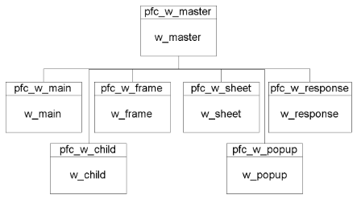
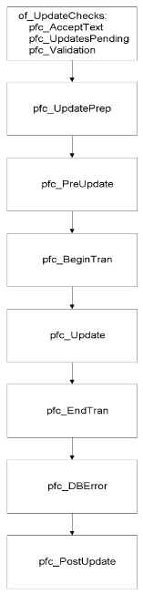

# Using PFC Windows and Menus

**About this chapter**

This chapter explains how to use PFC windows and menus.

| Contents Topic | Page |
| --- | --- |
| Using PFC windows | 191 |
| Using menus with PFC | 201 |

## Using PFC windows

PFC provides a base class ancestor window (w_master) as well as ancestor windows for each of the standard window types.

Each of these windows descends from w_master:



PFC windows contain instance variables, events, and functions that provide advanced functionality and enable communication with other PFC objects.

### Window usage basics

When developing an application, you typically:

- Create base-class and descendent windows
- Enable window services
- Open windows from menu items

**Developing with PFC windows**

As you begin an application, you review the required functionality to decide which instance variables, events, and functions belong in ancestor windows. The way you define application-specific ancestor behavior differs depending on your extension strategy.

For a discussion of extension strategy, see “Choosing an extension strategy”.

**Enabling window services**

PFC provides a variety of window services that you can use to add production-strength features to an application. Many of these services require little or no coding on your part. The window services are:

- Base window service
- Preference service
- Status bar service (frame windows only)
- Sheet management service (frame windows only)
- Resize service (also applies to tabs, tab pages, and custom visual user objects)

**To use window services:**

1. Determine which window services are appropriate for the window.
2. Enable the appropriate window services using the of_Set*servicename* functions (this example from the window’s pfc_PreOpen event enables the preference and resize services):

   ```
   this.of_SetPreference(TRUE)
   this.of_SetResize(TRUE)
   ```

3. Call other functions as necessary to initialize services (this example enables the preference service for menu items and toolbars and enables the resize service for a DataWindow and two CommandButtons):

   ```
   this.inv_preference.of_SetMenuItems(TRUE)
   this.inv_preference.of_SetToolbars(TRUE)
   this.inv_resize.of_Register  &
      (dw_emplist, 0, 0, 100, 100)
   this.inv_resize.of_Register  &
      (cb_ok, 0, 100, 0, 0)
   this.inv_resize.of_Register  &
      (cb_cancel, 0, 100, 0, 0)
   ```

For specific usage information on individual window services, see “Window services”.

**Opening PFC windows**

In many applications, users open windows by selecting menu items. You can use the PFC message router to help implement this process in a flexible and consistent manner.

See “The message router”.

**To open PFC windows from a menu item:**

1. In the menu item, populate Message.StringParm with the window name and call the menu service of_SendMessage function:

   ```
   n_cst_menu  lnv_menu

   Message.StringParm = "w_emplist"
   lnv_menu.of_SendMessage(this, "pfc_Open")
   ```

2. In the frame window’s pfc_Open event, add code to access the message object and open the requested window:

   ```
   String   ls_window
   w_sheet  lw_sheet

   ls_window = Message.StringParm
   OpenSheet(lw_sheet, ls_window, this, 4, Original!)
   ```

**Other options** There are other ways to open PFC windows. These include opening windows directly from the menu item, extending the message object to contain passed arguments, and defining additional frame window user events for opening windows.

### Using response windows

You typically use w_response (the PFC response window) to create a response window that displays and collects data, settings, or preferences.

**Another use for w_response** You can also use w_response to create a response window used in place of a MessageBox. But in that case it’s usually best to use the w_message dialog box (part of the error message service).

W_response includes three user events to which you add code that processes the user action:

| Event | Use it to | More information |
| --- | --- | --- |
| pfc_Apply | Process the window contents, leaving the window open | Many current applications contain an Apply CommandButton that performs this functionality |
| pfc_Cancel | Ignore the window contents and close the window | You call this event from the CommandButton to which you assign the Cancel property |
| pfc_Default | Process the window contents and close the window | You call this event from the CommandButton to which you assign the Default property |

**To use w_response events:**

1. Create a window that descends from w_response.
2. Add controls to handle display and user input.

   **Use the PFC standard visual user objects** You can use PowerBuilder window controls with PFC. But it’s best to use controls that descend from PFC standard visual user objects (u_dw, u_lb, u_sle, u_cb, and so on).

3. Add code to support these controls. For example, add code to the window’s pfc_PreOpen event to access values in an INI file for display in SingleLineEdit controls.
4. Code the pfc_Apply, pfc_Cancel, and pfc_Default events as necessary. For example, a pfc_Default event might save the window contents in an INI file and close the window:

   ```
   String   ls_temp

   ls_temp = trim(sle_base.Text)
   SetProfileString("eisapp.ini",  &
      "Files", "base", ls_temp)
   ls_temp = trim(sle_x1.Text)
   SetProfileString("eisapp.ini",  &
      "Files", "extra1", ls_temp)
   ls_temp = trim(sle_x2.Text)
   SetProfileString("eisapp.ini",  &
      "Files", "extra2", ls_temp)
   Close(this)
   ```

5. Add CommandButtons to trigger the corresponding event. For example, an OK CommandButton should call the pfc_Default event:

   ```
   parent.Event pfc_Default()
   ```

**Using pfc_Apply** To maximize reusability, place processing in pfc_Apply and call pfc_Apply from pfc_Default.

### Using the pfc_Save process

The w_master pfc_Save event automatically validates and saves changes for all PFC and non-PFC DataWindows on a window. Because pfc_Save calls many other events, offloading most of the work to the logical unit of work service, you should think of it as a process rather than a single event.

**The logical unit of work service** The pfc_Save process uses the logical unit of work service, which you enable by calling the of_SetLogicalUnitOfWork function. If you do not enable the logical unit of work service, w_master enables it automatically as needed.

Although there are many ways to save data, it’s best to use the pfc_Save event to save changes. In addition to simply calling the w_master pfc_Save event and checking the return value, you can have complete control over update processing by customizing and extending events called by the pfc_Save process. You can:

- Save changes for other self-updating objects (including the n_ds DataStore, the u_tvs TreeView, and the u_lvs Listview)
- Save changes for other controls
- Control which objects are updated and the order in which they are updated
- Save changes for objects on other windows

**Self-updating objects** PFC integrates update functionality into certain objects called **self-updating objects**. When you call the w_master pfc_Save event, it automatically updates all self-updating objects on the window. All DataWindows are self-updating. You must explicitly enable self-updating functionality for n_ds, u_lvs, u_tab, and u_tvs. And you can add self-updating functionality to any visual or nonvisual control.

For more on self-updating objects, see “Logical unit of work service”.

**The pfc_Save process**

This is the w_master pfc_Save process:



**Pfc_Save events**

These are the events in the pfc_Save process:

| Event | Purpose | Comment |
| --- | --- | --- |
| pfc_AcceptText | Performs an AcceptText function for all self-updating objects on the window | Called by the w_master of_AcceptText function |
| pfc_UpdatesPending | Determines which self-updating object have pending updates | Called by the w_master of_UpdatesPending function |
| pfc_Validation | Performs validation on all self-updating objects with pending updates | Called by the of_Validation function For non-PFC DataWindows, code a ue_validation user event that returns an integer or long greater than or equal to 0 to indicate success |
| pfc_UpdatePrep | Empty user event to which you add optional update preparation logic | Extend this event if the window itself functions as a self-updating object |
| pfc_PreUpdate | Empty event in which you can code additional validation | Return 1 for success; return anything else to terminate the pfc_Save process |
| pfc_BeginTran | Empty event in which you code logic to begin the database transaction, if required by your DBMS | Return 1 for success; return anything else to terminate the pfc_Save process |
| pfc_Update | Performs database updates for all modified self-updating object | You can extend this event to update controls that are not self-updating. Return 1 for success; return -1 for failure. If you return -1, also create an error message by calling the of_SetDBErrorMsg function. The pfc_DBError event will display this message |
| pfc_EndTran | Empty event to which you code logic to commit or roll back the database transaction | Commit or roll back changes based on the passed argument Although you can code COMMIT and ROLLBACK statements in other places, it’s best to code them here |
| pfc_DBError | If any update failed, this event displays a message | If the Error service is enabled, this event calls the of_Message function; if not, it calls the PowerScript MessageBox function |
|  |  | PFC delays displaying the error message (as opposed to displaying it in pfc_Update) so that you can roll back changes in the pfc_EndTran event before displaying an error message dialog box |
| pfc_PostUpdate | Resets the update flags for all updated objects, as follows | If you extended the pfc_Save process to update other controls, extend this event to reset the update flags |

**Pfc_Save return values**

Pfc_Save returns values as follows:

| Return value | Meaning | Comment |
| --- | --- | --- |
| 1 | Success |  |
| 0 | No pending updates |  |
| -1 | AcceptText error | pfc_Save process halted |
| -2 | Error in pfc_UpdatesPending | pfc_Save process halted |
| -3 | Validation error | pfc_Save process halted |
| -4 | Error in pfc_PreUpdate | pfc_Save process halted |
| -5 | Error in pfc_BeginTran | pfc_Save process halted |
| -6 | Error in pfc_Update | pfc_EndTran and pfc_DBError events completed; pfc_PostUpdate was not performed |
| -7 | Error in pfc_EndTran | pfc_PostUpdate was not performed |
| -8 | Error in pfc_PostUpdate |  |
| -9 | Error in pfc_UpdatePrep | pfc_Save process halted |

**Adding code to extend pfc_Save events**

You can customize and extend the pfc_Save process. For example, you can:

- Add code to the pfc_EndTran event to commit and roll back transactions
- Create and code a ue_Validation user event in non-PFC DataWindows to perform validation
- Extend the pfc_Save process to include other types of window controls

**To add code to the pfc_EndTran event:**

- Add code to the pfc_EndTran event that checks the ai_update_results argument and commits or rolls back changes as appropriate for each transaction object that might be updated:

  ```
  Integer  li_return

  IF ai_update_results = 1 THEN
    li_return = SQLCA.of_Commit()
  ELSE
    li_return = SQLCA.of_Rollback()
  END IF

  IF li_return = 0 THEN
    Return 1
  ELSE
    Return -1
  END IF
  ```

**Enabling self-updating objects**

By default, DataWindows are the only self-updating objects that are updatable. All others (n_ds, u_lvs, u_tvs, u_tab, and any user-defined custom visual user objects) are nonupdatable and must be specifically enabled.

**To enable self-updating objects:**

1. Call the self-updating object’s of_SetUpdatable function:

   ```
   ids_data.of_SetUpdateable(TRUE)
   lv_1.of_SetUpdateable(TRUE)
   tv_1.of_SetUpdateable)(TRUE)
   ```

2. (DataStores only) Add the n_ds-based DataStore to the list of controls to be updated:

   ```
   PowerObject lpo_objs[ ]
   Integer  li_count

   // this = window
   lpo_objs = this.control
   li_count = UpperBound(lpo_objs)
   lpo_objs[li_count + 1] = ids_data
   this.of_SetUpdateObjects(lpo_objs)
   ```

**Enabling a one-time update**

PFC allows you to identify a specified group of controls and update them.

**To perform a one-time update:**

1. Identify the controls to be updated:

   ```
   PowerObject lpo_objs[ ]
   Integer  li_return

   lpo_objs[1] = lv_1
   lpo_objs[2] = dw_1
   lv_1.of_SetUpdateable(TRUE)
   ```

2. Perform the one-time save by calling the pfc_SaveObjects event:

   ```
   // this = window
   li_return = this.Event pfc_SaveObjects(lpo_objs)
   // Check for return codes 1 to -8
   ...
   ```

## Using menus with PFC

PFC implements menu services through functions, menu items, and events coded in m_master. M_master contains:

- A function that calls the message router
- Menu items that use the message router to perform the requested functionality

**Inherit from menus in the extension level** When using menus, always inherit from menus with the m_ prefix (don’t inherit from menus with the pfc_ prefix). Pfc_ prefixed objects are subject to change when you upgrade PFC versions.

### Two menu inheritance strategies

You can use PFC’s menus or write your own.

**Using PFC menus**

Your application can use PFC menus as the basis for its menus. In most cases, you use m_master as the ancestor for your application’s sheet windows and use m_frame as the frame menu. You add all application-specific menu bar items and menu items to m_master. Let sheet menus inherit from m_master, and enable and disable menu items as appropriate. Disable menu bar items and menu items as appropriate in m_frame.

**Creating your own menus**

Alternatively, you can implement your own customized menus, separate from m_master. If you do, consider using the menu service of_SendMessage menu function to implement PFC message router functionality.

### Extending PFC menus

If you use PFC menus, you will need to modify them or their descendants to provide application-specific processing. When you add new menu bar items and menu items, PFC uses the PowerBuilder Shift Over/Down attribute to control where menu items are placed:

**On this menu PowerBuilder inserts new items**

|   |   |
| --- | --- |
| Menu bar | Between Tools and Window |
| File menu | Above Delete |
| Edit menu | Above Update Links |
| View menu | Above Ruler |
| Tools menu | Above Customize Toolbars |
| Window menu | Below Undo |
| Help menu | Above About |

For complete information on the Shift Over/Down feature, see the *PowerBuilder User’s Guide*.

### Creating your own menus

PFC menus provide menu items to cover most events in PFC controls. Your application may have more specific requirements that justify creating a menu from scratch for use with your PFC windows.

**Creating menus**

Use the Menu painter to create your menus. Add just the items required for your application, defining shortcut keys, accelerators, and toolbar bitmaps as needed.

**Creating an extension level** If you are an object administrator creating menus for use by multiple developers and applications, consider creating an ancestor menu (with PowerScript and PFC code) and an empty extension level menu for use by developers.

**Communicating with windows**

Depending on your needs, you can use either your own menu-window communication method or the PFC message router. When using the message router, it’s best to use the menu service of_SendMessage function to call events on the window. Each menu item calls of_SendMessage, passing the name of the event to call. For example, the Clicked event for the Edit>Cut menu item calls of_SendMessage as follows:

```
n_cst_menu  lnv_menu

lnv_menu.of_SendMessage(this, "pfc_Cut")
```

There are two menu items that require special attention:

- **File>Exit** Call the application manager pfc_Exit event:

  ```
  gnv_app.Event pfc_Exit()
  ```

- **MRU menu items (File menu)** Copy the menu item text to Message.StringParm before calling of_SendMessage:

  ```
  n_cst_menu  lnv_menu

  Message.StringParm = this.Text
  lnv_menu.of_SendMessage(this, "pfc_MRUClicked")
  ```

**Copy and paste** You can save time by copying and pasting menu item scripts from pfc_m_master.

**Enabling items on the Window menu**

When the window sheet manager service is enabled, PFC menus automatically enable and disable Window menu items as appropriate. If you are using the sheet manager service and want that functionality in your menus, copy the code from the pfc_m_master Window menu item Selected event.

### Using standard menu items

M_master contains menu items that invoke user events on the corresponding window. Use menu items as follows:

- **If the menu item does not apply to a window** Make it invisible.
- **If the menu item applies to a window** Review PowerScript code in the corresponding user event for the associated window, DataWindow, or visual control.

Each of the m_master menu items triggers certain events. Some of these user events are empty; you must add the appropriate PowerScript code to perform application-specific processing.

For more information on PFC user events, see the *PFC Object Reference*.

| File menu Menu item | Event triggered | Object(s) containing user event |
| --- | --- | --- |
| New | pfc_New | w_master |
| Open | pfc_Open | u_rte, w_master |
| Close | pfc_Close | w_master |
| Save | pfc_Save | u_rte, w_master |
| Save As | pfc_SaveAs | u_rte, w_master |
| Print | pfc_Print | u_dw, u_rte, w_master |
| Print Preview | pfc_PrintPreview | u_dw, u_rte |
| Page Setup | pfc_PageSetup | u_dw, w_master |
| Print Immediate | pfc_PrintImmediate | u_dw, u_rte, w_master |
| Delete | Empty menu item | Add your own events or functions |
| Properties | Empty menu item | Add your own events or functions |
| Exit | pfc_exit | N_cst_appmanager |

| Edit menu Menu item | Event triggered | Object(s) containing user event |
| --- | --- | --- |
| Undo | pfc_Undo | U_dw, u_em, u_mle, u_rte, and u_sle |
| Cut | pfc_Cut | U_ddlb, u_ddplb, u_dw, u_em, u_mle, u_oc, u_rte, and u_sle |
| Copy | pfc_Copy | U_ddlb, u_ddplb, u_dw, u_em, u_mle, u_oc, u_rte, and u_sle |
| Paste | pfc_Paste | U_ddlb, u_ddplb, u_dw, u_em, u_mle, u_oc, u_rte, and u_sle |
| Paste Special | pfc_PasteSpecial | U_oc |
| Clear | pfc_Clear | U_ddlb, u_ddplb, u_dw, u_em, u_mle, u_oc, u_rte, and u_sle |
| Select All | pfc_SelectAll | U_ddlb, u_ddplb, u_dw, u_em, u_mle, u_rte, and u_sle |
| Find | pfc_FindDlg | U_dw and u_rte |
| Replace | pfc_ReplaceDlg | U_dw and u_rte |
| Update Links | pfc_UpdateLinks | U_oc |
| Object>Edit | pfc_EditObject | U_oc |
| Object>Open | pfc_OpenObject | U_oc |

| View menu Menu item | Action | Object containing user event |
| --- | --- | --- |
| Ruler | pfc_Ruler | U_dw and u_rte |
| Large Icons | Empty menu item. | Add logic to u_lvs to switch to large icon view |
| Small Icons | Empty menu item | Add logic to u_lvs to switch to small icon view; call from this menu item |
| List | Empty menu item | Add logic to u_lvs to switch to list view; call from this menu item |
| Details | Empty menu item | Add logic to u_lvs to switch to detail view; call from this menu item |
| Arrange Icons>By | Empty menu item | Add logic to u_lvs to arrange icons by some common property; call from this menu item |
| Arrange Icons>Auto Arrange | Empty menu item | Add logic to u_lvs to arrange icons; call from this menu item |
| First | pfc_FirstPage | U_dw and u_rte |
| Next | pfc_NextPage | U_dw and u_rte |
| Prior | pfc_PreviousPage | U_dw and u_rte |
| Last | pfc_LastPage | U_dw and u_rte |
| Sort | pfc_SortDlg | U_dw |
| Filter | pfc_FilterDlg | U_dw |
| Zoom | pfc_Zoom | U_dw |

| Insert menu Menu item | Event triggered | Object(s) containing user event |
| --- | --- | --- |
| File | pfc_InsertFile | U_rte |
| Picture | pfc_InsertPicture | U_rte |
| Object | pfc_InsertObject | U_oc |

| Tools menu Menu item | Event triggered | Object(s) containing user event |
| --- | --- | --- |
| Customize Toolbars | pfc_Toolbars | W_frame |

| Window menu Menu item | Action | Object containing user event |
| --- | --- | --- |
| Cascade | pfc_Cascade | W_frame |
| Tile Horizontal | pfc_TileHorizontal | W_frame |
| Tile Vertical | pfc_TileVertical | W_frame |
| Layer | pfc_Layer | W_frame |
| Minimize All Windows | pfc_MinimizeAll | W_frame |
| Undo | pfc_UndoArrange | W_frame |

| Help menu Menu item | Event triggered | Object(s) containing user event |
| --- | --- | --- |
| Help Topics | pfc_Help | W_master |
| About | of_About | N_cst_appmanager |

### Using pop-up menus

PFC also provides pop-up menus for use by your applications and PFC services. The pop-up menu provided depends on the control that you right-click. You can disable the pop-up menu functionality by setting the ib_rmbmenu instance variable to FALSE in a control’s Constructor event. You can also extend the pop-up menus to add application-specific functionality.

For a list of the pop-up menus provided for standard controls, see “Using right-mouse button support”.
