# PFC Utilities

**About this chapter**

This chapter describes the PFC utilities and how to use them.

| Contents Topic | Page |
| --- | --- |
| DataWindow Properties window | 207 |
| SQL Spy | 210 |
| Security | 213 |
| Library Extender | 225 |
| Migration Assistant | 226 |

## DataWindow Properties window

The DataWindow Properties window allows you to:

- Selectively enable and disable DataWindow services
- View the PFC syntax for the selected service
- Access and modify DataWindow properties interactively, including:

DataWindow buffers Row and column status Statistics Properties of all objects on the DataWindow object

The DataWindow Properties service is invoked in Lesson 4, “Build the First Sheet Window” of the PFC tutorial.

**DataWindow Properties window tab**

The DataWindow Properties window has three tabs:

- **Services** Displays a list of DataWindow services. Select a service and click Enable or Disable as needed. Click Properties to display information for the currently selected service:

  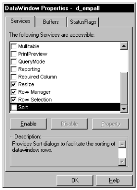

- **Buffers** Click the right mouse button to display a pop-up menu that allows you to manipulate rows:

  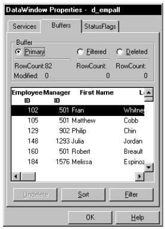

- **Status flags** Change DataWindow status flags as necessary. The Assist Status Change check box allows you to perform two-step status changes in one step:

  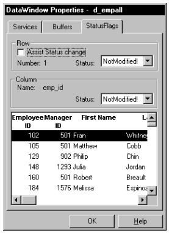

**Service dialog box tabs**

Each service displays its own set of tabs that display its properties. This example shows the tabs for the sort service:

- **General** Displays information about the selected service:

  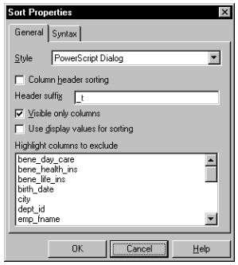

- **Syntax** Displays the PFC syntax used for the selected service:

  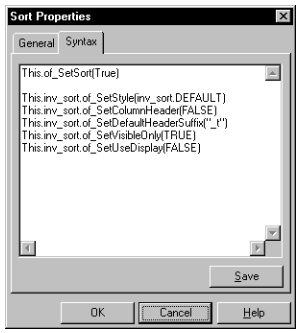

**Usage**

Use the DataWindow Properties window to debug and test your application and its use of DataWindow services.

**To display the DataWindow properties window:**

1. Enable the DataWindow Properties service by calling the u_dw of_SetProperty function:

   ```
   this.of_SetProperty(TRUE)
   ```

2. When the DataWindow displays, right-click and select DataWindow Properties.

   The DataWindow Properties window displays.

## SQL Spy

The SQL Spy utility traps and saves SQL automatically for DataWindows and EXEC IMMEDIATE SQL statements. You can also use SQL Spy to display and optionally modify DataWindow SQL statements, and to log native SQL.

**Modifying SQL** If you are using an ODBC data source, you must set DisableBind to 1 in the connect string.

SQL Spy logs SQL to a file, which you can optionally display in a pop-up window.

**Usage**

To use SQL Spy, you call functions to enable the utility, to specify the log file, and to control display of the w_sqlspy window. You can also call a function to log native SQL.

You typically initialize SQL Spy from the application manager pfc_Open event, although you can call SQL Spy functions from anywhere within an application.

**To enable SQL Spy:**

1. Enable the debugging service by calling the n_cst_appmanager of_SetDebug function:

   ```
   this.of_SetDebug(TRUE)
   ```

2. Enable SQL Spy by calling the n_cst_debug of_SetSQLSpy function:

   ```
   this.inv_debug.of_SetSQLSpy(TRUE)
   ```

3. (Optional) Specify a log file by calling the n_cst_sqlspy of_SetLogFile function:

   ```
   this.inv_debug.inv_sqlspy.of_SetLogFile &
          ("c:\MyPFCApps\ThisApp\appdbug.log")
   ```

**To display the w_sqlspy pop-up window:**

- Call the n_cst_sqlspy of_OpenSQLSpy function:

  ```
  gnv_app.inv_debug.inv_sqlspy.of_OpenSQLSpy(TRUE)
  ```

The w_sqlspy pop-up window displays the most recent entries in the log file:

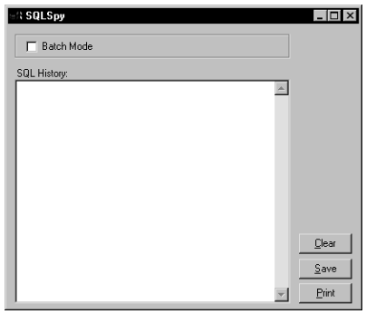

The w_sqlspyinspect dialog box allows you view and optionally modify SQL before the DataWindow submits it to the database.

**To display the w_sqlspyinspect dialog box:**

- Call the n_cst_sqlspy of_SetBatchMode(FALSE) function:

  ```
  gnv_app.inv_debug.inv_sqlspy.of_SetBatchMode &
         (FALSE)
  ```

**To use the w_sqlspyinspect dialog box:**

1. Update the database, inserting, deleting, or modifying rows.

   The w_sqlinspect dialog box displays:

   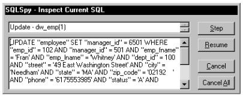

2. Review the SQL statement, optionally modifying values.
3. Click the appropriate command button:
   - **Step** Updates the current row and displays information for the next row to be updated
   - **Resume** Updates the current row and updates all remaining rows; disable the SQL Spy inspect capability
   - **Cancel** Does not update the current row and displays the next row to be updated
   - **Cancel All** Does not update all remaining rows

**To log a SQL statement manually:**

- Code the n_cst_sqlspy of_SQLSyntax function, passing the SQL to be logged:

  ```
  String ls_sql

  ls_sql = "SELECT * FROM employee;"
  gnv_app.inv_debug.inv_sqlspy.of_SQLSyntax &
         ("Native SQL", String(Now()) + ": " + &
            String(Today()) + ": " + ls_sql)
  ...
  ```

## Security

PFC provides a database-driven security system that requires minimal coding in your applications. It allows you to populate a security database with information, including:

- Window controls
- DataWindow columns
- User objects
- Menu items

You then create a matrix of users and groups, controlling access to these items.

At execution time, PFC selectively enables, disables, or hides secured items, as specified in the security database.

The PFC security system includes:

- **The security administration utility** Allows you to define users, groups, items to be secured, and user access.
- **The security scanner** Scans user-specified objects to gather information on all items that can be secured.
- **The security database** Contains information on users, groups, items to be secured, and user access to those secured items.

**Delivered as a local database** PFC provides a local database to hold security information. However, when you implement security, you will want to use a server database.

**Security by exception**

The PFC security capability provides security by exception. By default, the security system uses the object’s current settings. This means that PFC modifies settings only where specified explicitly in the security database.

**The process**

The security administration utility is a PowerBuilder application you run in order to:

- Define users and groups
- Run the security scanner
- Define security for objects and controls
- Associate users and groups with objects and controls

In your applications, you add code to implement security:

| In this object | Add this code |
| --- | --- |
| Application manager | Call the n_cst_appmanager of_SetSecurity function to enable the security service, n_cst_security |
| Application manager or frame window | Establish a Transaction object, connect to the security database, and call the n_cst_security of_InitSecurity function |
|  | The of_InitSecurity function allows you to set a default group for the user. The security system uses this group if there are no other group settings for the user |
| Windows that require security | Call the of_SetSecurity function in the window Open event |

For more information on enabling security in your applications, see “Implementing security in an application”.

### Defining users and groups

**Overview**

To use PFC security, you must define users and groups. A user can be a member of zero or more groups; user settings always override group settings.

**Usage**

You use the security administration utility to define users and groups, as well as associate users with groups.

**Use an existing target file** If you already have a target file for your security administration utility, add it to your PowerBuilder workspace, make sure it includes all the PFC libraries in its library list, and skip the first four steps in the following procedure.

**To define users:**

1. Add an Existing Application target to your PowerBuilder workspace (select File>New from the PowerBuilder menu bar, click the Target tab, click the Existing Application target icon, and click OK).
2. On the Choose Library and Application page of the target wizard, select the pfcsecurity_admin application in the PFCSECAD.PBL library in the PFC\Security directory and click Next.
3. On the Set Library Search Path page of the target wizard, add all the PFC libraries to the library list and click Next.
4. On the Specify Target File page of the target wizard, click Finish.

   The default target filename has the same name as the security application you selected with a PBT extension.

5. Select Run>Select And Run from the PowerBuilder menu bar, select the security_admin target, and click OK.

   **Security administration database and INI file** If there are problems connecting to the PFC.DB database, check the PFCSECAD.INI file and your workstation’s ODBC settings.

   If you have moved the PFC security tables from PFC.DB to some other database, you must update the Database section of the PFCSECAD.INI file to reflect the appropriate database connection parameters.

6. Select File>User/Groups from the security administration utiltiy menu bar.

   The User/Group Management window displays:

   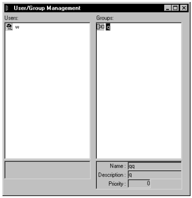

7. Right-click in the Users column and select Add Item.

   The Add User dialog box displays:

   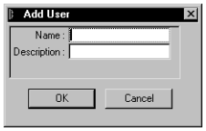

8. Type a user name and description. The user name must correspond to a user ID that your application can access at runtime.
9. Click OK.
10. Continue adding users as necessary.
11. Select File>Save from the menu bar.

**To define groups:**

1. Right-click in the Groups column and select Add Group.

   The Add Group dialog box displays:

   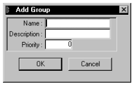

2. Type a group name, description, and priority. Zero is the highest priority; however, user specifications override group specifications.
3. Click OK.
4. Continue adding groups as necessary.
5. Select File>Save from the menu bar.

**To associate users with groups:**

- Drag the user and drop it over the group.

**To remove a user from a group:**

1. Right-click on the user and select Delete Item.

   The Delete User from Group dialog box displays.

2. Click OK.
3. Select File>Save from the menu bar.

**When group membership comes from an identity provider (PFC 2025 and later)** If your applications take each user's groups from an identity provider, such as an OpenID Connect server, instead of from the security database (see "Security service" in Chapter 4), set this option in the `[Options]` section of `pfcsecad.ini`:

```
[Options]
ExternalGroupMembership=1
```

The Users and Groups window then shows users and groups without their memberships, and you can't drag users onto groups. You still define the groups, their priorities, and the settings for users and groups. The report by user shows only the user's own settings, not the settings of groups. This option is available in PFC 2025 and later; it is not available in the 2019 and 2022 versions of PFC.

**To modify a previously defined user or group:**

1. Right-click on the item and select Edit Item.

   The Edit User or Edit Group dialog box displays.

2. Modify information as necessary.
3. Click OK.
4. Select File>Save from the menu bar.

### Running the security scanner

The security scanner reads the windows, menus, user objects, and DataWindow objects of an application and records in the security database the items that can be secured:

- Windows and their controls, including the controls a window inherits from its ancestors
- For DataWindow controls, the columns of their DataWindow objects
- Menu items, including inherited ones; a window's scan includes the items of its menu
- User objects and tab controls, with the controls of their tab pages and user objects, named as the security service names them at run time (for example, `tab_1.tabpage_1.dw_1.emp_id`)

The scanner reads the objects' source, so it scans a PowerBuilder 2025 solution as well as a workspace. It doesn't need the application to be compiled.

**Usage**

You can run the security scanner from the security administration utility, on its own, or from the command line for an unattended scan.

**The security database** The scanner uses the security administration utility's INI file (*pfcsecad.ini*) to connect to the security database. It looks for the file in this order:

1. The file given on the command line with `/ini`. The security administration utility gives its own INI file this way.
2. The file named by the `PFC_SECURITY_INI` environment variable.
3. *pfcsecad.ini* in the current folder.

Otherwise, the scanner asks for the file. If it can't connect, it shows the database's error and lets you choose another INI file.

**To run the security scanner from the security administration utility:**

1. Run the security administration utility.

   See “Defining users and groups” for steps on running it.

2. Select File>Scan Application from the menu bar.

   The scanner starts with the utility's INI file. The scanner, *pfcsecurity_scanner.exe*, must be in the utility's folder or on the path.

3. In the Select Application dialog box, browse for the application's project (*.pbproj*), solution (*.pbsln*), or target (*.pbt*).

   For a solution, choose the project to scan; the solution's default project is selected. The dialog box lists the application's libraries. For a workspace whose objects are kept as source (with source control), the scanner reads them from the workspace's *ws_objects* folder; otherwise, it reads the PBL files.

4. Click OK.

   The Select Objects to be Scanned dialog box lists the application's windows, menus, visual user objects, and DataWindow objects. All of them are selected, except the PFC ancestor layer (the *pfc_* objects), which is never opened itself.

5. Press CTRL+click or SHIFT+click to change the selection, then click Scan.

   **Selecting objects** To minimize the size of the security database, do not select objects for which you will never assign security.

6. When the scan completes, the scanner shows a summary: the controls added to the template, the controls whose type changed, and the controls the template has that the objects no longer have.

**Scanning again** You can scan an application again after you change it. A new scan adds the controls that are new, and keeps your work in Template Management:

- A description you edited is kept.
- A control you deleted stays deleted. The scanner remembers the controls it found in the *security_scan* table, which it creates in the security database if it doesn't have it. (If the scanner's login can't create tables, create the table with *security_scan.sql* from the [Database-scripts-and-files](https://github.com/OpenSourcePFCLibraries/Database-scripts-and-files) repository.)
- A control the object no longer has is listed in the summary, and kept in the template, because it might have security settings. Delete it in Template Management.

**To run the security scanner from the command line:**

```
pfcsecurity_scanner [/ini <file>] [/target <file> [/project <name>]] [/scan [/log <file>]]
```

| Option | Description |
| --- | --- |
| `/ini` | The security administration utility's INI file |
| `/target` | The project (*.pbproj*), solution (*.pbsln*), or target (*.pbt*) to scan |
| `/project` | For a solution, the project to scan; otherwise the solution's default project |
| `/scan` | Scans without a window: the objects that the Select Objects to be Scanned dialog box selects by default (all but the *pfc_* objects). Messages and the summary are written to the log. |
| `/log` | The log of an unattended scan; otherwise *pfcsecurity_scanner.log* in the current folder |

Without `/scan`, the scanner opens the Select Application dialog box with the target and project selected. Put a path with spaces in quotation marks. For example, to scan an application every night:

```
pfcsecurity_scanner /ini "C:\PFC\pfcsecad.ini" /target "C:\Projects\Sales\Sales.pbsln" /project sales /scan /log "C:\Logs\scan.log"
```

**To customize the controls for which security is enabled:**

1. Select and run the security administration utility.
2. Select File>Templates from the security administration utility menu bar.

   The Template Management window displays:

   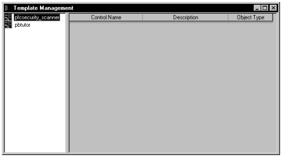

3. Double-click on the application you just scanned.

   A list of windows displays.

4. Double-click on one of the windows.

   A list of controls displays:

   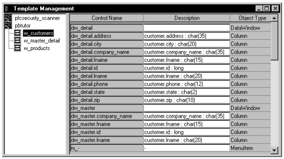

5. Modify descriptions as appropriate.

   Modifying descriptions on this window can make things clearer when associating users and groups with windows, window controls, and menu items.

6. Delete items that you will not secure by right-clicking over the item and selecting Delete.

   Deleting unnecessary items reduces the size of the security database, increasing performance.

7. When you are through, select File>Save from the menu bar.
8. Continue this process with all objects to be secured.

### Defining security for users and groups

After running the scanner to record objects and controls and selectively deleting items that don’t require securing, you specify security by associating users and groups with objects and controls.

**Usage**

For each user and group, you enable or disable access to window controls, DataWindow columns, user objects, and menu items for each object to be secured.

Users may belong to zero or more groups. User settings always take precedence over group settings. If there are no user settings, then the group setting with the highest priority is used (zero is the highest priority).

**To define security for a user or group:**

1. Select and run the security administration utility (PFCSECAD.PBT).

   See “Defining users and groups” for steps on adding the security administration target file to your workspace.

2. Select File>Users/Objects from the menu bar.

   The User/Object Management window displays:

   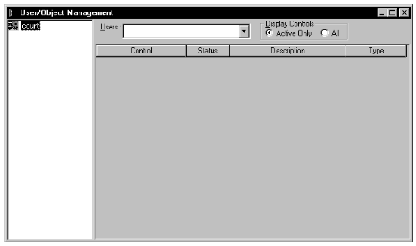

3. Click the Users drop-down list and select a user for whom to set security.
4. Double-click the application containing the objects to be secured.
5. Select the All radio button (if it’s not already selected).

   You are now ready to secure items.

   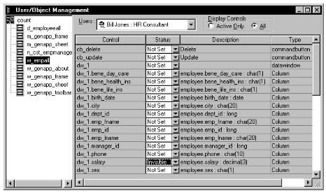

6. For items to be secured, use the Status drop-down list to specify Enabled, Disabled, or Invisible (Not Set makes no change to the object’s settings).
7. When you are finished, select File>Save from the menu bar.
8. Continue with the object until you are finished with all users and groups.
9. Continue with other objects.

### Implementing security in an application

Once you have defined a security database, enable the security service in your application.

**Usage**

Enabling the security service in your application involves:

- Enabling the security service
- Establishing a database connection to the database that contains the security tables and communicating this information to the security service
- Enabling the security service on the appropriate windows

**To enable the security service for an application:**

- Call the n_cst_appmanager of_SetSecurity function:

  ```
  gnv_app.of_SetSecurity(TRUE)
  ```

**To establish a connection to the database containing the security tables and communicate it to the security system:**

1. Create a Transaction object and connect to the database (this example assumes an itr_security instance variable on a customized n_cst_appmanager descendant):

   ```
   gnv_app.itr_security = CREATE n_tr
   gnv_app.itr_security.of_Init &
          (gnv_app.of_GetAppINIFile(), "Security")

   gnv_app.itr_security.of_Connect()
   ```

**Security table placement** To minimize the number of database connections held by your application, place the security tables in the application database.

2. Call the n_cst_security of_InitSecurity function:

   ```
   Integer li_return

   li_return = &
          gnv_app.inv_security.of_InitSecurity &
             (gnv_app.itr_security, "EISAPP", &
                gnv_app.of_GetUserID(), "Default")
   ```

**To enable security for a window:**

- Call the n_cst_security of_SetSecurity function in the window’s Open or pfc_PreOpen event:

  ```
  gnv_app.inv_security.of_SetSecurity(this)
  ```

**Deny by default (PFC 2025 and later)** By default, controls that have no setting for the user are left as designed. To disable or hide them instead, so that you only need to define the controls each user or group may use, call the n_cst_security of_SetDefaultStatus function after of_InitSecurity. See "Security service" in Chapter 4. This is available in PFC 2025 and later; it is not available in the 2019 and 2022 versions of PFC.

### Maintaining the security database

The PFC security system tables are delivered in the PFC.DB local database. The PFC security tables are:

- Security_apps
- Security_groups
- Security_info
- Security_template
- Security_users

You can use the PFC.DB local database to define users and groups, scan objects, and define access privileges. However, you will need to migrate these tables to a server database before deploying applications. The PFC security system and the security database are designed for easy migration to a server database:

- All database interactions for PFC security are via DataWindows (there is no embedded SQL)
- The PFC security system enforces cascading deletes manually

**Usage**

To enable security for all of your application’s users, move the PFC security tables to a server database.

**To migrate PFC security tables to a server database:**

1. Use the Pipeline painter to move table definitions and data to a server database. Retain the table and column names as much as possible.
2. Use the DataWindow painter to access the PFC security DataWindows. Note the following:
   - Preserve the DataWindow’s column order and DataWindow column names.
   - If necessary, use the Select Painter to change the name of the associated database tables or columns to match those on the server database. Remember not to change the name of the DataWindow columns.
3. In your application, populate Transaction object fields as appropriate for the server database containing the security tables.

## Library Extender

You use the PFC Library Extender to automatically create and populate an intermediate extension level between two existing levels, redefining the inheritance hierarchy.

By supplying the Library Extender with the names of the upper and lower levels, the Library Extender:

- Creates a new PBL
- Creates objects in the new PBL that descend from objects in the upper level
- Recreates objects in the lower level such that they descend from objects in the new PBL

  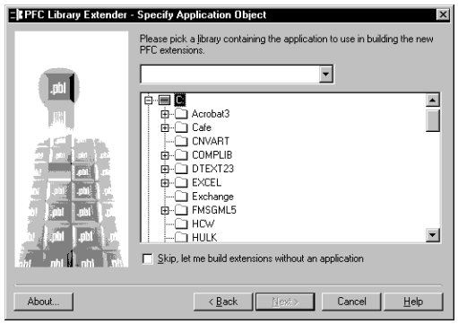

Typically you would use the Library Extender to add an intermediate level (or levels) between the PFC ancestor level and the PFC extension level. Adding corporate and departmental extensions to intermediate extension levels allows the application programmer to make full use of the extension level.

**Usage**

The Library Extender is available on the Tool tab in the New dialog box.

For complete usage information, see the Library Extender online Help.

## Migration Assistant

The Migration Assistant scans PowerBuilder libraries (PBLs) and highlights usage of obsolete functions and events. Obsolete functions and events still work in the current version of PowerBuilder but may not work in future versions. If you plan on maintaining an application in the future, it's best to use current syntax and events.

**Usage**

The Migration Assistant is available on the Tool tab in the New dialog box.

For complete usage information, see the Migration Assistant online Help.
