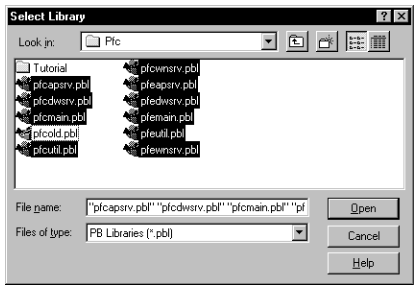
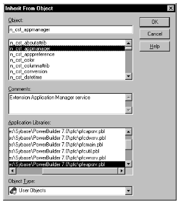
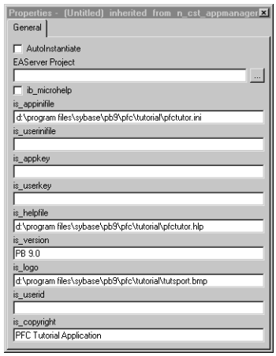
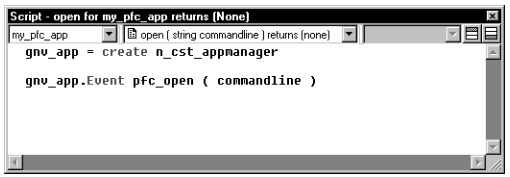
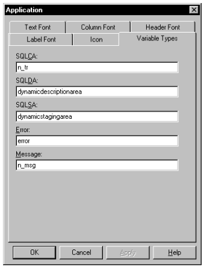

# Generate a PFC Application

In this tutorial, you generate a PFC application using the Template Application wizard. You will then create a user object to inherit from the PFC application manager object and you will redirect events from the Application object to the newly created user object.

In this lesson you will:

- Create a PFC application
- Modify the application manager
- Redefine a global variable and review events
- Use the PFC Transaction Object service

**How long will this lesson take?** About 20 minutes.

**What will you learn about PFC?**

- How to create a PFC application using the Template Application wizard
- How to use n_tr, PFC’s customized Transaction object
- How to use the application manager

## Create a PFC application

**Where you are**

- **Create a PFC application** (you are here)
- Modify the application manager
- Redefine a global variable and review events
- Use the PFC Transaction Object service

When you start PowerBuilder, you must open an existing workspace or generate a new one. In this exercise, you create an application target in a new PowerBuilder workspace. The application will use and inherit from objects in the PFC libraries.

**Required tutorial setup** This tutorial uses the EAS Demo DB database that installs with PowerBuilder. This is an Adaptive Server Anywhere database and requires an Adaptive Server Anywhere engine.

If you do not already have Adaptive Server Anywhere on your local machine or server, you must install it now. (You can install it from the PowerBuilder CD.) If you installed PowerBuilder in a nondefault location, you must make sure that the *odbc.ini* registry entry defining the EAS Demo DB as a data source points to the correct location of the Adaptive Server Anywhere engine.

1. Select *File>New* from the PowerBuilder menu bar. Make sure that the *Workspace* page of the New dialog box displays. Select the *Workspace* wizard and click *OK*.

   A file selection dialog box displays.

2. Type *PFC Tutorial* in the File Name box and click *OK*.

   An icon for the new workspace displays in the System Tree. If the System Tree is not displayed, select the System Tree tool in the toolbar or select the System Tree menu item in the Window menu.

3. Select *File>New* from the PowerBuilder menu bar. Click the *Target* tab of the New dialog box. Select the *Template Application* wizard and click *OK*.

   The wizard displays introductory information about itself.

4. Click *Next* twice until you see the *Specify New Application And Library* page. Type *my_pfc_app* in the Application Name box.

   The wizard resets default filenames for the application library and target.

5. Click the *ellipsis* button next to the Library box. Navigate to the *PFC tutorial* directory. Make sure *my_pfc_app.pbl* displays in the File Name box and click *Save*.

   The PFC tutorial directory is the *tutorial* folder in your copy of the PFC repository.

6. Click the *ellipsis* button next to the Target box. Navigate to the *PFC tutorial* directory. Make sure *my_pfc_app.pbt* displays in the File Name box, click *Save* and click *Next*.
7. Select the *PFC-Based Application* radio button on the Specify Application Type page and click *Next* again.

   The Adjust Application Library Search Path page displays. The my_pfc_app.pbl file is the only library in the list box.

8. Click the *ellipsis* button next to the Library Search Path list box.

   A standard library selection dialog box displays.

9. Navigate to the *PFC* directory (one level above the PFC Tutorial directory). Use CTRL+click or SHIFT+click to select these libraries from the main layer and the extension layer:

   

   | PFC main layer libraries | PFC extension layer libraries |
   | --- | --- |
   | *pfcapsrv.pbl* | *pfeapsrv.pbl* |
   | *pfcmain.pbl* | *pfemain.pbl* |
   | *pfcwnsrv.pbl* | *pfewnsrv.pbl* |
   | *pfcdwsrv.pbl* | *pfedwsrv.pbl* |
   | *pfcutil.pbl* | *pfeutil.pbl* |

10. Click *Open*.

    The Library Search Path list box redisplays with PFC libraries added to the list.

11. Click *Next* twice until you see the Ready To Create Application page.

    PowerBuilder summarizes your wizard selections in a list box. The Generate To-Do List check box is selected.

12. Click *Finish*.

## Modify the application manager

**Where you are**

- Create a PFC application
- **Modify the application manager** (you are here)
- Redefine a global variable and review events
- Use the PFC Transaction Object service

When you use the Template Application wizard to create a PFC application, it redirects Application object processing to a PFC application manager. This strategy provides many benefits, including extensibility and reuse.

You implement the application manager through the n_cst_appmanager custom class user object or a customized descendant. This tutorial implements the application manager by creating a descendant of n_cst_appmanager. You then initialize application-wide variables in the new application manager.

For more information on implementing the application manager, see Chapter 3, “PFC Programming Basics”.

1. Click the *Inherit* button in the PowerBar.

   The Inherit From Object dialog box displays.

2. Make sure *My_PFC_App.* displays in the Target list box. Select *pfeapsrv.pbl* in the Libraries drop-down list. Select *User Objects* in the Objects of Type drop-down list.

   You can enlarge the dialog box to display the full library name.

   

3. Select *n_cst_appmanager* in the Object list box and click *OK*.

   The User Object painter workspace displays. The default view layout scheme for the User Object painter includes a Script view, a Properties view, a Non-Visual Object list, and a stack of tabbed panes. Within the stack you can display the Event List, Function List, or Variable view.

   **Resetting to the default view layout scheme** To reset the layout to the default scheme, select View>Layouts>Default.

4. Make sure *Untitled* displays as the name of the user object in the first drop-down list of the Script view. Make sure the *Constructor* event displays as the selected event in the second drop-down list of the Script view.

   The purple icon in front of the Constructor event name indicates that a script is coded for this event in an ancestor object. In PowerBuilder, events (unlike functions) are triggered first in the ancestor object, then in the descendent object.

5. Select *pfc_n_cst_appmanager* from the third drop-down list of the Script view. Examine the code for the ancestor object.

   Most of the ancestor script is commentary. The code for the ancestor Constructor event consists of an assignment statement (that assigns the Application object to an instance variable) and a call to the GetEnvironment system function that populates the Environment object.

6. Type the following information in the boxes in the Properties view (replace *drive* and *pathname* with your workstation’s path to the PFC directory):

   | Property | Value |
   | --- | --- |
   | is_appinifile | *drive*:\*pathname*\*pfc*\*tutorial*\*pfctutor.ini* |
   | is_helpfile | *drive*:\*pathname*\*pfc*\*tutorial*\*pfctutor.pdf* |
   | is_version | PFC 9.0 |
   | is_logo | *drive*:\*pathname*\*pfc*\*tutorial*\*tutsport.bmp* |
   | is_copyright | PFC tutorial application |

The first two properties establish an INI file and online Help file for use with the application. The Help file, `pfctutor.pdf`, isn't in the tutorial folder: download it from the [PFCTUTOR-help-file-and-source](https://github.com/OpenSourcePFCLibraries/PFCTUTOR-help-file-and-source/releases/latest/download/pfctutor.pdf) repository's latest release and save it there. The other properties establish information that will be used in the application’s About dialog box and splash screen.



**If you prefer to add code to the Constructor event** You could type the following lines of code calling PFC functions instead of filling in the property boxes in the Properties view:

```
this.of_SetAppIniFile &
("drive:\pathname\pfc\tutorial\pfctutor.ini")
this.of_SetHelpFile &
("drive:\pathname\pfc\tutorial\pfctutor.pdf")
this.of_SetLogo &
("drive:\pathname\pfc\tutorial\tutsport.bmp")
this.of_SetCopyright("PFC Tutorial application.")
this.of_SetVersion("PFC 9.0")
```

7. Select *File*>*Save As* from the menu bar.

   The Save User Object dialog box displays.

8. Select *my_pfc_app.pbl* in the Application Libraries box. Type *n_cst_tutappmanager* in the User Objects box. Type the following comment in the Comments box:

   ```
   This is the PFC tutorial application manager.
   ```

9. Click *OK*.

   PowerBuilder saves the user object and redisplays it in the User Object painter workspace. The n_cst_tutappmanager name now displays in the painter title bar, in the Non-Visual Object List view, and in the first drop-down list of the Script view.

10. Select *File*>*Close* from the menu bar.

## Redefine a global variable and review events

**Where you are**

- Create a PFC application
- Modify the application manager
- **Redefine a global variable and review events** (you are here)
- Use the PFC Transaction Object service

When you generate a PFC application using the Template Application wizard, all the events of the Application object call corresponding events in the application manager (n_cst_appmanager or a descendant of n_cst_appmanager). For example, the Open event calls the application manager’s pfc_Open event, the Close event calls pfc_Close, and so on.

PFC uses the gnv_app global variable to access the application manager at runtime. Now you will modify this variable to use the customized application manager and you will review the events of the Application object that are redirected to the application manager.

1. Click the *Open* button in the PowerBar. Select *my_pfc_app.pbl* in the Libraries list box. Select *Applications* in the Objects of Type drop-down list.

   The Object box displays the only application (my_pfc_app) in the library file you selected.

2. Click *OK*.

   The Application painter displays the my_pfc_app Application object.

3. Make sure the Script view displays the *Open* event for the *my_pfc_app* Application object.

   The first line of code is an assignment statement that creates an instance of the application manager and assigns it to the global variable gnv_app. The next line of code calls the pfc_Open event of the application manager.

   

4. Change the first line of code to:

   ```
   gnv_app = CREATE n_cst_tutappmanager
   ```

The code will now create an instance of the application manager descendant, not the PFC ancestor. You do not change the second line of code, but you will change the global variable data type declaration.

**PFC login window** The PFC login window is not used in this tutorial, but if you want a login window at runtime, you could add the following line to the application object Open event:

```
gnv_app.of_LogonDlg ( )
```

Typing this line before the call to the pfc_open event assures that the login window will open before the connection is made to the database. If you want to make a database connection with user-entered information from the login window, you would have to add code to the Clicked event of the OK button in the w_logon window—and then make sure that that information is not overwritten by information in *pfctutor.ini* that you selected as the application INI file.

5. Select *Global Variables* in the second drop-down list in the Variable view.

   The Variable view displays the global variable declarations.

   **Using the Script view** You can use the Script view instead of the Variable view, if you select Declare in the first drop-down list. PowerBuilder will prevent you from opening two views to the same script, so you won’t be able to do this when the Variable view displays the Global Variables script.

6. Modify the *gnv_app* global variable declaration to use n_cst_tutappmanager:

   ```
   n_cst_tutappmanager gnv_app
   ```

By defining gnv_app as type n_cst_tutappmanager, you gain access to all n_cst_appmanager functionality as well as any new instance variables, user events, and functions defined in n_cst_tutappmanager.

7. Make sure my_pfc_app displays in the first drop-down list of the Script view. Review the Application object’s precoded events:

   | Event | What it does |
   | --- | --- |
   | Close | Calls the application manager’s pfc_Close event and destroys gnv_app |
   | ConnectionBegin | Calls the application manager’s pfc_ConnectionBegin event, passing three arguments and returning the connection privilege (for use with distributed applications) |
   | ConnectionEnd | Calls the application manager’s pfc_ConnectionEnd event (for use with distributed applications) |
   | Idle | Calls the application manager’s pfc_Idle event |
   | SystemError | Calls the application manager’s pfc_SystemError event |

## Use the PFC Transaction Object service

**Where you are**

- Create a PFC application
- Modify the application manager
- Redefine a global variable and review events
- **Use the PFC Transaction Object service** (you are here)

Now you will look at the definition for the default Transaction object. In standard PowerBuilder applications, SQLCA (SQL Communications Area) is defined as the default Transaction object. In PFC applications, the default Transaction object is assigned by the PFC transaction object service.

The n_tr user object is a Transaction object defined in *pfemain.pbl*. It inherits from the pfc_n_tr object in the *pfcmain.pbl* library. In this exercise, you will see how the SQLCA Transaction object is registered with the PFC transaction registration service (the registration was set automatically by the Template Application wizard).

**If you are not continuing directly from the previous exercise** If you closed the Application painter, you must reopen it to display the global SQLCA variables that are automatically part of any PowerBuilder application.

1. Click the *Additional Properties* button on the General page of the Properties view for the Application object.

   The Application property sheet shows additional properties in a tab page format.

2. Click the *Variable Types* tab.

   

3. Look at the *SQLCA* variable definition.

   PowerBuilder uses PFC’s n_tr transaction for SQLCA. If you had generated an application that did not specify PFC libraries, the value assigned to the SQLCA global variable would have been "transaction" .

4. Look at the *Message* variable definition.

   The global variable calls the PFC’s n_msg service.

5. Close the *Application* property sheet. Select *File*>*Save* from the menu bar.

   PowerBuilder saves the updated Application object.

6. Select *File*>*Close* from the menu bar.

   The Application painter closes.
