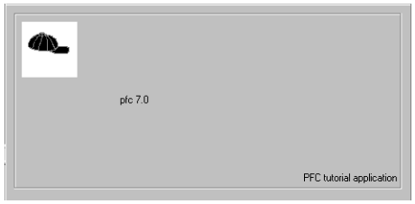
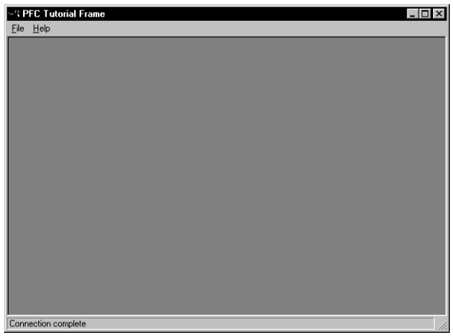

# Create the Frame Window

In a typical MDI application, you define a window whose type is MDI frame and open other windows as sheets within the frame. PFC provides w_frame, a frame window that includes many MDI features, including a status bar and a sheet manager.

In this lesson you will:

- Create a descendent frame window
- Define pre- and post-open processing
- Add script to open the frame window
- Run the application

**How long will this lesson take?** About 15 minutes.

**What will you learn about PFC?**

- How to open a sheet using a string passed via the message router
- How to enable the status bar service
- How to enable the sheet management service
- How to connect to a database using functions provided by n_tr

## Create a descendent frame window

**Where you are**

- **Create a descendent frame window** (you are here)
- Define pre- and post-open processing
- Add script to open the frame window
- Run the application

Now you will create a frame window by inheriting from w_frame. Then you will define a script for the pfc_Open script for the new frame window. PFC calls this event when the user selects File>Open from the menu bar. You can call it from other parts of the application as necessary to open sheet windows.

1. Click the *Inherit* button in the PowerBar.

   The Inherit From Object dialog box displays.

2. Select the *pfemain.pbl* file in the Libraries list box. Select *Windows* in the Objects of Type drop-down list. Select *w_frame* in the Object list box and click *OK*.

   The Window painter workspace displays.

3. Type *PFC Tutorial Frame* in the Title box in the Properties view. Click the *Toolbar* tab in the Properties view. Clear the *ToolbarVisible* check box.

   You will not use a toolbar in the frame window, only in the sheet windows.

4. Double-click *pfc_Open* in the Event List view.

   The Script view displays for the pfc_Open event. If a Script view is part of the stack with the Event List view, the Script pane will display in place of the Event List pane.

   **Finding the pfc_Open event in the Event List view** The events in the Event List view (and Script view) are alphabetized in two different series—events with code are listed before events without code. The pfc_Open event is not precoded in any of its ancestor scripts.

5. Type these lines in the Script view:

   ```
   String   ls_sheet
   w_sheet  lw_sheet

   ls_sheet = Message.StringParm
   OpenSheet(lw_sheet, ls_sheet, this, 0, Layered!)
   ```

This script will open an instance of the sheet window specified in the passed StringParm. You will initialize the StringParm value for two sheet windows later in this tutorial.

## Define pre- and post-open processing

**Where you are**

- Create a descendent frame window
- **Define pre- and post-open processing** (you are here)
- Add script to open the frame window
- Run the application

Now you will define two scripts: one for the pfc_PreOpen event to enable the sheet manager and status bar services, and one for the pfc_PostOpen event to connect to the database.

1. Select *pfc_PreOpen* from the second drop-down list in the Script view and type these lines:

   ```
   this.of_SetSheetManager(TRUE)
   this.of_SetStatusBar(TRUE)
   this.inv_statusbar.of_SetTimer(TRUE)
   ```

This script enables the sheet management service, which provides the ability to minimize all sheets and undo the last sheet arrange command. It also enables the status bar service, displaying date and time information in the bottom-right corner of the frame.

2. Select *pfc_PostOpen* from the second drop-down list in the Script view and type these lines:

   ```
   Integer  li_return
   String   ls_inifile

   ls_inifile = gnv_app.of_GetAppIniFile()

   IF SQLCA.of_Init(ls_inifile,"Database") = -1 THEN
      MessageBox("Database", &
      "Error initializing from " + ls_inifile)
    HALT CLOSE
   END IF
   IF SQLCA.of_Connect() = -1 THEN
    MessageBox("Database", &
      "Unable to connect using " + ls_inifile)
    HALT CLOSE
   ELSE
    this.SetMicroHelp  ("Connection complete")
   END IF
   ```

This script accesses database connection parameters with the transaction service (n_tr) of_Init function and connects with the transaction service of_Connect function. If these functions succeed, the script displays a message in the status bar.

**Extending the ancestor script** The purple icon in front of the pfc_postopen event indicates that an ancestor window is scripted for this event. By default, events are extended: script is processed first from ancestor objects, then from descendent objects. You can examine this script by selecting pfc_w_frame from the third drop-down list in the Script view.

3. Select *File*>*Save* from the menu bar.

   The Save Window dialog box displays.

4. Make sure *my_pfc_app.pbl* is selected in the Application Libraries list box. Type *w_tut_frame* in the Windows box. Type the following comment in the Comments box:

   ```
   Frame window for the PFC tutorial application.
   ```

5. Click *OK*. Select *File*>*Close* from the menu bar.

   PowerBuilder saves the window and you close the Window painter.

## Add script to open the frame window

**Where you are**

- Create a descendent frame window
- Define pre- and post-open processing
- **Add script to open the frame window** (you are here)
- Run the application

Now you will add code to the application manager pfc_Open event to open the frame window.

1. Click the *Open* button in the PowerBar. Select *my_pfc_app.pbl* in the Libraries list box. Select *User Objects* in the Objects of Type drop-down list.

   The n_cst_tutappmanager user object is the only user object in this library. It is selected in the Object list box.

2. Click *OK*.

   The User Object painter workspace displays.

3. Make sure *n_cst_tutappmanager* displays in the first drop-down list in the Script view. Select *pfc_Open* from the second drop-down list. Type these lines for the pfc_Open script:

   ```
   this.of_splash (1)
   Open(w_tut_frame)
   ```

The first line opens the PFC splash screen. The second line opens the MDI frame window for the application. The splash screen will stay open for one second after the n_cst_tutappmanager establishes the database connection.

4. Select *File*>*Save* from the menu bar.

   PowerBuilder saves the script changes.

5. Select *File*>*Close* from the menu bar.

   The User Object painter closes.

## Run the application

**Where you are**

- Create a descendent frame window
- Define pre- and post-open processing
- Add script to open the frame window
- **Run the application** (you are here)
1. Click the *Run* or the *Select And Run* button in the PowerBar. Make sure the *my_pfc_app* target is selected and click *OK*.

   The splash window displays and the database connection is established. The splash window uses information you entered for instance variables of the n_cst_tutappmanager user object:

   

If there is a database connection error, you may need to modify the *pfctutor.ini* file to specify a valid data source for EAS Demo DB V3.

The MDI frame window displays behind the splash window and remains open after the splash window closes.



2. Select *File*>*Exit* from the menu bar.

   The application closes.
