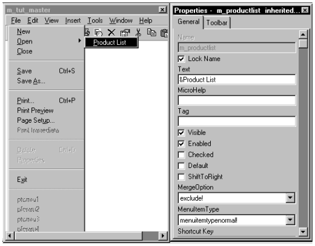

# Create Menus

In PFC applications, all menus typically inherit from m_master (or an m_master descendant) and add, modify, and hide items as needed. The m_master ancestor menu provides items for use with all PFC windows, DataWindows, and visual controls.

**Menu usage** This tutorial uses one approach to menu implementation. PFC allows you to implement other approaches, include modifying m_master directly and defining menus from scratch.

In this lesson you will:

- Create a descendent menu
- Add and modify items
- Create a frame menu
- Associate the frame window with a menu
- Create a menu for the w_products sheet
- Create a menu for the w_product_report sheet

**How long will this lesson take?** About 40 minutes.

**What will you learn about PFC?**

- How to create a customized descendant of m_master
- How to open a sheet, passing the window name in Message.StringParm

## Create a descendent menu

**Where you are**

- **Create a descendent menu** (you are here)
- Add and modify items
- Create a frame menu
- Associate the frame window with a menu
- Create a menu for the w_products sheet
- Create a menu for the w_product_report sheet

Now you will create a master menu for the tutorial by inheriting from the m_master menu.

1. Click the *Inherit* button in the PowerBar.

   The Inherit From Object dialog box displays.

2. Select *pfewnsrv.pbl* in the Libraries list box. Select *Menus* in the Objects of Type drop-down list. Select *m_master* and click *OK*.

   The Menu painter workspace displays.

3. Select *File*>*Save As* from the menu bar.

   The Save Menu dialog box displays.

4. Select *my_pfc_app.pbl* in the Application Libraries list box. Type *m_tut_master* in the Menus box. Type the following comment in the Comments box:

   ```
   Menu ancestor for tutorial frame and sheet menus.
   ```

5. Click *OK*.

   PowerBuilder saves the menu.

## Add and modify items

**Where you are**

- Create a descendent menu
- **Add and modify items** (you are here)
- Create a frame menu
- Associate the frame window with a menu
- Create a menu for the w_products sheet
- Create a menu for the w_product_report sheet

Now you will add and modify menu items on m_tut_master. You will use the Script, WYSIWYG, and Properties views of the Menu painter to make these changes.

**Modifying m_master directly** The PFC tutorial creates an m_master descendant, which you modify for use as a master menu. In most applications you can make these modifications to m_master, eliminating a layer of inheritance.

1. Select *m_file.m_open* in the first drop-down list in the Script view.

   This is the m_master (and m_tut_master) name for the File>Open menu item.

2. Select the *Clicked* event in the second drop-down list in the Script view.

   The purple icon in front of the event name indicates that the Clicked event in an ancestor menu is scripted. By default, events are extended: script is processed first from ancestor objects, then from descendent objects.

3. Select *Edit>Extend Ancestor Script* in the PowerBuilder menu bar.

   You clear the checkmark in front of the Extend Ancestor Script menu item. This will allow you to open a submenu with the application File>Open menu command without processing the ancestor script for the Clicked event of the Open menu item.

4. Type this comment in the Script view:

   ```
   // File->Open script override.
   ```

5. Click the File menu in the WYSIWYG view. Right-click the *Open* menu item below the File menu. Select *Insert Submenu Item* from the pop-up menu.

   An empty box displays next to Open menu item. The cursor flashes inside the box, prompting you to define a submenu item for File>Open.

6. Type *&Product List* in the empty box and press ENTER.

   The ampersand (&) converts the character that follows it to a menu hot key. After you press ENTER, the Product List menu item in the WYSIWYG view appears as it will at runtime: with an underscore under the P, and without the ampersand.

   In the Text box in the Properties view, the ampersand is not replaced by the underscore. The Name box in the Properties view displays the normalized menu name: m_productlist.

   **Using the Properties view to enter the item text** If you click away from the WYSIWYG view before typing the menu item name, the box for the name will be blackened and you will not be able to modify it. In this case, clear the Lock Name box in the Properties view and type &Product List in the Text box in the Properties view. The value in the Name box will be changed automatically when you click elsewhere in the painter.

   

7. Type *Product list* for the MicroHelp box in the Properties view. Double-click *Product List* in the WYSIWYG view.

   The Script view displays m_file.m_open.m_productlist in the first drop-down list. When you created the Product List menu item, PowerBuilder added it to the list.

8. Make sure the *Clicked* event is selected in the second drop-down list in the Script view. Type these lines:

   ```
   Message.StringParm = "w_products"
   of_SendMessage("pfc_Open")
   ```

These lines initialize the StringParm value and call the of_SendMessage menu function, which then calls the pfc_Open event on the frame window.

**Menu service** You can also call the n_cst_menu of_SendMessage function to perform this functionality.

9. Right-click the *Product List* menu item in the WYSIWYG view. Select *Insert Menu Item At End* from the pop-up menu.

   An empty box displays below the Product List menu item.

10. Type *Product &Sales Report* for the new menu item and click ENTER. Type *Product sales report* in the MicroHelp in the Properties view. Double-click *Product Sales Report* in the WYSIWYG view.

    The Script view displays m_file.m_open.m_productsalesreport in the first drop-down list.

11. Make sure the Clicked event is selected in the second drop-down list. Type the following lines:

    ```
    Message.StringParm = "w_product_report"
    of_SendMessage("pfc_Open")
    ```

These lines initialize the StringParm value and call the of_SendMessage menu function, which then calls the pfc_Open event on the frame window.

12. Click the *File>New* menu item in the WYSIWYG view.

    The Properties view displays properties of the m_new menu.

13. Clear the *Visible* check box on the General page of the Properties view. Select the *Toolbar* tab of the Properties view. Clear the *ToolbarItemVisible* check box on the Toolbar page.

    Since you will not be adding code to the File>New menu Clicked event in the tutorial application, you make the menu item and its toolbar picture invisible at runtime.

    In the previous lesson you made a selection to prevent the display of a toolbar for the application frame window. But the user can still opt to display a frame menu toolbar from an application that uses PFC window services. Now you ensure that even if the user makes this selection, the File>New toolbar picture will not be displayed.

    **Dithered appearance in WYSIWYG view** Menu items that will not be visible at runtime are displayed in a dithered format in the WYSIWYG view. Even though the menu item will not be visible, if its property sheet shows a toolbar picture for the menu item, you must clear the visible button on the toolbar page, or the toolbar picture will be displayed (or displayable by user selection) at runtime.

14. Click the *Insert* menu bar item in the WYSIWYG view. Clear the *Visible* check box on the General page of the Properties view.

    Menu items under the Insert menu will not be selectable at runtime, even though their Visible property is set to TRUE.

15. Hide menu items and toolbar pictures as follows:

    | Menu | Menu item | Hide item | Hide toolbar picture |
    | --- | --- | --- | --- |
    | File | New | Yes (done) | Yes (done) |
    |  | Open | No | Yes |
    |  | Save As | Yes | Not visible by default |
    | Edit | Paste Special | Yes | No picture to hide |
    |  | m_dash23 (separator line below Select All) | Yes | No picture to hide |
    |  | Find | Yes | Yes |
    |  | Replace | Yes | Yes |
    |  | m_dash24 (separator line below Replace) | Yes | No picture to hide |
    |  | Update Links | Yes | No picture to hide |
    |  | Object | Yes | No picture to hide |
    | View | Ruler | Yes | No picture to hide |
    |  | m_dash31 (separator line below Ruler) | Yes | No picture to hide |
    |  | Filter | Yes | No picture to hide |

**Hiding the items and toolbars separately** It may be quicker to go down the list once to hide the menu items and a second time to hide the toolbars. This way you avoid clicking back and forth between the General page and the Toolbar page of the Properties view.

16. Click the *Save* button in PainterBar1. Click the *Close* button in PainterBar1.

    PowerBuilder saves the updated menu.

## Create a frame menu

**Where you are**

- Create a descendent menu
- Add and modify items
- **Create a frame menu** (you are here)
- Associate the frame window with a menu
- Create a menu for the w_products sheet
- Create a menu for the w_product_report sheet

Now you will create a frame menu by inheriting from the m_tut_master menu. The main portion of this exercise is hiding menus and menu items that don’t apply when only the frame is displayed.

1. Click the *Inherit* button in the PowerBar.

   The Inherit From Object dialog box displays.

2. Make sure *my_pfc_app.pbl* is selected in the Libraries list box. Make sure *Menus* is selected in the Objects of Type drop-down list. Select *m_tut_master* in the Object list box and click *OK*.

   The Menu painter workspace displays.

3. Click the *Save* button in PainterBar1.

   The Save Menu dialog box displays.

4. Type *m_tut_frame* in the Menus box. Type the following comment in the Comments box and click *OK*:

   ```
   Frame menu for PFC tutorial application.
   ```

PowerBuilder saves the menu and displays the Menu painter workspace.

5. Using the WYSIWYG view and the Properties view, hide the following menu bar items: *Edit* menu, *View* menu, and *Tools* menu.

   The frame menu bar for the tutorial application will only show the File, Window, and Help menus.

6. Hide menu items and toolbar button pictures as follows:

   | Menu | Menu item | Hide item | Hide toolbar picture |
   | --- | --- | --- | --- |
   | File | Close | Yes | Not visible by default |
   |  | Save | Yes | Yes |
   |  | m_dash12 (separator line below Save As) | Yes | No picture to hide |
   |  | Print | Yes | No picture to hide |
   |  | Print Preview | Yes | Yes |
   |  | Print Immediate | Hidden in ancestor | Yes |
   | Edit | Undo | Not necessary, Edit menu hidden | Yes |
   |  | Cut | Not necessary, Edit menu hidden | Yes |
   |  | Copy | Not necessary, Edit menu hidden | Yes |
   |  | Paste | Not necessary, Edit menu hidden | Yes |
   |  | Clear | Not necessary, Edit menu hidden | Not visible by default |

7. Select *File*>*Save* from the menu bar.

   PowerBuilder saves the updated menu.

8. Select *File*>*Close* from the menu bar.

   The Menu painter closes.

## Associate the frame window with a menu

**Where you are**

- Create a descendent menu
- Add and modify items
- Create a frame menu
- **Associate the frame window with a menu** (you are here)
- Create a menu for the w_products sheet
- Create a menu for the w_product_report sheet

Now you will associate the frame window with m_tut_frame, the frame menu you just created.

1. Click the *Open* button in the PowerBar.

   The Open dialog box displays.

2. Select *my_pfc_app.pbl* in the Libraries list box. Select *Windows* in the Objects of Type drop-down list. Select *w_tut_frame* in the Object list box and click *OK*.

   The Window painter workspace displays.

3. Click the *ellipsis* button next to the MenuName box in the Properties view.

   The Select Object dialog box displays:

4. Select *m_tut_frame* and click *OK*.

   The Window property sheet displays with the selected menu.

5. Select *File*>*Save* from the menu bar.

   PowerBuilder saves the updated window.

6. Select *File*>*Close* from the menu bar.

   The Window painter closes.

## Create a menu for the w_products sheet

**Where you are**

- Create a descendent menu
- Add and modify items
- Create a frame menu
- Associate the frame window with a menu
- **Create a menu for the w_products sheet** (you are here)
- Create a menu for the w_product_report sheet

Now you will create a sheet menu by inheriting from m_tut_master, the PFC tutorial master menu.

1. Click the *Inherit* button in the PowerBar.

   The Inherit From Object dialog box displays.

2. Select *my_pfc_app.pbl* in the Libraries list box. Select *Menus* in the Objects of Type drop-down list. Select *m_tut_master* and click *OK*.

   The Menu painter workspace displays. You will leave the Edit, View, and Tools menus visible for the sheet menu.

3. Hide menu items and toolbars as follows:

   | Menu | Menu item | Hide item | Hide toolbar picture |
   | --- | --- | --- | --- |
   | File | Print | Yes | No picture to hide |
   |  | Print Preview | Yes | Yes |
   | View | m_dash35 (separator line below Last) | Yes | No picture to hide |
   |  | m_dash36 (separator line below Filter) | Yes | No picture to hide |
   |  | Zoom | Yes | No picture to hide |

4. Select *File*>*Save As* from the menu bar.

   The Save Menu dialog box displays.

5. Type *m_products* in the Menus box. Type the following line in the Comments box and click *OK*:

   ```
   Sheet menu for w_products window.
   ```

PowerBuilder saves your new menu as a descendant of m_tut_master.

## Create a menu for the w_product_report sheet

**Where you are**

- Create a descendent menu
- Add and modify items
- Create a frame menu
- Associate the frame window with a menu
- Create a menu for the w_products sheet
- **Create a menu for the w_product_report sheet** (you are here)

Now you will create a sheet menu for w_product_report by inheriting from m_tut_master (the PFC tutorial master menu).

1. Click the *Inherit* button in the PowerBar.

   The Inherit From Object dialog box displays.

2. Select *my_pfc_app.pbl* in the Libraries list box. Select *Menus* in the Objects of Type drop-down list. Select *m_tut_master* and click *OK*.

   The Menu painter workspace displays.

3. Hide the *Edit* menu bar item.

   You will prevent the user from modifying the product reports or updating the database at runtime.

4. Hide menu items and toolbar pictures as follows:

   | Menu | Menu item | Hide item | Hide toolbar picture |
   | --- | --- | --- | --- |
   | File | Save | Yes | Yes |
   |  | m_dash12 (separator line below Save As) | Yes | No picture to hide |
   | Edit | Undo | Not necessary, Edit menu hidden | Yes |
   |  | Cut | Not necessary, Edit menu hidden | Yes |
   |  | Copy | Not necessary, Edit menu hidden | Yes |
   |  | Paste | Not necessary, Edit menu hidden | Yes |
   |  | Clear | Not necessary, Edit menu hidden | Not visible by default |
   | View | Sort | Yes | No picture to hide |
   |  | m_dash36 (separator line below Filter) | Yes | No picture to hide |

5. Select *File*>*Save As* from the menu bar.

   The Save Menu dialog box displays.

6. Type *m_product_report* in the Menus box. Type the following line in the Comments box and click *OK*.

   ```
   Sheet menu for w_products_report window.
   ```

PowerBuilder saves your new menu as a descendant of m_tut_master.

7. Close the Menu painter.
