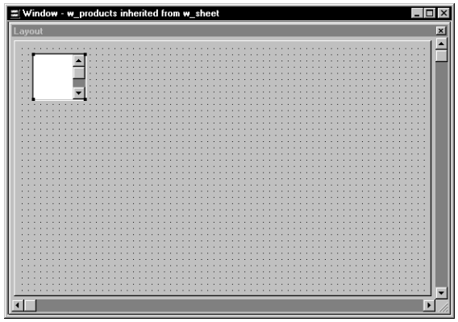
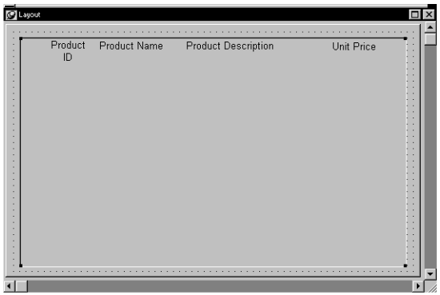
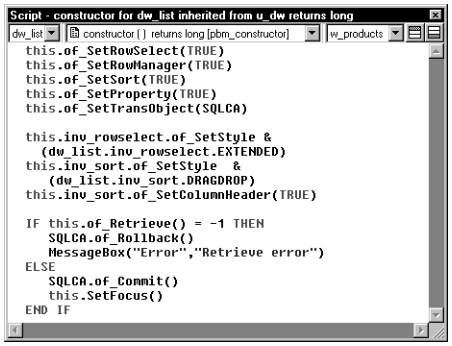
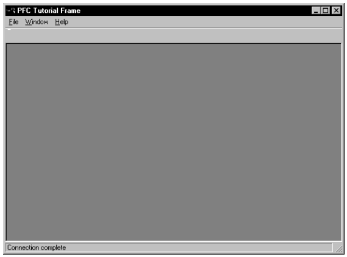
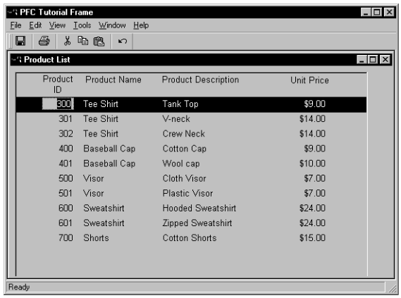
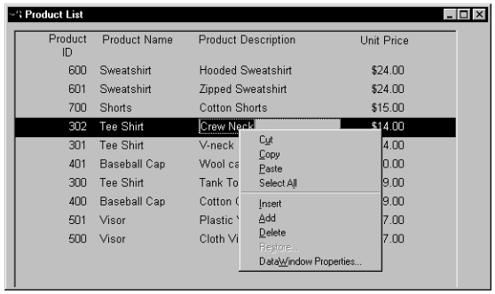
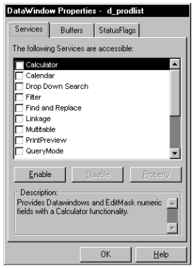
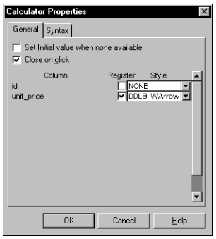

# Build the First Sheet Window

You inherit from PFC’s w_sheet window to create MDI sheets.

In this lesson you will:

- Add a library to the library list
- Create a descendent window
- Add a DataWindow control
- Enable DataWindow services
- Retrieve rows
- Run the application

**How long will this lesson take?** About 30 minutes.

**What will you learn about PFC?**

- How to create a descendant of the w_sheet window
- How to enable the DataWindow property, row selection, and row management services
- How to use the u_dw DataWindow control
- How to add database access and update functionality to u_dw user events

## Add a library to the library list

**Where you are**

- **Add a library to the library list** (you are here)
- Create a descendent window
- Add a DataWindow control
- Enable DataWindow services
- Retrieve rows
- Run the application

You will now add a library to the application target library list. The library you will add contains DataWindow objects created for this tutorial.

1. Right-click the *my_pfc_app* target on the Workspace page of the System Tree. Select *Properties* from the pop-up menu.

   The Library List page of the Properties dialog box displays all the libraries in the target search path.

2. Click the *Browse* button. Navigate to the *PFC\Tutorial* directory. Select *pfctutor.pbl* from the directory file list and click *Open*.

   The *pfctutor.pbl* library appears at the bottom of the Library Search Path list box.

3. Click *OK*.

## Create a descendent window

**Where you are**

- Add a library to the library list
- **Create a descendent window** (you are here)
- Add a DataWindow control
- Enable DataWindow services
- Retrieve rows
- Run the application

Now you will create a sheet window by inheriting from the w_sheet window.

1. Click the *Inherit* button in the PowerBar.

   The Inherit From Object dialog box displays.

2. Select *pfemain.pbl* in the Libraries list box. Select *Windows* in the Objects of Type drop-down list. Select *w_sheet* in the Object list box and click *OK*.

   The Window painter workspace displays.

3. Type *Product List* in the Title box in the Properties view.

   This defines a title for the sheet window.

4. Click the *ellipsis* button next to the MenuName box.

   The Select Object dialog box displays.

5. Select *pfc_my_app.pbl* in the Application Libraries list box. Select *m_products* and click *OK*.

   The Window painter redisplays with the MenuName box filled in.

6. Select *File*>*Save As* from the menu bar.

   The Save Window dialog box displays. The pfc_my_app.pbl file is selected in the Application Libraries list box.

7. Type *w_products* in the Windows box. Type the following line in the Comments box and click *OK*:

   ```
   Sheet window for product list.
   ```

## Add a DataWindow control

**Where you are**

- Add a library to the library list
- Create a descendent window
- **Add a DataWindow control** (you are here)
- Enable DataWindow services
- Retrieve rows
- Run the application

Now you will add a DataWindow control to the w_products window. This DataWindow control is based on PFC’s u_dw DataWindow user object.

1. Select and click the *UserObj* button in PainterBar1 (not the PowerBar). *or* Select *Insert*>*Control*>*UserObject* from the menu bar.

   **If you don’t see the UserObj button** To click the UserObj button, you first need to select the UserObj icon from a drop-down list of control buttons in PainterBar1 (this button typically displays a command button when the Window painter opens).

   The Select Object dialog box displays.

2. Select *pfemain.pbl* in the Application Libraries list box. Select *u_dw* in the User Objects list box and click *OK*.

   U_dw is a standard visual user object based on a DataWindow control that includes precoded events, instance variables, and functions to enable and disable PFC DataWindow services.

3. Click in the upper-left corner of the window in the Layout view. **PowerBuilder places a DataWindow control at the selected location. This DataWindow control is a descendant of u_dw, with access to u_dw events, functions, and instance variables:**

   

4. Select the text *dw_1* in the Name box of the Properties view. Type *dw_list* in the Name box.

   **Make sure the new control is selected** If you do not see the name dw_1 in the Name box, click the control you just added in the Layout view. When the control is selected in the Layout view, it is also selected in the Properties view.

5. Click the *ellipsis* button next to the DataObject box in the Properties view.

   The Select Object dialog box displays.

6. Select *pfctutor.pbl* in the Application Libraries list box. Select *d_prodlist* in the DataWindows list box and click *OK*.

   The DataWindow painter redisplays.

7. Make the control almost as big as the window in the Layout view, maximizing the Layout view if necessary:

   

8. Select *File*>*Save* from the menu bar.

   PowerBuilder saves the updated window.

## Enable DataWindow services

**Where you are**

- Add a library to the library list
- Create a descendent window
- Add a DataWindow control
- **Enable DataWindow services** (you are here)
- Retrieve rows
- Run the application

Now you will use the Script view of the Window painter to add PowerScript code to the DataWindow control. The script you will add calls functions to enable PFC DataWindow sort, row selection, and row management services.

1. Select *dw_list* from the first drop-down list in the Script view. Select the *Constructor* event from the second drop-down list.

   The third drop-down list in the Script view displays the parent window name, w_products. There is no code yet for the user object Constructor event, either in the current object or in the u_dw and pfc_u_dw ancestor objects.

2. Type the following script for the Constructor event:

   ```
   this.of_SetRowSelect(TRUE)
   this.of_SetRowManager(TRUE)
   this.of_SetSort(TRUE)
   this.of_SetProperty(TRUE)
   this.of_SetTransObject(SQLCA)
   ```

These lines enable the property, row selection, row management, and sort services for the DataWindow. They also set the Transaction object for the DataWindow.

**Using drag and drop from the System Tree** You can drag and drop methods and properties from the System Tree to the Script view. When you drag and drop a function such as of_SetRowSelect, PowerBuilder adds comments that serve as placeholders and give the data types for any arguments of the function.

3. Add the following script after the lines you just typed:

   ```
   this.inv_rowselect.of_SetStyle &
     (dw_list.inv_rowselect.EXTENDED)
   this.inv_sort.of_SetStyle  &
      (dw_list.inv_sort.DRAGDROP)
   this.inv_sort.of_SetColumnHeader(TRUE)
   ```

These lines initialize the row selection and sort services.

The row selection service of_SetStyle function enables extended row selection with the CTRL and SHIFT keys. The sort service of_SetStyle function instructs PFC to display a drag-and-drop sort dialog box when the user selects View>Sort from the menu bar.

The sort service of_SetColumnHeader function enables sorting by clicking on column headers, a feature found in many current applications.

4. Add the following script after the lines you just typed:

   ```
   IF this.of_Retrieve() = -1 THEN
          SQLCA.of_Rollback()
          MessageBox("Error","Retrieve error")
   ELSE
          SQLCA.of_Commit()
          this.SetFocus()
   END IF
   ```

These lines call the of_Retrieve function for the user object. Since this function is not coded in the u_dw control, PowerBuilder will parse the code for the same function in the pfc_u_dw ancestor.



5. Click the *Compile* button in PainterBar2.

   PowerBuilder compiles the script you typed for the dw_list Constructor event.

## Retrieve rows

**Where you are**

- Add a library to the library list
- Create a descendent window
- Add a DataWindow control
- Enable DataWindow services
- **Retrieve rows** (you are here)
- Run the application

Now you will add PowerScript code that retrieves rows from the database. In the last exercise, the call you made to the of_Retrieve function triggers the pfc_Retrieve event when the PFC Linkage service is not running. (You do not start the Linkage service in the tutorial application.)

Since events are extended by default, PowerBuilder parses the event script in both the pfc_u_dw ancestor, and then in the current u_dw control.

1. Select *pfc_Retrieve* from the second drop-down list in the Script view.

   There is already script for this event in the pfc_u_dw ancestor control. Now you will add code to extend the ancestor script.

2. Type this script:

   ```
   Return this.Retrieve( )
   ```

This line returns the Retrieve function return value, which gives the number of rows in the primary buffer if the retrieve is successful.

3. Select *File>Save* from the menu bar.

   PowerBuilder compiles the script and saves the window.

4. Select *File*>*Close* from the menu bar.

   The Window painter closes.

## Run the application

**Where you are**

- Add a library to the library list
- Create a descendent window
- Add a DataWindow control
- Enable DataWindow services
- Retrieve rows
- **Run the application** (you are here)

Now you will make sure the sheet window opens properly by running the PFC tutorial application.

1. Click the *Run* button in the PowerBar.

   The application connects to the database and displays the PFC tutorial frame window. Only the File, Windows, and Help menus are visible in the MDI frame menu bar.

   

2. Select *File*>*Open*>*Product List* from the menu bar. **The w_products window displays:**

   

3. Select multiple rows by holding the CTRL or SHIFT key down while clicking before the first column in the rows you want to select. Sort rows by clicking in the column headers. Click the same column header twice to change the order of the sort.

   You test the PFC selection and sort services.

   **Selecting multiple rows** You must click in front of the rows you want to select—clicking inside the rows does not select them.

4. Click the right mouse button over one of the columns in the DataWindow. **The DataWindow displays a pop-up menu, providing quick access to common actions:**

   

5. Select *DataWindow Properties*.

   The DataWindow Properties dialog box displays. You can enable or disable DataWindow services from this dialog box, and you can modify the properties of services that are enabled.

   

6. Click the *Calculator* check box in the list of DataWindow services. Click the *Property* button. If the Property button is grayed **The Property button is only enabled (not grayed) if the selected DataWindow service is enabled.**

   The Calculator Properties dialog box displays. The 2 columns that have numeric data types (id and unit_price) are listed on the General page of the Calculator Properties dialog box.

7. Select the *Register* check box for the unit_price column. Select *DDLB With Arrow* from the drop-down list for the unit_price column.

   

8. Click the *Syntax* tab.

   The Syntax page displays the PowerScript code that sets the properties you just selected.

9. Click *OK* twice.

   You can now use a drop-down calculator in the Unit Price column to change column values.

   **Displaying the modified column values** The values entered with the drop-down calculator (or from the keyboard) will display with the appropriate column display formats—in this case, with a dollar sign and two decimal places—when the user clicks in a different row or column.

   You can try enabling other DataWindow services and changing their properties.

10. Select *File*>*Exit* from the menu bar.

    The runtime application closes.
