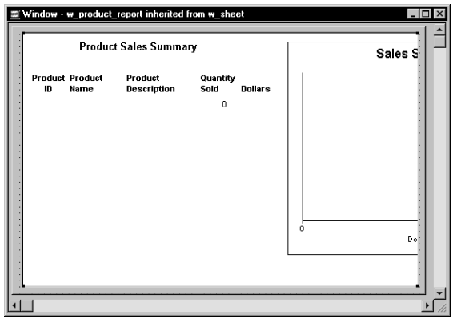
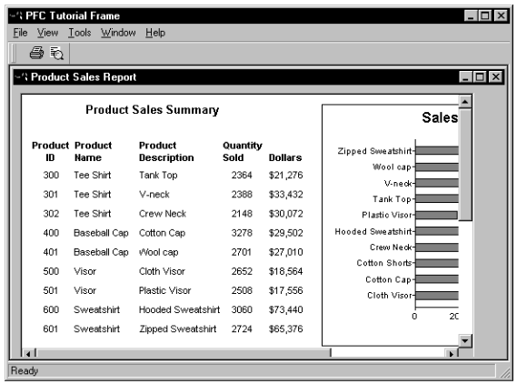

# Build the Second Sheet Window

You inherit from PFC’s w_sheet window to create a second MDI sheet window.

In this lesson you will:

- Create a descendent window
- Add a DataWindow control
- Enable report and print preview services
- Run the application

**How long will this lesson take?** About 10 minutes.

## Create a descendent window

**Where you are**

- **Create a descendent window** (you are here)
- Add a DataWindow control
- Enable report and print preview services
- Run the application

Now you will create a sheet window by inheriting from the w_sheet window.

1. Click the *Inherit* button in the PowerBar.

   The Inherit From Object dialog box displays.

2. Click *pfemain.pbl* in the Libraries list box. Select *Windows* from the Objects of Type drop-down list. Select *w_sheet* from the Object list box and click *OK*.

   The Window painter workspace displays.

3. Type *Product Sales Report* in the Title box in the Properties view.

   This defines a title for the new sheet window.

4. Click the *ellipsis* button next to the MenuName box in the Properties view.

   The Select Object dialog box displays.

5. Select *my_pfc_app.pbl* in the Application Libraries list box. Select *m_product_report* in the Menus list box and click *OK*.

   The Window property sheet redisplays with the Menu Name field filled in.

6. Select *File>Save As* from the menu bar.

   The Save Window dialog box displays.

7. Type *w_product_report* in the Windows box. Type the following line in the Comments box and click *OK*.

   ```
   This is the report sheet for the PFC tutorial.
   ```

## Add a DataWindow control

**Where you are**

- Create a descendent window
- **Add a DataWindow control** (you are here)
- Enable report and print preview services
- Run the application

Now you will create a DataWindow control using PFC’s u_dw DataWindow user object.

1. Select and click the *UserObj* button in PainterBar1 (not the PowerBar). *or* Select *Insert>Control>UserObject* from the menu bar.

   The Select User Object dialog box displays.

2. Select *pfemain.pbl* in the Application Libraries list box. Select *u_dw* in the User Objects list box and click *OK*. Click in the upper-left corner of the window in the Layout view.

   PowerBuilder places a DataWindow control at the selected location. This DataWindow control is a descendant of u_dw, with access to u_dw events, functions, and instance variables.

3. Select the text *dw_1* in the Name box in the Properties view. Type *dw_report* in the Name box. Select the *HScrollBar* check box.

   You add a horizontal scroll bar to the DataWindow that will be visible at runtime.

4. Click the *ellipsis* button next to the DataObject box.

   The Select Object dialog box displays.

5. Select *pfctutor.pbl* in the Application Libraries list box. Select *d_sales_report* in the DataWindows list box and click *OK*.

   The DataWindow property sheet redisplays with the DataObject box filled in.

6. Make the control almost as big as the window in the Layout view, maximizing the Layout view if necessary:

   

7. Select *File>Save* from the menu bar.

## Enable report and print preview services

**Where you are**

- Create a descendent window
- Add a DataWindow control
- **Enable report and print preview services** (you are here)
- Run the application

Now you will add PowerScript code to call functions that enable the PFC DataWindow report service and print preview service. You will also add code that retrieves rows from the database.

1. Select *dw_report* from the first drop-down list in the Script view. Select the *Constructor* event from the second drop-down list. Type the following script for the Constructor event:

   ```
   this.of_SetReport(TRUE)
   this.of_SetPrintPreview(TRUE)
   this.of_SetTransObject(SQLCA)
   this.of_SetUpdateable(FALSE)
   ```

These lines enable the report and print preview services, set SQLCA as the Transaction object and register the DataWindow as nonupdatable. In a nonupdatable DataWindow, PFC disregards default CloseQuery processing.

2. Add the following script after the lines you just typed:

   ```
   IF this.of_Retrieve() = -1 THEN
          SQLCA.of_Rollback()
          MessageBox("Error","Retrieve error")
   ELSE
          SQLCA.of_Commit( )
   END IF
   ```

These lines call the u_dw of_Retrieve event for the DataWindow. Precoded report service events and functions handle all other processing.

3. Select *pfc_Retrieve* from the second drop-down list in the Script view.

   PowerBuilder compiles the script for the Constructor event.

4. Type this script for the pfc_Retrieve event:

   ```
   Return this.Retrieve( )
   ```

5. Select *File*>*Save* from the menu bar.

   PowerBuilder compiles the script and saves the window.

6. Select *File*>*Close* from the menu bar.

   The Window painter closes.

## Run the application

**Where you are**

- Create a descendent window
- Add a DataWindow control
- Enable report and print preview services
- **Run the application** (you are here)

Now you will run the completed PFC tutorial application.

1. Click the *Run* button in the PowerBar.

   The application connects to the database and displays the PFC Tutorial Frame window.

2. Select *File*>*Open*>*Product Sales Report* from the menu bar.

   The w_product_report window displays:

   

3. Click the *Print Preview* button in the toolbar. *or* Select *File>Print Preview* from the menu bar. **The print preview shows the printable area inside a blue box. You may need to scroll or zoom the preview window to see the entire report.**
4. Select *View>Zoom* from the menu bar.

   The Zoom dialog box displays.

   **If the Zoom dialog box does not display** You must be in the Print Preview mode to display the Zoom dialog box.

5. Change the Zoom dialog box setting to display the entire report and click *OK*. Print the report if wanted.
6. Select *File*>*Exit* from the menu bar.

   The application closes and the Window painter workspace displays.

7. Close the Window painter.

   You have completed this tutorial. Before deploying a simple application like the one you created here, you would probably want to add your own Help file, edit the About box, and enable additional PFC services.

   For more information on PFC functions and events, see the *PFC Object Reference*.

   **PowerBuilder documentation** Current PowerBuilder documentation is available from Appeon at [docs.appeon.com](https://docs.appeon.com).
